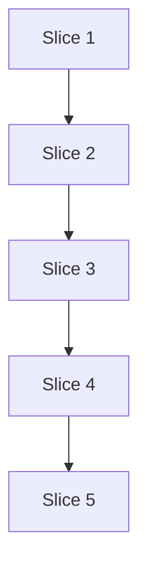

# Plan: Dependency groups (slice S11, #75)

**Created**: 2026-11-01
**Branch**: claude/ship-dev-team-project-1c8385
**Status**: implemented
**Gherkin persistence**: plan-file-only
<!-- The repo registers each feature file by hand in tests/acceptance.rs
     FEATURE_FILES; the export script's <dir>/<plan-slug>/ layout does not
     match, so Step 1.1 creates
     tests/features/lvpm-lockfile/slice-17-dependency-groups.feature. -->

Spec: [docs/specs/dependency-groups.md](../docs/specs/dependency-groups.md)

## Goal

A project names dependency groups as `[dependency-groups.<name>]` beside
`[dev-dependencies]` (the group `dev`). One lock covers every group;
`lvpm sync` installs main + dev, `--group <name>` adds a group, `--no-dev`
drops dev, and what the selection does not need is removed. `add/remove
--group` edit a group. Stances: **format fidelity** — lock format 2, a v1
lock reads as stale, no migration code; `--json` stays additive (`dev`
kept, `group` added, `reason` stays a string). **Replace-vs-merge** —
`LockedPackage.dev` is replaced by `groups`. **Scope** — issue #75's list,
ADR 1 syntax (user); upstream's `[dependencies.<name>]` not built.
**Integration** — PR, auto-merge on green.

**Every step is one commit that builds and passes `cargo test`.** Where a
core type change forces render/CLI edits, they land in the same step.

## Acceptance Criteria

- [ ] AC1 `lvpm sync --group ci` installs the `ci` group; `lvpm sync` alone leaves it out and removes it if installed.
- [ ] AC2 A package that `[dependencies]` and `ci` both need is installed by every selection.
- [ ] AC3 Adding, removing or an excluding constraint on a group entry makes the lock stale, naming `[dependency-groups.<name>]`.
- [ ] AC4 A malformed `[dependency-groups]` (a `dev`/`Dev` table, a non-table entry, or a name outside `[A-Za-z0-9_-]`) fails on any command that reads the manifest, naming the offending header and the rule; the `dev` case names `[dev-dependencies]`.
- [ ] AC5 The only changed recorded files are `tests/golden/s4-no-github.lock` (`version = 2`, `dev = true` → `groups = ["dev"]`) and `ci/e2e/fixture/lvpm.lock` (`version = 2`); no `--help` text is recorded, so none changes.
- [ ] AC6 `lvpm add/remove --group ci` edit `[dependency-groups.ci]`; `--dev` and `--group dev` give byte-identical lvpm.toml and lvpm.lock.
- [ ] AC7 `lvpm lock` writes `groups = [..]` (sorted) for packages only groups need, none for main's.
- [ ] AC8 `lvpm sync --group nope` fails naming `nope` and the defined groups, leaving dest and lvpm.toml byte-identical and lvpm.lock unchanged (still absent if it was absent).
- [ ] AC9 A v1 lock is stale: `lvpm lock --check` and `lvpm sync --locked` fail with `the lock format is outdated (this lvpm writes format 2)` plus their existing `lvpm lock` hint; plain `lvpm sync`, `lvpm add/remove` and `lvpm lock` re-lock it as v2, like any stale lock.
- [ ] AC10 `lvpm add/remove` install main, dev and the edited group, install nothing beyond that selection, and remove no installed package the new lock still lists.
- [ ] AC11 `--json` for `add --group ci` carries `"dev": false` and `"group": "ci"` (and `"created_table": true` only when it created the table); the golden `json-add` and `json-remove` outputs are byte-identical.

## Slices

All scenarios live in `tests/features/lvpm-lockfile/slice-17-dependency-groups.feature`.

**Manifest step grammar** (defined in Step 1.1): `lvpm.toml has` followed by
`<header> <entries>` pairs separated by `;`, entries `"name" "constraint"`
separated by `,`. An empty table is `<header> empty`. The tables are
merged into the Background's manifest (alpha in `[dependencies]` stays).

```gherkin
Background:
  Given fixture packages "alpha" 1.0, "beta" 1.0, "caraya" 1.0 requiring "delta" >= 1.0, "delta" 1.0, "ci_tools" 1.0 and 2.0 requiring "alpha" >= 1.0
  And a project with labview "2024" depending on "alpha" "*", with a scratch destination "dest"
```

### Slice 1: Manifest reads dependency groups

**Depends-on:** none
**Files:** `crates/lvpm-core/src/project.rs`, `tests/features/lvpm-lockfile/slice-17-dependency-groups.feature`, `tests/acceptance.rs`, `tests/steps/manifest.rs`

**Behavior:**

```gherkin
  # AC4
  Scenario Outline: a malformed [dependency-groups] is refused when read
    Given lvpm.toml has <manifest>
    When I run "lvpm lock"
    Then the command fails naming <named>
    And lvpm.lock does not exist

    Examples:
      | manifest                                   | named                                              |
      | [dependency-groups.dev] "caraya" "*"       | "[dependency-groups.dev]" and "[dev-dependencies]" |
      | [dependency-groups.Dev] "caraya" "*"       | "[dependency-groups.Dev]" and "[dev-dependencies]" |
      | [dependency-groups] ci = "ci_tools"        | "[dependency-groups] ci" and "table"               |
      | [dependency-groups."a.b"] "beta" "*"       | "a.b" and "letters, digits, - and _"               |
      | [dependency-groups.ci] "ci_tools" "~1.0"   | "[dependency-groups.ci] ci_tools"                  |
```

(The non-table and quoted-header rows are written as raw TOML by the step.)

**Steps:**

#### Step 1.1: Parse `[dependency-groups.<name>]` into `Project::groups`

**Complexity**: standard
**IMPLEMENT**: `File` gains `dependency-groups: toml::Table`; each value must be a table, its name checked by `pub fn valid_group_name` (`[A-Za-z0-9_-]+`, not `dev` in any case); entries parsed by `parse_dependencies("dependency-groups.<name>", ..)` into `Project::groups: Vec<(String, Vec<(String, Constraint)>)>` in file order, sharing the github one-repo check. Nothing outside `project.rs` changes: `DependencyTable` is untouched in this slice.
**TEST**: unit tests in `project.rs` (order, `dev`/`Dev`, non-table, bad name, github conflict with main, empty group). Create the feature file with the Background and this outline, register it in `FEATURE_FILES`, add the manifest grammar step in `tests/steps/manifest.rs`.
**REFACTOR**: no per-table parsing duplicated.
**Files**: `crates/lvpm-core/src/project.rs`, `tests/features/lvpm-lockfile/slice-17-dependency-groups.feature`, `tests/acceptance.rs`, `tests/steps/manifest.rs`
**Commit**: `feat(manifest): read [dependency-groups.<name>] tables`

### Slice 2: Lock records groups (format 2)

**Depends-on:** 1
**Files:** `crates/lvpm-core/src/project.rs`, `crates/lvpm-core/src/manifest_edit.rs`, `crates/lvpm-core/src/lockfile.rs`, `crates/lvpm-core/src/errors.rs`, `crates/lvpm-core/src/ops/lock.rs`, `crates/lvpm-core/src/ops/upgrade.rs`, `crates/lvpm-core/src/ops/add_remove.rs`, `crates/lvpm-core/src/ops/init.rs`, `crates/lvpm-core/src/ops/sync.rs`, `crates/lvpm-core/src/ops/github_index.rs`, `src/main.rs`, `src/render/lock.rs`, `src/render/sync.rs`, `src/render/edit.rs`, `tests/golden/s4-no-github.lock`, `ci/e2e/fixture/lvpm.lock`, `tests/features/lvpm-lockfile/slice-17-dependency-groups.feature`, `tests/steps/*.rs`

**Behavior:**

```gherkin
  # AC7
  Scenario: the lock marks what only groups need
    Given lvpm.toml has [dev-dependencies] "caraya" "*"; [dependency-groups.ci] "ci_tools" "*", "caraya" "*"
    When I run "lvpm lock"
    Then lvpm.lock is format 2 and has no "dev =" line
    And lvpm.lock gives "caraya" and "delta" groups ["ci", "dev"], "ci_tools" groups ["ci"], and "alpha" no groups

  # AC3
  Scenario Outline: a group change makes the lock stale
    Given lvpm.toml has [dependency-groups.ci] "ci_tools" "*" and a current lvpm.lock
    And lvpm.toml <change>
    When I run "lvpm lock --check"
    Then the command fails saying lvpm.lock is out of date: <reason>

    Examples:
      | change                                            | reason                                                      |
      | now also lists [dependency-groups.ci] "beta" "*"  | [dependency-groups.ci] dependency "beta" was added          |
      | no longer lists [dependency-groups.ci] "ci_tools" | [dependency-groups.ci] dependency "ci_tools" was removed    |
      | has no [dependency-groups.ci] table               | [dependency-groups.ci] dependency "ci_tools" was removed    |
      | gives [dependency-groups.ci] "ci_tools" "1.0"     | [dependency-groups.ci] "ci_tools" "1.0" excludes locked 2.0 |

  # AC3, AC6
  # Built as --upgrade-package: plain --upgrade never rewrites the manifest.
  Scenario: lock --upgrade-package moves a group's pin and rewrites it
    Given lvpm.toml has [dependency-groups.ci] "ci_tools" "1.0" and lvpm.lock holds "ci_tools" 1.0
    When I run "lvpm lock --upgrade-package ci_tools@2.0"
    Then lvpm.lock gives "ci_tools" 2.0 groups ["ci"]
    And [dependency-groups.ci] says "ci_tools" = "2.0"

  # AC9
  Scenario: a format 1 lock is stale
    Given an lvpm.lock in format 1 with "caraya" marked dev = true
    When I run "lvpm lock --check"
    Then the command fails saying "lvpm.lock is out of date: the lock format is outdated (this lvpm writes format 2); run `lvpm lock` to update it"

  # AC9
  Scenario: lvpm lock rewrites a format 1 lock as format 2
    Given an lvpm.lock in format 1 with "caraya" marked dev = true
    When I run "lvpm lock"
    Then lvpm.lock is format 2

  # AC9
  Scenario: --locked refuses a format 1 lock without changing anything
    Given an lvpm.lock in format 1 with "caraya" marked dev = true
    When I run "lvpm sync --locked --prefix dest"
    Then the command fails saying the lock format is outdated
    And dest and lvpm.lock are byte-identical to before
```

**Steps:**

#### Step 2.1: Tables, `groups` in the lock, format 2, per-table staleness

**Complexity**: complex
**IMPLEMENT**:
- `DependencyTable` gains `Group(String)` and loses `Copy`; `key(&self) -> String`; `manifest_edit::set/remove` take `&DependencyTable` and look up `dependency-groups.<name>` nested, appending the header when missing. Callers fixed in the same commit: `ops/add_remove.rs` (its two exhaustive matches become one lookup through `Project::tables()`), `ops/lock.rs` (`ManifestUpdate.table` by reference / clone in the closure), `ops/init.rs`, `errors.rs` (`found_in.key()`), `src/main.rs` (`dependency_table`), `src/render/edit.rs` (a `Group` arm printing `--group <name>`; full hint text in Slice 4).
- `Project::tables()` yields `(DependencyTable, &[(String, Constraint)])` for main, dev, each group; solver input, `name_pins`, `constraint_updates`, `build` and staleness iterate it.
- `FORMAT_VERSION = 2`; `LockedPackage.dev` → `groups: Vec<String>` (sorted, deduped, skipped when empty): the non-main tables reaching the package, empty when main reaches it. `Inputs` gains `dependency-groups`.
- `StaleReason`'s `dev: bool` → `table: DependencyTable`; staleness covers groups present only in the lock. `stale_reason` words main and dev exactly as today and a group as `[dependency-groups.<name>] dependency "x" was added` / `[dependency-groups.<name>] "x" "c" excludes locked v`; `FormatOutdated` → `the lock format is outdated (this lvpm writes format 2)` (every caller already appends its `lvpm lock` hint).
- Sync keeps today's behaviour: `wanted_here` treats a package as dev-only when `!groups.is_empty() && groups.iter().all(|g| g == "dev")`. Fixtures fixed in `sync.rs`, `github_index.rs`, `render/sync.rs`, `render/lock.rs` and `tests/steps/*`.
- Regenerate `tests/golden/s4-no-github.lock` (the only recorded lock holding `version = 1` / `dev = true`); review the diff — only those lines may change. Set `ci/e2e/fixture/lvpm.lock` to `version = 2` (no dev packages; the e2e smoke runs `lvpm lock --check` on it).
**TEST**: unit tests: existing dev tests rewritten to `groups == ["dev"]`; dev+ci → `["ci","dev"]` regardless of manifest order; main+ci → none; text `version = 2`, no `dev =`; each stale reason in a group and a lock-only group; render test at `render/lock.rs:505` updated; `manifest_edit` set/remove in new and existing group tables keep the rest byte-for-byte. This slice's scenarios. Full `cargo test` green; existing dev scenarios unchanged.
**REFACTOR**: `tables()` is the only table list; `manifest_lines`/`resolved_lines` take the table; no `[false, true]` loops left.
**Files**: `crates/lvpm-core/src/project.rs`, `crates/lvpm-core/src/manifest_edit.rs`, `crates/lvpm-core/src/lockfile.rs`, `crates/lvpm-core/src/errors.rs`, `crates/lvpm-core/src/ops/lock.rs`, `crates/lvpm-core/src/ops/upgrade.rs`, `crates/lvpm-core/src/ops/add_remove.rs`, `crates/lvpm-core/src/ops/init.rs`, `crates/lvpm-core/src/ops/sync.rs`, `crates/lvpm-core/src/ops/github_index.rs`, `src/main.rs`, `src/render/lock.rs`, `src/render/sync.rs`, `src/render/edit.rs`, `tests/golden/s4-no-github.lock`, `ci/e2e/fixture/lvpm.lock`, `tests/features/lvpm-lockfile/slice-17-dependency-groups.feature`, `tests/steps/*.rs`
**Commit**: `feat(lock): record the groups that alone need a package (format 2)`

### Slice 3: `lvpm sync --group`

**Depends-on:** 2
**Files:** `crates/lvpm-core/src/ops/sync.rs`, `crates/lvpm-core/src/ops/add_remove.rs`, `crates/lvpm-core/src/events.rs`, `src/main.rs`, `src/render/sync.rs`, `tests/features/lvpm-lockfile/slice-17-dependency-groups.feature`, `tests/steps/sync.rs`

**Behavior:**

```gherkin
  # AC1, AC2
  Scenario Outline: the selection decides what is installed
    Given lvpm.toml has [dev-dependencies] "caraya" "*"; [dependency-groups.ci] "caraya" "*", "ci_tools" "*", "delta" "*" and a current lvpm.lock
    When I run "lvpm sync <flags> --prefix dest"
    Then dest's lvpm-installed packages are exactly <installed>

    Examples:
      | flags                 | installed                      |
      |                       | alpha, caraya, delta           |
      | --no-dev              | alpha                          |
      | --group ci            | alpha, caraya, ci_tools, delta |
      | --no-dev --group ci   | alpha, caraya, ci_tools, delta |
      | --group ci --group ci | alpha, caraya, ci_tools, delta |
      | --group dev           | alpha, caraya, delta           |
      | --group Dev           | alpha, caraya, delta           |

  # AC1
  Scenario: an unselected group's package is announced, then removed
    Given lvpm.toml has [dependency-groups.ci] "ci_tools" "*", a current lvpm.lock, and dest synced with "--group ci"
    When I run "lvpm sync --prefix dest"
    Then the line "ci_tools: only the group ci needs it, and it is not selected" comes before the removal output
    And dest's lvpm-installed packages are exactly alpha

  # AC2
  Scenario Outline: a package both [dependencies] and a group need survives every selection
    Given lvpm.toml has [dependency-groups.ci] "ci_tools" "*", "alpha" "*" and a current lvpm.lock
    When I run "lvpm sync <flags> --prefix dest"
    Then "alpha" is installed in dest

    Examples:
      | flags      |
      |            |
      | --no-dev   |
      | --group ci |

  # AC8
  Scenario Outline: an unknown group fails before anything changes
    Given lvpm.toml has [dependency-groups.ci] "ci_tools" "*", <lock>, and "beta" 1.0 installed in dest
    When I run "lvpm sync --group nope --prefix dest"
    Then the command fails saying "unknown group 'nope'; defined groups: ci, dev"
    And dest, lvpm.lock and lvpm.toml are byte-identical to before

    Examples:
      | lock                |
      | a current lvpm.lock |
      | a stale lvpm.lock   |
      | no lvpm.lock        |

  # AC1
  Scenario: an empty group is a known group
    Given lvpm.toml has [dependency-groups.ci] empty and a current lvpm.lock
    When I run "lvpm sync --group ci --prefix dest"
    Then the command succeeds and dest's lvpm-installed packages are exactly alpha

  # AC8
  Scenario: --group dev is known without a dev table
    Given a current lvpm.lock and no [dev-dependencies]
    When I run "lvpm sync --group dev --prefix dest"
    Then the command succeeds

  Scenario: --group dev with --no-dev is refused
    When I run "lvpm sync --group dev --no-dev --prefix dest"
    Then the command fails saying "--group dev" and "--no-dev" cannot be combined

  # AC1
  Scenario: bare install takes --group like sync
    Given lvpm.toml has [dependency-groups.ci] "ci_tools" "*" and a current lvpm.lock
    When I run "lvpm install --group ci --prefix dest"
    Then dest's lvpm-installed packages are exactly alpha and ci_tools
    And lvpm.lock is unchanged

  Scenario: --group is refused with a package argument
    When I run "lvpm install beta --group ci --prefix dest"
    Then the command fails as a usage error naming "--group"
```

**Steps:**

#### Step 3.1: Select groups on sync

**Complexity**: standard
**IMPLEMENT**:
- `SyncOptions` keeps `no_dev` and gains `groups: Vec<String>`; inside `sync`, `pub struct Selection { no_dev, groups, keep_listed }` with `wants(&LockedPackage)` replaces `wanted_here`; `plan_sync(lock, installed, &Selection)` and `incomplete()` use it. `keep_listed` keeps any installed package the lock lists.
- `sync()` checks `--group` names right after finding the manifest, before `settle_lock`: `dev` (any case, folded to `dev`) and every `[dependency-groups]` name are known; else `unknown group 'nope'; defined groups: ci, dev`.
- Removal: `RemoveReason::DevOnly` (text unchanged) when the package's groups are exactly `["dev"]`; else new unit variant `RemoveReason::GroupsOnly` with the groups on `SyncStep::Remove` as `groups: Vec<String>` (skipped when empty), so JSON `reason` stays a string. Render: one group `only the group ci needs it, and it is not selected`; several `only the groups ci and docs need it, and none is selected`.
- `add_remove::commit` passes the default selection with `keep_listed: true`.
- CLI: `--group <name>` (repeatable) in the args shared by `sync` and bare `install`; help `Also install this dependency group (repeatable); [dependencies] and dev are installed by default`; `--no-dev` help `Leave out the dev group`; `group` added to `Install`'s `conflicts_with_all`; `--group dev` + `--no-dev` refused naming both.
**TEST**: unit tests: existing `no_dev` cases unchanged; each outline row; `keep_listed`; unknown group returns before any lock write (bytes asserted); both `GroupsOnly` renderings. This slice's scenarios and steps; slice-10 `--no-dev` scenarios unchanged; recorded `--help`, if any, is the AC5 change.
**REFACTOR**: no closure left duplicating `Selection::wants`.
**Files**: `crates/lvpm-core/src/ops/sync.rs`, `crates/lvpm-core/src/ops/add_remove.rs`, `crates/lvpm-core/src/events.rs`, `src/main.rs`, `src/render/sync.rs`, `tests/features/lvpm-lockfile/slice-17-dependency-groups.feature`, `tests/steps/sync.rs`
**Commit**: `feat(sync): lvpm sync --group`

### Slice 4: `lvpm add/remove --group`

**Depends-on:** 3
**Files:** `crates/lvpm-core/src/ops/add_remove.rs`, `crates/lvpm-core/src/ops/uninstall.rs`, `crates/lvpm-core/src/events.rs`, `crates/lvpm-core/src/errors.rs`, `src/main.rs`, `src/render/edit.rs`, `src/render/uninstall.rs`, `tests/features/lvpm-lockfile/slice-17-dependency-groups.feature`, `tests/steps/add_remove.rs`

**Behavior:**

```gherkin
  # AC6, AC7
  Scenario: add --group writes the group's table and installs it
    When I run "lvpm add ci_tools --group ci --prefix dest"
    Then [dependency-groups.ci] says "ci_tools" = ">=2.0"
    And the output says "created [dependency-groups.ci], a new group"
    And lvpm.lock gives "ci_tools" groups ["ci"]
    And "ci_tools" 2.0 is installed

  # AC11
  Scenario: add --group reports the group in JSON
    When I run "lvpm add ci_tools --group ci --json --prefix dest"
    Then the manifest-edited event has "dev": false and "group": "ci"

  # AC10
  Scenario: a later add keeps what a group installed
    Given lvpm.toml has [dependency-groups.ci] "ci_tools" "*", a current lvpm.lock, and dest synced with "--group ci"
    When I run "lvpm add beta --prefix dest"
    Then dest's lvpm-installed packages are exactly alpha, beta, ci_tools

  # AC10
  Scenario: a later remove keeps what a group installed
    Given lvpm.toml has [dependencies] "beta" "*"; [dependency-groups.ci] "ci_tools" "*", a current lvpm.lock, and dest synced with "--group ci"
    When I run "lvpm remove beta --prefix dest"
    Then dest's lvpm-installed packages are exactly alpha, ci_tools

  # AC10
  Scenario: add does not install another group
    Given lvpm.toml has [dependency-groups.ci] "ci_tools" "*" and a current lvpm.lock
    When I run "lvpm add beta --prefix dest"
    Then dest's lvpm-installed packages are exactly alpha, beta

  # AC6
  Scenario Outline: --group dev is the same as --dev
    Given <setup>
    When I run "lvpm <command> caraya <flag> --prefix dest"
    Then lvpm.toml and lvpm.lock are byte-identical to the result of "lvpm <command> caraya --dev --prefix dest" from the same start

    Examples:
      | command | flag        | setup                                                                 |
      | add     | --group dev | a current lvpm.lock                                                   |
      | add     | --group Dev | a current lvpm.lock                                                   |
      | remove  | --group dev | lvpm.toml has [dev-dependencies] "caraya" "*" and a current lvpm.lock |

  # AC6
  Scenario: remove --group removes from the group
    Given lvpm.toml has [dependency-groups.ci] "ci_tools" "*", a current lvpm.lock, and dest synced with "--group ci"
    When I run "lvpm remove ci_tools --group ci --prefix dest"
    Then "ci_tools" is gone from [dependency-groups.ci], lvpm.lock and dest

  Scenario: remove from the wrong table lists every table holding it
    Given lvpm.toml has [dependencies] "beta" "*"; [dependency-groups.ci] "beta" "*"
    When I run "lvpm remove beta --dev --prefix dest"
    Then the command fails saying "beta" is in [dependencies] and [dependency-groups.ci], with one next line each: "lvpm remove beta" and "lvpm remove beta --group ci"

  Scenario Outline: remove --group of something that is not there fails
    Given lvpm.toml has [dependency-groups.ci] "ci_tools" "*"
    When I run "lvpm remove <name> --group <group> --prefix dest"
    Then the command fails naming <named>
    And lvpm.toml and lvpm.lock are byte-identical to before

    Examples:
      | name     | group | named                                           |
      | beta     | ci    | "beta" and "[dependency-groups.ci]"             |
      | ci_tools | nope  | "unknown group 'nope'; defined groups: ci, dev" |

  Scenario Outline: a bad --group on add is refused before any change
    When I run "lvpm add beta <flags> --prefix dest"
    Then the command fails naming <named>
    And lvpm.toml is byte-identical to before

    Examples:
      | flags            | named                      |
      | --group ci --dev | "--group" and "--dev"      |
      | --group a.b      | "letters, digits, - and _" |
```

**Steps:**

#### Step 4.1: Edit any table, sync the edited group

**Complexity**: standard
**IMPLEMENT**:
- `add_remove` resolves the requested table, finds every table already holding the name (`errors::found_in` becomes a list), and reports each with its flag text from one `flag_for(&DependencyTable)` (`--dev`, `--group ci`, none). `commit` syncs `Selection { default + edited group, keep_listed: true }`. `remove --group <unknown>` fails with the sync wording.
- `ManifestEdited` and `UninstalledStillListed` keep `dev: bool` and add `group: Option<String>` (skipped when none); `ManifestEdited` adds `created_table: bool` (skipped when false). Render: `created [dependency-groups.ci], a new group` as its own line; the multi-table hint; existing `--dev` hint text byte-identical. Exhaustive patterns in `render/edit.rs` and `render/uninstall.rs` updated in this commit.
- CLI: `--group <name>` on `add`/`remove`, `conflicts_with = "dev"`, validated by `valid_group_name` except `dev` in any case maps to `DevDependencies`; one `dependency_table(dev, group)`.
**TEST**: unit tests for hints in several tables, `keep_listed`, `created_table`; golden `json-add`/`json-remove` unchanged; this slice's scenarios and steps; slice-13 scenarios unchanged.
**REFACTOR**: every hint goes through `flag_for`.
**Files**: `crates/lvpm-core/src/ops/add_remove.rs`, `crates/lvpm-core/src/ops/uninstall.rs`, `crates/lvpm-core/src/events.rs`, `crates/lvpm-core/src/errors.rs`, `src/main.rs`, `src/render/edit.rs`, `src/render/uninstall.rs`, `tests/features/lvpm-lockfile/slice-17-dependency-groups.feature`, `tests/steps/add_remove.rs`
**Commit**: `feat(edit): lvpm add/remove --group`

### Slice 5: Docs

**Depends-on:** 4
**Files:** `docs/manifest.md`, `docs/usage.md`, `docs/vision/build-slices.md`, `crates/lvpm-core/src/vipm_interop.rs`, `tests/features/lvpm-lockfile/slice-17-dependency-groups.feature`, `tests/steps/docs.rs`

**Behavior:**

```gherkin
  Scenario: the docs describe the groups that are built
    Then docs/manifest.md mentions "[dependency-groups.<name>]"
    And docs/manifest.md mentions "--group"
    And docs/manifest.md mentions "--no-dev"
    And docs/manifest.md does not mention "not built in this fork"
    And docs/usage.md mentions "lvpm sync --group"
```

**Steps:**

#### Step 5.1: Document groups on the built syntax

**Complexity**: trivial
**IMPLEMENT**: manifest.md: replace the fork note and "Named dependency groups" with the built syntax, defaults, flags, add/remove behaviour; usage.md: flags and the v1→v2 lock note; build-slices.md S11: what was built and why not upstream's syntax (uv model; `[dependencies.<name>]` collides with a table-form dependency). `vipm_interop.rs:71` shortcut comment reworded (nipm groups still map to dev).
**TEST**: the docs scenario: reuses `docs/<file> mentions "x"` (`tests/steps/docs.rs:485`) and adds its negative `does not mention`; full suite green.
**REFACTOR**: remove "until S11 lands" notes.
**Files**: `docs/manifest.md`, `docs/usage.md`, `docs/vision/build-slices.md`, `crates/lvpm-core/src/vipm_interop.rs`, `tests/features/lvpm-lockfile/slice-17-dependency-groups.feature`, `tests/steps/docs.rs`
**Commit**: `docs: dependency groups`

## Parallelization



| Wave | Slices (parallel) |
|------|-------------------|
| 1 | 1 |
| 2 | 2 |
| 3 | 3 |
| 4 | 4 |
| 5 | 5 |

## Complexity Classification

| Rating | Criteria | Review depth |
|--------|----------|--------------|
| `trivial` | Single-file rename, config change, typo fix, documentation-only | Skip inline review; covered by final `/code-review` |
| `standard` | New function, test, module, or behavioral change within existing patterns | Spec-compliance + relevant quality agents |
| `complex` | Architectural change, security-sensitive, cross-cutting concern, new abstraction | Full agent suite including opus-tier agents |

## Pre-PR Quality Gate

- [ ] `cargo test` passes (unit + acceptance) on every commit
- [ ] `cargo clippy --all-targets -- -D warnings` passes
- [ ] `cargo fmt --check` passes
- [ ] `/code-review` passes
- [ ] Documentation updated

## Risks & Open Questions

- 0.17 locks become stale (format 2); `--frozen`/headless CI fails until re-locked. Every message names `lvpm lock`; the PR body says so (pre-1.0, user accepted).
- Step 2.1 is a large, cross-cutting commit (type changes force their callers into it). Compiler-guided; behaviour for dev unchanged.
- `keep_listed` means `add/remove` are not exact syncs; plain `lvpm sync` remains the exact one. Decided by the user at plan review.
- `add --group typo` creates a new group; mitigated by the visible `created …, a new group` line, no prompt.
- Diverges from upstream's group syntax (Flydroid/lvpm); recorded in build-slices.md.

## Build Progress

### Slices (grouped by wave)

#### Wave 1
- [x] Slice 1: Manifest reads dependency groups
  - [x] Step 1.1: Parse `[dependency-groups.<name>]` into `Project::groups`

#### Wave 2
- [x] Slice 2: Lock records groups (format 2)
  - [x] Step 2.1: Tables, `groups` in the lock, format 2, per-table staleness

#### Wave 3
- [x] Slice 3: `lvpm sync --group`
  - [x] Step 3.1: Select groups on sync

#### Wave 4
- [x] Slice 4: `lvpm add/remove --group`
  - [x] Step 4.1: Edit any table, sync the edited group

#### Wave 5
- [x] Slice 5: Docs
  - [x] Step 5.1: Document groups on the built syntax

## Plan Review Summary

Plan tier: complex (5 slices / 5 waves, a `complex` step, format-fidelity stance) — reviewers: Acceptance, Design, UX, Strategic, Parallelization. Round 1: blockers from all but Parallelization. Round 2: UX approved; Acceptance, Design, Strategic re-flagged build breaks between steps and AC10 coverage. Round 3 (verification): Acceptance approved; Design's two remaining items (e2e fixture lock, docs steps) fixed without a further pass.

Remaining warnings (accepted):
- `created_table` JSON field and the `groups` list on a removal are unit-tested only.
- Step 2.1 is a large cross-cutting commit, because type changes must land with every caller to stay green.
- `add --group typo` creates a group; mitigated by a visible "created …, a new group" line.
- Sync-only (slices 1–3) would be a viable smaller MVP; not adopted, since issue #75 includes add/remove.
