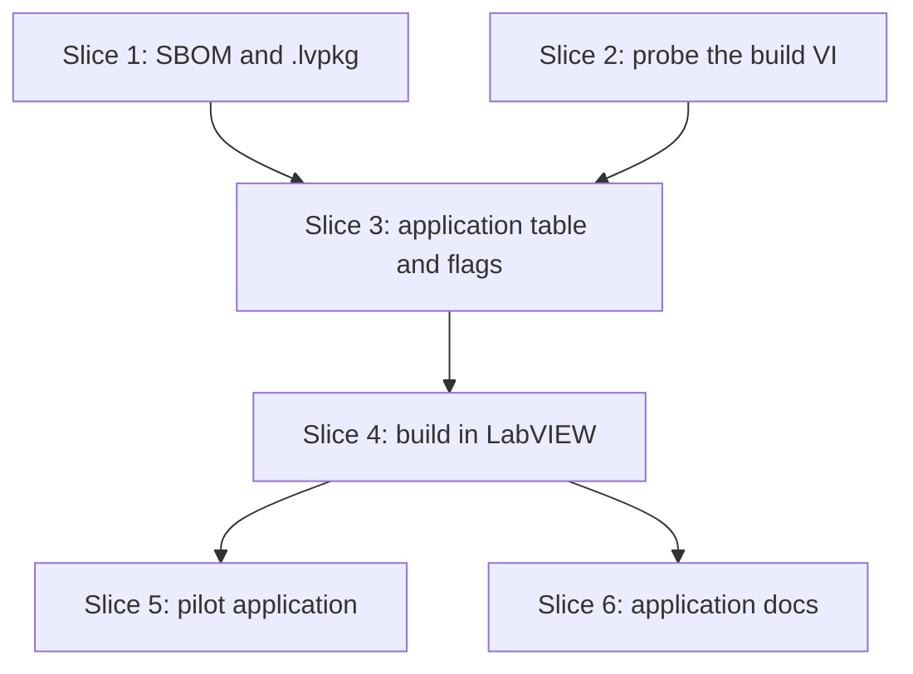

# Plan: Application builds and SBOM (S9)

**Created**: 2026-11-04
**Branch**: issue-70, off `main` at efffcdc
**Status**: approved
**Gherkin persistence**: plan-file-only (the builder writes `tests/features/build-slices/s9-lvpm-build-app.feature` by hand, as S12 did)
**Spec**: [docs/specs/lvpm-app-build-s9.md](../docs/specs/lvpm-app-build-s9.md)

## Goal

An application project names its `.lvproj` and build spec in `[application]`
of `lvpm.toml`. `lvpm build` runs that build spec in the venv's own LabVIEW
and writes `bom.cdx.json`, a CycloneDX 1.5 SBOM of the lock's
`[dependencies]` closure, next to the build. Every `.lvpkg` `lvpm build`
writes from a current lock carries the same kind of SBOM at its root.
`--app` and `--package` pick one kind; no flag builds every kind the
manifest declares. The pilot application is NI's Continuous Measurement and
Logging template, copied into `tests/fixtures/pilot-app/` and changed to call
both pilots. Closes #70.

## Acceptance Criteria

From the spec; numbers match it. AC1, AC4, AC5, AC7, AC9 and AC10 carry the
amendments below.

- [ ] AC1: with the pilot application synced into its venv, `lvpm build --app` headless builds `Main.exe`, which starts *(manual, `@labview`: needs LabVIEW 2026)*. It does not prove that HSE Logger came from the venv and not the global vi.lib (#78); the PR says so.
- [ ] AC2: the SBOM lists every package in the lock's `[dependencies]` closure with its version and SHA-256, and no other package.
- [ ] AC3: the SBOM parses as JSON with `bomFormat` "CycloneDX" and `specVersion` "1.5", and its fields match the spec's architecture section (no schema validation); two runs over the same lock give identical bytes.
- [ ] AC4: after a successful app build, `bom.cdx.json` is in the folder of the first output path; a failed build writes none and leaves an earlier one untouched.
- [ ] AC5: a `.lvpkg` `lvpm build` writes from a current lock (or with no `[dependencies]` and no lock) has `bom.cdx.json` at its root, listed in `RECORD`, and says `format = 2`. With no lock or a stale lock it has none and the build warns (A1). A `.lvpkg` without one still installs.
- [ ] AC6: with both tables, `lvpm build` builds both, `--package` only the `.lvpkg`, `--app` only the application; a flag for a missing table fails, naming it.
- [ ] AC7: no lock, a stale lock, no venv, or a venv that differs from the lock each fail the app build before LabVIEW starts, naming `lvpm lock`, `lvpm venv create` or `lvpm sync`.
- [ ] AC8: a build spec LabVIEW cannot build fails with exit code 1 and LabVIEW's code and message, and the spawned LabVIEW is closed.
- [ ] AC9 (A4): an unknown key in `[application]` fails when any command reads `lvpm.toml`. A missing or empty key, a wrong type, a missing `.lvproj`, a path not ending in `.lvproj` or a path outside the folder fails `lvpm build` before LabVIEW starts. Each names the problem.
- [ ] AC10: every existing feature file passes unchanged, except s5b lines 87 and 132, which now expect the A1 warning. `lvpm build` on a library-only manifest behaves as today, plus the SBOM entry and the A1 warning.
- [ ] AC11: `tests/fixtures/pilot-app/` holds the copied template; its README names NI's template and LabVIEW 2026 and lists what lvpm changed; a template VI links `lvpm Pilots.vi`, which calls both pilots. The link is a text check; the `@labview` run is the runtime check.
- [ ] AC12: docs/manifest.md has an `[application]` section with both keys and the refusal messages; docs/usage.md names `--app`, `--package` and `bom.cdx.json`; the README M2 SBOM line is ticked. Checked at PR review (no test).

### AC to slice

| AC | Covered by | Runs in default CI |
|----|------------|--------------------|
| AC1 | Slice 5 `@labview` scenario, manual evidence in the PR | no (manual only) |
| AC2, AC3 | Slice 1 unit tests and scenarios | yes |
| AC4 | Slice 4 unit tests on a fake launcher; slice 5 `@labview` for the real path | fake: yes; real: no |
| AC5 | Slice 1 unit tests and scenarios | yes |
| AC6, AC7, AC9 | Slice 3 scenarios and unit tests | yes |
| AC8 | Slice 4 unit tests on a fake launcher and the exit-code render test; slice 5 for the real path | fake: yes; real: no |
| AC10 | full suite | yes |
| AC11 | Slice 5 repository scenario | yes |
| AC12 | Slice 1 and slice 6 docs; slice 3 help scenario | help: yes |

## Spec amendments (shown at this gate)

Reading the code found four places where the spec does not fit it.

- **A1. A library with no lock, or a stale lock.** The spec refuses its
  build. That breaks AC10: `s1-lvpm-build.feature` and
  `s5b-lvpm-build-check.feature` build libraries with `[dependencies]` and no
  lock, and a stale lock (for example after an lvpm release bumps the lock
  format) would break every library's CI. The plan instead writes the
  package **without** an SBOM and warns on stderr, in the style of the
  existing build warnings (no prefix):
  - `no lvpm.lock, so the package has no SBOM; run lvpm lock to add one`
  - `lvpm.lock is out of date (<reason>), so the package has no SBOM; run lvpm lock to add one`

  No `[dependencies]` and no lock still gives an SBOM with no components.
  Only the **application** build refuses a missing or stale lock. The
  warning changes two existing expectations, s5b lines 87 and 132, which the
  builder updates. uv comparison: `uv build` never refuses over the lock and
  writes no SBOM; `uv export --format cyclonedx1.5` locks first.
- **A2. Old lvpm reads new packages.** `lvpkg::read` refuses every entry not
  below `install-dir`, so lvpm 0.23 and older cannot read a `.lvpkg` with a
  root `bom.cdx.json`. Kept at the root as the spec says. A package that
  carries an SBOM says `format = 2` in `package.toml`; one without stays
  `format = 1`. Old lvpm then says `package.toml format = 2 was written by a
  newer lvpm; update lvpm` instead of a confusing path error. The new reader
  accepts 1 and 2, and allows the root SBOM only under 2. The release note
  says which lvpm version reads these packages. The alternative,
  `<install-dir>/bom.cdx.json`, lets old lvpm install it, but it then lands
  in the LabVIEW tree.
- **A3. No new event.** `lvpm build` returns an `Outcome` that
  `src/render/build.rs` writes; it emits no events. The app build follows
  that path, as `Outcome::AppBuilt(AppBuilt { build_spec, outputs, sbom,
  took })`.
- **A4. `[application]` errors at build time.** AC9 said "fails at read".
  Only the unknown-key check runs at read, as `[policy]` does
  (`project.rs:406`). The rest runs in `application::validate` on `lvpm
  build`, so `lvpm lock` still works while the `.lvproj` is being set up.

## Approach stances (decision-defaults)

- **Replace-vs-merge:** merge. `[application]` is a new table. `lvpm build`
  keeps its package path, plus the SBOM entry.
- **Format fidelity:** `.lvpkg` gains `format = 2` only when it carries an
  SBOM (A2); packages without one are byte-for-byte as today. `lvpm.lock` is
  unchanged: `[application]` is not a lock input. The SBOM is deterministic.
- **Migrate-vs-edit-stub:** nothing to migrate. Old packages install as
  before.
- **Scope:** the spec's. Out: PPL, targets other than `My Computer`,
  `.lvlibp` in the SBOM, SBOM signing, the TUI, `lvpm init` writing
  `[application]`, cleaning old build output, Ctrl-C handling (see Risks).
- **Integration:** one PR against `main` with all six slices, chosen by the
  user at the plan gate over the recommended two. The user merges it, no
  auto-merge. It says `Closes #70`, states A1 to A4, the A2 format change
  with a release-note line, the AC1 limit, and the deviation: a local
  LabVIEW 2026 demo instead of the container.

## Design notes

- **`crates/lvpm-core/src/application.rs`** (new). It mirrors `distribution.rs`:
  - `Project.application: Option<toml::Table>`, as written, as `distribution` is.
  - `project.rs` owns `APPLICATION_KEYS` and refuses unknown keys at read, next to the `[policy]` check. `application.rs` uses that constant, so the module dependency stays one-way.
  - `application::validate(&Project, root) -> Result<Application>`, where `Application { project: PathBuf /* absolute */, build_spec: String, name: String, version: String }`.
  - Errors (`<v>` is the value as written):
    - `[application] needs project (the LabVIEW project, a .lvproj path relative to lvpm.toml)`
    - `[application] needs build-spec (the build specification's name in the LabVIEW project)`, also for `""`
    - `[application] project must be a string` / `[application] build-spec must be a string`
    - `[application] has unknown key "x"; expected project or build-spec`
    - `[application] project "<v>" is not a file`
    - `[application] project "<v>" must end in .lvproj`
    - `[application] project "<v>" lies outside the folder with lvpm.toml` (after `canonicalize`, as `build.rs` checks members; absolute paths included)
    - `an application build needs project.name and project.version in lvpm.toml, for the SBOM`
- **`crates/lvpm-core/src/sbom.rs`** (new):
  - `pub fn cyclonedx(lock: Option<&Lockfile>, subject: Subject) -> String`, where `Subject { name, version, kind: Application | Library }`.
  - Components are the lock packages whose `groups` is empty: the `[dependencies]` closure, as `Selection::wants` reads it. Sorted by `name_key`.
  - Built with structs in field order and `serde_json`. Output is `to_string_pretty` plus a trailing `\n`.
  - `requires` names map to `bom-ref`s. A name missing from the closure cannot happen in a valid lock; the code `debug_assert`s it and leaves it out.
  - Validity rests on a golden string and a re-parse, not on the CycloneDX schema. `shortcut: no schema validation, add the vendored 1.5 schema as a dev-dependency when a consumer rejects the file.`
- **`.lvpkg`**:
  - `lvpkg::write(meta, files, sbom: Option<&[u8]>)`. With `Some`, it writes root `bom.cdx.json`, lists it in `RECORD`, and writes `format = 2`.
  - `lvpkg::SBOM = "bom.cdx.json"`. `spec_from` skips that one root name under format 2 and does not install it. Its RECORD hash is checked by the existing loop. Under format 1 it is refused as today.
  - `ops/build.rs::build` reads the lock next to the manifest and applies A1. The lock lookup is one `pub(super)` helper that `build_app` shares.
- **`ops::build::kinds(&Project, app: bool, package: bool, no_check: bool) -> Result<Kinds>`** decides what to build, in core:
  - No flag: every table present. Neither present: `nothing to build: lvpm.toml has no [distribution] or [application]`.
  - Any flag: exactly the flagged tables. A missing one fails: `--app needs [application] in lvpm.toml (see docs/manifest.md)`, or the same for `--package` and `[distribution]`.
  - `--no-check` on a run that builds no package fails: `--no-check applies only to the package build, and this run builds none`.
- **The app build** (`crates/lvpm-core/src/ops/build_app.rs`, new; `ops/build.rs` keeps the package):
  - `pub fn build_app(env, launcher: &dyn AppLauncher) -> Result<AppBuilt>`. The traits are `pub` because the binary passes `VenvAppLauncher`. Tests pass a fake.
  - `pub fn check_app(env) -> Result<Ready>` runs the preconditions, in order, none starting LabVIEW:
    1. `application::validate`.
    2. There is a lock: `no lvpm.lock; run lvpm lock`.
    3. `staleness` is `None`: `lvpm.lock is out of date (<reason>); run lvpm lock`.
    4. There is a venv: `no venv in <dir>; run lvpm venv create and lvpm sync`. `check_app` tests for the venv directory itself before calling `venv::locate`, so this text is the one the user sees and the scenario pins it.
    5. `plan_sync(lock, installed, &Selection { no_dev: true, groups: vec![], keep_listed: true })` is empty: `the venv differs from lvpm.lock (<first step>); run lvpm sync`. `keep_listed` lets dev packages stay; a package not in the lock is still refused.
  - The sequence lives in core, `pub fn run(env, kinds: Kinds, no_check, launcher: &dyn AppLauncher, on_package: impl FnMut(&Outcome)) -> Result<Built>`: with both kinds it runs `check_app` first, then the package build, then `build_app`. A refusal of either check therefore writes nothing. `on_package` lets the CLI print the package's `built` line before the app build starts. `cmd_build` only parses flags, calls `run` and renders, so the sequence is unit-tested with a fake launcher.
- **The seam**: `AppLauncher::start(&Venv, headless, sink) -> Result<Box<dyn AppSession>>`, and `AppSession::build(project, target, spec) -> Result<Vec<PathBuf>, AppBuildError>`, with `enum AppBuildError { LabView(LvError { code: i32, message: String }), Other(anyhow::Error) }`. Only `LabView` renders as "could not build".
  - Dropping the session closes the connection and calls `shutdown_if_spawned`, as `VenvSession` does.
  - The connect-retry loop moves from `resave.rs` into `launch.rs` as `pub(crate) fn connect_venv(...) -> Result<(Instance, Connection)>`. This is the only refactor of existing code. `VenvAppLauncher` asks for `fresh = true`, because LabVIEW reads addons at launch.
- **The LabVIEW call goes through an lvpm-owned wrapper VI**, as relink does (`relink.rs:10`). `LvValue` has no cluster decode (`viserver.rs:853`), so NI's error cluster cannot be read directly.
  - `crates/lvpm-core/src/lv-src/build-app.vi`, embedded with `include_bytes!` and materialized as `relink-package.vi` is.
  - Inputs: `project path`, `build spec` (Str). Outputs: `outputs` (Str, paths joined by `\n`), `error code` (I32), `error message` (Str), `Done` (Bool). Only `ctrl_val_set`/`ctrl_val_get` with Str, I32 and Bool, which viserver supports.
  - It runs with `run_vi_async` and polls `Done`, as relink does (`relink.rs:358-450`), because a build can outlast `CALL_TIMEOUT` (180 s). No overall timeout: a build runs until LabVIEW finishes.
  - Slice 2 decides and records how the wrapper reaches NI's VI (static link or by path) and the LabVIEW version it is saved in. A 2026 static link ties it to 2026, which matches the "tested on 2026 only" stance.
  - Inside, it calls `<labview>/vi.lib/AppBuilder/BuildTargetBuildSpecification.vi` with target `My Computer`. An error cluster with status false (a warning) is not a failure: the wrapper returns code 0.
  - Slice 2 (the probe) fixes the real terminal names of NI's VI before this interface is frozen.
- **SBOM next to the build**: written to `outputs[0].parent()/bom.cdx.json` only after `build` returns `Ok`, staged and renamed as `write_atomically` does. Empty `outputs` is an error: `LabVIEW reported no output for "<spec>"`. If the SBOM write fails, the error says `the build output is in <dir>, but bom.cdx.json could not be written: <cause>`.
- **CLI** (`src/main.rs`):
  - `Build { no_check, #[arg(long)] app: bool, #[arg(long)] package: bool }`.
  - Before `start`, stderr says `building application "<spec>" with LabVIEW <year> ...`.
  - Text:
    - package: `built <path> (N files, with SBOM)`, or `(N files)` without one.
    - app: `built application "<spec>" in <s>s: <first output>`, then `  (+N more outputs)` when there are more, then `sbom: <path>`.
    - LabVIEW's error: `LabVIEW could not build "<spec>": <code> <message>`, then `open the LabVIEW project and run the build spec there to see details`, exit 1.
    - `AppBuildError::Other` prints its cause as any lvpm error does, also exit 1.
    - A launch failure (`AppBuildError::Other` before the build VI runs) adds `the venv uses LabVIEW <year>; lvpm venv create --labview-version <year> rebinds it`.
    - With both kinds, the package's `built` line prints as soon as the package is written, so an app failure after it still shows the good `.lvpkg`.
  - `--json`: a package-only run keeps today's shape. Otherwise `{"command":"build","package":{...},"application":{"build_spec","outputs","sbom","took"}}`, absent kinds omitted. Failures stay as today: the error on stderr, exit non-zero, no JSON.

## Slices

### Slice 1: the SBOM, and the SBOM inside the `.lvpkg`

**Depends-on:** none
**Files:** `crates/lvpm-core/src/sbom.rs`, `crates/lvpm-core/src/lib.rs`, `crates/lvpm-core/src/lvpkg.rs`, `crates/lvpm-core/src/ops/build.rs`, `crates/lvpm-core/src/index.rs`, `crates/lvpm-core/src/ops/install.rs`, `src/render/build.rs`, `tests/features/build-slices/s9-lvpm-build-app.feature`, `tests/steps/build.rs`, `tests/acceptance.rs`, `tests/features/build-slices/s7a-lvpkg.feature`, `tests/features/build-slices/s5b-lvpm-build-check.feature`, `docs/usage.md`

**Behavior:**

```gherkin
Feature: lvpm build writes an SBOM, and builds applications

  Scenario: the package carries an SBOM of the locked [dependencies]
    Given a library project depending on "alpha" 1.0, which requires "beta" 2.0
    And "gamma" 1.0 only in [dev-dependencies]
    And lvpm.lock is current
    When lvpm build runs
    Then stdout has a line ending "files, with SBOM)"
    And the package's RECORD lists "bom.cdx.json" at the root
    And its package.toml says format = 2
    And its bom.cdx.json has specVersion "1.5" and bomFormat "CycloneDX"
    And its bom.cdx.json lists exactly alpha 1.0 and beta 2.0, each with the lock's SHA-256
    And alpha's dependencies name "beta@2.0"

  Scenario: two builds over the same lock give the same SBOM
    Given a library project depending on "alpha" 1.0 and lvpm.lock is current
    When lvpm build runs twice, keeping the first package
    Then the bom.cdx.json inside both packages is byte-identical

  Scenario: a library with no dependencies and no lock gets an empty SBOM
    Given a library project with no [dependencies] and no lvpm.lock
    When lvpm build runs
    Then it succeeds
    And its bom.cdx.json has metadata.component type "library" and no components

  Scenario: a library with dependencies and no lock is built without an SBOM
    Given a library project depending on "alpha" 1.0 and no lvpm.lock
    When lvpm build runs
    Then it succeeds
    And the package has no bom.cdx.json and says format = 1
    And stderr has the line "no lvpm.lock, so the package has no SBOM; run lvpm lock to add one"

  Scenario: a stale lock builds the package without an SBOM
    Given a library project depending on "alpha" 1.0 and a lock written before "beta" was added to [dependencies]
    When lvpm build runs
    Then it succeeds
    And the package has no bom.cdx.json
    And stderr has a line starting "lvpm.lock is out of date (" and ending "so the package has no SBOM; run lvpm lock to add one"

  Scenario: --no-check keeps the SBOM
    Given a library project depending on "alpha" 1.0 and lvpm.lock is current
    When lvpm build --no-check runs
    Then the package's RECORD lists "bom.cdx.json" at the root

  Scenario: a package with an SBOM installs, and its SBOM does not
    Given a built "demo_lib-1.2.3.lvpkg" with bom.cdx.json
    When it is installed into a venv
    Then the install succeeds
    And no bom.cdx.json is installed

  Scenario: a package without an SBOM still installs
    Given a built "demo_lib-1.2.3.lvpkg" written without bom.cdx.json
    When it is installed into a venv
    Then the install succeeds
```

**Steps:**

#### Step 1.1: `sbom::cyclonedx`

**Complexity**: standard
**IMPLEMENT**: `sbom.rs` as the design notes describe.
**TEST**: unit tests:
- A lock with a main package, its transitive dependency, a dev-only package and a group-only package. The SBOM holds exactly the first two, asserted as one string.
- Two calls give identical bytes, for a library and an application `Subject`. No `serialNumber`, no `timestamp`.
- `None` lock gives empty `components` and `dependencies`.
- The `bom-ref` format, the `hashes` alg `SHA-256`, and an `externalReferences` entry of type `distribution` holding `source`.
- `metadata.component.type` is `application` or `library`, with the subject's name and version.
- Parsing back gives `specVersion` "1.5" and `bomFormat` "CycloneDX".

**REFACTOR**: one struct per CycloneDX object, so the field order stays in one place.
**Files**: `crates/lvpm-core/src/sbom.rs`, `crates/lvpm-core/src/lib.rs`
**Commit**: `feat(s9): CycloneDX 1.5 SBOM from the lock`

#### Step 1.2: the SBOM inside the `.lvpkg`

**Complexity**: complex (the package format and its reader, which is a trust boundary)
**IMPLEMENT**:
- `lvpkg::write(meta, files, sbom)`, `lvpkg::SBOM`, and `format = 2` with an SBOM.
- The reader accepts formats 1 and 2. `spec_from` skips the root SBOM name under 2 only. Any other root entry is still refused.
- `build` applies A1. Every `lvpkg::write` caller passes the new argument; test callers pass `None`.
- The A1 warnings and the `with SBOM` text in `render/build.rs`. The warning prints only after the check passed and the package is written, so a refused build's last stderr line stays the `build refused` line (s5b line 106).
- docs/usage.md: the SBOM in the package, A1's warnings, and that these packages need lvpm with S9 (A2).

**TEST**:
- `lvpkg` unit tests:
  - A package with an SBOM reads back with the same `files`, which hold no SBOM.
  - A tampered SBOM (bytes differ from `RECORD`) is refused with the existing "differs from RECORD" message.
  - A root `bom.cdx.json` missing from `RECORD` is refused, naming it.
  - A root `bom.cdx.json` in a `format = 1` package is refused.
  - `BOM.cdx.json` in upper case, and `x/bom.cdx.json` outside `install-dir`, are refused.
  - A file named `bom.cdx.json` below `install-dir` installs as a normal file.
  - The "written by a newer lvpm" tests move from format 2 to format 3.
- `build` unit tests for the four lock cases: current, none with deps, none without deps, stale.
- Slice 1's scenarios, in the new feature file listed in `FEATURE_FILES`.
- Update the s7a RECORD expectations that list exact entries.
- Update s5b lines 87 and 132 to expect the A1 line. Grep every build feature for `stderr is empty`, `stderr is exactly`, `stderr is`, `stderr's last line` and `no line containing` on a library with `[dependencies]` and no lock; line 13 has none and stays, line 106 holds because of the ordering above.
- Full suite green.

**REFACTOR**: the lock lookup goes in one `pub(super)` helper in `ops/build.rs`.
**Files**: `crates/lvpm-core/src/lvpkg.rs`, `crates/lvpm-core/src/ops/build.rs`, `crates/lvpm-core/src/index.rs`, `crates/lvpm-core/src/ops/install.rs`, `src/render/build.rs`, `tests/features/build-slices/s9-lvpm-build-app.feature`, `tests/steps/build.rs`, `tests/acceptance.rs`, `tests/features/build-slices/s7a-lvpkg.feature`, `tests/features/build-slices/s5b-lvpm-build-check.feature`, `docs/usage.md`
**Commit**: `feat(s9): every .lvpkg carries its SBOM`

### Slice 2: probe NI's build VI

**Depends-on:** none
**Files:** `plans/lvpm-app-build-s9.md`

No Gherkin: this slice writes no code. It settles the riskiest unknown before slice 3 freezes `AppSession`.

**Steps:**

#### Step 2.1: read and run `BuildTargetBuildSpecification.vi` once

**Complexity**: standard
**IMPLEMENT**:
1. Confirm LabVIEW 2026 has `vi.lib/AppBuilder/BuildTargetBuildSpecification.vi` and the Application Builder.
2. Read its terminal names and types with `lvai_vi_terminals`, a read-only call.
3. Run it once against an unmodified copy of NI's template in the scratchpad, never inside the repository or the global LabVIEW tree. Record whether it builds, what it returns for the output paths, and what its error cluster holds for a misspelled build-spec name.
4. Write the results into the design notes: the real terminal names, the error code for a missing build spec, the wrapper VI's final interface, how it links to NI's VI, and the LabVIEW version it is saved in.

**Decision rule**: if the VI cannot be called from a wrapper VI run over VI Server, stop and ask the user. Slices 3 to 6 wait; slice 1 stays committed on the branch.
**TEST**: the design notes name the terminals and the code. Nothing else changes.
**REFACTOR**: none.
**Files**: `plans/lvpm-app-build-s9.md`
**Commit**: `docs(s9): record the build VI's interface`

### Slice 3: `[application]`, the flags and the refusals

**Depends-on:** 1, 2
**Files:** `crates/lvpm-core/src/application.rs`, `crates/lvpm-core/src/lib.rs`, `crates/lvpm-core/src/project.rs`, `crates/lvpm-core/src/ops/build.rs`, `crates/lvpm-core/src/ops/build_app.rs`, `crates/lvpm-core/src/ops/mod.rs`, `src/main.rs`, `src/render/build.rs`, `tests/features/build-slices/s9-lvpm-build-app.feature`, `tests/steps/build.rs`

**Behavior:**

```gherkin
  Scenario Outline: a bad [application] table is refused, naming the problem
    Given an application project whose [application] <problem>
    When I run "lvpm build --app"
    Then the exit code is non-zero
    And the error says "<message>"
    And stderr has no line starting "building application"

    Examples:
      | problem                                        | message                                                    |
      | has no project                                 | [application] needs project                                |
      | has no build-spec                              | [application] needs build-spec                             |
      | has build-spec = ""                            | [application] needs build-spec                             |
      | has project = 5                                | [application] project must be a string                     |
      | has project = ""                               | [application] needs project                                |
      | has build-spec = 5                             | [application] build-spec must be a string                  |
      | has the key "target" = "RT"                    | [application] has unknown key "target"; expected project or build-spec |
      | names "app/Missing.lvproj", which is not there | [application] project "app/Missing.lvproj" is not a file   |
      | names "app/Main.vi"                            | [application] project "app/Main.vi" must end in .lvproj    |
      | names "../other/X.lvproj"                      | [application] project "../other/X.lvproj" lies outside the folder with lvpm.toml |
      | names "<sandbox parent>/X.lvproj", absolute    | lies outside the folder with lvpm.toml                     |

  Scenario: an unknown key in [application] is refused by any command reading the manifest
    Given an application project whose [application] has the key "target" = "RT"
    When I run "lvpm lock"
    Then the exit code is non-zero
    And the error says "[application] has unknown key \"target\""

  Scenario: lvpm lock works while the .lvproj is missing
    Given an application project whose [application] names "app/Missing.lvproj", which is not there
    When I run "lvpm lock"
    Then it succeeds

  Scenario: an application without a version is refused
    Given an application project with no version in lvpm.toml
    When I run "lvpm build --app"
    Then the error says "an application build needs project.name and project.version in lvpm.toml, for the SBOM"

  Scenario Outline: a flag for a table the manifest lacks fails, naming it
    Given a project with only <table>
    When I run "lvpm build <flags>"
    Then the exit code is non-zero
    And the error says "<missing> in lvpm.toml"

    Examples:
      | table          | flags            | missing                   |
      | [distribution] | --app            | --app needs [application] |
      | [application]  | --package        | --package needs [distribution] |
      | [distribution] | --app --package  | --app needs [application] |

  Scenario: a manifest with neither table has nothing to build
    Given a project with no [distribution] and no [application]
    When I run "lvpm build"
    Then the exit code is non-zero
    And the error says "nothing to build: lvpm.toml has no [distribution] or [application]"

  Scenario: --no-check on a run that builds no package is refused
    Given an application project with no [distribution]
    When I run "lvpm build --app --no-check"
    Then the error says "--no-check applies only to the package build"

  Scenario: --package with both tables builds only the package
    Given a project with [distribution] and [application], lvpm.lock current, and no venv
    When I run "lvpm build --package --no-check"
    Then it succeeds and dist holds the package
    And stderr has no line starting "building application"

  Scenario: --app with both tables builds no package
    Given a project with [distribution] and [application], lvpm.lock current, and no venv
    When I run "lvpm build --app"
    Then the exit code is non-zero
    And the error says "lvpm venv create"
    And dist holds no package

  Scenario Outline: the app build is refused before LabVIEW starts
    Given an application project <state>
    When I run "lvpm build --app"
    Then the exit code is non-zero
    And the error says "<reason>" and "<fix>"
    And stderr has no line starting "building application"

    Examples:
      | state                                             | reason                       | fix                                 |
      | with no lvpm.lock                                 | no lvpm.lock                 | run lvpm lock                       |
      | whose lock predates a new [dependencies] entry    | lvpm.lock is out of date     | run lvpm lock                       |
      | with a current lock and no venv                   | no venv in                   | run lvpm venv create and lvpm sync  |
      | whose venv lacks a locked package                 | the venv differs from lvpm.lock | run lvpm sync                    |
      | whose venv has alpha 0.9 where the lock says 1.0  | the venv differs from lvpm.lock | run lvpm sync                    |
      | whose venv holds a package the lock does not list | the venv differs from lvpm.lock | run lvpm sync                    |

  Scenario: with both tables, a refused app writes no package
    Given a project with [distribution] and [application] and no lvpm.lock
    When I run "lvpm build"
    Then the exit code is non-zero
    And the error says "no lvpm.lock"
    And dist holds no package

  Scenario: with both tables, a refused package stops the app build
    Given a project with [distribution] and [application], lvpm.lock current and the venv synced, so the app would otherwise build
    And its library member breaks a check rule
    When I run "lvpm build"
    Then the exit code is non-zero
    And stderr has the line "build refused: 1 problem(s) in library members, nothing written; fix them or pass --no-check"
    And stderr has no line starting "building application"

  Scenario: --app --package is the same as no flag
    Given a project with [distribution] and [application] and no lvpm.lock
    When I run "lvpm build --app --package"
    Then the exit code is non-zero
    And the error says "no lvpm.lock"
    And dist holds no package

  Scenario: the help names the flags
    When I run "lvpm build --help"
    Then stdout mentions "--app" and "--package"
```

In this slice the CLI's launcher is a stub whose only error is `launcher not
wired`. The refusal scenarios assert that the `building application`
progress line, printed just before `start`, never appears, so they keep
proving "refused before LabVIEW starts" after slice 4 replaces the stub.
`<sandbox parent>` is the sandbox's temp parent directory, so the absolute
path exists on every machine and lies outside the project.

**Steps:**

#### Step 3.1: read `[application]`

**Complexity**: standard
**IMPLEMENT**:
- `Project.application` and `APPLICATION_KEYS` in `project.rs`. `Project::read` refuses unknown keys and a non-table `[application]`.
- `application::validate` and its errors.

**TEST**: `project.rs` and `application.rs` unit tests for each error with its exact message. Symlinks out of the folder are refused. A directory named `X.lvproj` is "not a file". A manifest without the table gives `None`. Full suite green.
**REFACTOR**: `validate` shares the outside-the-folder check with `build.rs`'s member check when that takes no more than moving one function.
**Files**: `crates/lvpm-core/src/application.rs`, `crates/lvpm-core/src/lib.rs`, `crates/lvpm-core/src/project.rs`
**Commit**: `feat(s9): read [application] from lvpm.toml`

#### Step 3.2: `kinds`, `--app`, `--package` and the preconditions

**Complexity**: standard
**IMPLEMENT**:
- `ops::build::kinds` with its errors.
- `ops/build_app.rs`: `check_app`, `build_app`, the `AppLauncher`/`AppSession` traits and `AppBuildError`. The CLI passes a stub launcher that fails with `launcher not wired`.
- `ops::build::run`, the sequence. The CLI flags; `cmd_build` calls `run` and prints the progress line just before `start`.
- The `--json` shape for a run that builds both.

**TEST**:
- `kinds` unit tests: no flag, `--app`, `--package`, both flags (equal to no flag), neither table, a flag for a missing table, `--no-check` with no package.
- `run` unit tests with a fake launcher: both kinds give a `.lvpkg` and the app's `bom.cdx.json`; the package is built before `start`; `on_package` fires before `start`; a refused package never calls `start`; a refused `check_app` writes no package.
- `build_app` unit tests with a fake launcher that records whether `start` was called. Each refusal leaves it not called. A dev package in the venv is accepted.
- A render test for the `--json` shape with both kinds.
- Slice 3's scenarios. The existing `lvpm build` scenarios are unchanged.
- Full suite green.

**REFACTOR**: none planned beyond the cycle's own.
**Files**: `crates/lvpm-core/src/ops/build.rs`, `crates/lvpm-core/src/ops/build_app.rs`, `crates/lvpm-core/src/ops/mod.rs`, `src/main.rs`, `src/render/build.rs`, `tests/features/build-slices/s9-lvpm-build-app.feature`, `tests/steps/build.rs`
**Commit**: `feat(s9): lvpm build --app and --package`

### Slice 4: the build in the venv's LabVIEW

**Depends-on:** 3
**Files:** `crates/lvpm-core/src/ops/build_app.rs`, `crates/lvpm-core/src/ops/build.rs`, `crates/lvpm-core/src/launch.rs`, `crates/lvpm-core/src/ops/resave.rs`, `crates/lvpm-core/src/lv-src/build-app.vi`, `src/main.rs`, `src/render/build.rs`

**Behavior** (unit cases on a fake `AppLauncher`, not feature-file Gherkin; the real run is slice 5's `@labview` scenario):

```gherkin
  Scenario: a successful build writes the SBOM next to its first output
    Given an application project ready to build, and LabVIEW reports "<sandbox>/builds/app/Main.exe" and "<sandbox>/builds/app/data"
    When the app is built
    Then "<sandbox>/builds/app/bom.cdx.json" holds the SBOM of the lock, with metadata.component type "application"
    And the text says "(+1 more outputs)"
    And the LabVIEW session was closed

  Scenario: LabVIEW's error fails the build and writes no SBOM
    Given an application project ready to build, and LabVIEW returns error 1003 "The VI is not executable"
    When the app is built
    Then it fails with "LabVIEW could not build \"Continuous Measurement and Logging Application\": 1003 The VI is not executable"
    And the exit code is 1
    And no bom.cdx.json was written
    And the LabVIEW session was closed

  Scenario: a failed build leaves the previous SBOM untouched
    Given a previous build left "<sandbox>/builds/app/bom.cdx.json"
    And LabVIEW now returns error 1003
    When the app is built
    Then "<sandbox>/builds/app/bom.cdx.json" is unchanged

  Scenario: a VI Server failure closes the spawned LabVIEW
    Given an application project ready to build, and LabVIEW starts but running the build VI fails with "connection lost"
    When the app is built
    Then it fails naming "connection lost", not "could not build"
    And the LabVIEW session was closed
    And no bom.cdx.json was written

  Scenario: LabVIEW reporting no output is an error
    Given an application project ready to build, and LabVIEW reports no output paths
    When the app is built
    Then it fails with "LabVIEW reported no output for"
    And no bom.cdx.json was written

  Scenario: a LabVIEW that cannot start fails the build
    Given an application project ready to build, and the launcher fails with "LabVIEW 2026 not found"
    When the app is built
    Then it fails with "LabVIEW 2026 not found"
    And no bom.cdx.json was written

  Scenario: the SBOM write failing says the build output exists
    Given an application project ready to build, and the output folder is removed after LabVIEW succeeds
    When the app is built
    Then it fails with "the build output is in" and "bom.cdx.json could not be written"

  Scenario: with no flag and both tables, both are built
    Given a project with both tables ready to build, and LabVIEW reports "<sandbox>/builds/app/Main.exe"
    When everything is built
    Then dist holds the package, with bom.cdx.json inside
    And "<sandbox>/builds/app/bom.cdx.json" exists
    And the package was written before the launcher started

  Scenario: with both tables, an app failure still reports the built package
    Given a project with both tables ready to build, and LabVIEW returns error 1003
    When everything is built
    Then the text has the package's "built" line before the LabVIEW error
    And dist holds the package

  Scenario: the headless flag reaches the launcher
    Given an application project ready to build and LV_RTE_HEADLESS set
    When the app is built
    Then the launcher was asked for a headless LabVIEW
```

The LabVIEW-warning case (status false, code non-zero) is handled inside the
wrapper VI, so it is checked by slice 2's probe and slice 5's run, not here.

**Steps:**

#### Step 4.1: `VenvAppLauncher` runs the wrapper VI

**Complexity**: complex (a new VI, new VI Server use, the spawned LabVIEW's lifetime)
**IMPLEMENT**:
1. `build-app.vi`, generated with the `labview-vi-generator` agent to the interface slice 2 recorded. It is written into `lv-src/`; nothing is installed into the global LabVIEW.
2. `launch::connect_venv`, with `resave.rs` changed to use it.
3. `VenvAppLauncher` and `VenvAppSession`: materialize the wrapper as relink does, set the Str inputs, run, read the I32 and Str outputs, map them to `AppBuildError`. The drop closes the connection and the instance.
4. The SBOM write after `Ok`.
5. Delete slice 3's `launcher not wired` stub; the CLI passes `VenvAppLauncher`. `cmd_build` prints the stderr progress line, renders `AppBuilt` and the errors, and exits 1 on `LabView`.
6. `shortcut: Ctrl-C skips Drop and leaves the spawned LabVIEW running, handle SIGINT in cmd_build when users report it.`

**TEST**:
- The slice 4 cases as unit tests with the fake.
- A render unit test: an `AppBuildError::LabView` maps to the exact text and exit code 1; `Other` does not say "could not build" and also exits 1.
- `resave`'s existing tests are unchanged and green.
- Full suite green.

The real VI call is covered only by slice 5's `@labview` scenario.
**REFACTOR**: the staged SBOM write reuses `write_atomically`.
**Files**: `crates/lvpm-core/src/ops/build_app.rs`, `crates/lvpm-core/src/ops/build.rs`, `crates/lvpm-core/src/launch.rs`, `crates/lvpm-core/src/ops/resave.rs`, `crates/lvpm-core/src/lv-src/build-app.vi`, `src/main.rs`, `src/render/build.rs`
**Commit**: `feat(s9): build the application in the venv's LabVIEW`

### Slice 5: the pilot application

**Depends-on:** 4
**Files:** `tests/fixtures/pilot-app/**`, `.gitignore`, `tests/features/build-slices/s9-lvpm-build-app.feature`, `tests/steps/build.rs`

**Behavior:**

```gherkin
  Scenario: the pilot application is in the repository
    Given the repository
    Then tests/fixtures/pilot-app/lvpm.toml has [application] build-spec "Continuous Measurement and Logging Application" and both pilots in [dependencies]
    And tests/fixtures/pilot-app/README.md names "Continuous Measurement and Logging", "LabVIEW 2026" and "National Instruments"
    And the README has a section "What lvpm changed"
    And the .lvproj's build spec writes below the fixture's "builds" folder
    And the fixture's lvpm.lock is current

  Scenario: the pilot application calls both pilots
    Given the repository
    Then "lvpm Pilots.vi" is in tests/fixtures/pilot-app/app
    And a template VI's bytes name "lvpm Pilots.vi"

  @labview
  Scenario: the pilot application builds headless from its venv
    Given a copy of the pilot application and the pilots, side by side in the sandbox
    And lvpm venv create and lvpm sync have run in it
    And LabVIEW runs headless
    When I run "lvpm build --app"
    Then the command succeeds
    And "builds/<the build spec's folder>/Main.exe" exists, with bom.cdx.json next to it
    And bom.cdx.json lists both pilots and their locked dependencies
    And Main.exe, once launched, is still running after 5 seconds
```

"A template VI's bytes name it" is a text search of the binary VI for the
subVI name. It shows the call is linked, not that it runs.

**Steps:**

#### Step 5.1: copy the template, unchanged

**Complexity**: standard
**IMPLEMENT**:
1. Copy `<LabVIEW 2026>\ProjectTemplates\Source\Core\Continuous Measurement` to `tests/fixtures/pilot-app/app/`.
2. Edit the `.lvproj` build spec's destination to `builds/` inside the fixture. This is an XML edit; the tag names are checked against the file. Nothing else changes.
3. Add `lvpm.toml`: name, version, `labview = "2026"`, `sources.local` relative to the fixture (`../pilots`), both pilots in `[dependencies]`.
4. Add the README and `tests/fixtures/pilot-app/builds/` to `.gitignore`.
5. `lvpm lock` in the fixture. Commit `lvpm.lock`. If the lock records the source path absolutely, the `@labview` scenario runs `lvpm lock` in the sandbox first, and the step says so.

**TEST**: the "is in the repository" scenario passes. Full suite green.
**REFACTOR**: none.
**Files**: `tests/fixtures/pilot-app/**`, `.gitignore`, `tests/features/build-slices/s9-lvpm-build-app.feature`, `tests/steps/build.rs`
**Commit**: `test(s9): the pilot application, from NI's Continuous Measurement template`

#### Step 5.2: the `@labview` build scenario

**Complexity**: standard
**IMPLEMENT**: slice 5's `@labview` scenario, on the unchanged template from step 5.1.
**TEST**: `cargo test` is green, with `@labview` counted as not run. With `LVPM_TEST_LABVIEW=1` on a machine with LabVIEW 2026, the scenario runs inside the venv only, and its last Then kills `Main.exe` after the check; the PR records the output. Otherwise the PR states AC1 as not verified.
**REFACTOR**: reuse the sandbox's venv and headless helpers.
**Files**: `tests/features/build-slices/s9-lvpm-build-app.feature`, `tests/steps/build.rs`
**Commit**: `test(s9): the pilot application builds headless`

#### Step 5.3: the template calls both pilots

**Complexity**: standard
**IMPLEMENT**:
- Generate one new VI, `lvpm Pilots.vi`, with the `labview-vi-generator` agent. It logs start and stop through HSE Logger and writes the settings through OpenSerializer.
- Call it from the template's acquisition start and stop and its settings save, with the `labview-vi-editor` agent.
- The editor regenerates a VI and loses its layout. If a template VI cannot survive that, the step stops and asks the user. The fallback is to add `lvpm Pilots.vi` to the build spec's Always Included list.

**TEST**: the "calls both pilots" scenario passes. The `@labview` scenario is run again where LabVIEW 2026 is available. Full suite green.
**REFACTOR**: none beyond the README wording.
**Files**: `tests/fixtures/pilot-app/**`, `tests/features/build-slices/s9-lvpm-build-app.feature`, `tests/steps/build.rs`
**Commit**: `test(s9): the pilot application calls both pilots`

### Slice 6: application docs

**Depends-on:** 4
**Files:** `docs/manifest.md`, `docs/usage.md`, `README.md`, `docs/specs/lvpm-app-build-s9.md`

No scenario: the help text is checked in slice 3, and a substring check of
prose proves little.

**Steps:**

#### Step 6.1: docs

**Complexity**: trivial
**IMPLEMENT**:
- docs/manifest.md `[application]`: a copy-paste example, the keys and the errors.
- docs/usage.md: the flags table, the preconditions with `lvpm venv create --labview-version 2026`, where the SBOM goes, the `--json` shape, that application builds are tested on LabVIEW 2026 only, what an idle headless LabVIEW looks like during a build, and that a LabVIEW already open on the venv must be closed first (`ensure_instance` refuses it with "close it first").
- README M2 tick.
- docs/specs/lvpm-app-build-s9.md: AC5 and AC9 reworded to A1 and A4, so the spec matches what ships.
- Book links to pages not in `docs/SUMMARY.md` use GitHub URLs.

**TEST**: the lychee check passes in CI. Full suite green.
**REFACTOR**: none.
**Files**: `docs/manifest.md`, `docs/usage.md`, `README.md`, `docs/specs/lvpm-app-build-s9.md`
**Commit**: `docs(s9): application builds`

## Parallelization



| Wave | Slices (parallel) |
|------|-------------------|
| 1 | 1, 2 |
| 2 | 3 |
| 3 | 4 |
| 4 | 5, 6 |

One builder runs them in order: 1, 2, 3, 4, 5, 6. Slice 2 needs LabVIEW and
the user's machine, so it is not a worktree job.

## Complexity Classification

`trivial` skips inline review. `standard` gets spec-compliance plus the relevant quality agents. `complex` gets the full suite.

- Step 1.2 is `complex`: it changes the package format and its reader, which is a trust boundary.
- Step 4.1 is `complex`: it adds a VI, new VI Server use, and owns the spawned LabVIEW's lifetime.

## Pre-PR Quality Gate

For each PR:

- [ ] `cargo test --workspace` passes (unit and scenarios; `@labview` counted as not run)
- [ ] `cargo clippy --all-targets -- -D warnings` passes
- [ ] `cargo fmt --check` passes
- [ ] `/code-review` passes
- [ ] AC12 checked by reading the docs diff
- [ ] The PR states A1 to A4 with a release-note line for the format change, the deviation (local demo, not the container) and the AC1 limit, says `Closes #70`, and carries the AC1 evidence or says it was not done

## Skipped (low value)

- A scenario that greps the application docs for strings. It passes on wrong docs; the help scenario and lychee cover what can be checked.

## Risks & Open Questions

- **The build VI (slice 2).** If NI's VI cannot be called from a wrapper over VI Server, slices 3 to 6 wait and the user decides. Slice 1 does not depend on it.
- **Pilot calls in the template (step 5.3).** The editor's round trip loses diagram layout. The unchanged template builds first (step 5.2), so a failure here does not hide a build failure. The fallback (Always Included) is asked for first.
- **HSE Logger in the global vi.lib.** A venv build could resolve it from LabVIEW 2026's vi.lib (#78) and hide a missing venv package. AC1 states this limit; nothing in S9 proves isolation.
- **A2 compatibility.** lvpm 0.23 and older refuse packages with an SBOM, saying "update lvpm". The release note says so.
- **NI-internal VI.** `BuildTargetBuildSpecification.vi` may change between LabVIEW versions. The docs say application builds are tested on LabVIEW 2026 only.
- **Ctrl-C** leaves a spawned LabVIEW running (`shortcut:` comment in step 4.1).
- **No LabVIEW container.** The demo is local.
- **The spec is amended (A1 to A4).** The user sees the amendments at this gate.
- **Review cap.** The Acceptance critic's round-2 blockers (AC6 success path untested; the `launcher not wired` guard going vacuous after slice 4) were fixed after the two-round cap, without a third review.
- **LabVIEW warnings.** The warning-versus-error handling in the wrapper VI is covered only by slice 2's probe and slice 5's manual run; the PR says so.

## Build Progress

### Slices (grouped by wave)

#### Wave 1
- [ ] Slice 1: the SBOM, and the SBOM inside the `.lvpkg`
  - [ ] Step 1.1: `sbom::cyclonedx`
  - [ ] Step 1.2: the SBOM inside the `.lvpkg`
- [ ] Slice 2: probe NI's build VI
  - [ ] Step 2.1: read and run `BuildTargetBuildSpecification.vi` once

#### Wave 2
- [ ] Slice 3: `[application]`, the flags and the refusals
  - [ ] Step 3.1: read `[application]`
  - [ ] Step 3.2: `kinds`, `--app`, `--package` and the preconditions

#### Wave 3
- [ ] Slice 4: the build in the venv's LabVIEW
  - [ ] Step 4.1: `VenvAppLauncher` runs the wrapper VI

#### Wave 4
- [ ] Slice 5: the pilot application
  - [ ] Step 5.1: copy the template, unchanged
  - [ ] Step 5.2: the `@labview` build scenario
  - [ ] Step 5.3: the template calls both pilots
- [ ] Slice 6: application docs
  - [ ] Step 6.1: docs

## Plan Review Summary

Plan tier: complex — reviewers: Acceptance, Design, UX, Strategic, Parallelization.

| Reviewer | Round 1 | Round 2 |
|---|---|---|
| Strategic | approve, with warnings | not re-run |
| Parallelization | approve | not re-run |
| UX | needs-revision (no-venv remedy) | approve, with warnings |
| Design | needs-revision (no cluster decode) | approve, with warnings |
| Acceptance | needs-revision (3 blockers) | needs-revision (2 blockers), fixed after the cap |

Folded in:
- Strategic: probe NI's VI first (slice 2), split the fixture into unchanged template then pilot calls, state the #78 isolation limit, A4 for AC9, two PRs (the user chose one), the A2 release note.
- UX: the no-venv text names both commands, the package's `built` line prints before an app failure, the launch-failure hint names the venv's LabVIEW version.
- Design: an lvpm-owned wrapper VI with Str/I32/Bool terminals, `run_vi_async` and polling `Done`, slice 2 records the link and save version, step 4.1 deletes the stub, docs say to close an open LabVIEW first.
- Acceptance round 2: the sequence moved into core as `ops::build::run`, unit-tested with the fake launcher; refusal scenarios assert no `building application` line; the exact `build refused` text; the A1 warning prints after the package is written; rows for `project = ""` and `build-spec = 5`; the absolute path built from the sandbox's parent; the no-venv text pinned; `Main.exe` still running after 5 seconds; `Other` exits 1; slice 5's repository scenario split; scenarios for both kinds succeeding and for `--app --package`.

`plan_waves.py`: waves [[1, 2], [3], [4], [5, 6]], no collisions, no scope mismatches.
