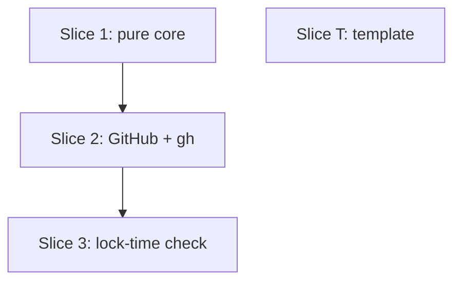

# Plan: attestations and consumer policy (S6)

**Created**: 2026-11-02
**Branch**: claude/ship-s6-attestations
**Status**: approved
**Gherkin persistence**: plan-file-only (only scenarios tagged `@cucumber` go to `tests/features/build-slices/s6-attestations.feature`, written by the steps themselves)
**Spec**: [docs/specs/lvpm-attestations-s6.md](../docs/specs/lvpm-attestations-s6.md) (v2) · Issue ThatsTheEnd/lvpm#65

## Goal

A GitHub dependency's lock entry says who built it, and a project's `[policy]`
can refuse unattested releases or releases attested by an untrusted repository.

**Decision-defaults stances**:
- **Scope**: GitHub sources only (human, Q3). Feeds, vipm.io/NI and local packages are unchanged.
- **Replace vs. merge**: the lock format is merged. Two optional fields are added and the version is not bumped (Q9).
- **Integration**: a PR with auto-merge on green checks (the default).

## Out of scope

- Re-checking an up-to-date lock (Q7). `lvpm install` from a fresh lock checks nothing new.
- `min-release-age`, Notation, OCI referrers (S7b), checks on feed packages.
- Pinning the signing workflow (`gh --signer-workflow`). Trust is per repository.
- Without `gh`, a lock written with the policy off carries no signer. Run
  `lvpm lock` again after `gh auth login` to record one. The docs say so.

## Acceptance Criteria

- [ ] AC1 An attested GitHub release locks. Its lock entry has `signer = "<SAN>"` and `subject = "https://github.com/<owner>/<repo>"`.
- [ ] AC2 With `require-signature = true`, an unattested GitHub release is refused. `lvpm lock` exits 1 and leaves any existing `lvpm.lock` byte-identical. The error names every refused package and contains `has no attestation`.
- [ ] AC3 With `trusted-publishers = ["https://github.com/a/*"]`:
  - an attestation from `https://github.com/b/x` is refused, and the error names that repository, its workflow and the configured patterns;
  - one from `https://github.com/A/x` locks, because matching ignores case;
  - an unattested release is refused even with `require-signature` off (Q10).
- [ ] AC4 An attestation that `gh` rejects is refused with no `[policy]`, and the error carries gh's trimmed stderr.
- [ ] AC5 With the policy off and the check unavailable, the package locks without `signer` and one trailing warning names it and the cause. When the policy requires an attestation, the same case is an error with a hint for that cause.
- [ ] AC6 Feed, local-path and vipm.io/NI packages lock as before under a policy that requires an attestation, and the verifier is never called.
- [ ] AC7 Adding, changing or removing `[policy]` makes `lvpm lock --check` report a stale lock. An old lock with no policy stays fresh for a manifest with no `[policy]` or an explicitly default one.
- [ ] AC8 A `[policy]` with an unknown key, a wrong type, or a pattern not starting with `https://github.com/` fails to parse, and the error names the key.
- [ ] AC9 The template job grants `id-token: write` and `attestations: write`. It runs `actions/attest-build-provenance@v2` with `subject-path: dist/*.lvpkg` before the upload step.

### Rules, decided

**`decide(outcome, policy)`**: "requires" means `require_signature || !trusted_publishers.is_empty()`.

| outcome | policy off | requires, no list | list set |
|---|---|---|---|
| attested, subject matches (or no list) | lock with signer | lock with signer | lock with signer |
| attested, subject matches no pattern | — | — | refused: UntrustedSigner |
| unattested | lock, no signer | refused: NoAttestation | refused: NoAttestation |
| unchecked(reason) | lock, warn | refused: CannotCheck | refused: CannotCheck |
| invalid(stderr) | refused: DoesNotVerify | refused: DoesNotVerify | refused: DoesNotVerify |

**Classifier (spec Q11)**:
- The API lookup goes first, with the SHA-256 lvpm already has.
  - 404, or 200 with an empty `attestations` list → **unattested**.
  - Any other answer → **unchecked**: 429, or 403 with `x-ratelimit-remaining: 0`, is a rate limit; any other 403 reads `GitHub refused the attestation lookup (HTTP 403)`; other statuses and connection errors as pinned below.
- gh runs only when the API found an attestation.
  - gh not found, a timeout (60 s), or gh without the `attestation` subcommand (`unknown command`) → **unchecked**.
  - lvpm has no token → **unchecked**. gh needs one, even for a public repo.
  - gh exits non-zero otherwise → **invalid**.
  - Exit 0 with JSON lvpm cannot read → **invalid** ("unrecognised gh output").
  - No entry whose subject digest equals the archive's SHA-256 → **invalid**.
  - Several entries → the first one whose digest matches.

**Lock values**: `subject` is stored exactly as gh reports it; only the matcher normalises.

**Trust matching**: the subject is the certificate's `sourceRepositoryURI`, compared without a trailing `.git` and case-insensitively. In a pattern, `*` matches any run, including an empty one, of characters other than `/`. Every other character is literal, so `.` is a dot.

**Kept packages**: `lock` re-uses a package it has already locked, with the same version and SHA.
- It keeps the package's `signer`/`subject` and re-runs only `decide`, with the stored attestation as the outcome.
- A kept package with no signer is checked again only when the policy requires an attestation.
- A newly fetched GitHub package is always checked.

### Pinned wording

Every refusal is collected, and `lvpm lock` prints them all, then exits 1:

```
error: lvpm refused 2 packages under [policy]:
  serializer 1.2.0 from github.com/b/x has no attestation
    hint: ask the publisher to build with the lvpm release template
  helper 0.3.0 was attested by repository https://github.com/b/x (workflow https://github.com/b/x/.github/workflows/release.yml@refs/tags/v0.3.0)
    which [policy] trusted-publishers does not list: https://github.com/a/*
    hint: add the repository to [policy] trusted-publishers, or depend on a release built by a trusted repository
```

- AC4 line: `the attestation of <name> <version> from github.com/<repo> does not verify:`, followed by gh's stderr.
  - The stderr is stripped of ANSI codes, cut to the first 5 lines, and indented four spaces.
  - Hint: `report this to the publisher; the archive may have been tampered with. lvpm refuses it whatever [policy] says`.
- CannotCheck line: `cannot check the attestation of <name> <version>: <reason>`. Reasons and hints:
  - `gh is not installed` → `install the GitHub CLI 2.49 or newer: https://cli.github.com`
  - `gh is too old to verify attestations` → `upgrade the GitHub CLI to 2.49 or newer`
  - `lvpm has no GitHub token` → `run \`gh auth login\` or set GH_TOKEN`
  - Without a token: `GitHub rate limit reached (60/h without a token)` → `run \`gh auth login\` or set GH_TOKEN`
  - With a token: `GitHub rate limit reached` → `try again later`
  - `could not reach GitHub` → `check your network connection and try again`
  - `GitHub returned HTTP <n>` / `gh timed out` → `try again later`
  - No hint ever suggests turning the policy off.
- Policy-off warning, after the summary: `warning: did not check the attestation of a 1.0.0, b 2.0.0: gh is not installed`. One line per distinct reason, with that reason's hint.
- Parse errors name the key:
  - `lvpm.toml: [policy] has unknown key \`trusted-publisher\` (expected require-signature, trusted-publishers)`
  - `lvpm.toml: [policy] trusted-publishers entry \`github.com/a/*\` must start with https://github.com/`
- Wrong type: `lvpm.toml: [policy] require-signature must be true or false`, `lvpm.toml: [policy] trusted-publishers must be a list of URL patterns`.
- The header pluralises: `refused 1 package`, `refused 2 packages`.
- While checking, the existing progress line reads `checking attestation of <name> <version>`.
- Stale reason: `[policy] changed since lvpm.lock was written`.

## Slices

### Slice 1: the pure core: `[policy]`, `decide`, lock fields

**Depends-on:** none
**Files:** `crates/lvpm-core/src/verify.rs`, `crates/lvpm-core/src/lib.rs`, `crates/lvpm-core/src/project.rs`, `crates/lvpm-core/src/lockfile.rs`, `crates/lvpm-core/src/ops/lock.rs`, `crates/lvpm-core/src/ops/sync.rs`, `crates/lvpm-core/src/ops/github_index.rs`, `src/render/lock.rs`
**File notes:** `verify.rs` is new. Slice 1 changes only struct literals and `Inputs` in `ops/lock.rs`, test literals in `sync.rs` and `github_index.rs`, and the `PolicyChanged` arm in `src/render/lock.rs`.

```gherkin
Feature: S6 — policy, decide, lock fields
  @unit
  Scenario: a [policy] table is read
    Given a manifest with [policy] require-signature = true and trusted-publishers = ["https://github.com/a/*"]
    Then the project's policy requires a signature and trusts that one pattern
  @unit
  Scenario: no [policy] means trust on first use
    Given a manifest with no [policy]
    Then the policy requires nothing and trusts any publisher
  @unit
  Scenario Outline: a bad [policy] is refused, naming the key
    Given a manifest with <policy>
    Then parsing fails naming "<key>"
    Examples:
      | policy                                            | key                |
      | [policy] require-signature = "yes"                | require-signature  |
      | [policy] trusted-publisher = []                   | trusted-publisher  |
      | [policy] trusted-publishers = "https://github.com/a/*" | trusted-publishers |
      | [policy] trusted-publishers = [1]                 | trusted-publishers |
      | [policy] trusted-publishers = [""]                | trusted-publishers |
      | [policy] trusted-publishers = ["github.com/a/*"]  | trusted-publishers |
      | policy = 1                                        | policy             |
  @unit
  Scenario Outline: the policy decides
    Given the outcome <outcome> and the policy <policy>
    Then the package is <verdict>
    Examples:
      | outcome            | policy                  | verdict                          |
      | attested by a/x    | none                    | locked with signer               |
      | attested by a/x    | require-signature       | locked with signer               |
      | attested by A/x    | trusted a/*             | locked with signer               |
      | attested by b/x    | trusted a/*             | refused: untrusted, naming b/x   |
      | unattested         | none                    | locked without signer            |
      | unattested         | require-signature       | refused: no attestation          |
      | unattested         | trusted a/*             | refused: no attestation          |
      | unchecked          | none                    | locked without signer, warned    |
      | unchecked          | require-signature       | refused: cannot check            |
      | unchecked          | trusted a/*             | refused: cannot check            |
      | invalid            | none                    | refused: does not verify         |
      | invalid            | require-signature       | refused: does not verify         |
      | invalid            | trusted a/*             | refused: does not verify         |
      | attested by b/x    | require-signature       | locked with signer               |
  @unit
  Scenario Outline: trusted-publishers patterns
    Then "<pattern>" <result> "<subject>"
    Examples:
      | pattern                       | result         | subject                         |
      | https://github.com/a/*        | matches        | https://github.com/a/x          |
      | https://github.com/a/*        | matches        | https://GitHub.com/A/X          |
      | https://github.com/a/*        | matches        | https://github.com/a/x.git      |
      | https://github.com/a/*        | does not match | https://github.com/a/x/y        |
      | https://github.com/a/*        | does not match | https://github.com/ab/x         |
      | https://github.com/a/x*       | matches        | https://github.com/a/x          |
      | https://github.com/a/*-*      | matches        | https://github.com/a/lv-lib     |
      | https://github.com/a/x.y      | does not match | https://github.com/a/xzy        |
  @unit
  Scenario Outline: changing [policy] makes the lock stale
    Given a lock written for a project with <before>
    When the project has <after>
    Then the lock is <state>
    Examples:
      | before                   | after                                   | state                      |
      | no [policy]              | [policy] require-signature = true       | stale: policy changed      |
      | require-signature = true | require-signature = false               | stale: policy changed      |
      | trusted a/*              | trusted b/*                             | stale: policy changed      |
      | require-signature = true | no [policy]                             | stale: policy changed      |
      | no [policy]              | no [policy]                             | fresh                      |
      | no [policy]              | [policy] require-signature = false      | fresh                      |
      | no [policy]              | [policy] trusted-publishers = []        | fresh                      |
  @unit
  Scenario: signer and subject round-trip
    Given a locked package with signer and subject
    Then writing and reading the lock keeps both
  @unit
  Scenario: absent fields stay absent
    Given a locked package with no signer
    Then the written lock has no "signer" or "subject" key
    And a lock written before S6 reads with both absent
```

Steps:
- **1.1** `verify.rs` with `Policy`, `Attestation { signer, subject }`, `Outcome` (Attested/Unattested/Unchecked(reason)/Invalid(stderr)), `Refusal` kinds, `decide` and the matcher.
  - It is pure: nothing from `github/` or `ops/`.
  - Complexity: complex (security).
  - Test: unit tests in `verify.rs` (decide outline, pattern outline).
- **1.2** `Project::policy`, parsed in `project.rs`. It rejects unknown keys and wrong types, and validates patterns.
  - Complexity: standard.
  - Test: unit tests in `project.rs` (read, default, bad-policy outline).
- **1.3** The lock side:
  - `Inputs.policy` is written only when it is not the default.
  - `StaleReason::PolicyChanged` and its line in `src/render/lock.rs`.
  - `LockedPackage.signer`/`.subject` are `Option<String>` with `skip_serializing_if`.
  - The comment block in `lockfile.rs` shows the new fields.
  - Complexity: standard.
  - Test: unit tests in `lockfile.rs` (staleness outline, the two round-trip scenarios).

### Slice T: the release template

**Depends-on:** none
**Files:** `.github/workflow-templates/lvpm-release.yml`, `tests/features/build-slices/s6-attestations.feature`, `tests/steps/docs.rs`
**File notes:** the feature file is new.

```gherkin
Feature: S6 — the release template attests
  @cucumber
  Scenario: the release template attests what it uploads
    Then the release template's job grants "id-token: write" and "attestations: write"
    And the release template runs "actions/attest-build-provenance@v2" with subject-path "dist/*.lvpkg"
    And that step comes before the step that runs "gh release upload"
```

Steps:
- **T.1** Make the template change.
  - The step reuses `template_lines()` in `docs.rs` (no YAML crate in the workspace): it finds the two permission lines, then checks that the attest step's line index is below the upload step's.
  - Complexity: trivial.
  - Test: the cucumber scenario above.

### Slice 2: asking GitHub and gh

**Depends-on:** 1
**Files:** `crates/lvpm-core/src/github/attestation.rs`, `crates/lvpm-core/src/github.rs`, `crates/lvpm-core/src/github/gh.rs`, `crates/lvpm-core/src/cache.rs`, `crates/lvpm-core/src/ops/session.rs`, `crates/lvpm-core/tests/fixtures/gh-attestation-verify.json`, `src/main.rs`, `crates/lvpm-tui/src/lib.rs`
**File notes:** `attestation.rs`, `gh.rs` and the fixture are new. In `cache.rs`, `blob_path` becomes `pub(crate)`.

```gherkin
Feature: S6 — the attestation check
  @unit
  Scenario: gh's JSON gives signer and subject
    Given gh's recorded verify output for a release attested by https://github.com/cli/cli
    Then the outcome is attested with subject https://github.com/cli/cli and the workflow SAN as signer
  @unit
  Scenario Outline: gh output lvpm cannot use is invalid
    Given gh exits 0 with <output>
    Then the outcome is invalid with "<message>"
    Examples:
      | output                                   | message                        |
      | not JSON                                 | unrecognised gh output         |
      | an empty list                            | unrecognised gh output         |
      | an entry missing the certificate         | unrecognised gh output         |
      | entries whose digest is not the archive  | does not match the archive     |
  @unit
  Scenario: several entries pick the one for this archive
    Given gh returns two entries and only the second has the archive's digest
    Then the outcome is attested with the second entry's signer
  @unit
  Scenario Outline: the API lookup decides whether gh runs
    Given the attestations API answers <answer>
    Then the outcome is <outcome>
    And gh is <ran>
    Examples:
      | answer                 | outcome                                  | ran     |
      | 404                    | unattested                               | not run |
      | 200 with an empty list | unattested                               | not run |
      | 403 rate limited       | unchecked: GitHub rate limit reached     | not run |
      | 500                    | unchecked: GitHub returned HTTP 500      | not run |
      | connection refused     | unchecked                                | not run |
      | 200 with one entry     | what gh says                             | run     |
  @unit
  Scenario Outline: gh failures are classified
    Given the API found an attestation and gh <does>
    Then the outcome is <outcome>
    Examples:
      | does                                   | outcome                                   |
      | is not installed                       | unchecked: gh is not installed            |
      | says unknown command "attestation"     | unchecked: gh is too old                  |
      | times out                              | unchecked: gh timed out                   |
      | exits 1 with "verification failed"     | invalid, carrying that stderr             |
  @unit
  Scenario: no token means unchecked, and gh is not run
    Given the API found an attestation and lvpm has no GitHub token
    Then the outcome is unchecked: lvpm has no GitHub token
  @unit
  Scenario: gh gets lvpm's token and the cached archive
    Given the API found an attestation
    Then gh is run on the cache's blob for that SHA with --repo owner/repo and GH_TOKEN set
```

Steps:
- **2.1** `github/attestation.rs`:
  - `lookup(client, repo, sha)` maps API statuses as in the classifier.
  - `parse_gh_json(bytes, sha) -> Outcome`.
  - The fixture is recorded once from `gh attestation verify` on a `cli/cli` release asset. Its header comment names the gh version.
  - Complexity: complex.
  - Test: unit tests in `attestation.rs` (JSON scenarios, API outline against `GitHubFake`).
- **2.2** The runner:
  - `GhRun` is `Spawned { status, stdout, stderr }` or `NotRunnable(reason)`.
  - `GitHub` gains a field `Arc<dyn Fn(&Path, &str, &str) -> GhRun + Send + Sync>` with the archive, `owner/repo` and the token.
  - `GitHub::default()` and the existing constructors install a runner that answers `NotRunnable("gh is not installed")`, so no test spawns gh.
  - `GitHub::with_gh_runner(...)` sets it. The real runner and `GhRun` live in the new `github/gh.rs`. It spawns `gh` with `GH_TOKEN` set by `Command::env`, a 60 s timeout, stdout capped at 1 MiB and stderr kept. It does not reuse `auth.rs`'s `run()`, which drops stderr and caps at 4 KiB.
  - `github::gh::real_runner()` is the one constructor both `src/main.rs` and `crates/lvpm-tui/src/lib.rs` call. `from_lookup` keeps its signature, and its doc comment says the front end must add the runner.
  - `GitHub`'s `Debug` becomes manual, printing the runner as `<gh runner>`, because `dyn Fn` is not `Debug`.
  - Complexity: complex.
  - Test: unit tests in `attestation.rs` (classifier outline, no-token scenario, a fake runner recording its arguments).
- **2.3** `Downloads` stores a clone of `env.github` (API base, auth, runner) in place of the bare `GitHubAuth`; its existing uses go through `.auth`. `Downloads::attestation(entry, sha) -> Outcome` in `ops/session.rs`. It points gh at `Cache::blob_path(sha)`, which becomes `pub(crate)`. It writes no temp file.
  - Complexity: standard.
  - Test: unit test in `session.rs` (the token-and-blob scenario).

### Slice 3: the check at lock time

**Depends-on:** 2
**Files:** `crates/lvpm-core/src/ops/attest.rs`, `crates/lvpm-core/src/ops/mod.rs`, `crates/lvpm-core/src/ops/lock.rs`, `crates/lvpm-core/src/errors.rs`, `crates/lvpm-core/src/events.rs`, `src/render/lock.rs`, `src/render/mod.rs`, `docs/usage.md`, `tests/features/build-slices/s6-attestations.feature`, `tests/steps/github.rs`
**File notes:** `attest.rs` is new. `src/render/mod.rs` gains the event's arm in its exhaustive dispatch. The TUI's log has a wildcard arm and `EditError`/`SyncError` wrap `LockError` transparently, so neither changes.

```gherkin
Feature: S6 — attestations at lock time
  @unit
  Scenario: an attested release's signer reaches the lock
    Given a GitHub dependency whose release the fake attests as https://github.com/a/x
    When the project is locked
    Then its lock entry has that signer and subject
  @unit
  Scenario: every refused package is reported and the old lock is untouched
    Given an existing lvpm.lock and require-signature = true
    And two GitHub dependencies with no attestation
    When the project is locked
    Then the error lists both packages with "has no attestation"
    And lvpm.lock is byte-identical to before
  @unit
  Scenario: a forged attestation is refused with no policy
    Given the manifest has no [policy]
    And a GitHub dependency the API attests and gh rejects with "verification failed"
    When the project is locked
    Then the error contains "does not verify" and "verification failed"
    And no lvpm.lock is written
  @unit
  Scenario: an untrusted publisher is refused, a trusted one locks
    Given trusted-publishers = ["https://github.com/a/*"]
    And dependency p attested by https://github.com/b/x and dependency q attested by https://github.com/a/q
    When the project is locked
    Then p is refused naming https://github.com/b/x, its workflow, and the pattern https://github.com/a/*
    And q is not refused and carries subject https://github.com/a/q
  @unit
  Scenario: without gh and without a policy the lock is written with a warning
    Given no gh and no [policy]
    And a GitHub dependency the API attests
    When the project is locked
    Then the lock entry has no signer
    And after LockWritten one AttestationsNotChecked event names the package and "gh is not installed"
  @unit
  Scenario Outline: non-GitHub packages are never checked
    Given require-signature = true and a <source> dependency
    When the project is locked
    Then it locks and the verifier was not called
    Examples:
      | source       |
      | hosted feed  |
      | local path   |
      | vipm.io      |
  @unit
  Scenario: a kept package keeps its signer and is re-decided
    Given a lock whose GitHub package has signer and subject from https://github.com/b/x
    When trusted-publishers changes to ["https://github.com/a/*"] and the project is locked
    Then p is refused without a new gh call
  @unit
  Scenario Outline: a kept package without a signer is checked again only when the policy requires it
    Given a lock whose GitHub package p has no signer
    And the attestations API answers <answer> for p
    When <policy> is set and the project is locked
    Then <result>
    And the attestations API was asked <asked>
    Examples:
      | answer    | policy                   | result                       | asked |
      | 404       | require-signature = true | p is refused: no attestation | once  |
      | one entry | require-signature = true | p locks with its signer      | once  |
      | 404       | no [policy]              | p locks, no signer           | never |
  @unit
  Scenario Outline: a cannot-check refusal carries the hint for its cause
    Given a refusal of p 1.0.0 as cannot-check with reason "<reason>"
    Then the error has "cannot check the attestation of p 1.0.0: <reason>" and the pinned hint for it
    And no hint mentions turning the policy off
    Examples:
      | reason                                         |
      | gh is not installed                            |
      | gh is too old to verify attestations           |
      | lvpm has no GitHub token                       |
      | GitHub rate limit reached (60/h without a token) |
      | could not reach GitHub                         |
  @unit
  Scenario: gh's stderr is stripped, cut and indented
    Given gh's stderr is 8 lines, some with ANSI colour codes
    Then the error shows the first 5 lines, with no ANSI codes, each indented 4 spaces
  @unit
  Scenario: unchecked warnings collapse per reason
    Given no policy, a 1.0.0 and b 2.0.0 unchecked for "gh is not installed" and c 3.0.0 for "gh timed out"
    Then after the summary there are two warning lines, "a 1.0.0, b 2.0.0" and "c 3.0.0", each with its hint
  @cucumber
  Scenario: an unattested release is refused when the policy requires a signature
    Given the pilot B project
    And the manifest has [policy] require-signature = true
    When I run "lvpm lock"
    Then the command fails with exit code 1 naming "has no attestation"
    And no lvpm.lock is written
  @cucumber
  Scenario: without a policy the same release locks with no signer
    Given the pilot B project
    When I run "lvpm lock"
    Then the command succeeds
    And lvpm.lock has no signer for "labview_open_source_lib_serializer"
  @cucumber
  Scenario: a policy change makes the lock stale
    Given the pilot B project, locked
    And the manifest gains [policy] require-signature = true
    When I run "lvpm lock --check"
    Then the command fails naming "[policy] changed"
```

Steps:
- **3.1** Errors and events:
  - `LockError::Refused(Vec<AttestationRefusal { name, version, repo, kind }>)` in `errors.rs`.
  - `Event::AttestationsNotChecked { packages: Vec<(String, String)>, reason }`, one per distinct reason. The unchecked packages ride out of `relock_in` with the lock, and `announce_written` emits these events after `LockWritten`, so the renderer only formats. `sync` and the edit commands get it through the same path.
  - Rendering, with the pinned wording and hints, goes in `src/render/lock.rs`: `error_for` gains the `Refused` arm, and `src/render/mod.rs` routes the event to `lock::render`.
  - Complexity: standard.
  - Test: unit tests in `src/render/lock.rs` asserting the pinned strings: the cannot-check outline, the stderr scenario, the warning-collapse scenario, and the two-package block shown under Pinned wording.
- **3.2** Extract `kept_of(previous, key, entry) -> Option<&LockedPackage>` in `ops/lock.rs`, `pub(super)`, used by both `hash_archives` and the new pass, so the kept rule has one copy. `ops/attest.rs::attest_archives(...)` runs after `hash_archives` in `relock_in`. It follows the kept-package rules, collects the refusals, emits the events and hands `signer`/`subject` to `build`. The lock file is written only after it passes.
  - Complexity: complex.
  - Test: the `@unit` scenarios above, in `ops/lock.rs` tests with `GitHubFake` and a fake runner.
- **3.3** Write the `[policy]` section of `docs/usage.md` (anchor `#policy`):
  - a copy-paste example;
  - signature = attestation;
  - that gh 2.49 or newer and `gh auth login` are needed;
  - the GitHub-only scope;
  - the fail-open limit;
  - that publishers use the template.
  - Then the cucumber scenarios and steps.
  - Complexity: standard.
  - Test: the `@cucumber` scenarios above. The GitHub fake already answers 404 for the attestations path.

## AC → test trace

| AC | Tested by |
|---|---|
| AC1 | 2.1 (gh JSON), 3.2 (signer reaches the lock); a real release is the demo |
| AC2 | 1.1 (decide), 3.2 (two refused, lock untouched), 3.3 cucumber |
| AC3 | 1.1 (decide, matcher), 3.2 (untrusted refused) |
| AC4 | 2.2 (gh exits 1 → invalid), 3.2 (forged refused), 3.1 (rendering) |
| AC5 | 1.1 (decide), 2.2 (classifier), 3.2 (warning event), 3.1 (hints) |
| AC6 | 3.2 (non-GitHub outline) |
| AC7 | 1.3 (staleness outline), 3.3 cucumber `lock --check` |
| AC8 | 1.2 (bad-policy outline) |
| AC9 | T.1 cucumber |

## Parallelization



| Wave | Slices |
|------|--------|
| 1 | 1, T |
| 2 | 2 |
| 3 | 3 |

Slices 1 to 3 ship together in one PR: `[policy]` must never be released parsed but not enforced. Slices 1 and T share no file. Slice 3 extends the feature file Slice T creates, which is safe because they run in different waves.

## Pre-PR Quality Gate

- [ ] `cargo test --workspace` passes, the cucumber suite included. `@labview` scenarios are not run.
- [ ] `cargo clippy --workspace --all-targets -- -D warnings` passes.
- [ ] `cargo fmt --check` passes.
- [ ] `/code-review` passes.
- [ ] docs/usage.md is updated.

## Skipped (low value)

- A cucumber scenario that runs real `gh` against a real attested release. It needs network access and a published attested `.lvpkg`, and the recorded fixture covers the parse. The demo covers it.

## Risks & Open Questions

- **Deviation from the issue's Files line**: the verifier, the GitHub runner, the lock pass, errors, events, renderers, both front ends and the test steps change too.
- A future front end that forgets `with_gh_runner` fails closed under a policy, with the reason `gh is not installed`; without one it skips the check. Both current front ends call the same `real_runner()`. The PR is labelled `deviation`.
- Every newly fetched GitHub package costs one more API call, against the 60/h anonymous limit. A rate-limited lookup is unchecked: it warns with the policy off and is refused with it on.
- `gh attestation verify --format json` is gh's shape, not a stable API. The parser is tested against a recorded fixture and fails closed (invalid). The docs pin gh 2.49 or newer.
- AC1 end to end is only a demo until pilot A publishes with the new template.
- An up-to-date lock is trusted without a re-check (Q7). A hand-edited `signer` in a committed lock is not detected, the same trust the SHA-256 pin has.

## Build Progress

### Slices (grouped by wave)

#### Wave 1
- [ ] Slice 1: the pure core
  - [ ] Step 1.1: `verify.rs` (Policy, Outcome, decide, matcher)
  - [ ] Step 1.2: `[policy]` parsing
  - [ ] Step 1.3: lock fields and staleness
- [ ] Slice T: the release template
  - [ ] Step T.1: template and its check

#### Wave 2
- [ ] Slice 2: asking GitHub and gh
  - [ ] Step 2.1: API lookup and gh JSON parse
  - [ ] Step 2.2: gh runner on `GitHub`
  - [ ] Step 2.3: `Downloads::attestation`

#### Wave 3
- [ ] Slice 3: the check at lock time
  - [ ] Step 3.1: errors, events, rendering
  - [ ] Step 3.2: `attest_archives` pass
  - [ ] Step 3.3: docs and cucumber

## Plan Review Summary

Plan tier: complex (3 waves, 4 slices, security-sensitive). Reviewers: Acceptance, Design, UX, Strategic, Parallelization (all 5).

- Iteration 1: blockers from Acceptance (classifier, lock-level scenarios, AC7), Design (runner injection, check placement) and UX/Strategic warnings. Parallelization approved.
- Iteration 2: Strategic and UX approve. Acceptance and Design have no blockers; their warnings (3+ each) are folded in without re-review:
  - Acceptance: rate-limit vs other 403, subject stored raw, stronger AC3/AC4 scenarios, kept-package-without-signer outline, rendering scenarios, extra decide and staleness rows.
  - Design: one trailing `AttestationsNotChecked` per reason after `LockWritten`; `src/render/mod.rs` in, `edit.rs`/`sync.rs`/TUI out; `Downloads` holds a `GitHub` clone; manual `Debug`; shared `kept_of`; runner in `github/gh.rs`; one `real_runner()` for both front ends.
  - Strategic: slices 1–3 ship in one PR.
  - UX: connection-error and token-aware rate-limit reasons, actionable AC3/AC4 hints, wrong-type and plural wording, a progress line.
