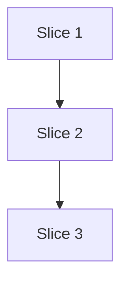

# Plan: `lvpm build` runs the check (S5b)

**Created**: 2026-11-02
**Branch**: claude/dev-team-ship-250da7
**Status**: approved (revision 3)
**Gherkin persistence**: custom: tests/features/build-slices/ (the build steps write `s5b-lvpm-build-check.feature` themselves, as S1 and S5 did)

Spec: [docs/specs/lvpm-build-check-s5b.md](../docs/specs/lvpm-build-check-s5b.md). Issue ThatsTheEnd/lvpm#64, `deviation`.

## Goal

`lvpm build` runs `lvpm check` over the library's members before it writes
anything, and refuses with the VI and link named when a member breaks a rule.
It also warns about `[dependencies]` entries that no member links to.
`--no-check` keeps today's build. Users see the word "check" and "member"
everywhere; "gate" stays internal.

## Approach stances (decision-defaults)

- Scope: the slice as written, plus `--no-check` and the unused-dependency
  warning the user chose. No `lvpm tree`, no lifting of resolution out of
  `ops/check.rs`.
- Replace-vs-merge: `lvpm check` and `ops::check::check` are unchanged. A new
  `ops::check::check_library(env)` shares their loop. `ops::build::build`
  gains a `check: bool` parameter.
- Membership, owners and name matching stay in `check.rs` (its private `key`,
  `members`, `Search::owner`, `same_name`). `build.rs` calls one function and
  never compares names itself.
- A refusal is a result, not an `Err`, as `check`'s findings are: `build`
  returns `Outcome::{Built(Built), Refused(Library)}`; `main.rs` exits 1.

## Acceptance Criteria

- [ ] AC1 Broken member link: exit 1, `<VI>: link not found: <link>`, no `.lvpkg` in `dist/`.
- [ ] AC2 A previous `.lvpkg` is unchanged after a refusal.
- [ ] AC3 A member link into a venv package not in `[dependencies]` refuses, naming VI, link and package.
- [ ] AC4 A broken non-member VI does not stop the build.
- [ ] AC5 An unused `[dependencies]` entry: build succeeds, stderr warns naming it; a used one gives no warning.
- [ ] AC6 No venv: exit 1, nothing written, message names `lvpm sync` and `--no-check`.
- [ ] AC7 `--no-check` builds with a broken member link and with no venv, and says the check was skipped.
- [ ] AC8 Too new, not separated, unreadable, not a resource on a member each refuse, with their own message.
- [ ] AC9 Pilot A builds with the check on; the demo (a deleted subVI) refuses naming the VI. Verified only by `@pilot-source` scenarios (S0 moves to `--no-check`).
- [ ] AC10 `docs/usage.md` documents the check in build and `--no-check`, and that build checks members only.

## Slices

### Slice 1: `check_library`: the members' findings and the unused dependencies

**Depends-on:** none
**Files:** `crates/lvpm-core/src/ops/check.rs`, `crates/lvpm-core/src/errors.rs`, `crates/lvpm-core/src/venv.rs`

`check`'s body becomes `run(env, dir, Scope::All | Scope::Members)`. With
`Members`, the loop skips files that are not library members (by `key`), so
`vis` counts members only and every finding is a member's. For each resolved
`File` link it adds `Search::owner(..)` to a used set. `check_library` returns:

```rust
pub struct Library { pub checked: Checked, pub unused: Vec<String> }
```

`unused` is each `[dependencies]` name no used package matches by `same_name`,
in manifest order. `// shortcut: a package loaded by path at run time has no
link and is reported unused; a manifest opt-out would fix it if users ask.`
`check.rs` tests `venv::binding_path(&dir).is_file()` (made `pub(crate)`) before
calling `venv::binding`; when it is absent it returns `CheckError::NoVenv(PathBuf)` (its text keeps
today's "no venv in <repo> — `lvpm venv create` makes one" for `lvpm check`).
`Checked`'s fields do not change, so `src/render/check.rs` still compiles.

**Behavior:** (unit tests in `check.rs`, hand-bound venv and install records as S5's tests do)

```gherkin
Feature: check_library holds the members to the check

  Scenario: only members are read
    Given a library with member "Good.vi" and a broken non-member "Broken.vi"
    When the library is checked
    Then 1 VI is checked and there are no findings

  Scenario: a member's broken link is a finding
    Given a library whose member "Broken.vi" links to the missing "Sub/Gone.vi"
    When the library is checked
    Then the findings are exactly "Broken.vi" with link not found "Sub/Gone.vi"

  Scenario: a member in a class of the library is a member
    Given class "C/C.lvclass" in the library, holding "C/M.vi" with a broken link
    When the library is checked
    Then there is a finding for "C/M.vi"

  # unit test is #[cfg(windows)]: a case-sensitive filesystem has no such file
  Scenario: a member listed in another case is still a member (Windows)
    Given the library lists "good.vi" and the file on disk is "Good.vi" with a broken link
    When the library is checked
    Then there is a finding for "Good.vi"

  Scenario: a declared dependency a member links into is not unused
    Given [dependencies] names "dep" and a member links into "dep" in the venv
    When the library is checked
    Then unused is empty

  Scenario: a declared dependency no member links into is unused
    Given [dependencies] names "dep" and "spare", and a member links into "dep" only
    When the library is checked
    Then unused is exactly "spare"

  Scenario: a name differing only in case still matches (same_name folds ASCII case, not separators, as check's Undeclared rule does)
    Given [dependencies] names "Dep_Pkg" and a member links into package "dep_pkg"
    When the library is checked
    Then unused is empty

  Scenario: two packages, one undeclared
    Given a member that links into "dep" (declared) and "other" (not declared)
    When the library is checked
    Then there is one Undeclared finding, for "other"

  Scenario: no venv
    Given the project has no venv
    When the library is checked
    Then the error is NoVenv
```

#### Step 1.1: `run` with a scope, and `check_library`

**Complexity**: standard
**IMPLEMENT**: the scoped loop, the used set, `unused`, `Library`, `CheckError::NoVenv`.
**TEST**: the eight unit scenarios; `s5-lvpm-check.feature` still green (no output change).
**REFACTOR**: `link_problems` returns the owners it saw alongside the problems instead of a second out-parameter, if that reads simpler.
**Files**: `crates/lvpm-core/src/ops/check.rs`, `crates/lvpm-core/src/errors.rs`, `crates/lvpm-core/src/venv.rs`
**Commit**: `feat(s5b): check_library checks the members and finds unused dependencies`

### Slice 2: the check in `lvpm build`

**Depends-on:** 1
**Files:** `crates/lvpm-core/src/ops/build.rs`, `src/main.rs`, `src/render/build.rs`, `src/render/check.rs`, `tests/steps/build.rs`, `tests/steps/check.rs`, `tests/steps/pilots.rs`, `tests/steps/publish.rs`, `tests/acceptance.rs`, `tests/features/build-slices/s5b-lvpm-build-check.feature`

Output contract:

| Case | stdout | stderr | exit |
|---|---|---|---|
| refused | `render::check::listing` of the members' findings | `render::check::warnings` (never the unused lines), then `build refused: N problem(s) in library members, nothing written; fix them or pass --no-check` | 1 |
| built | `built <path> (<n> files)` | `render::check::warnings`; one line per unused name: `[dependencies] names <x>, which no member links to (ignore this if it is loaded by path at run time)` | 0 |
| `--no-check` | `built ...` | `check skipped (--no-check)` | 0 |
| no venv | | `no venv in <repo>: run lvpm venv create and lvpm sync, or pass --no-check` | 1 |
| `--json` refused | | | 1, `render::check::result` with `"command": "build"` |

No unused warning prints with a refusal or with `--no-check`.

**Behavior:**

```gherkin
Feature: lvpm build checks the library's members first
  Before writing, `lvpm build` checks the VIs the library lists, as
  `lvpm check` does, and writes nothing when one breaks a rule.

  Background:
    Given a check project with labview ">=2026" and [distribution] naming "Lib.lvlib", holding "Lib.lvlib", "Good.vi" and "Helper.vi"

  Scenario: a clean library builds
    When lvpm build runs on it
    Then it exits 0, dist holds the package, and stderr is empty

  Scenario: a member with a missing subVI refuses the build
    Given "Broken.vi" is a member of "Lib.lvlib" and the folder "Sub" is empty
    And [dependencies] names "spare"
    When lvpm build runs on it
    Then it exits 1
    And stdout has the line "Broken.vi: link not found: Sub/Gone.vi"
    And stderr has the line "build refused: 1 problem(s) in library members, nothing written; fix them or pass --no-check"
    And stderr has no line containing "no member links to"
    And dist holds no .lvpkg

  Scenario: a refused build leaves the previous package
    Given dist holds a built package for this version
    And "Broken.vi" is a member of "Lib.lvlib" and the folder "Sub" is empty
    When lvpm build runs on it
    Then it exits 1 and that package is byte-identical to before

  Scenario: a broken VI outside the library does not stop the build
    Given the project also holds "Broken.vi", not a member
    When lvpm build runs on it
    Then it exits 0 and dist holds the package

  Scenario: a member linking into an undeclared package refuses the build
    Given member "UsesDep.vi" links into package "dep" installed in the venv, and [dependencies] is empty
    When lvpm build runs on it
    Then it exits 1
    And stdout has the line "UsesDep.vi: <vilib>/dep/Dep.vi is in dep, which is not in [dependencies]"
    And dist holds no .lvpkg

  Scenario: a member using a dev-dependency refuses the build
    Given member "UsesDep.vi" links into package "dep" installed in the venv, and "dep" only in [dev-dependencies]
    When lvpm build runs on it
    Then it exits 1
    And stdout has the line "UsesDep.vi: <vilib>/dep/Dep.vi is in dep, which is only in [dev-dependencies]"
    And dist holds no .lvpkg

  Scenario: a declared dependency no member uses is a warning
    Given [dependencies] names "spare" and no member links into it
    When lvpm build runs on it
    Then it exits 0 and dist holds the package
    And stderr has the line "[dependencies] names spare, which no member links to (ignore this if it is loaded by path at run time)"

  Scenario: a declared dependency a member uses gives no warning
    Given member "UsesDep.vi" links into package "dep" installed in the venv, and "dep" in [dependencies]
    When lvpm build runs on it
    Then it exits 0 and stderr has no line containing "no member links to"

  Scenario Outline: every check rule on a member refuses the build
    Given the member "Good.vi" <is broken>
    When lvpm build runs on it
    Then it exits 1, stdout has a line starting "Good.vi: <message>", and dist holds no .lvpkg

    Examples:
      | is broken                                    | message                          |
      | is saved in a LabVIEW newer than the minimum | saved in LabVIEW                                |
      | keeps its compiled code                      | compiled code is not separated from the source  |
      | has its LIvi section size set past the end   | linker table not readable (LIvi at byte         |
      | contains "not a VI"                          | not a LabVIEW resource file                     |

  Scenario: no venv refuses and says how to go on
    Given the project has no venv
    When lvpm build runs on it
    Then it exits 1, stderr names "lvpm sync" and "--no-check", and dist holds no .lvpkg

  Scenario: --no-check builds without a venv and past a broken member
    Given the project has no venv
    And "Broken.vi" is a member of "Lib.lvlib" and the folder "Sub" is empty
    And [dependencies] names "spare"
    When lvpm build --no-check runs on it
    Then it exits 0 and dist holds the package
    And stderr is exactly "check skipped (--no-check)"

  Scenario: --json reports a refusal as check does
    Given "Broken.vi" is a member of "Lib.lvlib" and the folder "Sub" is empty
    When lvpm build runs on it with --json
    Then it exits 1, dist holds no .lvpkg, and the JSON has "command": "build" and one finding for "Broken.vi"
```

The `message` column is the prefix of `render::check::what()`'s text for each
rule. `<vilib>` in the Undeclared lines is literal: check shows a vi.lib link
by its symbolic root, so the fixture installs `dep` at `vi.lib/dep/Dep.vi`.

#### Step 2.1: `build(env, check)` and `Outcome`

**Complexity**: standard
**IMPLEMENT**: with `check`, call `check_library(env)` before reading any member; findings → `Outcome::Refused(library)`; else `Outcome::Built(Built { .., library: Some(library) })` (the whole `Library`, because `render::check::warnings` takes a `&Checked`; `render/build.rs`'s test literal gains `library: None`). `CheckError::NoVenv` → the no-venv message above. `CheckError::Cancelled` stays a cancel. Without `check`, `library: None`.
**TEST**: no new unit test: the venv fixtures are cucumber steps, and AC1/AC2 scenarios assert `dist/` byte-equal. `cargo build` and the S1 suite (on `--no-check`) green.
**REFACTOR**: `build` reads the library members once; the gate needs none of them (check reads them itself).
**Files**: `crates/lvpm-core/src/ops/build.rs`
**Commit**: `feat(s5b): build refuses a library whose members fail the check`

#### Step 2.2: CLI flag, rendering, scenarios

**Complexity**: standard
**IMPLEMENT**: `Cmd::Build { /// Skip the member check; builds without a venv. #[arg(long)] no_check: bool }`. Render per the output contract. The unused-dependency line lives in `render/check.rs` beside the other check wordings; `render/build.rs` holds the footer and the skipped line.
**TEST**: `s5b-lvpm-build-check.feature` (added to `FEATURE_FILES`), steps in `tests/steps/check.rs` reusing its project builders. Regression upkeep: S1, S2 and S0's build steps pass `--no-check` (S1's members are text, not VIs; S0's pilot A sandbox has no venv). A shared `lvpm_build_with(&[args])` helper comes first, so the three call sites change one line each.
**REFACTOR**: the in-process `build` call in `tests/steps/build.rs` uses the same helper's args.
**Files**: `src/main.rs`, `src/render/build.rs`, `src/render/check.rs`, `tests/steps/build.rs`, `tests/steps/check.rs`, `tests/steps/pilots.rs`, `tests/steps/publish.rs`, `tests/acceptance.rs`, `tests/features/build-slices/s5b-lvpm-build-check.feature`
**Commit**: `feat(s5b): lvpm build --no-check and the refusal listing`

### Slice 3: pilot A and docs

**Depends-on:** 2
**Files:** `tests/features/build-slices/s5b-lvpm-build-check.feature`, `tests/steps/check.rs`, `docs/usage.md`, `docs/vision/build-slices.md`, `tests/steps/docs.rs`, `.github/workflow-templates/lvpm-release.yml`

The pilot scenarios use S5's `pilot_project` step, which binds a venv by
hand to an installation folder that does not exist (no `lvpm venv create`,
no LabVIEW). Links into vi.lib are then counted as not checked, as in S5's
"pilot A passes". Like S5's, they run only when `LVPM_TEST_PILOT_A` names
the pinned checkout; without it the harness reports them skipped, not
passed. AC9 is checked in the PR evidence with that variable set.

**Behavior:**

```gherkin
  @pilot-source
  Scenario: pilot A builds with the check on
    Given pilot A's pinned source checkout with labview ">=2016"
    And the bound installation folder does not exist
    When lvpm build runs on it
    Then it exits 0 and dist holds the package

  @pilot-source
  Scenario: the demo: a broken link in pilot A refuses the build
    Given pilot A's pinned source checkout with labview ">=2016"
    And the bound installation folder does not exist
    And "Source/HSE-Logger/LogRecord/Generate Callchain.vi" is deleted from the project
    When lvpm build runs on it
    Then it exits 1 and dist holds no .lvpkg
    And stdout has the line "Source/HSE-Logger/LogRecord/Init.vi: link not found: Source/HSE-Logger/LogRecord/Generate Callchain.vi"

  Scenario: the docs describe the check in build
    Then docs/usage.md contains "checks the library's members first", "needs a venv", "VIs checked" counts members, and "--no-check"
```

#### Step 3.1: pilot scenarios

**Complexity**: trivial
**IMPLEMENT/TEST**: the two `@pilot-source` scenarios, reusing S5's pilot steps with `[distribution]` kept. Time the pilot A build and note it in the PR.
**REFACTOR**: none beyond step reuse.
**Files**: `tests/features/build-slices/s5b-lvpm-build-check.feature`, `tests/steps/check.rs`
**Commit**: `test(s5b): pilot A builds through the check`

#### Step 3.2: docs and release template

**Complexity**: trivial
**IMPLEMENT**: `docs/usage.md` command row and "Building a package" section; `build-slices.md` S5b notes the deviation and what S9/S7a reuse (`check_library`, `Outcome`); release template runs `lvpm build --no-check` and prints `::warning::unchecked build (no LabVIEW on this runner; run lvpm build locally to check)`.
**TEST**: docs scenario in `tests/steps/docs.rs`.
**REFACTOR**: none.
**Files**: `docs/usage.md`, `docs/vision/build-slices.md`, `.github/workflow-templates/lvpm-release.yml`, `tests/steps/docs.rs`
**Commit**: `docs(s5b): lvpm build checks the library first`

## Parallelization



| Wave | Slices (parallel) |
|------|-------------------|
| 1 | 1 |
| 2 | 2 |
| 3 | 3 |

## Pre-PR Quality Gate

- [ ] `cargo test` (workspace) passes
- [ ] `cargo clippy --all-targets -- -D warnings` and `cargo fmt --check`
- [ ] `/code-review` passes
- [ ] Docs updated
- [ ] AC9 evidence in the PR: the `LVPM_TEST_PILOT_A=... cargo test` command and its output, both pilot scenarios passed (not skipped)

## Risks & Open Questions

- **Release template: decided (a)** by the user on 2026-11-02: `lvpm build --no-check` plus a `::warning::unchecked build` annotation. Context: `.github/workflow-templates/lvpm-release.yml` runs `lvpm build` on `ubuntu-latest`. No LabVIEW there, so no venv can be created. Options:
  - (a) the template runs `lvpm build --no-check` and prints a visible `::warning::unchecked build` annotation; the check runs locally.
  - (b) without a venv, build still checks links between the package's own files and counts vi.lib and package links as not checked. Changes the "require a venv" answer for that case.
  - The template pins `LVPM_VERSION`, so nothing breaks until a user raises it.
- The check skips what `walk` skips (dot-names, symlinked files); a member under a dot-folder is packaged but not checked. Known limit, stated in docs.
- A package loaded by path at run time is always reported unused (`shortcut:` comment in code).

## Build Progress

### Slices (grouped by wave)

#### Wave 1
- [x] Slice 1: `check_library`: the members' findings and the unused dependencies
  - [x] Step 1.1: `run` with a scope, and `check_library`

#### Wave 2
- [x] Slice 2: the check in `lvpm build`
  - [x] Step 2.1: `build(env, check)` and `Outcome`
  - [x] Step 2.2: CLI flag, rendering, scenarios

#### Wave 3
- [ ] Slice 3: pilot A and docs
  - [ ] Step 3.1: pilot scenarios
  - [ ] Step 3.2: docs and release template

## Plan Review Summary

Plan tier: standard. Reviewers: Acceptance, Design, UX, Parallelization (Strategic skipped, standard tier).

| Reviewer | Round 1 | Round 2 |
|---|---|---|
| Parallelization | approve | n/a |
| UX | approve, 5 warnings (all folded in) | n/a |
| Acceptance | needs-revision: AC9 could pass unrun, pilot venv undefined | approve; refusal-plus-unused, demo dist and member-case scenarios added |
| Design | needs-revision: membership split across modules, Slice 1 compile break | approve; NoVenv detection, Library on Built, wording in render/check.rs folded in |

Remaining observations, accepted as is:
- AC9 runs only with `LVPM_TEST_PILOT_A`; the PR carries the command and its output.
- The class-member case is unit-level only; the dot-folder limit is documented, not tested.
- No scenario for `--no-check` replacing an existing package; S1's "rebuilding replaces the package" covers it on `--no-check`.
- The `message` column and `<vilib>` link text are pinned to `render::check`'s exact strings in step 2.2.
