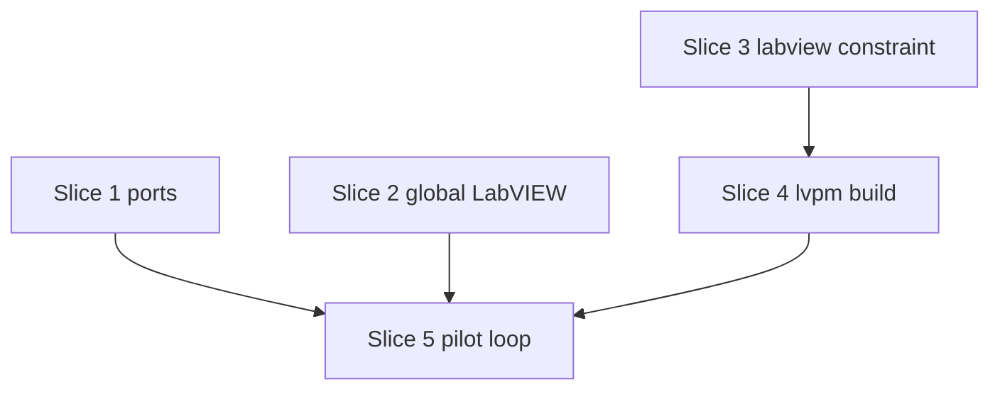

# Plan: S1 — `lvpm build` writes a `.vip` (plus the two harness fixes it needs)

**Created**: 2026-10-26
**Branch**: claude/s0-pilot-acceptance (S1 branches off it as `claude/s1-lvpm-build`)
**Status**: approved
**Gherkin persistence**: custom: tests/features/build-slices/
**Spec**: [docs/specs/lvpm-build-s1.md](../docs/specs/lvpm-build-s1.md)

## Goal

`lvpm build` turns a library's `.lvlib` membership into a `.vip` that `lvpm
install` installs from a folder feed, so the Friday demo can show the pilot
loop on pilot A: build, install into project B's venv, mass compile. Two
harness fixes come first, because the `@labview` scenarios cannot run on this
machine without them: Windows reserved most of the venv VI Server port range
at the 10-25 boot, and two worktrees share one global LabVIEW.

## Acceptance Criteria

- [ ] AC1–AC10 of the spec, mapped below.
- [ ] H1 (harness): a venv never gets a VI Server port Windows has reserved; a
      venv whose stored port became reserved after a reboot moves to a free one
      the next time lvpm starts or contacts its LabVIEW. A free hashed port is
      used as is.
- [ ] H2 (harness): the global-LabVIEW scenario runs only when this run holds
      the machine-wide claim and nothing else answers on the global LabVIEW
      port; the run then starts that LabVIEW itself and ends it afterwards,
      also when a scenario fails or panics. Headless CI is unchanged.

### AC → scenario → step

| AC | Scenarios | Step |
|---|---|---|
| AC1 writes the package | S4 "the package is written", "rebuilding replaces the package", "build needs no LabVIEW" | 4.3 |
| AC2 deterministic | S4 "building twice gives the same bytes" | 4.3 |
| AC3 round trip | S4 "the built spec parses back", "version is written as four parts", "dependencies become Requires" | 4.2, 4.3 |
| AC4 membership | S4 "a stray file is left out", "members of a nested class are in", "an auto-populating folder contributes its files"; S5 "pilot A's package holds exactly its published vi.lib files" | 4.1, 5.1 |
| AC5 install path | S4 "default install path", "install-dir places the members" | 4.3 |
| AC6 key errors | S4 outline "a manifest problem fails naming the key", "a failed build leaves the previous package" | 4.2, 4.3 |
| AC7 member errors | S4 outline "a member problem fails naming the member" | 4.1, 4.3 |
| AC8 labview constraint | S3 all scenarios; the existing suite passing with `>=` manifests | 3.1 |
| AC9 installs | S5 the completed `@pending-s1` loop scenario (`@labview`) | 5.2 |
| AC10 documented | S5 "the docs name lvpm build" (a check over docs/usage.md and README.md) | 5.2 |

## Approach stances (decision-defaults)

- Scope: S1 as the spec bounds it. The two harness fixes ride along because
  they block S1's own `@labview` scenario, not as new features.
- Format fidelity: the `.vip` follows the published pilot archives' `spec`
  shape, nothing VIPM-only beyond that (S1b probes VIPM).
- Replace-vs-merge: `dist/<name>-<version>.vip` is replaced; nothing else in
  `dist/` is touched.
- Integration: PR against `main`, stacked on the open S0 PR #49; no
  auto-merge (the user merges).

## Slices

### Slice 1: venv ports Windows has reserved are never used

**Depends-on:** none
**Files:** `crates/lvpm-core/src/venv.rs`, `crates/lvpm-core/src/events.rs`, `crates/lvpm-core/src/ops/launch.rs`, `crates/lvpm-core/src/ops/install.rs`, `crates/lvpm-core/src/ops/relink.rs`, `src/render/*` (one event line), `tests/support/venv.rs`, `tests/support/sandbox.rs`

These scenarios are unit-test specifications: port availability comes from an
injected probe (`&dyn Fn(u16) -> bool`), so they never depend on the
machine's real reservations.

```gherkin
Feature: a venv's VI Server port can be bound

  Scenario: a free hashed port is used as is
    Given the venv's hashed port can be bound
    When a venv is created
    Then its port is the hashed port

  Scenario: the hashed port is reserved, so the next free one is used
    Given the hashed port and the 5 after it cannot be bound
    When a venv is created
    Then its port is the 6th port after the hashed port

  Scenario: the search wraps to the start of the range
    Given the hashed port is the last port of the range and cannot be bound
    When a venv is created
    Then its port is the first port of the range

  Scenario: no port in the range can be bound
    Given no port in 3400–3999 can be bound
    When a venv is created
    Then its port is one the operating system assigned

  Scenario: a stored port that became reserved moves before LabVIEW starts
    Given a venv whose stored port can no longer be bound and has no listener
    When lvpm launches, installs into or relinks the venv
    Then the venv gets a port that can be bound, its binding file says so, and lvpm reports the move

  Scenario: a stored port a LabVIEW listens on is kept
    Given a venv whose stored port has a listener
    When lvpm launches the venv
    Then its port is unchanged

  Scenario: reading a venv never changes it
    Given a venv whose stored port can no longer be bound
    When lvpm status or lvpm env runs
    Then the binding file is unchanged
```

#### Step 1.1: pick the port at create, repair it before LabVIEW

**Complexity**: standard
**IMPLEMENT**: `pick_port(start, bindable)` walks the 600-port range from
`port_for`'s hash, wrapping, then falls back to an OS-assigned port.
Production `bindable` binds both `0.0.0.0` and `127.0.0.1`. `create` uses it.
`load` stays read-only. A new `venv::ensure_port(&mut Venv, sink)` re-picks when
the stored port neither binds nor has a listener, rewrites the binding and
emits `VenvPortMoved { from, to }`. It is called only on the paths that start
or contact LabVIEW: launch, install and relink.
**TEST**: unit tests for each scenario with a fake probe; `ensure_port` test
asserts the rewritten binding and the event; an acceptance check that
`status` leaves `venv.json` byte-identical.
**REFACTOR**: keep `port_for` as the start point only.
**Files**: `venv.rs`, `events.rs`, the three ops, render
**Commit**: `fix(venv): never bind a venv to a port Windows has reserved`

#### Step 1.2: the harness predicts the same port

**Complexity**: trivial
**IMPLEMENT**: the harness mirrors only the hash start (`predicted_port`
unchanged). The sandbox picks a path whose start port can be bound, so
`pick_port` returns the start and `learn_venv_port`'s equality still holds.
**TEST**: `a_sandbox_is_made_at_a_path_whose_venv_port_is_free` extended with
a port that cannot be bound.
**Files**: `tests/support/venv.rs`, `tests/support/sandbox.rs`
**Commit**: `test: sandboxes avoid venv ports that cannot be bound`

### Slice 2: one global LabVIEW, claimed per run

**Depends-on:** none
**Files:** `tests/support/global.rs`, `tests/support/sandbox.rs`, `tests/support/selection.rs`, `tests/acceptance.rs`, `tests/features/lvpm-lockfile/slice-1-characterization-harness-and-recorded-cli-output.feature`

Unit-test specifications: the port probe, the process table and the claim
file location are injected.

```gherkin
Feature: the global LabVIEW is used by one test run at a time

  Scenario: another run holds the claim
    Given the claim names a live process other than this run
    When the global-LabVIEW scenarios are selected
    Then they are skipped, and the run says another run holds the global LabVIEW

  Scenario: something already answers on the global LabVIEW port
    Given no run holds the claim and something answers on the global LabVIEW port
    When the global-LabVIEW scenarios are selected outside headless CI
    Then they are skipped, and the run says the global LabVIEW is in use

  Scenario: a claim left by a process that has ended is taken over
    Given the claim names a process that is not running, or one whose start time differs
    When the global-LabVIEW scenarios are selected
    Then this run holds the claim

  Scenario: headless CI neither claims nor starts
    Given LVPM_TEST_LABVIEW_HEADLESS=1 and the CI script's LabVIEW answering
    When the global-LabVIEW scenarios are selected
    Then they run against that LabVIEW, no claim is taken and nothing is started

  Scenario: this run starts the global LabVIEW and ends it
    Given this run holds the claim and nothing answers on the global LabVIEW port
    When a global-LabVIEW scenario runs and then fails
    Then the harness had started LabVIEW, and after the run no process with that PID is running and the claim file is gone
```

#### Step 2.1: the claim

**Complexity**: standard
**IMPLEMENT**: in `tests/support/global.rs` (beside the existing global
fixture): `claim()` creates `%TEMP%/lvpm-tests-global-labview.lock` with
`create_new`, holding PID and process start time; a claim whose PID is not
running, or runs with another start time, is taken over. Selection gains a
skip reason for scenarios tagged `@global-labview`, decided once per run.
**TEST**: unit tests for held / stale / reused-PID / free claim and the
selection results, including headless.
**Files**: `tests/support/global.rs`, `tests/support/selection.rs`, `tests/acceptance.rs`, slice-1 feature (tag)
**Commit**: `test: claim the global LabVIEW per test run`

#### Step 2.2: start and end our own global LabVIEW

**Complexity**: standard
**IMPLEMENT**: `require_clean_labview_installation` starts LabVIEW.exe when
this run holds the claim and nothing answers (headless: requires it to answer,
as now). The child and the claim live in a Drop guard owned by `run_features`,
so a panic or failure still kills the child and removes the claim.
**TEST**: unit test of the guard with a stand-in child process (asserts the
PID is gone and the claim file absent after drop, also after a panic); then
the slice-1 global scenario with `LVPM_TEST_LABVIEW=1`.
**Files**: `tests/support/sandbox.rs`, `tests/support/global.rs`, `tests/acceptance.rs`
**Commit**: `test: start and end the global LabVIEW the run claimed`

### Slice 3: `labview` is a `>=` constraint

**Depends-on:** none
**Files:** `crates/lvpm-core/src/project.rs`, `crates/lvpm-core/src/venv.rs`, `src/render/lock.rs`, `src/render/install.rs`, `tests/golden/venv-install-*/stderr.txt`, `tests/features/lvpm-lockfile/slice-8*.feature`, `slice-10*.feature`, `tests/support/project.rs`, `tests/steps/staleness.rs`, `tests/support/sandbox.rs`, unit-test manifests in `crates/lvpm-core/src/{venv,env,lockfile}.rs` and `ops/{add_remove,lock,route,sync}.rs`, `docs/usage.md`

```gherkin
Feature: labview is a minimum constraint

  Scenario: a >= constraint locks and installs for its lower bound
    Given a manifest with labview = ">=2024"
    When lvpm lock and lvpm venv create run
    Then the lock is for LabVIEW 2024 and the venv binds LabVIEW 2024

  Scenario: a plain year is refused with the fix
    Given a manifest with labview = "2024"
    When lvpm lock runs
    Then it fails naming project.labview and suggesting ">=2024"

  Scenario Outline: other forms are refused
    Given a manifest with labview = "<value>"
    When lvpm lock runs
    Then it fails naming project.labview

    Examples:
      | value     |
      | >2024     |
      | ^2024     |
      | <=2024    |
      | >=24      |
      | >=2024.1  |
      | >=        |
      |           |

  Scenario: venv create writes the constraint form
    Given a folder without lvpm.toml
    When lvpm venv create runs
    Then lvpm.toml holds labview = ">=<year>"
```

`">= 2024"` (with a space) is accepted: `Constraint::parse` already trims.

#### Step 3.1: parse, write and report the constraint form

**Complexity**: standard
**IMPLEMENT**: `project::parse` reads `labview` as `">=YYYY"` and stores the
lower bound in `Project.labview`, so lock, staleness, env and venv code are
unchanged; any other form fails naming `project.labview`, and a plain year
suggests `">=YYYY"`. `venv::create` writes `">=YYYY"`. The lock and install
texts change from `labview = "<year>"` to `labview = ">=<year>"`.
**TEST**: unit tests for each scenario in `project.rs`; the changed texts are
asserted by the existing render test (`src/render/lock.rs`) and the
`venv-install-*` goldens, re-recorded; every test manifest moves to `">="`, and
the whole suite passing is AC8's "accepted everywhere".
**Files**: as the slice
**Commit**: `feat(manifest)!: labview is a ">=" constraint (ADR 1)`

### Slice 4: `lvpm build`

**Depends-on:** 3
**Files:** `crates/lvpm-core/src/project.rs`, `crates/lvpm-core/src/lvlib.rs`, `crates/lvpm-core/src/spec.rs`, `crates/lvpm-core/src/distribution.rs`, `crates/lvpm-core/src/ops/build.rs`, `crates/lvpm-core/src/ops/mod.rs`, `crates/lvpm-core/src/events.rs`, `crates/lvpm-core/src/lib.rs`, `src/main.rs`, `src/render/build.rs`, `src/render/mod.rs`, `tests/features/build-slices/s1-lvpm-build.feature`, `tests/steps/build.rs`, `tests/steps/mod.rs`, `tests/acceptance.rs`

```gherkin
Feature: lvpm build writes a .vip of a library's members

  Background:
    Given a project "demo_lib" version "1.2.3" with labview ">=2016"
    And [distribution] top-level-library "Lib.lvlib", vendor "Vendor", display-name "Demo Lib"
    And library "Lib.lvlib" holding "A.vi" and class "C/C.lvclass", which holds "C/M.vi"
    And "Stray.vi" next to the library, not a member

  Scenario: the package is written
    When lvpm build runs
    Then it succeeds and dist holds "demo_lib-1.2.3.0.vip"

  Scenario: build needs no LabVIEW
    Given no LabVIEW installation is visible to lvpm
    When lvpm build runs
    Then it succeeds

  Scenario: the built spec parses back
    When lvpm build runs
    Then the package's spec reads as demo_lib 1.2.3.0 for LabVIEW>=16.0, with one file group targeting "<application>"

  Scenario: default install path
    When lvpm build runs
    Then the file group holds Lib.lvlib, A.vi, C/C.lvclass and C/M.vi under "vi.lib/Vendor/Demo Lib"

  Scenario: a stray file is left out
    When lvpm build runs
    Then the package holds no "Stray.vi"

  Scenario: members of a nested class are in
    When lvpm build runs
    Then the file group holds "C/C.lvclass" and "C/M.vi"

  Scenario: an auto-populating folder contributes its files
    Given the library has an auto-populating folder "Data" holding "d.txt" on disk
    When lvpm build runs
    Then the file group holds "Data/d.txt"

  Scenario: install-dir places the members
    Given [distribution.vip] install-dir = "vi.lib/Other/Place"
    When lvpm build runs
    Then the file group holds the members under "vi.lib/Other/Place"

  Scenario: building twice gives the same bytes
    When lvpm build runs, every member's modification time is set to a different value, dist is emptied, and lvpm build runs again
    Then both packages are byte-identical

  Scenario: rebuilding replaces the package
    Given dist holds an older "demo_lib-1.2.3.0.vip" and "notes.txt"
    When lvpm build runs
    Then "demo_lib-1.2.3.0.vip" holds the current members and "notes.txt" is unchanged

  Scenario Outline: version is written as four parts
    Given the project version "<in>"
    When lvpm build runs
    Then dist holds "demo_lib-<out>.vip" and its spec Version is "<out>"

    Examples:
      | in      | out     |
      | 2.1.0   | 2.1.0.0 |
      | 2.1.0.5 | 2.1.0.5 |

  Scenario: dependencies become Requires
    Given dependencies a = "1.0", b = ">=2.0", c = "*" and "@hexagon/lib-a" = "3.0"
    And dependency-names maps "@hexagon/lib-a" to "hexagon_lib_a"
    When lvpm build runs
    Then the spec's Requires is "a>=1.0,b>=2.0,c,hexagon_lib_a>=3.0"

  Scenario Outline: a manifest problem fails naming the key and writes nothing
    Given the manifest <change>
    When lvpm build runs
    Then it fails, the message names the key "<key>" exactly, and dist holds no .vip

    Examples:
      | change                                                 | key                               |
      | has no [distribution] table                            | distribution                      |
      | has no top-level-library                               | distribution.top-level-library    |
      | names top-level-library "Missing.lvlib"                | distribution.top-level-library    |
      | names top-level-library "../Out.lvlib"                 | distribution.top-level-library    |
      | names top-level-library "C:/Abs.lvlib"                 | distribution.top-level-library    |
      | has no vendor                                          | distribution.vip.vendor           |
      | has no display-name                                    | distribution.vip.display-name     |
      | sets kinds = ["ppl"]                                   | distribution.kinds                |
      | sets kinds = ["source", "ppl"]                         | distribution.kinds                |
      | sets formats = ["lvpkg"]                               | distribution.formats              |
      | sets [distribution] colour = "red"                     | distribution.colour               |
      | sets [distribution.vip] icon                           | distribution.vip.icon             |
      | sets version = "1.2"                                   | project.version                   |
      | sets version = "1.2.3.4.5"                             | project.version                   |
      | sets version = "1.a.3"                                 | project.version                   |
      | names the project "@scope/lib" with no vip name        | distribution.vip.name             |
      | depends on "@scope/dep" with no dependency-names entry | distribution.vip.dependency-names |

  Scenario Outline: a member problem fails naming the member and writes nothing
    Given <problem>
    When lvpm build runs
    Then it fails naming "<name>" and dist holds no .vip

    Examples:
      | problem                                                  | name          |
      | the library lists "Gone.vi", which is not on disk        | Gone.vi       |
      | class "C/C.lvclass" lists "C/Lost.vi", not on disk       | Lost.vi       |
      | the library lists "../Outside.vi"                        | Outside.vi    |
      | "Lib.lvlib" is not a readable library                    | Lib.lvlib     |

  Scenario: a failed build leaves the previous package
    Given dist holds a built "demo_lib-1.2.3.0.vip"
    And the manifest has no vendor
    When lvpm build runs
    Then it fails and that package is unchanged
```

#### Step 4.1: membership reader

**Complexity**: standard
**IMPLEMENT**: `lvlib::members(path)` reads `<Item … URL="…">` of a
`.lvlib`/`.lvclass` (URLs resolve against the file itself, `../X` being a
sibling), recurses into nested `.lvlib`/`.lvclass`, skips `Class Private
Data`, expands auto-populating folders and decodes XML entities. No new
dependency: an attribute scanner over `<Item` tags. Attributes may come in
any order; an unterminated `<Item` is an error, never a skip.
**TEST**: unit tests on small XML texts (attribute order, `/>` vs `>`,
entities, unterminated tag, nested class, auto-populating folder), and on
pilot A's real `.lvlib` against the published group 0 (Step 5.1).
**REFACTOR**: `shortcut:` comment on the scanner's limits.
**Files**: `crates/lvpm-core/src/lvlib.rs`, `crates/lvpm-core/src/lib.rs`
**Commit**: `feat(core): read a library's members from its .lvlib`

#### Step 4.2: `[distribution]` and the spec writer

**Complexity**: standard
**IMPLEMENT**: one manifest parse: `project::parse` keeps the raw
`[distribution]` table (`Project.distribution: Option<toml::Table>`), and
`distribution::validate(&Project) -> Result<Distribution, BuildError>` is the
only place that checks the S1 keys (errors name the full key). `spec::write`
renders the `spec` text.
**TEST**: unit tests per key error; `spec::parse(spec::write(d))` round trip.
**Files**: `project.rs`, `distribution.rs`, `spec.rs`
**Commit**: `feat(core): read [distribution] and write a vip spec`

#### Step 4.3: the build operation and the command

**Complexity**: standard
**IMPLEMENT**: `ops::build` validates, collects, then zips deterministically
(sorted, fixed 1980 time, fixed level, no extra fields) to a temp file in
`dist/` and renames it over the target only when everything succeeded;
event `BuildWrote`; `lvpm build` in `main.rs` and its render.
**TEST**: `s1-lvpm-build.feature`; its "spec parses back" step opens the
built `.vip`, runs `spec::parse` and also checks entry order, timestamps and
compression method.
**Files**: as the slice
**Commit**: `feat: lvpm build writes a .vip of a library's members`

### Slice 5: pilot A builds, installs and mass compiles

**Depends-on:** 1, 2, 4
**Files:** `tests/fixtures/pilots/hse-logger-f7cc16a.zip`, `tests/fixtures/pilots/SHA256SUMS`, `tests/features/build-slices/README.md`, `tests/support/pilots.rs`, `tests/steps/pilots.rs`, `tests/features/build-slices/s0-pilot-loop.feature`, `docs/usage.md`, `README.md`

```gherkin
  Scenario: pilot A's package holds exactly its published vi.lib files
    Given pilot A's repository at its pinned commit
    When lvpm build runs in pilot A
    Then the package's files are exactly the vi.lib files of File Group 0 of hse_lib_hse_logger-2.2.2.114.vip, read from that archive

  @labview @interactive-labview
  Scenario: lvpm build turns pilot A's library into a .vip project B installs and mass compiles
    Given a LabVIEW 2026 installation without the pilots
    And pilot A built with lvpm build
    And project B depending on both pilots, with a folder feed of the built pilot A and the other pilot archives
    And a venv for project B
    When project B is installed
    Then the venv holds both pilots and the packages OpenSerializer needs
    And mass compiling the venv's packages in a LabVIEW on the venv succeeds

  Scenario: the docs name lvpm build
    Then docs/usage.md has a command-table line for lvpm build and documents the [distribution] keys
    And README.md ticks the S1 milestone
```

"Mass compile succeeds" keeps S0's definition: LabVIEWCLI exits 0, writes a
non-empty log, and the log has no bad-VI line.

#### Step 5.1: the pilot A snapshot and the exact-membership scenario

**Complexity**: standard
**IMPLEMENT**: commit `git archive` of `Source`, `Tests`, `LICENSE`,
`README.md` at f7cc16a (1.1 MB; `Packages/` left out: old archives), add it to
`SHA256SUMS`; the step unpacks it and writes pilot A's `lvpm.toml`. The
expected list is read from the published archive's `spec`, not hard-coded.
**TEST**: the scenario; the checksum scenarios still pass with a non-`.vip`
entry, and the pilot-archive helpers ignore the snapshot zip.
**Files**: fixture, `tests/support/pilots.rs`, `tests/steps/pilots.rs`, feature
**Commit**: `test: pilot A's source snapshot and its membership scenario`

#### Step 5.2: complete the pending loop, and docs

**Complexity**: standard
**IMPLEMENT**: the existing `@labview @pending-s1` scenario
(`s0-pilot-loop.feature:25`) is completed as above, `@pending-s1` removed and
`@interactive-labview` added; usage.md command table and `[distribution]`
keys; README S1 milestone; the docs check.
**TEST**: the docs scenario; `LVPM_TEST_LABVIEW=1` run of the build-slices
feature when the claim and the pilot rule allow it.
**Files**: as the slice
**Commit**: `test: the pilot loop installs the pilot A lvpm built; docs for lvpm build`

## Parallelization



| Wave | Slices |
|------|--------|
| 1 | 1, 2, 3 |
| 2 | 4 |
| 3 | 5 |

Built in one session, in order 3, 1, 2, 4, 5 (slices 1–3 share
`tests/support/sandbox.rs`, so no parallel worktrees).

## Pre-PR gate

`cargo fmt --check`, `cargo clippy --all-targets -- -D warnings`, `cargo test`
(unit + acceptance), `LVPM_TEST_LABVIEW=1 cargo test --test acceptance` where
the claim allows, `/code-review --since origin/main`.

## Skipped (low value)

None.

## Risks & Open Questions

- AC9 needs LabVIEW 2026 without HSE Logger installed globally; on 2026-10-26
  it was installed, which fails the scenario by design. AC9 is not claimed
  covered until that scenario has run green.
- VIPM may refuse the `.vip` (no `ID`, no `license`): S1b's question.
- Kept from the design review as a decision, not changed: `Project.labview`
  stays a string holding the lower bound (smallest change, callers untouched),
  though it no longer matches the file text. Parsing it to `u32` is a later
  cleanup.
- Slice 1 changes which commands write `venv.json`: only launch, install and
  relink, each reporting the move.

## Build Progress

- [ ] Wave 1
  - [ ] Slice 1: venv ports
    - [ ] 1.1 pick the port at create, repair it before LabVIEW
    - [ ] 1.2 the harness predicts the same port
  - [ ] Slice 2: global LabVIEW
    - [ ] 2.1 the claim
    - [ ] 2.2 start and end our own global LabVIEW
  - [ ] Slice 3: labview constraint
    - [ ] 3.1 parse, write and report the constraint form
- [ ] Wave 2
  - [ ] Slice 4: lvpm build
    - [ ] 4.1 membership reader
    - [ ] 4.2 `[distribution]` and the spec writer
    - [ ] 4.3 the build operation and the command
- [ ] Wave 3
  - [ ] Slice 5: pilot loop
    - [ ] 5.1 snapshot and exact-membership scenario
    - [ ] 5.2 complete the pending loop, and docs

## Plan Review Summary

Plan tier: complex (5 slices, 3 waves) — reviewers run: Acceptance, Design.
Strategic, UX and Parallelization not run: build order is sequential and the
user reviews the plan in person.

Both returned `needs-revision`; this revision addresses every blocker:

- Acceptance: added the AC → scenario → step table; added scenarios for the
  nested class, replace, failed-build-keeps-old, version padding, scoped
  dependency names, auto-populating folder, malformed library, no-LabVIEW,
  exact pilot A membership and the docs; outline rows for unknown keys and
  version boundaries; exact key matching; rejected `labview` forms; Slice 1–2
  scenarios marked as unit specs with injected probes.
- Design: one manifest parse (`Project.distribution` + `distribution::validate`);
  port repair moved out of `venv::load` into `ensure_port` on launch, install
  and relink, with a `VenvPortMoved` event and a wildcard-plus-loopback probe;
  the claim lives in `tests/support/global.rs`, stores PID plus start time and
  is Drop-guarded; the scanner errors on an unterminated `<Item`.
- Not taken: parsing `labview` to `u32` (see Risks).

## Approval

Approved by the user in chat on 2026-10-26 ("I approve, build it").
