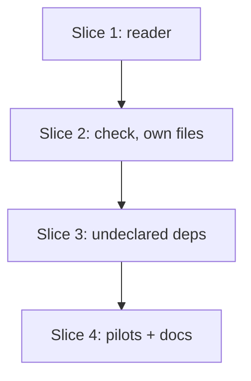

# Plan: S5 — `lvpm check` finds broken and undeclared links without LabVIEW

**Created**: 2026-11-02
**Branch**: claude/uv-cargo-comparison-5d6d6d (PR branch `issue-63` or this one)
**Status**: implemented 2026-11-02
**Gherkin persistence**: custom: tests/features/build-slices/ (the build steps write `s5-lvpm-check.feature` themselves, as S1, S7a and S10a did)
**Spec**: [docs/specs/lvpm-check-s5.md](../docs/specs/lvpm-check-s5.md) · **Issue**: [#63](https://github.com/ThatsTheEnd/lvpm/issues/63)

## Goal

`lvpm check [DIR]` reads every VI's save version, compiled-code flag and
linker table, and names each VI and link that breaks a rule: too new for
`[project] labview`, compiled code not separated, a link to a file that is
not there, or a link into a package the manifest does not declare directly.
It never starts or looks for LabVIEW. The reader lives in a new `linker.rs`;
the `PTH0` codec in `viserver.rs` and the `vers` reader in `ops/resave.rs`
move into it.

Slices 1 and 2 are the minimum useful command (broken links, save version,
compiled code). Slice 3 adds undeclared dependencies. All ship in one PR.

## Approach stances (decision-defaults)

| Axis | Stance |
|---|---|
| Replace vs. merge | Merge: the `PTH0` codec and `resave::read_major` move into `linker.rs`; `viserver.rs` and `resave.rs` call them with the same behaviour. |
| Format fidelity | The reader is lossless for what it reads and refuses the rest: an undecodable block is a finding, never a guess. |
| Migrate vs. edit stub | Not applicable (no data migration). |
| Integration | Open a PR with auto-merge on green checks (default). The pilot run's output goes into the PR body before auto-merge is armed, since CI does not run `@pilot-source`. |
| Scope | Spec scope only. Old OpenG `PTH0` flavour, `lvpm tree` and the S5b build gate are out. |

## Acceptance Criteria

From the spec, numbered as there:

- [ ] 1. A link to a missing file fails, naming the VI and the link.
- [ ] 2. A library VI linking into an installed package missing from `[dependencies]` fails, naming the VI, link and package; it passes once declared.
- [ ] 3. A link into a package that is only transitive fails the same way.
- [ ] 4. A library member linking into a dev/group-only package fails; a non-member VI linking into it passes.
- [ ] 5. A 2026-saved VI fails under `">=2025"` naming both versions; it passes under `">=2026"`.
- [ ] 6. A VI without separated compiled code fails, naming the VI.
- [ ] 7. A link through an `.llb` resolves only when the `.llb` lists that member.
- [ ] 8. One finding per broken rule per VI and link; all are listed; exit non-zero when there are findings, 0 when there are none.
- [ ] 9. An undecodable linker block is reported as "not readable", never as a pass.
- [ ] 10. No LabVIEW is started; with the bound installation absent, its `vi.lib` links count as "not checked" and do not fail.
- [ ] 11. Pilot A passes; pilot B passes only with its dependency in `[dependencies]`.
- [ ] 12. Without a venv, check says how to make one and exits non-zero (see Deviation 1).
- [ ] 13. `viserver.rs` uses the `PTH0` codec from `linker.rs`; its `PTH0` tests pass unchanged.
- [ ] 14. docs/usage.md lists `lvpm check`; PROVENANCE.md records where the linker format came from.

### Deviations from the spec (for the PR body)

1. **AC 12 wording.** The spec says "run `lvpm sync`". A project with a
   manifest and no venv already has one message in lvpm
   (`venv::locate`: "`lvpm venv create` makes one"), and `sync` does not
   create a venv. Check reuses that message, so one state has one hint.
2. **AC 10, "not checked: N".** The count appears in the summary line pinned
   below (`links not checked: N`) and in a stderr warning that names why.

## Output contract

Pinned here once; every scenario quotes these strings.

**stdout**, one line per finding, sorted by VI path, then rule (in the order
below), then link. Paths are relative to the project root, with `/`.

| Rule | Line |
|---|---|
| not a resource file | `x.vi: not a LabVIEW resource file` |
| unreadable | `Good.vi: linker table not readable (LIvi at byte 1234): format not supported yet` |
| too new | `Good.vi: saved in LabVIEW 2026, newer than the minimum 2025` |
| not separated | `NotSeparated.vi: compiled code is not separated from the source` |
| not found | `Broken.vi: link not found: Gone.vi` |
| undeclared | `UsesDep.vi: <vilib>/Check Fixture/Dep.vi is in check_fixture_dep, which is not in [dependencies]` |
| only in another table | `UsesDevOnly.vi: <vilib>/Check Fixture Dev/DevDep.vi is in check_fixture_other, which is only in [dev-dependencies]` (or `only in [dependency-groups] ci`) |

A link is shown as stored for symbolic roots (`<vilib>/…`), and otherwise as the resolved path relative to the project root (`Old/Sub/Gone.vi`).

Then one `next:` line per rule that occurred, in the same order:

| Rule | `next:` |
|---|---|
| not a resource file | `next: restore the file (is it a git-LFS pointer or a cut-short copy?) or delete it` |
| unreadable | `next: report it at https://github.com/ThatsTheEnd/lvpm/issues with the VI attached` |
| too new | `next: save the VI for LabVIEW <minimum>, or raise labview in lvpm.toml` |
| not separated | `next: turn on "Separate compiled code from source file" in the VI's properties` |
| not found | `next: restore the file, or open the VI in LabVIEW and relink it` |
| undeclared / only in | `next: add <pkg> to [dependencies] in lvpm.toml` (one line per package) |

Then the summary, always: `VIs checked: N, problems: M, links not checked: K`.

**stderr**, warnings, each naming its cause:

- `warning: links not checked: K into vi.lib (the bound installation <path> is not on this machine)` — one line per cause; other symbolic roots read `warning: links not checked: K into <resource> (lvpm does not resolve this root)`
- `warning: links not checked: K absolute paths not on this machine (saved elsewhere; LabVIEW searches for them when it loads)` — an absolute link to a file that is not here; one that is here is checked
- `warning: lvpm.toml has no labview, so save versions were not checked`
- `warning: no VIs under <DIR>`

**Exit**: 1 when there is at least one finding, else 0. Findings are a
normal result (`Report` with a failed flag), not an `Err`: the listing stays on
stdout and `--json` gets the structure.

**`--json`**, the same shape on pass and fail:
`{"ok": bool, "vis": N, "not_checked": K, "findings": [{"vi", "kind", "link", "package", "table", "saved", "minimum", "block", "offset"}]}`
(fields that do not apply are `null`; `kind` is `not_resource | unreadable | too_new | not_separated | not_found | undeclared`).

**Errors** (`Err`, the existing `Error: …` path, exit 1): no venv (Deviation 1);
DIR does not exist (`folder <DIR> does not exist`); no `lvpm.toml`; the
`top-level-library` cannot be read (`<lib>: …`, from `lvlib::members`).
Core errors name no lvpm command (errors.rs convention); `render/check.rs`
words the hints, as `render::lock::error` does.

## Resolution rules (decisions the spec left to the plan)

- **Existence** is whatever the filesystem says (`Path::is_file`, or `.llb`
  membership). So matching is case-insensitive on Windows and case-sensitive
  on Linux, as LabVIEW itself is. No scenario depends on case.
- **Relative** links resolve from the VI file's folder; a `..` component moves up.
- **`<vilib>`, `<userlib>`, `<instrlib>`** resolve against the bound
  installation's folder first, then each venv package's `<pkg>/1/` tree. The
  mapping from linker root to folder (`vi.lib`, `user.lib`, `instr.lib`) is one
  `Root` table in `linker.rs`. When the bound installation folder does not
  exist, a link that no package holds is counted as not checked.
- **Other symbolic roots** (`<resource>`, …) are counted as not checked.
- **Absolute** links (`C:/x.vi`) are checked for existence like any other when the file is there; one whose file is not on this machine is not checked (counted, one warning, no failure).
- **Inside a file.** A link whose nearest existing ancestor is a regular file is found inside it (`Logger.lvclass/Logger.ctl`, `X.vi/LabVIEW`); an `.llb` must list the member, and a folder ancestor with a missing leaf still fails. The container file's owner owns the link.
- **Not-a-path** links are skipped (spec). docs/usage.md says that a VI saved
  with a missing subVI may store one, which check cannot see.
- **Attribution**: a resolved file listed in a venv install record
  (`install::list_installed`) belongs to that package. Records hold absolute
  forward-slashed paths; both sides are compared after `paths::clean` and,
  on Windows, case folding (as `target::within` does). A file in the
  installation is LabVIEW's own even when a package also holds it, since the
  installation is searched first (spec order).
- **Members**: `distribution::top_level_library` (made `pub(crate)`) and
  `lvlib::members`. Members may use `[dependencies]` only; other VIs may use
  every table in `Project::tables()`. No `[distribution]` → no members.
- **The walk** covers `.vi .vit .ctl .ctt` under DIR, skips the venv folder,
  dot-folders and symlinks (as `lvlib::folder_files` does).

## Fixtures

All made with the local LabVIEW 2026 in Step 1.1, committed under
`tests/fixtures/check/`, and described in `tests/fixtures/check/README.md`
(what each one is and how it was made, so they can be remade).
`.gitattributes` marks `*.vi *.vit *.ctl *.ctt *.llb *.lvlib` as binary so
autocrlf cannot change them.

| Fixture | What it is |
|---|---|
| `project/Lib.lvlib` | Library holding `Good.vi`, `Helper.vi`, `UsesDep.vi`, `UsesDevOnly.vi` |
| `project/Good.vi` | Calls `Helper.vi` (relative link) |
| `project/NotSeparated.vi` | A copy of `Good.vi` re-saved with only "Separate compiled code" turned off (minimal pair) |
| `project/Broken.vi` | Called `Sub/Gone.vi`, which was deleted after saving (the link has a subfolder) |
| `project/Archive.llb` | Holds `InLlb.vi` |
| `project/UsesLlb.vi` | Calls `Archive.llb/InLlb.vi`, and `Archive.llb/Removed.vi`, which was removed from the `.llb` after saving |
| `project/UsesDep.vi` | Calls `<vilib>/Check Fixture/Dep.vi`, saved while a venv package provided it |
| `project/UsesDevOnly.vi` | Calls `<vilib>/Check Fixture Dev/DevDep.vi`, same way |
| `project/Tests/TestDevOnly.vi` | Not a library member; calls `DevDep.vi` |
| `project/UsesNi.vi` | Calls one NI `<vilib>` VI (for the installation and "not checked" cases) |
| `packages/Check Fixture/Dep.vi`, `packages/Check Fixture Dev/DevDep.vi` | The package files the scenarios put in a sandbox venv with an install record |

Made at run time by the test support, not committed: the truncated VI (the
`LIvi` section's size field is set past the end of the file) and `x.vi`
holding the text `not a VI`.

**Fallback** if a fixture cannot be saved through the LabVIEW tools: byte-edit
the `PTH0` of a saved VI (for example rename `Helper.vi` to `Gone.vi`) and say
so in the README.

The scenarios write the venv binding (`.lvpm/venv.json`) and the install
records into the sandbox themselves. No scenario detects or starts LabVIEW.

## Spike results already in hand (2026-11-02)

Read from the pilot `.vip`s and the cached `oglib_boolean`, scratch scripts
only:

- All links seen use one `PTH0` flavour; no pilot holds an `.llb`.
- Separate-compiled-code candidate: `LVSR` u32 at byte 8, bit `0x400`. It is
  set on every library file of both pilots and their dependency (90/91 in
  pilot A's package; the one without it is `PostInstall.vi`, a VIPM build
  hook that is not in the source checkout), 92/92, 30/30. A `VICD` block is
  not a signal: separated typedef `.ctl`s keep one.
- Save versions: pilot A 2016, pilot B 2013, matching their stated minimums.

So the pilots should pass rules 5 and 6. Step 1.4 confirms the bit with the
minimal pair.

## Slices

### Slice 1: The linker-table reader

**Depends-on:** none
**Files:** `crates/lvpm-core/src/linker.rs`, `crates/lvpm-core/src/lib.rs`, `crates/lvpm-core/src/viserver.rs`, `crates/lvpm-core/src/ops/resave.rs`, `tests/fixtures/check/**`, `.gitattributes`, `PROVENANCE.md`

**Behavior.** Library code with no CLI surface. Its cases are Rust unit
tests in `linker.rs`, not cucumber scenarios, and do not count as
acceptance coverage:

| Case | Expected |
|---|---|
| `Good.vi` links | exactly the list the Step 1.1 spike recorded (`Helper.vi` relative, plus the owning `Lib.lvlib` if LabVIEW stores it) |
| `UsesDep.vi` links | contains `Symbolic(ViLib)` with `Check Fixture`, `Dep.vi` |
| `UsesLlb.vi` links | `Archive.llb/InLlb.vi` and `Archive.llb/Removed.vi` (the reader returns components; `resolve` splits at the `.llb`) |
| `Good.vi` save version | 2026; a pilot VI from the committed `.vip`: 2013 |
| compiled-code flag | `Good.vi` true, `NotSeparated.vi` false |
| `Archive.llb` members | exactly `InLlb.vi` |
| `LIvi` size set past the end | `Err(Unreadable { block: "LIvi", offset: <that section's offset (its size field)> })` |
| `not a VI` text | `Err(NotResource)` |
| major below 9 in `vers` | `save_year` is `None` (LabVIEW 8.x and older are not years; the too-new rule passes them) |

**Steps:**

#### Step 1.1: Make and commit the fixture VIs

**Complexity**: standard
**IMPLEMENT**: Save the fixtures above with LabVIEW 2026 (LabVIEW MCP tools; the package-providing ones in a scratch venv started with `lvpm launch`). Add the `.gitattributes` binary line. Spike the layouts the reader needs and write them down in PROVENANCE.md ("linker format" section): the `LIvi`/`LIfp`/`LIbd` entry structure around each `PTH0`, the `.llb` directory layout, and the `LVSR` bit evidence. Write `tests/fixtures/check/README.md`: each file, why it exists, how it was made, the LabVIEW version, each VI's link list as the spike read it, and the pilot spike results above.
**TEST**: The README's link lists are the expected values for Slice 1's unit tests (committed there, Steps 1.2–1.4).
**REFACTOR**: Drop any fixture no test uses.
**Files**: `tests/fixtures/check/**`, `.gitattributes`, `PROVENANCE.md`
**Commit**: `test(s5): LabVIEW 2026 fixture VIs for lvpm check`

#### Step 1.2: RSRC block walker and save version

**Complexity**: standard
**IMPLEMENT**: `linker::Rsrc::read(bytes)` lists blocks (type, section id, data) from the header offsets, with its own small bounds-checked big-endian cursor (no import from `viserver`). `save_year()` decodes the `vers` BCD major: majors 9 and up are `2000 + major`, older ones `None`. `resave::saved_major` calls it; `resave::read_major` is deleted.
**TEST**: Unit tests on `Good.vi`, a pilot VI, the non-RSRC file and a truncated header. The existing `resave.rs` tests pass unchanged.
**REFACTOR**: None beyond removing `read_major`.
**Files**: `crates/lvpm-core/src/linker.rs`, `crates/lvpm-core/src/lib.rs`, `crates/lvpm-core/src/ops/resave.rs`
**Commit**: `feat(s5): read RSRC blocks and a VI's save version`

#### Step 1.3: Move the PTH0 codec (no behaviour change)

**Complexity**: standard
**IMPLEMENT**: Move `encode_pth0` and the `PTH0` decode into `linker.rs` as `encode_pth0` and `decode_pth0(&[u8]) -> Result<(LinkPath, usize)>` (bytes consumed). `LinkPath { kind: Absolute | Relative | Symbolic(Root) | NotAPath, components: Vec<Component> }`, `Component::{Name(String), Up}`, `Root::{ViLib, UserLib, InstrLib, Other(String)}`, and `to_path_string()` with the old Windows/Linux behaviour. `viserver::Reader::pth0` becomes a wrapper over `decode_pth0`.
**TEST**: The existing viserver `PTH0` tests pass with no edit. `viserver.rs` has no `PTH0` encode/decode of its own left (a unit test in `linker.rs` reads `include_str!("viserver.rs")` and asserts it defines no `fn encode_pth0`/`fn decode_pth0` of its own).
**REFACTOR**: Remove the misleading `pascal_padded` comment.
**Files**: `crates/lvpm-core/src/linker.rs`, `crates/lvpm-core/src/viserver.rs`
**Commit**: `refactor(s5): move the PTH0 codec into linker.rs`

#### Step 1.4: Linker tables, compiled-code flag and `.llb` members

**Complexity**: complex
**IMPLEMENT**: Parse `LIvi`/`LIfp`/`LIbd` by the entry structure recorded in PROVENANCE, into a deduplicated link list; anything the structure does not account for is `Unreadable { block, offset }`. `separate_compiled()` from the `LVSR` bit, with the minimal-pair evidence in a comment. List an `.llb`'s members from its layout. One `ViFacts { save_year, separate_compiled, links }` read per file.
**TEST**: The Slice 1 table's link, flag, `.llb`, truncation and not-a-resource cases, with the truncation case run once each for `LIvi`, `LIfp` and `LIbd` (AC9).
**REFACTOR**: If the entry structure proves irregular, fall back to reading consecutive `PTH0` records with every length bounds-checked, marked `// shortcut: reads PTH0 records by magic, not entry structure; upgrade once the entry layout is documented`.
**Files**: `crates/lvpm-core/src/linker.rs`
**Commit**: `feat(s5): read linker tables, the compiled-code flag and .llb members`

### Slice 2: `lvpm check` on the project's own files

**Depends-on:** 1
**Files:** `crates/lvpm-core/src/ops/check.rs`, `crates/lvpm-core/src/ops/mod.rs`, `crates/lvpm-core/src/venv.rs`, `crates/lvpm-core/src/errors.rs`, `src/main.rs`, `src/render/check.rs`, `src/render/mod.rs`, `docs/usage.md`, `tests/features/build-slices/s5-lvpm-check.feature`, `tests/steps/check.rs`, `tests/steps/mod.rs`, `tests/acceptance.rs`

**Behavior** (no Background: each scenario builds its own state; "a check
project" is a sandbox `lvpm.toml` plus a venv binding whose installation is a
sandbox folder holding an empty `vi.lib`; no LabVIEW is detected anywhere):

```gherkin
Feature: lvpm check finds broken links without LabVIEW

  Scenario: a clean project passes
    Given a check project with labview ">=2026" holding "Lib.lvlib", "Good.vi" and "Helper.vi"
    When lvpm check runs
    Then it exits 0
    And stdout ends with "VIs checked: 2, problems: 0, links not checked: 0"

  Scenario: a missing subVI is named with its VI
    Given a check project holding "Broken.vi" and an empty folder "Sub"
    When lvpm check runs
    Then it exits 1
    And stdout has the line "Broken.vi: link not found: Sub/Gone.vi"
    And stdout has the line "next: restore the file, or open the VI in LabVIEW and relink it"

  Scenario: a link through an .llb needs the member
    Given a check project holding "UsesLlb.vi" and "Archive.llb"
    When lvpm check runs
    Then it exits 1
    And stdout has the line "UsesLlb.vi: link not found: Archive.llb/Removed.vi"
    And stdout has no line containing "Archive.llb/InLlb.vi"

  Scenario: a missing .llb fails every link through it
    Given a check project holding "UsesLlb.vi" and no "Archive.llb"
    When lvpm check runs
    Then stdout has the line "UsesLlb.vi: link not found: Archive.llb/InLlb.vi"
    And stdout has the line "UsesLlb.vi: link not found: Archive.llb/Removed.vi"

  Scenario: two VIs with the same missing link give two findings
    Given a check project holding "Broken.vi", and a copy of it named "Broken2.vi"
    When lvpm check runs
    Then stdout has the line "Broken.vi: link not found: Sub/Gone.vi"
    And stdout has the line "Broken2.vi: link not found: Sub/Gone.vi"
    And stdout ends with "VIs checked: 2, problems: 2, links not checked: 0"

  Scenario: an unreadable linker table fails
    Given a check project holding "Good.vi" with its LIvi section size set past the end of the file
    When lvpm check runs
    Then it exits 1
    And stdout has a line starting "Good.vi: linker table not readable (LIvi at byte "

  Scenario: a file named .vi that is not a VI
    Given a check project holding "x.vi" containing "not a VI"
    When lvpm check runs
    Then it exits 1
    And stdout has the line "x.vi: not a LabVIEW resource file"

  Scenario: a vi.lib link is checked in the bound installation, with no LabVIEW detected
    Given a check project holding "UsesNi.vi"
    And the bound installation folder holds the vi.lib file it links to
    When lvpm check runs
    Then it exits 0
    And stdout ends with "VIs checked: 1, problems: 0, links not checked: 0"

  Scenario: a vi.lib file missing from the installation is a broken link
    Given a check project holding "UsesNi.vi"
    And the bound installation folder does not hold the vi.lib file it links to
    When lvpm check runs
    Then it exits 1
    And stdout has a line starting "UsesNi.vi: link not found: <vilib>/"

  Scenario: with the bound installation absent, vi.lib links are not checked
    Given a check project holding "UsesNi.vi"
    And the bound installation folder does not exist
    When lvpm check runs
    Then it exits 0
    And stdout ends with "VIs checked: 1, problems: 0, links not checked: 1"
    And stderr has a line starting "warning: links not checked: 1 into vi.lib (the bound installation "

  Scenario: links not checked do not hide real findings
    Given a check project holding "UsesNi.vi" and "Broken.vi" and an empty folder "Sub"
    And the bound installation folder does not exist
    When lvpm check runs
    Then it exits 1
    And stdout has the line "Broken.vi: link not found: Sub/Gone.vi"
    And stdout ends with "VIs checked: 2, problems: 1, links not checked: 1"

  Scenario: without a venv check says how to make one
    Given a sandbox project with an lvpm.toml and no venv, holding "Broken.vi"
    When lvpm check runs
    Then it exits 1
    And stderr says "`lvpm venv create` makes one"
    And stdout has no line containing "link not found"
    And stdout has no line containing "is not in [dependencies]"

  Scenario: DIR limits the walk
    Given a check project holding "Broken.vi" in folder "Old" and "Good.vi", "Helper.vi", "Lib.lvlib" in folder "New"
    When lvpm check runs on "New"
    Then it exits 0
    And stdout ends with "VIs checked: 2, problems: 0, links not checked: 0"

  Scenario: DIR is the folder with the problem
    Given a check project holding "Broken.vi" in folder "Old" and "Good.vi", "Helper.vi", "Lib.lvlib" in folder "New"
    When lvpm check runs on "Old"
    Then it exits 1
    And stdout has the line "Old/Broken.vi: link not found: Old/Sub/Gone.vi"

  Scenario: DIR that does not exist
    Given a check project holding "Good.vi"
    When lvpm check runs on "Nope"
    Then it exits 1
    And stderr says "folder Nope does not exist"

  Scenario: no VIs under DIR
    Given a check project holding no VIs
    When lvpm check runs
    Then it exits 0
    And stdout ends with "VIs checked: 0, problems: 0, links not checked: 0"
    And stderr has a line starting "warning: no VIs under "

  Scenario: the venv's files and dot-folders are not walked
    Given a check project holding "Good.vi", "Helper.vi" and "Lib.lvlib"
    And the venv holds an installed package containing "Broken.vi"
    And the project holds "Broken.vi" in folder ".hidden"
    When lvpm check runs
    Then it exits 0
    And stdout ends with "VIs checked: 2, problems: 0, links not checked: 0"

  Scenario: findings in JSON
    Given a check project holding "Broken.vi" and an empty folder "Sub"
    When lvpm check runs with --json
    Then it exits 1
    And the JSON has "ok" false, "vis" 1 and one finding with "vi" "Broken.vi", "kind" "not_found" and "link" "Sub/Gone.vi"

  Scenario: a clean project in JSON
    Given a check project with labview ">=2026" holding "Lib.lvlib", "Good.vi" and "Helper.vi"
    When lvpm check runs with --json
    Then it exits 0
    And the JSON has "ok" true, "vis" 2 and no findings
```

Added in Step 2.3:

```gherkin
  Scenario: a VI too new for the project's LabVIEW
    Given a check project with labview ">=2025" holding "Lib.lvlib", "Good.vi" and "Helper.vi"
    When lvpm check runs
    Then it exits 1
    And stdout has the line "Good.vi: saved in LabVIEW 2026, newer than the minimum 2025"
    And stdout has the line "next: save the VI for LabVIEW 2025, or raise labview in lvpm.toml"

  Scenario: a VI saved before the minimum passes
    Given a check project with labview ">=2026" holding the pilot VI saved in LabVIEW 2013
    When lvpm check runs
    Then stdout has no line containing "newer than the minimum"

  Scenario: no labview key means no save-version check
    Given a check project with no labview key holding "Lib.lvlib", "Good.vi" and "Helper.vi"
    When lvpm check runs
    Then it exits 0
    And stderr has the line "warning: lvpm.toml has no labview, so save versions were not checked"

  Scenario: compiled code must be separated
    Given a check project holding "NotSeparated.vi" and "Helper.vi"
    When lvpm check runs
    Then it exits 1
    And stdout has the line "NotSeparated.vi: compiled code is not separated from the source"

  Scenario: one VI breaking several rules gives one finding per rule, in order
    Given a check project with labview ">=2025" holding "NotSeparated.vi", "Broken.vi" and an empty folder "Sub"
    When lvpm check runs
    Then the finding lines are, in order:
      | Broken.vi: saved in LabVIEW 2026, newer than the minimum 2025 |
      | Broken.vi: link not found: Sub/Gone.vi                        |
      | NotSeparated.vi: saved in LabVIEW 2026, newer than the minimum 2025 |
      | NotSeparated.vi: compiled code is not separated from the source |
      | NotSeparated.vi: link not found: Helper.vi                    |
```

(The last table assumes `Helper.vi` is absent in that scenario. Step 2.3
fixes the exact rows from the README's link lists before committing it,
including any link to the owning `Lib.lvlib`.)

**Steps:**

#### Step 2.1: The `check` op, its walk and the broken-link rule

**Complexity**: complex
**IMPLEMENT**:
- `venv::binding(repo, venv_dir) -> Result<Bound>`: reads `.lvpm/venv.json` with no installed-target requirement (B1). `Bound` builds an `LvTarget` from the stored `target_path`, `version` and `bitness`, and offers `store() -> Roots` (via `Roots::project_store`) for Slice 3's `install::list_installed`; no detection. Check finds the repo from `OpEnv` the way `venv::find` does (`--project`, else `cwd`), and reuses `locate`'s no-venv error.
- `ops::check(&OpEnv, dir: Option<&Path>) -> Result<Checked>`, taking `OpEnv` like every op (cancel token checked between VIs).
- `Checked { vis, not_checked, saves_checked: bool, findings: Vec<Finding> }`, `Finding { vi, problem }`, `Problem::{NotResource, Unreadable { block, offset }, NotFound { link }}`.
- One `resolve(link, vi, roots) -> Resolved::{File(PathBuf), NotFound, NotChecked}` following the Resolution rules above.
- `CheckError::{NoDir(PathBuf)}` in `errors.rs`; core messages name no lvpm command.
**TEST**: Unit tests on `Checked` in `ops/check.rs` against the fixtures copied to a temp dir, for each Slice 2 base scenario's state, with `env.targets` empty. Plus `resolve` unit tests for the rules no scenario reaches: a `..` relative link, an absolute link, `<resource>` counted as not checked, a not-a-path link skipped, a symlinked folder skipped, and one link stored in both `LIvi` and `LIfp` giving one finding. AC10: a unit test asserts `include_str!("check.rs")` names neither `viserver` nor `detect_labview`, so the operation cannot start LabVIEW.
**REFACTOR**: Findings sorted by (VI, rule order, link) and deduplicated in one place.
**Files**: `crates/lvpm-core/src/ops/check.rs`, `crates/lvpm-core/src/ops/mod.rs`, `crates/lvpm-core/src/venv.rs`, `crates/lvpm-core/src/errors.rs`
**Commit**: `feat(s5): check op finds links to missing files`

#### Step 2.2: The CLI command, its output and the feature file

**Complexity**: standard
**IMPLEMENT**: `lvpm check [DIR]` in `src/main.rs`, with help text. `Report` gains a `failed` flag (about three lines in `main`: print as usual, then return `ExitCode::FAILURE`). `src/render/check.rs` renders the Output contract and the JSON shape, running VI and link names through `render::printable` (they come from untrusted files). Add the `lvpm check` line to docs/usage.md in this step, so the docs scenario stays green; Step 4.2 adds a docs scenario asserting usage.md has a `lvpm check` line (AC14).
**TEST**: Write `s5-lvpm-check.feature` with the Slice 2 base scenarios, the step definitions in `tests/steps/check.rs` (sandbox project from fixtures, hand-written `venv.json` and install records, no `detect_labview`), and add it to `FEATURE_FILES`.
**REFACTOR**: Reuse the sandbox helpers in `tests/support/`; no second project builder.
**Files**: `src/main.rs`, `src/render/check.rs`, `src/render/mod.rs`, `docs/usage.md`, `tests/features/build-slices/s5-lvpm-check.feature`, `tests/steps/check.rs`, `tests/steps/mod.rs`, `tests/acceptance.rs`
**Commit**: `feat(s5): lvpm check [DIR] command`

#### Step 2.3: Save version and compiled-code rules

**Complexity**: standard
**IMPLEMENT**: `Problem::TooNew { saved, minimum }` from `Project::labview`; no key sets `saves_checked = false` and the warning prints. `Problem::NotSeparated`.
**TEST**: The five "Added in Step 2.3" scenarios, plus unit tests on `Checked`.
**REFACTOR**: None expected.
**Files**: `crates/lvpm-core/src/ops/check.rs`, `src/render/check.rs`, `tests/features/build-slices/s5-lvpm-check.feature`, `tests/steps/check.rs`
**Commit**: `feat(s5): check save versions and separated compiled code`

### Slice 3: Undeclared dependencies

**Depends-on:** 2
**Files:** `crates/lvpm-core/src/ops/check.rs`, `crates/lvpm-core/src/distribution.rs`, `src/render/check.rs`, `tests/features/build-slices/s5-lvpm-check.feature`, `tests/steps/check.rs`

**Behavior** (each scenario's "check project" has `[distribution]
top-level-library "Lib.lvlib"` unless it says otherwise, and the venv has
`check_fixture_dep` and `check_fixture_other` installed with install records;
`check_fixture_other` holds `Check Fixture Dev/DevDep.vi`):

```gherkin
Feature: lvpm check finds links into undeclared packages

  Scenario: a declared dependency passes
    Given a check project with [dependencies] holding "check_fixture_dep", holding "Lib.lvlib" and "UsesDep.vi"
    When lvpm check runs
    Then it exits 0

  Scenario: an undeclared dependency is named with the VI, link and package
    Given a check project with [dependencies] empty, holding "Lib.lvlib" and "UsesDep.vi"
    When lvpm check runs
    Then it exits 1
    And stdout has the line "UsesDep.vi: <vilib>/Check Fixture/Dep.vi is in check_fixture_dep, which is not in [dependencies]"
    And stdout has the line "next: add check_fixture_dep to [dependencies] in lvpm.toml"

  Scenario: a package that is only installed, not declared, is not enough
    Given a check project with [dependencies] holding "check_fixture_other" only, holding "Lib.lvlib" and "UsesDep.vi"
    And the lock lists "check_fixture_dep" as a dependency of "check_fixture_other"
    When lvpm check runs
    Then it exits 1
    And stdout has the line "UsesDep.vi: <vilib>/Check Fixture/Dep.vi is in check_fixture_dep, which is not in [dependencies]"

  Scenario: a library member may not use a dev-dependency
    Given a check project with [dev-dependencies] holding "check_fixture_other", holding "Lib.lvlib" and "UsesDevOnly.vi"
    When lvpm check runs
    Then it exits 1
    And stdout has the line "UsesDevOnly.vi: <vilib>/Check Fixture Dev/DevDep.vi is in check_fixture_other, which is only in [dev-dependencies]"

  Scenario: a library member may not use a dependency group
    Given a check project with [dependency-groups] "ci" holding "check_fixture_other", holding "Lib.lvlib" and "UsesDevOnly.vi"
    When lvpm check runs
    Then it exits 1
    And stdout has the line "UsesDevOnly.vi: <vilib>/Check Fixture Dev/DevDep.vi is in check_fixture_other, which is only in [dependency-groups] ci"

  Scenario: a test VI may use a dev-dependency
    Given a check project with [dev-dependencies] holding "check_fixture_other", holding "Lib.lvlib" and "Tests/TestDevOnly.vi"
    When lvpm check runs
    Then it exits 0

  Scenario: a test VI may use a dependency group
    Given a check project with [dependency-groups] "ci" holding "check_fixture_other", holding "Lib.lvlib" and "Tests/TestDevOnly.vi"
    When lvpm check runs
    Then it exits 0

  Scenario: a test VI may not use a package in no table
    Given a check project with every dependency table empty, holding "Lib.lvlib" and "Tests/TestDevOnly.vi"
    When lvpm check runs
    Then it exits 1
    And stdout has the line "Tests/TestDevOnly.vi: <vilib>/Check Fixture Dev/DevDep.vi is in check_fixture_other, which is not in [dependencies]"

  Scenario: an undeclared finding in JSON
    Given a check project with [dependencies] empty, holding "Lib.lvlib" and "UsesDep.vi"
    When lvpm check runs with --json
    Then the JSON has one finding with "kind" "undeclared", "package" "check_fixture_dep" and "table" null

  Scenario: a vi.lib file no package owns is LabVIEW's own
    Given a check project with [dependencies] empty, holding "UsesNi.vi"
    And the bound installation folder holds the vi.lib file it links to
    When lvpm check runs
    Then it exits 0

  Scenario: a file in the installation wins over a package
    Given a check project with [dependencies] empty, holding "Lib.lvlib" and "UsesDep.vi"
    And the bound installation folder also holds "vi.lib/Check Fixture/Dep.vi"
    When lvpm check runs
    Then it exits 0

  Scenario: package links are checked with the installation absent
    Given a check project with [dependencies] empty, holding "Lib.lvlib" and "UsesDep.vi"
    And the bound installation folder does not exist
    When lvpm check runs
    Then it exits 1
    And stdout has the line "UsesDep.vi: <vilib>/Check Fixture/Dep.vi is in check_fixture_dep, which is not in [dependencies]"

  Scenario: without [distribution], every VI may use any declared table
    Given a check project with no [distribution] table and [dev-dependencies] holding "check_fixture_other", holding "UsesDevOnly.vi"
    When lvpm check runs
    Then it exits 0

  Scenario: the top-level library cannot be read
    Given a check project with [distribution] top-level-library "Nope.lvlib", holding "UsesDep.vi"
    When lvpm check runs
    Then it exits 1
    And stderr has a line containing "Nope.lvlib"
```

**Steps:**

#### Step 3.1: Attribute resolved files to packages

**Complexity**: complex
**IMPLEMENT**: Make `distribution::top_level_library` `pub(crate)`. Confirm whether `lvlib::members` tolerates members absent from DIR; if not, the Slice 3 Givens copy every member. Build a file → package map from `install::list_installed` once per run, keyed as the Resolution rules say. A resolved link inside a recorded file is that package's, unless the installation held it. `Problem::Undeclared { link, package, only_in: Option<Table> }`. Members may use `[dependencies]`; others every table in `Project::tables()`. The lock is never read; the lock Given above only proves that.
**TEST**: The Slice 3 scenarios, plus unit tests on `Checked` for precedence and table selection.
**REFACTOR**: None expected.
**Files**: `crates/lvpm-core/src/ops/check.rs`, `crates/lvpm-core/src/distribution.rs`, `src/render/check.rs`, `tests/features/build-slices/s5-lvpm-check.feature`, `tests/steps/check.rs`
**Commit**: `feat(s5): check names links into undeclared packages`

### Slice 4: Pilots and documentation

**Depends-on:** 3
**Files:** `tests/features/build-slices/s5-lvpm-check.feature`, `tests/steps/check.rs`, `tests/support/pilots.rs`, `tests/support/selection.rs`, `tests/features/build-slices/README.md`, `docs/usage.md`, `docs/cli.md`, `docs/roadmap.md`, `docs/vision/build-slices.md`, `tests/steps/docs.rs`

**Behavior:**

```gherkin
Feature: lvpm check on the pilots

  @pilot-source
  Scenario: pilot A passes
    Given pilot A's pinned source checkout with labview ">=2016" and its bound installation absent
    When lvpm check runs on the pilot
    Then it exits 0
    And stdout reports at least 80 VIs checked and 0 problems

  @pilot-source
  Scenario: the demo: a broken link in pilot A is named
    Given pilot A's pinned source copied to a sandbox, with "<subVI path from the README>" deleted
    When lvpm check runs on the copy
    Then it exits 1
    And stdout has the line "<calling VI path>: link not found: <subVI path>"

  @pilot-b-source
  Scenario: pilot B needs its dependency declared
    Given pilot B's pinned source checkout with labview ">=2013" and [dependencies] empty
    And "labview_open_source_lib_data_manipulation" installed in the venv from the committed pilot archive
    When lvpm check runs on the pilot
    Then it exits 1
    And stdout has the line recorded in the build-slices README for pilot B (VI, link and "is in labview_open_source_lib_data_manipulation, which is not in [dependencies]")

  @pilot-b-source
  Scenario: pilot B passes with its dependency declared
    Given the same pilot B project with "labview_open_source_lib_data_manipulation" in [dependencies]
    When lvpm check runs on the pilot
    Then it exits 0
    And stdout reports at least 25 VIs checked and 0 problems
```

**Steps:**

#### Step 4.1: Pilot scenarios

**Complexity**: standard
**IMPLEMENT**: Add `LVPM_TEST_PILOT_B` (pinned `723d7a672b5f0eafa9f98ea63629ba5855d50227`) in `tests/support/pilots.rs` and a `@pilot-b-source` tag with its own "not run" line in `selection.rs`. Pick the demo's subVI (one called by exactly one library VI) and write it into the README; fill in the VI counts from the spike.
**TEST**: Run with both checkouts set and paste the output into the PR body; without the variables they are counted as not run. `selection.rs` unit tests cover the new tag.
**REFACTOR**: Reuse `pilot_checkout`'s clean-tree check.
**Files**: `tests/features/build-slices/s5-lvpm-check.feature`, `tests/steps/check.rs`, `tests/support/pilots.rs`, `tests/support/selection.rs`, `tests/features/build-slices/README.md`
**Commit**: `test(s5): lvpm check on the pilot sources`

#### Step 4.2: Documentation

**Complexity**: trivial
**IMPLEMENT**: Full `lvpm check` section in docs/usage.md (rules, output, the not-a-path limit) and docs/cli.md. In docs/roadmap.md mark the exact-path and `.llb` gaps closed and the old OpenG flavour open (follow-up issue). In build-slices.md note what S5b and `lvpm tree` can reuse. Add a docs scenario `Scenario: PROVENANCE records the linker format / Then PROVENANCE.md has a section titled "Linker format" that names LabVIEW 2026 and the fixture set` and `Scenario: usage lists check / Then docs/usage.md has a line starting "lvpm check"` to the existing docs feature file.
**TEST**: The docs scenarios in `tests/steps/docs.rs` pass, including the new one.
**REFACTOR**: Same wording as the Output contract.
**Files**: `docs/usage.md`, `docs/cli.md`, `docs/roadmap.md`, `docs/vision/build-slices.md`, `tests/steps/docs.rs`
**Commit**: `docs(s5): document lvpm check`

## Parallelization



| Wave | Slices (parallel) |
|------|-------------------|
| 1 | 1 |
| 2 | 2 |
| 3 | 3 |
| 4 | 4 |

A strict chain: each slice builds on the one before, so nothing runs concurrently.

## Complexity Classification

| Rating | Criteria | Review depth |
|--------|----------|--------------|
| `trivial` | Single-file rename, config change, typo fix, documentation-only | Skip inline review; covered by final `/code-review` |
| `standard` | New function, test, module, or behavioral change within existing patterns | Spec-compliance + relevant quality agents |
| `complex` | Architectural change, security-sensitive, cross-cutting concern, new abstraction | Full agent suite including opus-tier agents |

## Pre-PR Quality Gate

- [ ] `cargo test` passes (all crates, acceptance harness)
- [ ] `cargo clippy --all-targets -- -D warnings` passes
- [ ] `cargo fmt --check` passes
- [ ] `/code-review` passes
- [ ] Pilot run output pasted into the PR body
- [ ] Documentation updated (usage, cli, roadmap, PROVENANCE)

## Risks & Open Questions

- Build criteria gate (2026-11-02) flagged six items; five fixed in the TEST lines above. The `labview` form question needs no change: `project::labview_minimum` already refuses every form but `">=YYYY"` (YYYY ≥ 2000) at parse time.

- **The linker entry structure is not yet documented.** Step 1.1 spikes it;
  if it proves irregular, Step 1.4's marked shortcut reads `PTH0` records by
  magic with bounds checks.
- **Fixture saving needs the interactive LabVIEW 2026** and a venv launch for
  the package-providing VIs. Fallback: byte-edit a saved VI's `PTH0`.
- **NI vi.lib links are only as good as the bound installation.** On CI with
  no LabVIEW they are "not checked", by design (AC 10).
- **Deviation from the Resolution rules above (2026-11-02, human decision after Slice 4).** The pilots hold links the exact-path rule reported as broken: 56 in pilot A and 3 in pilot B through a class file or a VI (`Logger.lvclass/Logger.ctl`), and 7 absolute paths saved on the author's machine in pilot A. So a link inside a file counts as found, and a missing absolute link is not checked. See the Ambiguity Log of the spec.
- **The old OpenG `PTH0` flavour** is not decoded; it shows as "not readable".
  A follow-up issue is opened at PR time (#108).
- **Found in review (2026-11-02), kept as is.** A VI whose linker table cannot
  be read gets that one finding; its other rules are not checked (AC 8 counts
  one finding per rule that ran). The pilot demo scenario uses a pilot without
  `[distribution]`, because a library member that is missing errors the whole
  run before any VI is checked. Pilot counts are asserted as "at least", since
  the pilots are other people's repositories and grow.
- **Shared files.** `main.rs`, `render/mod.rs`, `viserver.rs` and `venv.rs`
  are also touched by S10a, S10b and S12. Rebase before the PR; expected
  conflicts are small.

## Build Progress

### Slices (grouped by wave)

#### Wave 1
- [x] Slice 1: The linker-table reader
  - [x] Step 1.1: Make and commit the fixture VIs
  - [x] Step 1.2: RSRC block walker and save version
  - [x] Step 1.3: Move the PTH0 codec (no behaviour change)
  - [x] Step 1.4: Linker tables, compiled-code flag and `.llb` members

#### Wave 2
- [x] Slice 2: `lvpm check` on the project's own files
  - [x] Step 2.1: The `check` op, its walk and the broken-link rule
  - [x] Step 2.2: The CLI command, its output and the feature file
  - [x] Step 2.3: Save version and compiled-code rules

#### Wave 3
- [x] Slice 3: Undeclared dependencies
  - [x] Step 3.1: Attribute resolved files to packages

#### Wave 4
- [x] Slice 4: Pilots and documentation
  - [x] Step 4.1: Pilot scenarios
  - [x] Step 4.2: Documentation

## Plan Review Summary

Plan tier: complex (4 slices, 4 waves, complex steps) — reviewers: Acceptance, Design, UX, Strategic, Parallelization.

Iteration 1: Acceptance, Design and UX returned needs-revision (blockers: unobservable "no LabVIEW" scenario, vacuous DIR scenario, missing group-member scenario, unreachable "installation absent" state, findings sent as `Err`, unpinned wording). Strategic and Parallelization raised warnings only. Iteration 2: Acceptance, Design and UX approve.

Warnings folded in after iteration 2: separate `next:` for non-VI files; one "not checked" warning per cause; `Bound` builds the roots for install records; one package name (`check_fixture_other`); link display form; non-member undeclared scenario; undeclared JSON scenario; `resolve` unit tests for `..`, absolute, `<resource>`, not-a-path, symlink and LIvi+LIfp dedup.

Open warnings, accepted: the Step 2.3 multi-rule rows and the pilot VI counts are fixed from the Step 1.1 spike; "a VI saved before the minimum passes" asserts only the absence of the too-new line; no scenario for a missing `lvpm.toml` (existing error path).
