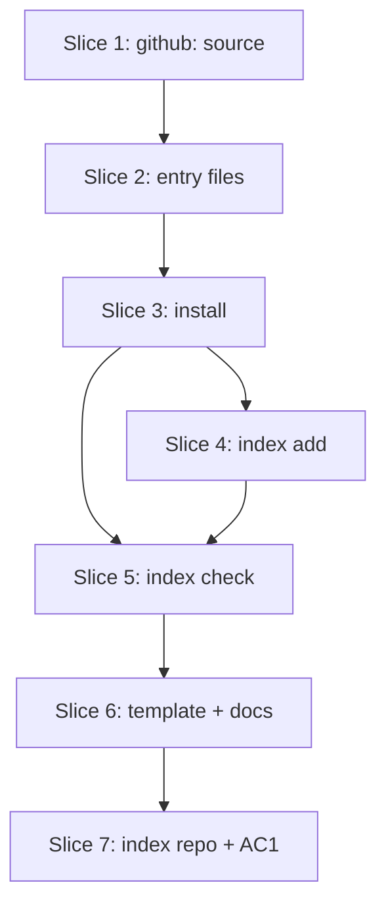

# Plan: federated community index (S8)

**Created**: 2026-11-06
**Branch**: claude/community-index-org-migration-0649a1
**Status**: approved (revision 3; approved by the user on 2026-11-06)
**Gherkin persistence**: plan-file-only (only scenarios tagged `@cucumber` go to `tests/features/build-slices/s8-*.feature`, written by the steps themselves)
**Spec**: [docs/specs/lvpm-community-index-s8.md](../docs/specs/lvpm-community-index-s8.md) · Issue ThatsTheEnd/lvpm#69

## Goal

A project that lists `github:labview-package-manager/package-index` in
`[sources]` installs a package by name. A maintainer registers a package in
that index with one copied workflow, one secret and a tag. A bot (`lvpm index
check`) accepts only attested, unchanged, owner-published versions.

**Decision-defaults stances**:
- **Scope**: a new source kind and two commands. Defaults, first-source-wins and `lvpm search` are unchanged. Moving the lvpm repo is out of scope (user). One PR (see Risks for the split option).
- **Replace vs. merge**: merged. `Feed` gains a variant, `Entry` gains one optional, unserialised field, and the lock format version stays (the lock gains no field).
- **Format fidelity**: the entry file is new and owned by lvpm, so there is no fidelity axis. The release template is edited in place, and its existing jobs are unchanged.
- **Integration**: a PR with auto-merge on green checks (the default). Creating the index repo and each push to it are asked for one by one (user).
- **Deviation**: the PR carries the `deviation` label. S8's slice text says "OCI once S7b ships"; the spec drops OCI for the index, and the slice's file list grows. Both are said in the PR body, as build-slices.md requires.

## Design decisions made here

- **Feed kind.** `Feed::Index { owner, repo }`. Its `owner()`, and the `Entry::source` of its entries, is `github-index:owner/repo`. It never starts with `github:`, so `index::github_repo` keeps meaning "an S4 GitHub dependency". A helper `index::index_repo(entry)` returns the index repo of an index entry; no call site parses the string itself.
- **The string-scheme shortcut** (`index.rs`, `GITHUB_SCHEME`). The source string still carries only one repo; the extra data an index entry needs (sha256, publisher) lives in `Entry::index_pin`, not in the string. So the shortcut's trigger ("a third kind needs more than a repo") is not hit by the source string, and its comment is updated to say so and to name `index_pin`.
- **Entry field.** One `index_pin: Option<IndexPin { sha256, publisher }>`, `#[serde(skip)]`, `None` for every other source. `search --json` output is unchanged. `publisher` is the entry file's `github` repo, which S6 verifies against. `index::attesting_repo(entry)` returns `github_repo(entry)` or the publisher. `ops/attest.rs::origin_of` and `ops/lock.rs::build`/`entry_source` call it. `ops/session.rs` does not change: there `github_repo` picks the download token, and an index download takes no token.
- **Order.** Each entry gets a rank: the cache and local folders first, then hosted folders and indexes by their `[sources]` line, then the defaults, then OCI last. That is today's order with indexes slotted in among hosted folders. `split_sources` keeps the `[sources]` order: `SourceSet.extra` becomes an ordered `Vec<Remote>` with `Remote::{Hosted(String), Index(IndexFeed)}`, and its position is the rank. The rank lives in a local `Vec<(rank, Entry)>` inside `read_each`; a stable sort by rank runs before `first_source_wins`.
- **Which names are asked.** `SourceSet` gains `wanted`: the manifest's dependency names plus the names a command was given (`lvpm add <name>`, `install <name>`, `info <name>`), passed through `load_index*` as `extra_names`. Each index is asked for `wanted`. Then, for each name already asked, the `requires` of its entries (from any source) are asked, until no new name appears. `requires` of a name nobody asked for are never walked, so a whole vipm.io catalogue adds no request. `search` passes no names and makes no index request (spec: no search). A cycle in `requires` ends because a name is asked once.
- **Transport.** `GET {api}/repos/{owner}/{repo}/contents/packages/{key}.toml` with `Accept: application/vnd.github.raw`, through the S4 client and token chain. `key` is `name_key(name)`; a name whose key is not `[a-z0-9_.-]+` is never asked. 200 → parse. 404 → not listed. Anything else → a listing failure of that source, like a hosted folder's. Each body, and each 404 as a "not listed" marker, is cached in the existing feed cache keyed by its URL; without `--refresh` a cached answer is used with no request, as `feed_body` does. A body over 1 MiB is a listing failure.
- **Module layout.** `crates/lvpm-core/src/community.rs` holds the entry file (parse, write, add a version, build entries) and the six rules as pure functions over two parsed trees. It imports `index`; `index.rs` never imports `community`. The name-closure loop stays in `index.rs::read_each`, which gets entry bodies through a fetcher on `SourceSet`: `index_fetch: &dyn Fn(&IndexFeed, &str) -> Result<Option<String>>` (`None` = not listed). `load_index_each` in `env.rs` and `Source::index` in `sync.rs` build it from `env.github`; the parsing is passed in the same way, as a `fn(&str, &str) -> Result<Vec<Entry>>` that `ops` wires to `community`. `parse_requires` and `parse_lv_gate` become `pub(crate)`. The network half of the check (download, `verify`) and both ops are in `crates/lvpm-core/src/ops/community.rs`. `src/main.rs` adds `lvpm index add|check`.
- **Findings are typed.** `community::Finding` is an enum of rule, path, name, version and the rule's fields. Every line is worded in `src/render/community.rs` (ADR 5), and the pinned-text tests sit there.
- **Download URL and web base.** An entry's `url` is the browser URL `https://github.com/<github>/releases/download/<tag>/<file>`, downloaded without a token. shortcut: public release assets only; use the API asset URL with the token when a private index is wanted. The web base comes from the API: `https://api.github.com` → `https://github.com`; `https://host/api/v3` → `https://host`; anything else → itself. The loopback fake serves release downloads on its own base.
- **sha256 check.** `fetch.rs` gains `verify_sha256` beside `verify_md5`. A mismatch is a typed error in `errors.rs` carrying the entry, both hashes and the source. The consumer renders it as the AC7 line, and `check` renders it as R5. `on_hand` reuses the cache by `index_pin.sha256`, so a second `lvpm lock` downloads nothing.
- **sync.** `ops/sync.rs` gains `Source::Index(feed)` in `Source::all`, `answers_for` (a lock entry whose `source` is `feed.owner()`) and `Source::index` (with `wanted` = the locked names). The lock stores no `url`; `sync --locked` re-reads the index for the locked names and checks the locked `sha256`.
- **Lock staleness.** `lockfile.rs` `Inputs.sources` lists every `[sources]` line, `github:` lines included, so adding, removing or changing the `community` line makes the lock stale. An older lvpm reading a lock with `github-index:` sees an unknown source and refuses `sync --locked` with its existing not-found error; no format bump.
- **R4 is a URL check.** The url is parsed. Scheme and host must equal the web base's, and the path segments must start `<owner>/<repo>/releases/download/<tag>/<file>` with exactly one tag and one file segment. A `..`, `.`, empty segment or percent-encoded `/` or `\` is refused. This reuses or generalises `index.rs::stays_in_folder`.
- **Owner names compare case-insensitively**, as GitHub does, in R2, R6b and `index add`. Versions compare as lvpm parses them, so `1.0.0.0` is the same version as a listed `1.0.0`.
- **Bot input bounds.** Only regular `.toml` files directly in `packages/` are read; a symlink, a subdirectory or another extension is an R1 refusal, and the bot never follows a link. No file is read past 1 MiB: an entry file over it is a parse refusal, any other file over it is R1 whenever the head has it (it has no hash, so it is never compared). The entry bodies a checkout keeps total at most 64 MiB; a body past that is dropped, and the file reads as one over the limit if the PR changes it. An empty folder (a submodule checks out as one) is R1, and so is a file or folder whose name is not UTF-8 (shown by its lossy name; two names that show alike are never one). A download is capped at 256 MiB, and reading the package's own metadata from the zip stops at 1 MiB uncompressed. A parse error names the line and key only, never file content.
- **Bot work bounds.** A PR may add at most 20 versions and change or add at most 20 entry files (`MAX_NEW_VERSIONS_PER_PR`, `MAX_ENTRY_FILES_PER_PR`). Over either, the whole PR is refused with one line each and nothing is downloaded. Each downloaded version goes through a cache of its own in a folder the run makes and removes, so R5 always fetches the url and never finds a file an earlier run (or an earlier version of the same run) cached. A package file is read once per SHA-256 in a run. A version with an R5b finding is not asked about its attestation.
- **Names lvpm cannot install.** A name that is empty, ends in `.`, or whose part before the first `.` is a Windows device name (`con`, `prn`, `aux`, `nul`, `com1` to `com9`, `lpt1` to `lpt9`, any case) is refused wherever lvpm reads an entry file: the consumer's parse and the bot's (as its own line below). The same rule, and `is_file_key`, hold for each requirement's name. An entry file's `version` must be a whole version (as `is_version`), its `labview` exactly the text lvpm writes (`>=` and the number as a float prints, like `>=20.0`), and a file needs at least one `[[version]]`; each of these is the parse line when it fails.
- **Who closes refused PRs.** The bot comments and leaves the PR open. The publisher fixes the cause and pushes a new tag, which opens a new PR, and closes the refused one. The PR branch is named per tag (`lvpm/<name>-<version>`), so a new tag never collides with an old branch. A maintainer can close stale ones.

## Acceptance Criteria

- [ ] AC1 *(manual)* A fork of pilot B, renamed to a throwaway package name and set up by following docs/usage.md "Publish to the community index" (except the branch-build substitutions listed in the PR body), opens a PR on `labview-package-manager/package-index` from a tag. `lvpm index check` built from this branch accepts it, and the PR is merged after the user approves. The PR body links that PR and the check's output, and lists every step that used a branch build instead of a release.
- [ ] AC2 A project with `community = "github:<o>/<r>"` and pilot B as `labview_open_source_lib_serializer = ">=1.2"` locks and syncs pilot B from the index. Its lock entry has `source = "github-index:<o>/<r>"`, the entry's `sha256`, and `signer`/`subject` from the fake `gh`. `sync --locked` installs it again from that lock.
- [ ] AC3 `lvpm index check` refuses a head that changes an existing version's `sha256`, prints the pinned R3 line with both hashes, and exits 1.
- [ ] AC4 `lvpm index check` refuses each case of R1, R1b, R2, R3b, R4, R5, R5b, R6 and R6b, a non-TOML `packages/bar.toml` (parse), and an entry file over 1 MiB (parse). It accepts a new name, and a new version of an owned name, that pass every rule (exit 0, `accepted` lines).
- [ ] AC5 `lvpm index add` creates `packages/<key>.toml`. It appends to the owner's file. It refuses another `--github`, a listed version, a url outside the owner's releases, and a file that is not an `.lvpkg`. On any refusal it writes nothing.
- [ ] AC6 A name the index does not list (404) resolves from a later source. A name an earlier `[sources]` line lists is not taken from the index, and a name the index lists is taken from it before vipm.io. A dependency pinned with `index = "community"` that the index does not list fails naming `searched github:<o>/<r>`, and is not taken from another source.
- [ ] AC7 A download whose SHA-256 differs from the index entry fails with the pinned line naming both hashes and the hint. Nothing is installed and no lock is written.
- [ ] AC8 With `[policy] require-signature = true`, an unattested index package is refused with S6's `has no attestation` line, and one attested by another repo is refused with S6's line for that outcome, asserted in full, exit 1. Without a policy, an unattested index package installs with no `signer`.
- [ ] AC9 A `github:` source parses only when the owner matches `[A-Za-z0-9-]+` and the repo matches `[A-Za-z0-9._-]+` and is not `.` or `..`. `github:x`, `github:/r`, `github:o/`, `github:o/r/x`, `github:../r`, `github:o/..` and `github:o/r?x` fail to parse with the pinned line.
- [ ] AC10 *(manual, with AC1)* docs/usage.md "Publish to the community index" has the four publisher steps and the consumer's two lines. Anything AC1 needed that the section did not say is added to it.
- [ ] AC11 Every refusal line names its package and version when it has them (R1 and parse name only the path), and carries a `fix:`. A render test per line pins its full text.
- [ ] AC12 docs/usage.md has a `github:` sources section that says source order matters, and its command table has rows for `lvpm index add` and `lvpm index check`. The template's header comment documents `register`. The README S8 milestone is `- [x]`. build-slices.md S8 names `labview-package-manager` and lists the files this PR changed.
- [ ] AC13 The template's `register` job has `env: LVPM_INDEX_TOKEN: ${{ secrets.LVPM_INDEX_TOKEN }}` and `if: env.LVPM_INDEX_TOKEN != ''` on every step that does work, so it does nothing without the secret. The step that writes a `register failed:` line has `if: failure() && env.LVPM_INDEX_TOKEN != ''`. The last step has `if: env.LVPM_INDEX_TOKEN == ''` and writes the pinned not-registered line. On success it writes the PR link to `$GITHUB_STEP_SUMMARY`. The `publish` and `publish-oci` jobs never mention `LVPM_INDEX_TOKEN`, and the PR diff leaves them unchanged.

### Pinned wording

Check (`lvpm index check`). Findings print sorted by path, then version. The process exits 1 if any line is a refusal.

| Rule | Line |
|---|---|
| ok | `accepted <name> <version>` |
| R1 | `refused <path>: only .toml files directly under packages/ may change. fix: remove this change` |
| R1b | `refused <path>: the entry for <name> must be packages/<key>.toml. fix: rename the file` |
| R2 | `refused <name>: github changed from <old> to <new>, and <name> belongs to <old>. fix: publish from <old>, or register another name` |
| R3 | `refused <name> <version>: already listed with <field> <old>, now <new>. fix: listed versions cannot change; publish a new version` |
| R1b (name) | `refused <path>: <name> is not a name lvpm can install. fix: register another name` |
| limit (versions) | `refused this PR: it adds <n> versions, more than 20. fix: register at most 20 versions per PR` |
| limit (files) | `refused this PR: it changes <n> entry files, more than 20. fix: change at most 20 entry files per PR` |
| R3b | `refused <name> <version>: listed versions cannot be removed. fix: restore it` |
| R4 | `refused <name> <version>: <url> is not a release file of <github>. fix: upload the package to a release of <github>` |
| R5 | `refused <name> <version>: the file has sha256 <actual>, the entry says <entry>. fix: don't replace release files after tagging; push a new tag` |
| R5 (download) | `refused <name> <version>: the file could not be downloaded: <error>. fix: check the release is published and public, then push a new tag` |
| R5b | `refused <name> <version>: the package says <field> <actual>, the entry says <entry>. fix: don't replace release files after tagging; push a new tag` |
| R6 | `refused <name> <version>: not attested (<reason>). fix: build with the lvpm release template, which attests the package` |
| R6b | `refused <name> <version>: attested by <subject>, not https://github.com/<github>. fix: publish from <github>` |
| R5 (not a package) | `refused <name> <version>: the file is not a package lvpm reads: <error>. fix: build the package with the lvpm release template, then push a new tag` |
| parse | `refused <path>: does not parse: <error>. fix: register with the lvpm release template instead of editing by hand` |
| none | `nothing to check` (exit 0) |

- `<field>` of R5b is `name`, `version`, `requires` or `labview`.
- `<field>` of R3 is the first of `sha256`, `version`, `url`, `labview`, `requires` that differs from the base; consumers trust every field. `version` is the text as written, so `1.0.0` rewritten as `1.0.0.0` with the same sha256 is `already listed with version 1.0.0, now 1.0.0.0`; two spellings with another sha256 are the `sha256` line. A missing `labview` or empty `requires` shows as `none`; `requires` joins with `, `. Under R2 (new owner) only `sha256` is compared, since the URLs change with the owner.
- `<error>` of R5 (download) is one fixed form, never the url or a server's words: `HTTP <status>` (the number, like `HTTP 404`), `timed out`, `too large`, or `could not connect` (also what any other failure says).
- `<error>` of parse never quotes the file. A file with no `[[version]]` is `lists no version`; a version, labview or requires value that lvpm does not write is `version[<n>].<key>: cannot be read`.
- A value out of the PR (name, path, version, url, error, hash) shows at most 200 characters, then `…`; a control character, a Unicode format character (Cf, like a bidi override), U+2028 and U+2029 show as `?`.
- `<reason>` of R6 is S6's outcome text: `no attestation`, an unchecked reason (`gh` could not run), or `does not verify`. Every one refuses: the bot fails closed.
- The bot's PR comment starts `lvpm index check refused this PR:`, lists the lines, and ends `Fix the cause, push a new tag, and close this PR.` with a link to docs/usage.md "Publish to the community index". The lines are in one fenced code block, one per line, with a fence of at least three backticks and longer than any run of backticks in them. At most 50 lines are listed, then `… and <n> more` as the block's last line.

Add (`lvpm index add`), each refusal exits 1:
- `added <name> <version> to packages/<key>.toml`
- `lvpm index: <name> <version> belongs to <owner> in packages/<key>.toml, not <github>. fix: publish from <owner>, or register another name`
- `lvpm index: <name> <version> is already listed in packages/<key>.toml. fix: listed versions cannot change; publish a new version`
- `lvpm index: <name> <version>: --url must be <web>/<github>/releases/download/<tag>/<file>. fix: pass the release asset's download URL`
- `lvpm index: <file> is not an .lvpkg: <error>. fix: pass the package lvpm build made` (any package lvpm reads counts, as for install; the Background's pilot B fixture is a `.vip`)
- `lvpm index: packages/<key>.toml does not parse: <error>. fix: restore it from the index repo`
- `lvpm index: <name> <version>: packages/<key>.toml would exceed 1048576 bytes. fix: ask the index maintainers to split or prune it`
- `lvpm index: <entries-dir> is not a folder: <error>. fix: pass the index repo's packages folder`

Template `register` summary lines (`$GITHUB_STEP_SUMMARY`):
- success: `registered <name> <version>: <pr-url>. The index bot checks it, then merges it or comments the reasons it refused. A PR with no verdict waits for a maintainer.`
- skipped: the working steps skip, and the job's last step (`if: env.LVPM_INDEX_TOKEN == ''`) writes `not registered in the community index: LVPM_INDEX_TOKEN is not set`.
- `register failed: the token was refused. fix: save a classic token with public_repo as LVPM_INDEX_TOKEN`
- `register failed: <name> <version> is already listed. fix: push a new tag`
- `register failed: <name> belongs to <owner>. fix: publish from <owner>, or register another name`
- any other failure: `register failed: <step> failed. fix: see the job log, then re-run the job`

Consumer:
- AC7: `the file of <name> <version> from github-index:<o>/<r> has sha256 <actual>, but the index lists <entry>`, hint `report this to the package's owner, <github>; lvpm installed nothing`.
- AC9: `lvpm.toml: [sources] <name>: "<value>" is not github:owner/repo`.
- An entry that does not parse: a listing failure of the source, `packages/<key>.toml in github:<o>/<r> does not parse: <error>`.
- Not found: the existing not-found hint also names each index source searched, e.g. `searched github:labview-package-manager/package-index`.

## Slices

### Slice 1: `github:owner/repo` in `[sources]`

**Depends-on:** none
**Files:** `crates/lvpm-core/src/project.rs`, `crates/lvpm-core/src/index.rs`, `crates/lvpm-core/src/lockfile.rs`, `crates/lvpm-core/src/ops/env.rs`, `crates/lvpm-core/src/ops/lock.rs`, `crates/lvpm-core/src/ops/sync.rs`

```gherkin
Feature: S8: the index as a source
  @unit
  Scenario: a github: source is an index feed
    Given a manifest with [sources] community = "github:labview-package-manager/package-index"
    Then the project's sources are one index feed for labview-package-manager/package-index

  @unit
  Scenario Outline: a github: source that is not owner/repo is refused
    Given a manifest with [sources] community = "<value>"
    Then parsing fails with lvpm.toml: [sources] community: "<value>" is not github:owner/repo
    Examples:
      | value         |
      | github:x      |
      | github:/r     |
      | github:o/     |
      | github:o/r/x  |
      | github:../r   |
      | github:o/..   |
      | github:o/r?x  |

  @unit
  Scenario: a dependency can pin the index source
    Given a manifest with [sources] community = "github:o/r" and x = { version = "*", index = "community" }
    Then x is pinned to the owner github-index:o/r

  @unit
  Scenario: changing the community line makes the lock stale
    Given a lock written with [sources] community = "github:o/r"
    When the manifest's community line is removed, or changed to "github:o/s"
    Then the lock is stale
```

#### Step 1.1: parse `github:` into `Feed::Index`

**Complexity**: standard
**IMPLEMENT**: `Feed::Index { owner, repo }` and its parse with the AC9 error. `owner()` is `github-index:o/r`. `split_sources` returns index feeds as a third list, so every caller compiles and ignores it for now. `lockfile::Inputs.sources` includes `github:` lines.
**TEST**: the four scenarios as unit tests in `project.rs`, `index.rs` and `lockfile.rs`; full suite green.
**REFACTOR**: share the owner/repo check with the `github = "owner/repo"` dependency parse if they match.
**Files**: `crates/lvpm-core/src/project.rs`, `crates/lvpm-core/src/index.rs`, `crates/lvpm-core/src/lockfile.rs`, `crates/lvpm-core/src/ops/env.rs`, `crates/lvpm-core/src/ops/lock.rs`, `crates/lvpm-core/src/ops/sync.rs`
**Commit**: `feat(s8): github:owner/repo as an index source`

### Slice 2: reading entry files

**Depends-on:** 1
**Files:** `crates/lvpm-core/src/community.rs`, `crates/lvpm-core/src/lib.rs`, `crates/lvpm-core/src/index.rs`, `crates/lvpm-core/src/github.rs`, `crates/lvpm-testkit/src/github.rs`, `crates/lvpm-core/src/ops/env.rs`, `crates/lvpm-core/src/ops/lock.rs`, `crates/lvpm-core/src/ops/sync.rs`, `crates/lvpm-core/src/ops/add_remove.rs`, `crates/lvpm-core/src/ops/install.rs`, `crates/lvpm-core/src/ops/query.rs`

```gherkin
Feature: S8: entry files
  @unit
  Scenario: an entry file becomes one entry per version
    Given packages/foo.toml with github "a/x" and versions 1.0.0 and 1.1.0, 1.1.0 requiring "bar >=2" and LabVIEW ">=20.0"
    When it is read as source github-index:o/r
    Then there are two entries of foo with source github-index:o/r, publisher a/x and their sha256
    And 1.1.0 requires bar >=2 and runs on LabVIEW 20.0 and newer

  @unit
  Scenario Outline: an entry file that is not valid does not parse
    Given packages/foo.toml with <change>
    Then reading it fails naming "<key>"
    Examples:
      | change                                | key      |
      | an unknown top-level key "own"        | own      |
      | a version without sha256              | sha256   |
      | a sha256 that is not 64 hex digits    | sha256   |
      | name "bar"                            | name     |
      | version 1.0.0 listed twice            | version  |
      | github "a"                            | github   |
      | labview "twenty"                      | labview  |
      | requires ["bar >=?"]                  | requires |

  @unit
  Scenario: write then read gives the same entries
    Given an entry file written for foo by a/x with one version that has no labview and no requires
    Then reading it back gives that version unchanged, with neither key written

  @unit
  Scenario: the index is asked for each wanted name and the names they require
    Given a fake index listing foo (requiring bar) and bar
    When the sources are read with wanted name foo
    Then the fake was asked for packages/foo.toml and packages/bar.toml, once each

  @unit
  Scenario: requires of a name nobody wanted are not followed
    Given vipm.io lists qux requiring zap, and a fake index listing foo
    When the sources are read with wanted name foo
    Then the fake was asked for packages/foo.toml only

  @unit
  Scenario: requires of a hosted entry of a wanted name are followed
    Given a hosted folder lists foo requiring bar, and a fake index listing bar
    When the sources are read with wanted name foo
    Then the fake was asked for packages/foo.toml and packages/bar.toml

  @unit
  Scenario: a requires cycle ends
    Given a fake index where foo requires bar and bar requires foo
    When the sources are read with wanted name foo
    Then the fake was asked for each name once

  @unit
  Scenario: a name that cannot be a file name is never asked
    Given a dependency named "../x"
    When the sources are read
    Then the fake got no request for it

  @unit
  Scenario: search makes no index request
    Given [sources] community = a fake index
    When the sources are read with no wanted names
    Then the fake got no request

  @unit
  Scenario: a name passed to add is asked
    Given a manifest with no dependencies and [sources] community = a fake index listing foo
    When the sources are read for "lvpm add foo"
    Then the fake was asked for packages/foo.toml

  @unit
  Scenario: a name the index does not list is a 404 and nothing else
    Given a fake index that answers 404 for foo
    When the sources are read with wanted name foo
    Then no entry of foo comes from the index and no listing failure is reported

  @unit
  Scenario Outline: an index that fails is a listing failure of that source
    Given a fake index that <answer> for foo
    When the sources are read with wanted name foo
    Then on_fail is called with the source github-index:o/r and "<text>"
    Examples:
      | answer                         | text                                                    |
      | answers 500                    | 500                                                     |
      | serves an entry that does not parse | packages/foo.toml in github:o/r does not parse     |

  @unit
  Scenario: an entry body over the limit is a listing failure
    Given a fake index serving packages/foo.toml larger than the entry limit (set small in the test)
    When the sources are read with wanted name foo
    Then on_fail is called with the source github-index:o/r naming the limit

  @unit
  Scenario: a cached entry file is used without a request unless refreshing
    Given foo was read once from the fake index
    When the sources are read again without refresh, then with refresh
    Then the fake got no new request the first time and one the second

  @unit
  Scenario: a 404 is cached too
    Given the fake index answered 404 for foo once
    When the sources are read again without refresh
    Then the fake got no new request
```

```gherkin
Feature: S8: source order
  @unit
  Scenario: an earlier [sources] line wins over the index, and the index wins over vipm.io
    Given [sources] first = a hosted folder listing foo 1.0, then community = an index listing foo 2.0 and bar 1.0
    And the defaults list bar 3.0
    When the sources are read with wanted names foo and bar
    Then foo comes from the hosted folder and bar from the index

  @unit
  Scenario: local folders rank first and OCI last
    Given a local folder listing baz 1.0, an index listing baz 2.0 and qux 1.0, and an OCI source listing qux 2.0
    When the sources are read with wanted names baz and qux
    Then baz comes from the local folder and qux from the index

  @unit
  Scenario: a hosted folder before the index still wins after reordering by rank
    Given [sources] a = hosted listing foo 1.0, b = an index listing foo 2.0, c = hosted listing foo 3.0
    When the sources are read with wanted name foo
    Then foo comes from a, and swapping a and c makes it come from c
```

#### Step 2.1: the entry file in `community.rs`

**Complexity**: standard
**IMPLEMENT**: `EntryFile { name, github, versions }` with parse (unknown key, bad sha256, name not matching the file, duplicate version, bad `github`, unparsable `labview`/`requires` = error naming the key), write (stable key order, the pinned keys; empty `labview`/`requires` omitted), `add_version`, and `entries(source)` → `Vec<Entry>`. `Entry` gains `index_pin` and derives `Default`; every `Entry { .. }` literal (about 70 across `fetch.rs`, `cache.rs`, `solve.rs`, `ops/github_index.rs`, `ops/staging.rs`, `lvpm-tui` and the tests) gets `..Default::default()` or `index_pin: None`. `parse_requires`/`parse_lv_gate` become `pub(crate)` and are reused.
**TEST**: the parse, outline and round-trip scenarios; full suite green.
**REFACTOR**: none beyond the `Default` fallout; the compiler lists every literal.
**Files**: `crates/lvpm-core/src/community.rs`, `crates/lvpm-core/src/lib.rs`, `crates/lvpm-core/src/index.rs` 
**Commit**: `feat(s8): the community index entry file`

#### Step 2.2: fetch per name, with the name closure and the cache

**Complexity**: complex
**IMPLEMENT**: the fake serves `/repos/{o}/{r}/contents/{path}` and records requests. `SourceSet` gains `index` (the index feeds), `wanted`, `index_fetch` and `index_parse` (with `Default`). `read_each` asks for the closure of names as the design says, caches each body, and caches a 404 as a "not listed" marker. `load_index*` takes `extra_names`; `env.rs`, `lock.rs`, `sync.rs`, `add_remove.rs`, `install.rs` and `query.rs` pass the manifest's names plus the command's own.
**TEST**: the fetch, closure, 404, failure, cache, add and search scenarios against the fake; full suite green.
**REFACTOR**: one helper for "GET with the S4 token, map the status" if `github.rs` already has one; else none.
**Files**: `crates/lvpm-core/src/community.rs`, `crates/lvpm-core/src/index.rs`, `crates/lvpm-core/src/github.rs`, `crates/lvpm-testkit/src/github.rs`, `crates/lvpm-core/src/ops/env.rs`, `crates/lvpm-core/src/ops/lock.rs`, `crates/lvpm-core/src/ops/sync.rs`, `crates/lvpm-core/src/ops/add_remove.rs`, `crates/lvpm-core/src/ops/install.rs`, `crates/lvpm-core/src/ops/query.rs`
**Commit**: `feat(s8): read the community index one name at a time`

#### Step 2.3: `[sources]` order across hosted folders and indexes

**Complexity**: standard
**IMPLEMENT**: `SourceSet.extra` becomes the ordered `Vec<Remote>`; rank each entry as the design says, stable-sort, then `first_source_wins`.
**TEST**: the three order scenarios; the existing first-source-wins tests stay green unchanged.
**REFACTOR**: drop the separate `extra`-before-`defaults` ordering code if the rank makes it redundant.
**Files**: `crates/lvpm-core/src/index.rs`, `crates/lvpm-core/src/ops/env.rs`, `crates/lvpm-core/src/ops/sync.rs`
**Commit**: `feat(s8): the index keeps its place in [sources]`

### Slice 3: installing from the index

**Depends-on:** 2
**Files:** `crates/lvpm-core/src/fetch.rs`, `crates/lvpm-core/src/index.rs`, `crates/lvpm-core/src/github.rs`, `crates/lvpm-core/src/ops/attest.rs`, `crates/lvpm-core/src/ops/lock.rs`, `crates/lvpm-core/src/ops/sync.rs`, `crates/lvpm-core/src/errors.rs`, `src/render/lock.rs`, `crates/lvpm-testkit/src/github.rs`, `tests/features/build-slices/s8-index-install.feature`, `tests/steps/community.rs`, `tests/steps/mod.rs`, `tests/acceptance.rs`

```gherkin
Feature: S8: installing from the community index
  Background:
    Given a fake GitHub whose index labview-package-manager/package-index lists pilot B, published by "someone/Serializer"
    And someone/Serializer's release serves pilot B's file and its dependency data_manipulation is in the project's hosted folder

  @cucumber
  Scenario: a project installs pilot B by name through the index
    Given pilot B's release is attested by someone/Serializer
    And the pilot B project with community = "github:labview-package-manager/package-index" in [sources] and pilot B as a plain dependency
    When I run "lvpm sync"
    Then the command succeeds
    And lvpm.lock has pilot B from "github-index:labview-package-manager/package-index" with the index's sha256
    And lvpm.lock has pilot B's signer and subject "https://github.com/someone/Serializer"

  @cucumber
  Scenario: a locked index package installs again from the lock
    Given that project was synced once and its installed packages are removed
    When I run "lvpm sync --locked"
    Then the command succeeds and pilot B is installed with the locked sha256

  @cucumber
  Scenario: a file whose hash differs from the index is not installed
    Given the release serves other bytes for pilot B's file
    When I run "lvpm sync"
    Then the command fails naming pilot B, both hashes and "but the index lists"
    And the hint says "report this to the package's owner, someone/Serializer; lvpm installed nothing"
    And no lvpm.lock is written and pilot B is not installed

  @cucumber
  Scenario Outline: the policy applies to index packages
    Given pilot B's release is <attestation>
    And the manifest has [policy] require-signature = true
    When I run "lvpm lock"
    Then the command fails with exit code 1 naming "<text>"
    Examples:
      | attestation                 | text                  |
      | not attested                | has no attestation    |
      | attested by other/Fork      | S6's full line for a subject of other/Fork |

  @cucumber
  Scenario: without a policy an unattested index package installs unsigned
    Given pilot B's release is not attested
    When I run "lvpm lock"
    Then the command succeeds and lvpm.lock has pilot B with no signer

  @cucumber
  Scenario: a name the index does not list comes from a later source
    Given the index lists nothing
    When I run "lvpm lock"
    Then data_manipulation is locked from the hosted folder

  @cucumber
  Scenario: a dependency pinned to the index that it does not list fails
    Given data_manipulation is pinned with index = "community" and the index does not list it
    When I run "lvpm lock"
    Then the command fails naming data_manipulation and "searched github:labview-package-manager/package-index"
    And data_manipulation is not taken from the hosted folder

  @unit
  Scenario Outline: the web base follows the API
    Given the GitHub API "<api>"
    Then the web base is "<web>"
    Examples:
      | api                       | web                   |
      | https://api.github.com    | https://github.com    |
      | https://ghe.corp/api/v3   | https://ghe.corp      |
      | http://127.0.0.1:5000     | http://127.0.0.1:5000 |

  @unit
  Scenario: a release download carries no token
    Given a GitHub token is configured
    When an index entry's file is downloaded
    Then the request to /releases/download/ has no Authorization header

  @unit
  Scenario Outline: a download or package read over its limit is refused
    Given the <limit> is set small in the test
    When an index entry's file larger than it is <action>
    Then the fetch fails naming the limit, and nothing is cached
    Examples:
      | limit                       | action                        |
      | download limit              | downloaded                    |
      | uncompressed metadata limit | read for its name and version |

  @unit
  Scenario: bytes whose sha256 is not the pinned one are refused
    Given an index entry pinned to sha256 A
    When its download returns bytes with sha256 B
    Then the fetch fails with a hash mismatch carrying A and B, and nothing is cached
```

#### Step 3.1: web base and the fake's release downloads

**Complexity**: trivial
**IMPLEMENT**: `GitHub::web_base()`; the fake serves `/{o}/{r}/releases/download/{tag}/{file}` and records request headers.
**TEST**: the web-base outline; full suite green.
**REFACTOR**: none beyond naming; the function is three branches.
**Files**: `crates/lvpm-core/src/github.rs`, `crates/lvpm-testkit/src/github.rs`
**Commit**: `feat(s8): the GitHub web base`

#### Step 3.2: download an index entry and check its sha256

**Complexity**: standard
**IMPLEMENT**: `fetch.rs` downloads an index entry's `url` without a token, capped at 256 MiB, and `verify_sha256` (beside `verify_md5`) refuses bytes whose SHA-256 is not `index_pin.sha256` with a typed error in `errors.rs`, before caching. `on_hand` reuses the cache by the pinned sha256. The download runs in `lock`'s fetch, before the lock is written.
**TEST**: the no-token and hash unit scenarios in `fetch.rs`; full suite green. The cucumber hash scenario runs in Step 3.3, once the lock wires the source.
**REFACTOR**: share one hashing helper between `verify_md5` and `verify_sha256` if it removes code.
**Files**: `crates/lvpm-core/src/fetch.rs`, `crates/lvpm-core/src/errors.rs`, `crates/lvpm-core/src/ops/lock.rs`
**Commit**: `feat(s8): the index pins each file's sha256`

#### Step 3.3: attest, lock and sync index packages

**Complexity**: standard
**IMPLEMENT**: `index::attesting_repo` and `index::index_repo`; `ops/attest.rs::origin_of` verifies index entries against the publisher; `build`/`entry_source` in `ops/lock.rs` write the index source; `ops/sync.rs` gains `Source::Index`. The AC7 line and the not-found addition are worded in `src/render/lock.rs`. Update the shortcut comment on `GITHUB_SCHEME`.
**TEST**: every `@cucumber` scenario of this slice; S6's scenarios stay green.
**REFACTOR**: replace only the `github_repo` calls that mean "who attests" with `attesting_repo`; `session.rs` keeps its own. The `_` arm of `answers_for` excludes index entries via `index::index_repo`. Confirm `from_same_repo` (`ops/lock.rs`) still holds for index entries.
**Files**: `crates/lvpm-core/src/index.rs`, `crates/lvpm-core/src/ops/attest.rs`, `crates/lvpm-core/src/ops/lock.rs`, `crates/lvpm-core/src/ops/sync.rs`, `src/render/lock.rs`, `tests/features/build-slices/s8-index-install.feature`, `tests/steps/community.rs`, `tests/steps/mod.rs`, `tests/acceptance.rs`
**Commit**: `feat(s8): index packages are attested, locked and synced`

### Slice 4: `lvpm index add`

**Depends-on:** 3
**Files:** `crates/lvpm-core/src/community.rs`, `crates/lvpm-core/src/ops/community.rs`, `crates/lvpm-core/src/ops/mod.rs`, `crates/lvpm-core/src/events.rs`, `src/main.rs`, `src/render/community.rs`, `src/render/mod.rs`, `tests/features/build-slices/s8-index-add.feature`, `tests/steps/community.rs`, `tests/acceptance.rs`

```gherkin
Feature: S8: lvpm index add
  Background:
    Given pilot B's built .lvpkg as <file>, version 1.2.1.16

  @cucumber
  Scenario: a first version creates the entry file
    Given an empty packages folder
    When I run "lvpm index add packages <file> --github someone/Serializer --url https://github.com/someone/Serializer/releases/download/1.2.1/<file>"
    Then the command succeeds printing "added labview_open_source_lib_serializer 1.2.1.16 to packages/labview_open_source_lib_serializer.toml"
    And that file lists github "someone/Serializer" and one version with the file's sha256, requires and LabVIEW minimum

  @cucumber
  Scenario: a new version is appended to the owner's file
    Given packages/labview_open_source_lib_serializer.toml owned by someone/Serializer with version 1.2.0.1
    When I run lvpm index add on <file> with --github someone/Serializer and its release url
    Then the file lists both versions, the old one unchanged

  @cucumber
  Scenario: the owner's name in another case is the owner
    Given packages/labview_open_source_lib_serializer.toml owned by someone/Serializer with version 1.2.0.1
    When I run lvpm index add on <file> with --github Someone/serializer and its release url
    Then the command succeeds and the file's github stays "someone/Serializer"

  @cucumber
  Scenario Outline: add refuses and leaves the folder unchanged
    Given <state>
    When I run lvpm index add on <input>
    Then the command fails with exit code 1 printing "<line>"
    And the packages folder is unchanged
    Examples:
      | state                                                  | input                                              | line                                                                 |
      | the entry file is owned by someone/Serializer           | <file> with --github other/Fork                    | <version> belongs to someone/Serializer in packages/labview_open_source_lib_serializer.toml, not other/Fork. fix: |
      | the entry file already lists 1.2.1.16                   | <file> with --github someone/Serializer            | 1.2.1.16 is already listed in packages/labview_open_source_lib_serializer.toml. fix: |
      | an empty packages folder                                | <file> with --github someone/Serializer --url https://example.com/x.lvpkg | <version>: --url must be https://github.com/someone/Serializer/releases/download/<tag>/<file>. fix: |
      | an empty packages folder                                | notes.txt with --github someone/Serializer         | notes.txt is not an .lvpkg: <error>. fix: pass the package lvpm build made |
      | the entry file is not TOML                              | <file> with --github someone/Serializer            | does not parse                                                       |
```

The url in the outline's `--url` row is the fake's web base in the test, so the check is against `web_base()`, not a hard-coded host.

#### Step 4.1: the add op, event, render and CLI

**Complexity**: standard
**IMPLEMENT**: `ops::community::add` reads the package (`entry_from_bytes`), hashes it, checks the URL (the R4 check against the web base), and calls `EntryFile::add_version`, writing nothing on refusal. Event `IndexEntryAdded`. `lvpm index add` in `main.rs`; every line worded in `src/render/community.rs`.
**TEST**: the scenarios above; full suite green.
**REFACTOR**: reuse `name_key` for the file name everywhere; no second normaliser.
**Files**: `crates/lvpm-core/src/community.rs`, `crates/lvpm-core/src/ops/community.rs`, `crates/lvpm-core/src/ops/mod.rs`, `crates/lvpm-core/src/events.rs`, `src/main.rs`, `src/render/community.rs`, `src/render/mod.rs`, `tests/features/build-slices/s8-index-add.feature`, `tests/steps/community.rs`, `tests/acceptance.rs`
**Commit**: `feat(s8): lvpm index add`

### Slice 5: `lvpm index check`, the bot

**Depends-on:** 3, 4
**Files:** `crates/lvpm-core/src/community.rs`, `crates/lvpm-core/src/ops/community.rs`, `crates/lvpm-core/src/events.rs`, `src/main.rs`, `src/render/community.rs`, `crates/lvpm-testkit/src/github.rs`, `tests/features/build-slices/s8-index-check.feature`, `tests/steps/community.rs`, `tests/acceptance.rs`

```gherkin
Feature: S8: the index rules that need no network
  @unit
  Scenario Outline: a pure rule refuses
    Given a base where packages/foo.toml is owned by "a/x" with versions 1.0.0 and 1.0.1
    And a head that <change>
    Then the findings are exactly <finding>
    Examples:
      | change                                                   | finding                               |
      | adds notes.md                                            | R1 notes.md                           |
      | adds packages/sub/x.toml                                 | R1 packages/sub/x.toml                |
      | adds packages/x.txt                                      | R1 packages/x.txt                     |
      | adds packages/bar.toml as a symlink                      | R1 packages/bar.toml                  |
      | adds packages/Foo2.toml for name foo2                    | R1b packages/Foo2.toml foo2           |
      | changes foo's github to "b/x"                            | R2 foo a/x b/x                        |
      | changes foo's github to "A/X"                            | none                                  |
      | changes foo 1.0.0's sha256                               | R3 foo 1.0.0 old new                  |
      | adds foo 1.0.0.0 with another sha256                     | R3 foo 1.0.0 old new                  |
      | removes foo 1.0.0                                        | R3b foo 1.0.0                         |
      | deletes packages/foo.toml                                | R3b foo 1.0.0 and R3b foo 1.0.1       |
      | adds an entry file of 2 MiB                              | parse packages/big.toml               |

  @unit
  Scenario: several new versions are each checked
    Given the head adds foo 1.1.0 and 1.2.0
    Then the versions to check are foo 1.1.0 and foo 1.2.0

  @unit
  Scenario Outline: R4 refuses a url that is not a release file of the owner
    Given foo is owned by a/x
    Then "<url>" <verdict>
    Examples:
      | url                                                                 | verdict      |
      | <web>/a/x/releases/download/1.1.0/foo.lvpkg                          | is accepted  |
      | https://example.com/a/x/releases/download/1.1.0/foo.lvpkg            | is refused   |
      | <web>/a/xy/releases/download/1.1.0/foo.lvpkg                         | is refused   |
      | <web>/a/x/releases/download/1.1.0/../../../b/y/foo.lvpkg             | is refused   |
      | <web>/a/x/releases/download/1.1.0%2f..%2f..%2fb/foo.lvpkg            | is refused   |
      | <web>/a/x/releases/download/1.1.0/sub/foo.lvpkg                      | is refused   |

  @unit
  Scenario: every finding renders as its pinned line
    Given one finding of each rule in the pinned table, and one of each lvpm index add line
    Then each renders exactly as its pinned line, and the PR comment starts "lvpm index check refused this PR:"
```

```gherkin
Feature: S8: lvpm index check
  Background:
    Given a base index where packages/foo.toml is owned by "a/x" with version 1.0.0
    And a fake GitHub where a/x's releases hold foo 1.0.0 and foo 1.1.0, attested by a/x

  @cucumber
  Scenario: a new version from the owner is accepted
    Given the head adds foo 1.1.0 with the release's url and sha256
    When I run "lvpm index check --base base --head head"
    Then the command succeeds printing "accepted foo 1.1.0"

  @cucumber
  Scenario: a new name is accepted
    Given the head adds packages/bar.toml owned by "b/y", whose release is attested by b/y
    When I run "lvpm index check --base base --head head"
    Then the command succeeds printing "accepted bar 1.0.0"

  @cucumber
  Scenario: a changed hash for an existing version is rejected
    Given the head changes foo 1.0.0's sha256 from <old> to <new>
    When I run "lvpm index check --base base --head head"
    Then the command fails with exit code 1 printing "refused foo 1.0.0: already listed with sha256 <old>, now <new>. fix: listed versions cannot change; publish a new version"

  @cucumber
  Scenario Outline: a network rule refuses with a fix
    Given <fixture>
    And the head adds foo 1.1.0 <entry>
    When I run "lvpm index check --base base --head head"
    Then the command fails with exit code 1 printing "<line>"
    Examples:
      | fixture                                         | entry                                  | line                                                                                   |
      | the Background                                  | with a url on example.com              | is not a release file of a/x. fix: upload the package to a release of a/x               |
      | the Background                                  | with another sha256                    | refused foo 1.1.0: the file has sha256                                                  |
      | the release file of foo 1.1.0 answers 404       | with the release's url and sha256      | refused foo 1.1.0: the file could not be downloaded                                     |
      | the Background                                  | whose requires differ from the package | refused foo 1.1.0: the package says requires                                            |
      | the Background                                  | whose labview differs from the package | refused foo 1.1.0: the package says labview                                             |
      | the Background                                  | named foo but the package says bar     | refused foo 1.1.0: the package says name bar                                            |
      | the Background                                  | whose version differs from the package | refused foo 1.1.0: the package says version                                             |
      | foo 1.1.0's release has no attestation          | with the release's url and sha256      | refused foo 1.1.0: not attested (no attestation)                                        |
      | gh cannot run                                   | with the release's url and sha256      | refused foo 1.1.0: not attested (                                                       |
      | foo 1.1.0's attestation does not verify         | with the release's url and sha256      | refused foo 1.1.0: not attested (does not verify)                                       |
      | foo 1.1.0 is attested by b/x                    | with the release's url and sha256      | refused foo 1.1.0: attested by https://github.com/b/x, not https://github.com/a/x       |
      | foo 1.1.0 is attested by A/X                    | with the release's url and sha256      | accepted foo 1.1.0                                                                       |

  @cucumber
  Scenario: a file that does not parse is refused
    Given the head adds packages/bar.toml that is not TOML
    When I run "lvpm index check --base base --head head"
    Then the command fails with exit code 1 printing "refused packages/bar.toml: does not parse"

  @cucumber
  Scenario: several findings print sorted by path, then version
    Given the head changes foo 1.0.0's sha256 and adds notes.md
    When I run "lvpm index check --base base --head head"
    Then the output is the notes.md line, then the foo line, and the exit code is 1

  @cucumber
  Scenario: no change is nothing to check
    Given the head equals the base
    When I run "lvpm index check --base base --head head"
    Then the command succeeds printing "nothing to check"
```

Each outline row that names a fixture other than the Background replaces only that part of it. Where a row shows the start of a line, the step asserts the full pinned line with the fixture's values (hashes, field values, the S6 reason text); the table keeps the rows readable. `gh cannot run` gives S6's unchecked reason for a missing `gh`, asserted in full.

#### Step 5.1: the pure rules (R1–R3b)

**Complexity**: standard
**IMPLEMENT**: `community::diff(base, head)` → typed `Finding`s for R1, R1b, R2, R3, R3b and parse, plus the new versions to check. It reads regular files only, never follows a link, caps each at 1 MiB, and never runs PR code. The R4 URL check is a pure function here too. Owners compare case-insensitively; versions as parsed.
**TEST**: the pure-rule outline, the several-versions and R4 scenarios as unit tests; full suite green.
**REFACTOR**: one `Finding` enum; no wording in core.
**Files**: `crates/lvpm-core/src/community.rs`
**Commit**: `feat(s8): the index rules that need no network`

#### Step 5.2: the network rules (R5–R6b), the render and the CLI

**Complexity**: complex
**IMPLEMENT**: `ops::community::check` runs R4, downloads each new version through Slice 3's fetch (capped, typed hash error = R5, download error = R5 download), reads its metadata with a 1 MiB uncompressed cap (R5b), and runs S6's `verify` against `github` (R6, R6b; every unchecked outcome refuses). Event per finding. `src/render/community.rs` words every line and the PR comment, sorted by path then version. `lvpm index check` exits 1 on any refusal.
**TEST**: the check feature and the render scenario (every pinned line); full suite green. The fake gains a per-file 404; the `gh` outcomes reuse S6's `gh` stub (`gh::install`), plus a sandbox with no `gh` for "cannot run".
**REFACTOR**: share the download and attestation calls with Slice 3's code instead of a second path.
**Files**: `crates/lvpm-core/src/ops/community.rs`, `crates/lvpm-core/src/events.rs`, `src/main.rs`, `src/render/community.rs`, `crates/lvpm-testkit/src/github.rs`, `tests/features/build-slices/s8-index-check.feature`, `tests/steps/community.rs`, `tests/acceptance.rs`
**Commit**: `feat(s8): lvpm index check`

### Slice 6: the release template and the docs

**Depends-on:** 5
**Files:** `.github/workflow-templates/lvpm-release.yml`, `docs/usage.md`, `docs/vision/README.md`, `docs/vision/build-slices.md`, `tests/features/build-slices/s8-index-docs.feature`, `tests/steps/community.rs`, `tests/acceptance.rs`

```gherkin
Feature: S8: publishing to the community index
  @cucumber
  Scenario: the template registers only with a token
    Then the release template has a job "register" that needs "publish"
    And "register" sets LVPM_INDEX_TOKEN from the secret, and every step but the last two has "if: env.LVPM_INDEX_TOKEN != ''"
    And the step writing "register failed:" has "if: failure() && env.LVPM_INDEX_TOKEN != ''"
    And the last step of "register" has "if: env.LVPM_INDEX_TOKEN == ''" and writes "not registered in the community index: LVPM_INDEX_TOKEN is not set" to GITHUB_STEP_SUMMARY
    And "register" runs "lvpm index add" and "gh pr create" against LVPM_INDEX_REPO, defaulting to labview-package-manager/package-index
    And "register" writes to GITHUB_STEP_SUMMARY the pinned success line and each pinned "register failed:" line
    And the jobs "publish" and "publish-oci" do not mention LVPM_INDEX_TOKEN

  @cucumber
  Scenario: usage.md tells a publisher and a consumer what to do
    Then docs/usage.md has a section "Publish to the community index" with four numbered steps naming lvpm.toml, lvpm-release.yml, LVPM_INDEX_TOKEN and a tag
    And the section names the token type "classic" with "public_repo", and says who closes a refused PR
    And it shows community = "github:labview-package-manager/package-index" and says source order matters
    And the command table lists "lvpm index add" and "lvpm index check"
```

#### Step 6.1: the `register` job

**Complexity**: standard
**IMPLEMENT**: the job as the spec lists it, with job-level `env` from the secret and `if: env.LVPM_INDEX_TOKEN != ''` on each working step, a failure-summary step with `if: failure() && env.LVPM_INDEX_TOKEN != ''`, and: fork, clone, `lvpm index add`, push a branch named `lvpm/<name>-<version>`, `gh pr create`, and the summary lines. A last step with `if: env.LVPM_INDEX_TOKEN == ''` writes the not-registered line. `publish` and `publish-oci` are not edited. The header comment documents it, as for `publish-oci`.
**TEST**: the template scenario; full suite green. The review checks the PR diff touches no line of `publish` or `publish-oci`.
**REFACTOR**: none; the install step is copied, as `publish-oci` copies it.
**Files**: `.github/workflow-templates/lvpm-release.yml`, `tests/features/build-slices/s8-index-docs.feature`, `tests/steps/community.rs`, `tests/acceptance.rs`
**Commit**: `feat(s8): the release template registers in the index`

#### Step 6.2: the docs

**Complexity**: trivial
**IMPLEMENT**: the usage.md section (one verb: "register"; it says once that the `register` job runs `lvpm index add` and that "listed" means present in the index, and that a refused PR is replaced by a new tag), sources docs with the order note, and the command table; the README milestone; S8 in build-slices.md names the organisation and gets the new file list.
**TEST**: the usage scenario; full suite green. The README and build-slices.md edits are checked by grep in the PR gate.
**REFACTOR**: link the new section from the GitHub-dependencies section instead of repeating it.
**Files**: `docs/usage.md`, `docs/vision/README.md`, `docs/vision/build-slices.md`, `tests/steps/community.rs`
**Commit**: `docs(s8): register in the community index`

### Slice 7: the index repo and the manual criterion

**Depends-on:** 6
**Files:** `docs/vision/community-index/README.md`, `docs/vision/community-index/check.yml`, `docs/usage.md`

No `cargo test`: this slice is AC1 and AC10. The index repo is the source of truth for its files; the copies here are kept in step with it, so the repo can be rebuilt.

#### Step 7.1: create `labview-package-manager/package-index`

**Complexity**: standard
**IMPLEMENT**: README (the rules in one paragraph, a link to docs/usage.md for the publisher steps, and how a maintainer recovers a name: a maintainer-reviewed PR that changes `github`, merged past the bot), `packages/.gitkeep`, and `.github/workflows/check.yml`: `pull_request_target`, both checkouts with `persist-credentials: false`, an lvpm binary checked against `SHA256SUMS`, `lvpm index check`, then `gh pr merge --squash` or `gh pr comment` with the refusal lines. No step executes or sources a file from the head checkout. **Ask the user before creating the repo and before each push.**
**TEST**: `actionlint` on `check.yml` if available; a grep that no `run:` names a path under the head checkout; the repo exists and is public.
**REFACTOR**: none.
**Files**: `docs/vision/community-index/README.md`, `docs/vision/community-index/check.yml`
**Commit**: `chore(s8): the community index repo's files`

#### Step 7.2: run AC1 and AC10 by hand

**Complexity**: standard
**IMPLEMENT**: in a fork of pilot B, follow only the usage.md section: copy the template, set the secret, push a tag. The template and the bot use this branch's build of lvpm (a workflow artifact), since no release has `lvpm index` yet; list each such substitution in the PR body. Run `lvpm index check` on the PR. **Ask the user before merging it.** Fix any gap in the docs. Re-confirm the token type; if it differs from "classic with `public_repo`", edit the template, usage.md and the pinned token line together.
**TEST**: the PR link, the check output and the substitutions go into this slice's PR body.
**REFACTOR**: none.
**Files**: `docs/usage.md`
**Commit**: `docs(s8): what AC1 showed the publisher steps were missing` (only if there was a gap)

## Parallelization



| Wave | Slices (parallel) |
|------|-------------------|
| 1 | 1 |
| 2 | 2 |
| 3 | 3 |
| 4 | 4 |
| 5 | 5 |
| 6 | 6 |
| 7 | 7 |

Every slice depends on the one before: they share `tests/steps/community.rs`, `tests/acceptance.rs` and the `community` modules, so nothing runs in parallel.

## Complexity Classification

As the template: `trivial` skips inline review, `standard` gets spec-compliance and quality agents, and `complex` gets the full suite.

## Pre-PR Quality Gate

- [ ] `cargo test` passes (unit and cucumber)
- [ ] `cargo clippy --all-targets -- -D warnings` passes
- [ ] `cargo fmt --check` passes
- [ ] `/code-review` passes
- [ ] docs/usage.md, the template, the README milestone and build-slices.md updated (grep: `- [x]` on the S8 milestone, `labview-package-manager` and the new file list in S8)
- [ ] The PR body says `Closes #69`, carries the `deviation` label and text, the AC1/AC10 evidence, and the list of branch-build substitutions

## Skipped (low value)

| Finding | Rationale (one line) |
|---|---|
| `lvpm search` over the index | Out of scope by decision; no behaviour to test |
| A per-name failure type for one corrupt transitive entry | A bad entry fails its whole source, like a hosted folder; no request for it yet |

## Risks & Open Questions

- **The bot needs a released lvpm.** No release has `lvpm index check` until this PR is released. release-please raises `LVPM_VERSION` in the release template (it is in `extra-files`), but not in the index repo's `check.yml`. After the first release with S8, a user-approved push pins that release in `check.yml`. Until then, PRs to the index wait for a maintainer to run the check by hand; the index README says so. `register` in a copied template also needs that release.
- **AC1 registers a throwaway name** (user, 2026-11-06). Under first-come ownership the fork that runs AC1 owns its package name, so AC1 rebuilds pilot B's fork under a test name (for example `lvpm_s8_selftest`), leaving the real Serializer name free. The index README documents how a maintainer removes it and recovers a name.
- **One PR** (user, 2026-11-06). Slices 1–3 (consumer) and 4–7 (publisher and bot) land together, closing #69.
- **Token type for `LVPM_INDEX_TOKEN`.** Expected: a classic token with `public_repo`. Step 7.2 settles it, and the docs name only what worked.
- **Rate limit.** One API request per asked name per index on a cold cache, 404s included (the closure walks every version's `requires`, so a deep vipm.io tree can ask dozens of names); 60/h without a token. Both answers are cached, so a warm run makes none; `--refresh` without a token on a large tree can hit the limit, and S4's rate-limit error says so.
- **A missing or private index repo reads as empty.** GitHub answers 404 for a misspelled `github:o/typo` or a private repo without a token, the same as for an unlisted name, so every name is cached as not listed with no error until `--refresh`. Accepted for S8 (found in the Step 2.2 review); telling the two apart costs one extra request per index.
- **`pull_request_target` safety.** The bot checks out the PR as data, reads only regular files under `packages/` with size caps, never follows links, and never runs PR code. The review confirms no step executes a file from the head checkout.
- **Public assets only** (shortcut in the design): a private index with private release assets cannot download.
- **Older lvpm and a new lock.** An lvpm before S8 refuses `sync --locked` on a `github-index:` entry with its not-found error. Accepted; no format bump.
- **The org move** (follow-up, not here). These hard-code `ThatsTheEnd/lvpm` and form the move slice's edit list: `lvpm-release.yml` lines 54 and 100 and the new `register` install step, `check.yml`'s download URL, and the docs links this PR adds. GitHub redirects after a transfer, so nothing breaks in between.

## Build Progress

### Slices (grouped by wave)

#### Wave 1
- [x] Slice 1: `github:owner/repo` in `[sources]`
  - [x] Step 1.1: parse `github:` into `Feed::Index`

#### Wave 2
- [x] Slice 2: reading entry files
  - [x] Step 2.1: the entry file in `community.rs`
  - [x] Step 2.2: fetch per name, with the name closure and the cache
  - [x] Step 2.3: `[sources]` order across hosted folders and indexes

#### Wave 3
- [x] Slice 3: installing from the index
  - [x] Step 3.1: web base and the fake's release downloads
  - [x] Step 3.2: download an index entry and check its sha256
  - [x] Step 3.3: attest, lock and sync index packages

#### Wave 4
- [x] Slice 4: `lvpm index add`
  - [x] Step 4.1: the add op, event, render and CLI

#### Wave 5
- [x] Slice 5: `lvpm index check`, the bot
  - [x] Step 5.1: the pure rules (R1–R3b)
  - [x] Step 5.2: the network rules (R5–R6b), the render and the CLI

#### Wave 6
- [ ] Slice 6: the release template and the docs
  - [ ] Step 6.1: the `register` job
  - [ ] Step 6.2: the docs

#### Wave 7
- [ ] Slice 7: the index repo and the manual criterion
  - [ ] Step 7.1: create `labview-package-manager/package-index`
  - [ ] Step 7.2: run AC1 and AC10 by hand

## Plan Review Summary

Plan tier: complex (7 slices, 7 waves, two `complex` steps, a security-sensitive bot) — reviewers: Acceptance, Design, UX, Strategic, Parallelization.

| Reviewer | Iteration 1 | Iteration 2 |
|---|---|---|
| Parallelization | approve | not re-run (no blockers) |
| Strategic | needs-revision (0 blockers, 5 warnings) | not re-run (no blockers); every warning addressed |
| UX | needs-revision (2 blockers) | approve; four warnings applied |
| Acceptance | needs-revision (4 blockers) | 4 resolved, 1 new (template `publish` unchanged vs. summary line), fixed after iteration 2; warnings W1–W6 applied |
| Design | needs-revision (3 blockers) | 3 resolved, no new blocker; W-A to W-D applied |

The iteration limit (2) is reached. The one blocker found in iteration 2 is fixed in plan text and was not re-reviewed: the not-registered line moved from `publish` into `register`'s last step, so `publish` and `publish-oci` stay unedited.

Remaining observations:
- Slice 2's `@unit` scenarios name internals (`on_fail`, `wanted`, recorded requests); acceptable at unit scope.
- The template scenario greps YAML, which AC13 needs.
- The `docs/vision/community-index/` copies follow the index repo, which is the source of truth.
- One corrupt transitive entry fails its whole source (Skipped table).
- Decided by the user at the gate: AC1 uses a throwaway name; one PR.
