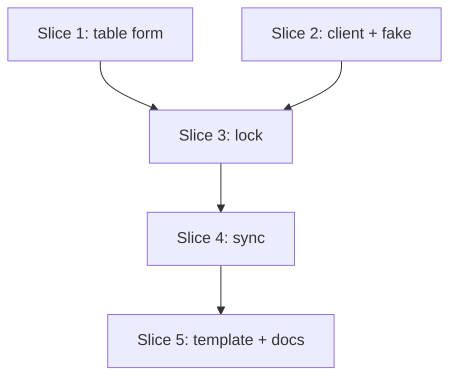

# Plan: GitHub Releases as a feed (S4)

**Created**: 2026-10-31
**Revised**: 2026-10-31, after plan review round 1
**Branch**: claude/dev-team-specs-review-3b3a69, off `main` at be6e0e1
**Status**: implemented
**Gherkin persistence**: custom: tests/features/build-slices/
**Spec**: [docs/specs/lvpm-github-feed-s4.md](../docs/specs/lvpm-github-feed-s4.md)

## Goal

A dependency line `name = { github = "owner/repo", version = ">=1.2" }`
resolves, locks and installs that package from the repo's GitHub releases and
from nowhere else. The release file is `<name>-<version>.lvpkg`, or `.vip`
when there is none, and its version comes from the file name. The lock pins
the file's SHA-256, so a re-uploaded file fails `sync`. Private repos work
with `GH_TOKEN`, `GITHUB_TOKEN` or `gh auth token`, and the token is never
written anywhere. A copyable CI workflow publishes a `.lvpkg` from a tag.

## Acceptance Criteria

The spec's AC1–13, and where each is checked. "Unit" means a Rust test, not
a harness scenario.

| AC | Check |
|---|---|
| 1 install from a release | "pilot B locks from its GitHub release" (slice 3), "pilot B syncs from its GitHub release" (slice 4) |
| 2 `.lvpkg` first, `.vip` second | unit `release_file` table (slice 2); "a release with both files installs the .lvpkg" (slices 3, 4) |
| 3 version from the file name; drafts and pre-releases skipped | unit (slice 2); "pilot B is locked at the file's version, not the tag", "a pre-release is never picked" (slice 3) |
| 4 re-upload is caught | outline "a re-uploaded file fails sync" (slice 4); "re-locking after a re-upload fails with an empty cache" (slice 3) |
| 5 contents must match the name and version | outline "a file whose contents do not match its name fails" (slice 3) |
| 6 `github` with `index` fails | outline "a dependency table lvpm cannot use fails naming the package" (slice 1) |
| 7 never looked up in `[sources]` | "a higher version on a [sources] feed is not used", "a repo with no fitting version does not fall back to [sources]" (slice 3) |
| 8 private repos, token never stored | "a private repo locks with GH_TOKEN" (slice 3), "a private repo syncs and the token is written nowhere" (slice 4), "a rejected token fails without printing it" (slice 3); unit token outline (slice 2) |
| 9 token stays on the API host | "the redirect drops it", at lock (slice 3) and at sync (slice 4) |
| 10 rate limit fails with a hint | unit variants (slice 2); "an exhausted rate limit fails at once with a hint" (slice 3) |
| 11 lock follows the manifest | outline "a change to github in the manifest makes the lock stale", "a lock without GitHub dependencies is unchanged" (slice 3) |
| 12 *(manual)* template publishes from ZAlign | slice 5, run by the user before merge; "the release template is in place" checks the file |
| 13 docs | "the docs describe github dependencies" (slice 5) |

## Approach stances (decision-defaults)

- **Replace-vs-merge:** merge. The table form extends `[dependencies]`, and the
  short form stays byte-for-byte as it is. `[inputs.github]` is an optional
  addition to the lock.
- **Format fidelity:** no lock format bump. A lock without GitHub
  dependencies serialises to the same bytes as today (AC11). Unknown keys in a
  dependency table are refused, never ignored. `lvpm add` and `lvpm upgrade`
  change only the `version` key of a table-form line.
- **Migrate-vs-edit-stub:** nothing to migrate. No manifest or lock holds a
  `github` line yet.
- **Scope:** the spec's. No `lvpm add --github`, no attestations (S6), no GitHub
  Enterprise Server outside Actions, no wait-and-retry.
- **Integration:** one PR against `main` that says `Closes #62`, labelled
  `deviation` (the demo moves from a pilot B fork to ZAlign), merged by the
  user. No auto-merge. The strategic review suggested a second PR for slice 5;
  kept as one, because slice 5 is a YAML file and two docs pages and AC12 is
  the slice's own exit test.

## Design notes

**Manifest.** `Project` gains `github: BTreeMap<String, String>` (name key →
`owner/repo`) for both dependency tables. `dependencies` keeps
`(name, Constraint)`, so the solver and `Inputs::of` see a GitHub dependency's
constraint like any other. `{ version = "*" }` without `github` is valid and
the same as the short form. S12 (`hooks`) and S7c (`index`) add their keys to
the same table parser; whichever lands later adds one arm and turns the
refusal into the feature.

`manifest_edit::set` edits only the `version` key when the existing entry is
an inline table, keeping `github` and the decor. `remove` already drops the
whole entry.

**`github` module (core), split in two.**
- `github/release_file.rs`, pure: the `<name>-<version>.<ext>` parse and the
  `.lvpkg`-before-`.vip` choice. Table-tested.
- `github/api.rs`: `releases(client, api, repo, name, auth)` lists
  `GET {api}/repos/{repo}/releases?per_page=100`, follows `Link: rel="next"`,
  skips drafts and pre-releases and counts them, and returns per release with
  a release file `(version, asset API URL, tag, file name)`. It maps 401, 403
  (rate limit or not), 404, 429, 5xx, connection failures and malformed JSON
  to the errors below, never retrying. The listing is cached per repo under
  the cache dir and read again on `lock` and `--refresh`.
- `GitHubAuth`: a token chain the front end builds (`src/main.rs`,
  `crates/lvpm-tui/src/destination.rs`) from `GH_TOKEN`, `GITHUB_TOKEN`, then
  `gh auth token` (missing `gh`, non-zero exit or empty output: no token; an
  empty variable counts as unset). It resolves on first use, so a run without
  GitHub dependencies spawns no `gh`. It remembers which source the token came
  from, for error texts. Its `Debug` prints `***`. `OpEnv` holds
  `github: GitHub { api, auth }`, where `api` is `GITHUB_API_URL` or
  `https://api.github.com`, both built by the front end and defaulted by
  `OpEnv::new` as `machine` is; core reads no environment variable, as `OpEnv`'s
  module doc requires.

**Where a GitHub entry comes from.** `Entry.source` for a GitHub entry is
`github:owner/repo`, a scheme no feed URL has; `index::github_repo(entry)`
reads it. `ops/lock.rs::build` writes `https://github.com/owner/repo` as the
lock's `source` for such an entry instead of `index::source_of(&entry.url)`
(which would give the asset URL). `Entry.url` is the asset API URL.
shortcut: the repo rides in a string scheme, not an `Origin` enum; upgrade
when a third kind of source needs more than a repo.

**Resolution (lock only).** A new `ops/github_index.rs`,
`with_github(env, downloads, project, previous, moving, index) -> Index`, is
called by `ops/lock.rs::load_index`, which the lock paths (`relock`,
`upgrade`, `add`, `remove`) already share; its callers pass the previous lock
and the `Moving` set they hold. `add` and `remove` build their edit first and
pass the edited project, so a narrowed constraint is judged as written. A
GitHub package that has a locked version and is not moving takes only that
version, from the cache when it holds it: an `add` of another package lists
and downloads nothing for it. The listing cache is read by `lock`, `add` and
`remove`; `upgrade` and `--refresh` list again.
`OpEnv::load_index_each`, `search`, `info`, `query::catalog` and
`install.rs:198` are untouched and never call GitHub. Per GitHub dependency
it:
1. drops every entry of that name from the index (AC7), so no fall-back;
2. lists the repo's releases and emits an `EventSink` line
   (`{name}: listing releases of github.com/{repo}`, or `… (cached)`);
3. takes the version the previous lock holds when the constraint still admits
   it, using the cached bytes under the locked SHA-256 when the cache has them
   (no download);
4. walks the admitted versions newest first, downloading through `Downloads`
   until one has an `lv_min` the project's LabVIEW meets;
5. builds each `Entry` with `index::entry_from_bytes`, checks that its name and
   version equal the file name's (AC5), and sets `md5` from the bytes, so
   `hash_archives` reuses the cached bytes instead of downloading again.

shortcut: only those one or two versions reach the solver, so a conflict that
an older release would solve fails, and `upgrade pkg@X` to a version that is
neither the newest fitting nor the locked one says no such version. The
conflict note names the GitHub package and this limit; it is built in
`solve.rs` where the conflict text prints `entry.source`, which renders
`github:o/r` as `github.com/o/r`. Upgrade to lazy
per-version downloads when someone hits it.

A re-locked version whose bytes changed is caught by `hash_archives`'
existing check against the previous lock's SHA-256: with a warm cache the
pin stays, with an empty cache the lock fails naming both hashes.

**Download.** `fetch::package` gains `auth: Option<&str>`; `Downloads::fetch`
passes the token only when `index::github_repo(entry)` is some. `fetch`'s
`request()` sends `Accept: application/octet-stream` when
`index::github_repo(entry)` is some, token or not. `fetch.rs` does not
import `github`. reqwest's default redirect policy drops `Authorization` on a
cross-host redirect; AC9 checks that against the fake.

**Sync.** `Source::all` puts `Source::GitHub(name, repo)` for each GitHub
dependency first, and that source answers only for its own name. Its index is
built from a fresh listing (never the cached one, since `--clobber` gives a
new asset id), made only when a package of that name misses the cache.
`Source::index` returns `Result`, and a GitHub listing error is attached to
the `Search` of that name as `unfetched`, so sync prints the hint instead of
a bare "not found".

**Lock inputs.** `Inputs` gains `github: BTreeMap<String, String>`, skipped
when empty and taken into `sources_changed`. `lvpm lock --check` reads the
manifest and the lock only, so it needs no network.

**Fake.** `lvpm-testkit` gains `GitHubFake`, a loopback server bound to
`127.0.0.1` that serves `/repos/{o}/{r}/releases` (paged), drafts and
pre-releases, and `/…/releases/assets/{id}` that answers JSON unless the
request sends `Accept: application/octet-stream`, then 302 to
`http://localhost:{port}/download/{id}`: the same server under another host
*name*, so a host-based redirect policy treats it as cross-host. Modes:
private (401 for a bad token, 404 without one), rate limit (403 or 429 with
`x-ratelimit-remaining: 0` and a reset), 403 with requests remaining, 5xx,
replace bytes under the same id, replace with a new id, and delete a release.
It logs each request's path, host, `Accept` and `Authorization`. Scenarios
point `GITHUB_API_URL` at it. The sandbox also sets `GH_CONFIG_DIR` to an
empty scratch dir.

Tests of `github/api.rs` that need the fake live in the root `tests/`
(`tests/github_client.rs`), because `lvpm-testkit` depends on `lvpm-core` and
a dev-dependency back would be a cycle.

## Message texts

Every GitHub error starts with `{name} (github.com/{repo}):`. `{table}` is
`dependencies` or `dev-dependencies`. `{var}` is the token's source:
`GH_TOKEN`, `GITHUB_TOKEN` or `gh auth token`. No text ever holds the token.

| Case | Text |
|---|---|
| `github` and `index` | `[{table}] {name}: github and index cannot be used together; a github dependency comes only from its repo` |
| `index` alone | `[{table}] {name}: index is not supported yet` |
| unknown key | `[{table}] {name}: unknown key {key:?}; expected version or github` |
| no `version` | `[{table}] {name}: a table needs version, e.g. {name} = {{ github = "owner/repo", version = "*" }}` |
| bad `github` | `[{table}] {name}: github = {value:?} is not "owner/repo", e.g. github = "LabVIEW-Open-Source/Serializer"` (a pasted `https://github.com/o/r` adds `; drop "https://github.com/"`) |
| no fitting version | `{name} (github.com/{repo}): no release has a version {constraint}; the newest is {newest}` (no release file at all: `no release holds {name}-<version>.lvpkg or .vip`; skipped ones are counted: `({n} pre-releases and drafts skipped)`) |
| same version twice | `{name} (github.com/{repo}): version {version} is in two releases, {tag1} and {tag2}; delete one of the files` |
| contents differ | `{name} (github.com/{repo}): {file} holds {inner_name} {inner_version}, not {name} {version}; the file name must be <name>-<version> of the package inside` |
| rate limit, no token | `{name} (github.com/{repo}): GitHub's rate limit is used up until {reset} ({in}); run gh auth login or set GH_TOKEN` |
| rate limit, token sent | `{name} (github.com/{repo}): GitHub's rate limit for the token from {var} is used up until {reset} ({in})` |
| 404, no token | `{name} (github.com/{repo}): not found. If it is private, run gh auth login or set GH_TOKEN` |
| 404, token sent | `{name} (github.com/{repo}): not found, or the token from {var} cannot see it` |
| 401 | `{name} (github.com/{repo}): GitHub rejected the token from {var}; unset it or run gh auth login` |
| other 403 | `{name} (github.com/{repo}): GitHub refused access ({message})` |
| 5xx, unreachable, bad JSON | `{name} (github.com/{repo}): cannot read the releases; check your network and try again: {cause}` |
| locked file changed | `{name} (github.com/{repo}): the release file changed after it was locked (locked {sha_locked}, now {sha_now})` |

Asset-download failures (401, 403, 404, 5xx on the asset URL, a deleted
release during sync) reuse the rows above with the same prefix. The first
rate-limit failure aborts the run, so it prints once however many GitHub
dependencies there are. Without a reset header the `until {reset} ({in})`
clause is dropped.

`{message}` is the `message` field of GitHub's JSON error body (the status
line when there is none). `{cause}` is the transport error's text, or
`HTTP {status}`, or the JSON parse error. `{reset}` is the
`x-ratelimit-reset` header (Unix seconds) as UTC in RFC 3339 (`2026-10-31T14:05:00Z`) so tests can match it;
`{in}` is relative (`in 12 min`). The docs say that Actions sets
`GITHUB_TOKEN`, so a workflow needs no `gh auth login`.

## Shared step phrases

Scenarios in slices 3 and 4 use these Givens, defined once in
`tests/steps/github.rs`:

- `the pilot B project`: lvpm.toml depends on
  `labview_open_source_lib_serializer` with github
  `LabVIEW-Open-Source/Serializer` and version `>=1.2`, plus the GitHub fake
  with release `1.2.1` holding pilot B's .vip and a `[sources]` feed with
  pilot B's dependencies. `…, asking for version "{c}"` changes the constraint.
- `the repo "{o}/{r}" has release "{tag}" with "{file}"` (optionally `that
  holds "{name}" {version}`, `holding different bytes`, `as a pre-release`).
- `a project depending on "{name}" with github "{o}/{r}" and version "{c}"`
  (optionally `and a current lvpm.lock`).
- `the repo "{o}/{r}" is private`: the fake accepts only the token
  `s3cret-token` for it. `GH_TOKEN is "{t}"`; `an empty cache`;
  `the GitHub fake's request log is cleared`.

## Slices

### Slice 1: the dependency table and `github`

**Depends-on:** none
**Files:** `crates/lvpm-core/src/project.rs`, `crates/lvpm-core/src/manifest_edit.rs`, `tests/features/build-slices/s4-github-manifest.feature`, `tests/acceptance.rs`, `tests/steps/manifest.rs`

**Behavior:**

```gherkin
Feature: a dependency can name a GitHub repo

  Scenario Outline: a dependency table lvpm cannot use fails naming the package
    Given a project whose lvpm.toml has the dependency line <line>
    When I run "lvpm lock"
    Then the command fails naming "[dependencies] pkg" and <said>
    And no lvpm.lock is written

    Examples:
      | line                                                        | said                           |
      | pkg = { github = "o/r", index = "internal", version = "*" } | "github and index"             |
      | pkg = { index = "internal", version = "*" }                 | "index is not supported yet"   |
      | pkg = { github = "o/r", version = "*", hooks = "run" }      | "unknown key \"hooks\""        |
      | pkg = { github = "o/r" }                                    | "a table needs version"        |
      | pkg = { github = "o", version = "*" }                       | "is not \"owner/repo\""        |
      | pkg = { github = "o/r/x", version = "*" }                   | "is not \"owner/repo\""        |
      | pkg = { github = "/r", version = "*" }                      | "is not \"owner/repo\""        |
      | pkg = { github = "o/", version = "*" }                      | "is not \"owner/repo\""        |
      | pkg = { github = "", version = "*" }                        | "is not \"owner/repo\""        |
      | pkg = { github = 5, version = "*" }                         | "is not \"owner/repo\""        |
      | pkg = { github = "https://github.com/o/r", version = "*" }  | "drop \"https://github.com/\"" |
      | pkg = { github = "o/r", version = "~1.2" }                  | "unsupported version constraint" |

  Scenario: a dev dependency is refused with its own table name
    Given a project whose lvpm.toml has the dev dependency line pkg = { github = "o/r", index = "x", version = "*" }
    When I run "lvpm lock"
    Then the command fails naming "[dev-dependencies] pkg"

  Scenario: the refusal happens when the manifest is read, not only at lock
    Given a project whose lvpm.toml has the dependency line pkg = { github = "o/r", index = "internal", version = "*" }
    When I run "lvpm sync --prefix dest"
    Then the command fails naming "[dependencies] pkg" and "github and index"

  Scenario: the short form is unchanged
    Given a project whose lvpm.toml depends on "pkg" ">=1.2" with a feed that lists pkg 1.2
    When I run "lvpm lock"
    Then the command succeeds
    And lvpm.lock has no [inputs.github] table
```

**Steps:**

#### Step 1.1: parse the table form

**Complexity**: standard
**IMPLEMENT**: `parse_dependencies` accepts a string (as today) or a table with `version` and optional `github`, fills `Project::github`, and refuses `index`, unknown keys, a missing `version`, and a `github` that is not two non-empty `/`-separated parts, with the texts above.
**TEST**: unit tests in `project.rs`: `Project::github` holds the repo for a table line in `[dependencies]` and in `[dev-dependencies]`; `{ version = "*" }` alone equals the short form; each refusal. The feature file with slice 1's scenarios, in `FEATURE_FILES`; full suite green
**REFACTOR**: one `fn dependency(table, name, value)` so the string and table arms share the constraint parse and its context
**Files**: `crates/lvpm-core/src/project.rs`, `tests/features/build-slices/s4-github-manifest.feature`, `tests/acceptance.rs`, `tests/steps/manifest.rs`
**Commit**: `feat(manifest): github dependencies in the table form (#62)`

#### Step 1.2: `add` and `upgrade` keep the table

**Complexity**: standard
**IMPLEMENT**: `manifest_edit::set` changes only `version` inside an existing inline table, keeping its other keys and decor.
**TEST**: unit tests in `manifest_edit.rs`: a table entry keeps `github` and its comment; an equal version leaves the text unchanged; string entries as before; full suite green
**REFACTOR**: none expected
**Files**: `crates/lvpm-core/src/manifest_edit.rs`
**Commit**: `fix(manifest): add and upgrade change only the version of a table line (#62)`

### Slice 2: the GitHub client and its fake

**Depends-on:** none
**Files:** `crates/lvpm-core/src/github.rs`, `crates/lvpm-core/src/github/release_file.rs`, `crates/lvpm-core/src/github/api.rs`, `crates/lvpm-core/src/errors.rs`, `crates/lvpm-core/src/lib.rs`, `crates/lvpm-testkit/src/github.rs`, `crates/lvpm-testkit/src/feed.rs`, `crates/lvpm-testkit/src/lib.rs`, `tests/github_client.rs`

**Behavior:** Rust tests, not harness scenarios. The Gherkin below is their
spec; slice 3 checks the observable parts through the CLI.

```gherkin
  Scenario: the release file is the .lvpkg, else the .vip, named for the package
    Given a release "v1.0" with assets "pkg-1.0.0.4.vip", "pkg-1.0.0.4.lvpkg" and "notes.txt"
    And a release "v0.9" with the asset "pkg-0.9.0.1.vip"
    And a release "v0.8" with the asset "other-0.8.lvpkg"
    When the releases of "pkg" are listed
    Then they are 1.0.0.4 as the .lvpkg and 0.9.0.1 as the .vip

  Scenario: drafts and pre-releases are not versions, and are counted
    Given a draft release and a pre-release, each with "pkg-2.0.lvpkg"
    When the releases of "pkg" are listed
    Then there is no version 2.0 and 2 releases are counted as skipped

  Scenario: every page is read
    Given 150 releases served 100 per page
    When the releases of "pkg" are listed
    Then there are 150 versions

  Scenario: the same version in two releases fails naming both tags
    Given releases "a" and "b" that both hold "pkg-1.0.lvpkg"
    When the releases of "pkg" are listed
    Then the listing fails naming "a" and "b"

  Scenario Outline: an API failure maps to its text and is not retried
    Given the API answers <answer>
    When the releases of "pkg" are listed <with>
    Then the listing fails with the "<case>" text
    And the fake received one request
    And the text holds no token

    Examples:
      | answer                         | with              | case                       |
      | 403 with no requests remaining | without a token   | rate limit, no token       |
      | 429 with no requests remaining | without a token   | rate limit, no token       |
      | 403 with no requests remaining | with GH_TOKEN "t" | rate limit, token sent     |
      | 403 with requests remaining    | without a token   | other 403                  |
      | 404                            | without a token   | 404, no token              |
      | 404                            | with GH_TOKEN "t" | 404, token sent            |
      | 401                            | with GH_TOKEN "t" | 401                        |
      | 502                            | without a token   | 5xx, unreachable, bad JSON |
      | 200 with a body that is not JSON | without a token | 5xx, unreachable, bad JSON |

  Scenario Outline: the token is the first of GH_TOKEN, GITHUB_TOKEN and gh auth token
    Given GH_TOKEN <gh_token>, GITHUB_TOKEN <github_token> and gh <gh>
    Then the token is <token> from <from>

    Examples:
      | gh_token | github_token | gh            | token | from          |
      | "a"      | "b"          | answering "c" | "a"   | GH_TOKEN      |
      | unset    | "b"          | answering "c" | "b"   | GITHUB_TOKEN  |
      | ""       | "b"          | answering "c" | "b"   | GITHUB_TOKEN  |
      | unset    | unset        | answering "c" | "c"   | gh auth token |
      | unset    | unset        | answering ""  | none  | -             |
      | unset    | unset        | failing       | none  | -             |
      | unset    | unset        | missing       | none  | -             |
```

**Steps:**

#### Step 2.1: `GitHubFake` in the testkit

**Complexity**: standard
**IMPLEMENT**: `GitHubFake::start(repos)` with the routes and modes in the design notes, and its request log.
**TEST**: testkit unit tests: a listing round-trips; an asset URL answers JSON without the octet-stream `Accept` and 302 to `localhost` with it; private mode answers 404 without a token and 401 with a wrong one
**REFACTOR**: share the HTTP read/write helpers with `feed.rs` instead of copying them
**Files**: `crates/lvpm-testkit/src/github.rs`, `crates/lvpm-testkit/src/feed.rs`, `crates/lvpm-testkit/src/lib.rs`
**Commit**: `test(testkit): a loopback fake of the GitHub releases API (#62)`

#### Step 2.2: list releases and pick the release file

**Complexity**: standard
**IMPLEMENT**: `github/release_file.rs` (parse and choice) and `github/api.rs::releases` with paging, draft/pre-release skip and count, the two-tags error, and the cached listing.
**TEST**: table test in `release_file.rs`; `tests/github_client.rs` against `GitHubFake` for slice 2's first four scenarios; full suite green
**REFACTOR**: `github.rs` holds only the module docs and re-exports
**Files**: `crates/lvpm-core/src/github.rs`, `crates/lvpm-core/src/github/release_file.rs`, `crates/lvpm-core/src/github/api.rs`, `crates/lvpm-core/src/lib.rs`, `tests/github_client.rs`
**Commit**: `feat(github): list a repo's release files (#62)`

#### Step 2.3: `GitHubAuth` and the error mapping

**Complexity**: complex
**IMPLEMENT**: `GitHubAuth` (lazy chain with an injected variable lookup and `gh` runner, its source name, `Debug` as `***`); `Authorization: Bearer` on API calls only; the status and failure mapping to the message texts, never retried.
**TEST**: unit outline for the chain; `tests/github_client.rs` outline for the failures, each asserting one request and no token in the rendered error; full suite green
**REFACTOR**: one `fn failure(status, headers, auth) -> Error` so the mapping is a table
**Files**: `crates/lvpm-core/src/github/api.rs`, `crates/lvpm-core/src/github.rs`, `crates/lvpm-core/src/errors.rs`, `tests/github_client.rs`
**Commit**: `feat(github): tokens from the environment or gh, and clear API errors (#62)`

### Slice 3: lock a GitHub dependency

**Depends-on:** 1, 2
**Files:** `crates/lvpm-core/src/ops/github_index.rs`, `crates/lvpm-core/src/ops/mod.rs`, `crates/lvpm-core/src/ops/lock.rs`, `crates/lvpm-core/src/ops/add_remove.rs`, `crates/lvpm-core/src/events.rs`, `crates/lvpm-core/src/solve.rs`, `src/render/mod.rs`, `src/render/lock.rs`, `crates/lvpm-core/src/ops/env.rs`, `crates/lvpm-core/src/ops/session.rs`, `crates/lvpm-core/src/fetch.rs`, `crates/lvpm-core/src/index.rs`, `crates/lvpm-core/src/lockfile.rs`, `crates/lvpm-core/src/ops/sync.rs`, `src/main.rs`, `crates/lvpm-tui/src/destination.rs`, `tests/features/build-slices/s4-github-lock.feature`, `tests/acceptance.rs`, `tests/steps/github.rs`, `tests/steps/mod.rs`, `tests/support/sandbox.rs`, `tests/golden/s4-no-github.lock`

**Behavior:**

```gherkin
Feature: lvpm locks a package from its GitHub repo

  Scenario: pilot B locks from its GitHub release
    Given the pilot B project
    When I run "lvpm lock"
    Then the command succeeds
    And lvpm.lock takes "labview_open_source_lib_serializer" at version "1.2.1.16" from "https://github.com/LabVIEW-Open-Source/Serializer" with the .vip's SHA-256
    And lvpm.lock takes "labview_open_source_lib_data_manipulation" from the [sources] feed
    And lvpm.lock has github "LabVIEW-Open-Source/Serializer" for "labview_open_source_lib_serializer" in [inputs.github]
    And stderr names "listing releases of github.com/LabVIEW-Open-Source/Serializer"

  Scenario: pilot B is locked at the file's version, not the tag
    Given the pilot B project
    When I run "lvpm lock"
    Then lvpm.lock's version for "labview_open_source_lib_serializer" is exactly "1.2.1.16", not "1.2.1"

  Scenario: a second lock downloads nothing
    Given the pilot B project with a current lvpm.lock
    And the GitHub fake's request log is cleared
    When I run "lvpm lock"
    Then the GitHub fake received no asset request

  Scenario: a re-lock keeps the locked version when a newer release appears
    Given the pilot B project with a current lvpm.lock
    And the repo "LabVIEW-Open-Source/Serializer" has release "1.3.0" with "labview_open_source_lib_serializer-1.3.0.1.vip"
    When I run "lvpm lock"
    Then lvpm.lock takes "labview_open_source_lib_serializer" at version "1.2.1.16"

  Scenario: lvpm upgrade moves to the newest release and keeps the github line
    Given the pilot B project with a current lvpm.lock
    And the repo "LabVIEW-Open-Source/Serializer" has release "1.3.0" with "labview_open_source_lib_serializer-1.3.0.1.vip"
    When I run "lvpm upgrade labview_open_source_lib_serializer"
    Then lvpm.lock takes "labview_open_source_lib_serializer" at version "1.3.0.1"
    And lvpm.toml's pilot B line still has github "LabVIEW-Open-Source/Serializer"

  Scenario: a constraint above every file fails naming the newest
    Given the pilot B project, asking for version ">=1.2.2"
    When I run "lvpm lock"
    Then the command fails naming "labview_open_source_lib_serializer (github.com/LabVIEW-Open-Source/Serializer)" and "the newest is 1.2.1.16"
    And no lvpm.lock is written

  Scenario: a repo with no fitting version does not fall back to [sources]
    Given the pilot B project, asking for version ">=10"
    And the [sources] feed also lists "labview_open_source_lib_serializer" 10.0
    When I run "lvpm lock"
    Then the command fails naming "labview_open_source_lib_serializer (github.com/LabVIEW-Open-Source/Serializer)"
    And no lvpm.lock is written

  Scenario: a higher version on a [sources] feed is not used
    Given the pilot B project
    And the [sources] feed also lists "labview_open_source_lib_serializer" 9.0
    When I run "lvpm lock"
    Then lvpm.lock takes "labview_open_source_lib_serializer" at version "1.2.1.16" from "https://github.com/LabVIEW-Open-Source/Serializer"

  Scenario: a release whose file is not named for the package fails naming the pattern
    Given the repo "o/r" has release "v1.0" with "Pkg_Release.lvpkg"
    And a project depending on "pkg" with github "o/r" and version "*"
    When I run "lvpm lock"
    Then the command fails naming "pkg (github.com/o/r)" and "pkg-<version>.lvpkg"

  Scenario: a pre-release is never picked
    Given the repo "o/r" has release "v1.0" with "pkg-1.0.lvpkg"
    And the repo "o/r" has release "v2.0-rc" with "pkg-2.0.lvpkg" as a pre-release
    And a project depending on "pkg" with github "o/r" and version "*"
    When I run "lvpm lock"
    Then lvpm.lock takes "pkg" at version "1.0"

  Scenario: a release with both files installs the .lvpkg
    Given the repo "o/r" has release "v1.0" with "pkg-1.0.lvpkg" and "pkg-1.0.vip" holding different bytes
    And a project depending on "pkg" with github "o/r" and version "*"
    When I run "lvpm lock"
    Then lvpm.lock holds the SHA-256 of "pkg-1.0.lvpkg"

  Scenario Outline: a file whose contents do not match its name fails
    Given the repo "o/r" has release "v1.0" with "pkg-1.0.lvpkg" that holds <inside>
    And a project depending on "pkg" with github "o/r" and version "*"
    When I run "lvpm lock"
    Then the command fails naming "pkg-1.0.lvpkg" and <said>
    And no lvpm.lock is written

    Examples:
      | inside      | said        |
      | "other" 1.0 | "other 1.0" |
      | "pkg" 1.1   | "pkg 1.1"   |

  Scenario: a private repo locks with GH_TOKEN, and the redirect drops it
    Given the repo "o/private" is private and has release "v1.0" with "pkg-1.0.lvpkg"
    And a project depending on "pkg" with github "o/private" and version "*"
    And GH_TOKEN is "s3cret-token"
    When I run "lvpm lock"
    Then the command succeeds
    And the GitHub fake saw the token on the listing and the asset request
    And it saw no Authorization header on the request to the redirected host "localhost"
    And "s3cret-token" appears in none of lvpm.toml, lvpm.lock, the cache directory, stdout and stderr

  Scenario: a private repo without a token fails with a hint
    Given the repo "o/private" is private
    And a project depending on "pkg" with github "o/private" and version "*"
    When I run "lvpm lock"
    Then the command fails naming "pkg (github.com/o/private)", "not found" and "gh auth login"
    And no lvpm.lock is written

  Scenario: a rejected token fails without printing it
    Given the repo "o/private" is private
    And a project depending on "pkg" with github "o/private" and version "*"
    And GH_TOKEN is "wrong-token"
    When I run "lvpm lock"
    Then the command fails naming "rejected the token from GH_TOKEN"
    And "wrong-token" appears in neither stdout nor stderr
    And no lvpm.lock is written

  Scenario: an unreachable API fails naming the package and the repo
    Given the pilot B project with GITHUB_API_URL pointing at a closed port
    When I run "lvpm lock"
    Then the command fails naming "labview_open_source_lib_serializer (github.com/LabVIEW-Open-Source/Serializer)" and "cannot read the releases"
    And no lvpm.lock is written

  Scenario: an exhausted rate limit fails at once with a hint
    Given the pilot B project
    And the GitHub fake has no requests left for anonymous callers until "2099-01-01T00:00:00Z"
    When I run "lvpm lock"
    Then the command fails naming "labview_open_source_lib_serializer (github.com/LabVIEW-Open-Source/Serializer)", "rate limit", "2099-01-01T00:00:00Z", "gh auth login" and "GH_TOKEN"
    And the GitHub fake received one request
    And no lvpm.lock is written

  Scenario: re-locking after a re-upload fails with an empty cache
    Given the pilot B project with a current lvpm.lock and an empty cache
    And the GitHub fake now serves other bytes for pilot B's .vip
    When I run "lvpm lock"
    Then the command fails naming "labview_open_source_lib_serializer" and both SHA-256 values

  Scenario Outline: a change to github in the manifest makes the lock stale
    Given the pilot B project with a current lvpm.lock
    When I <change>
    And I run "lvpm lock --check"
    Then the exit code is non-zero
    And stderr is one line naming sources changed

    Examples:
      | change                                                     |
      | change pilot B's github to "someone/Serializer"            |
      | replace pilot B's line with the short form ">=1.2"         |
      | add github "o/r" to the "labview_open_source_lib_data_manipulation" line |

  Scenario: lvpm add keeps the github line
    Given the pilot B project with a current lvpm.lock
    When I run "lvpm add labview_open_source_lib_serializer@>=1.2.1"
    Then lvpm.toml's pilot B line still has github "LabVIEW-Open-Source/Serializer"

  Scenario: lvpm remove drops the github line and its lock input
    Given the pilot B project with a current lvpm.lock
    When I run "lvpm remove labview_open_source_lib_serializer"
    Then lvpm.lock has no [inputs.github] table

  Scenario: a lock without GitHub dependencies is unchanged
    Given a project whose lvpm.toml depends on "pkg" ">=1.2" with a feed that lists pkg 1.2
    When I run "lvpm lock"
    Then lvpm.lock equals tests/golden/s4-no-github.lock, captured from main before step 3.2
```

**Steps:**

#### Step 3.1: the token reaches the download

**Complexity**: complex
**IMPLEMENT**: `OpEnv.github: GitHubAuth`, set by `src/main.rs` and the TUI from the real environment; `Downloads` holds it; `fetch::package` takes `auth: Option<&str>` and sends it with `Accept: application/octet-stream` when `Downloads::fetch` sees a GitHub entry (`index::github_repo`). `index::github_repo` and the `github:` source scheme. The sandbox passes `GITHUB_API_URL`, `GH_TOKEN` when a scenario sets it, and an empty `GH_CONFIG_DIR`. Every caller of `fetch::package` is found by grep and updated.
**TEST**: tests in `tests/github_client.rs` against `GitHubFake`: a GitHub entry downloads the bytes, and the redirected request has no `Authorization`; a feed entry sends neither header; full suite green
**REFACTOR**: the request is built by one `fn request(client, entry, auth)` so `package` stays one flow
**Files**: `crates/lvpm-core/src/ops/env.rs`, `crates/lvpm-core/src/ops/session.rs`, `crates/lvpm-core/src/fetch.rs`, `crates/lvpm-core/src/index.rs`, `src/main.rs`, `crates/lvpm-tui/src/destination.rs`, `tests/support/sandbox.rs`
**Commit**: `feat(fetch): download github release files with the token on the API host only (#62)`

#### Step 3.2: `[inputs.github]` and staleness

**Complexity**: standard
**IMPLEMENT**: `Inputs.github`, filled by `Inputs::of`, skipped when empty, compared in `sources_changed`; the `Inputs` literal in `ops/sync.rs`'s tests gains the field.
**TEST**: capture `tests/golden/s4-no-github.lock` from the current build first; unit tests in `lockfile.rs` (round trip, empty table omitted, changed/removed/added repo is stale); the golden-lock scenario; the staleness outline is written here and passes once step 3.3 can lock pilot B; full suite green
**REFACTOR**: the lock's module doc example gains the `[inputs.github]` line
**Files**: `crates/lvpm-core/src/lockfile.rs`, `crates/lvpm-core/src/ops/sync.rs`, `tests/features/build-slices/s4-github-lock.feature`, `tests/steps/github.rs`, `tests/golden/s4-no-github.lock`
**Commit**: `feat(lock): a changed github repo makes the lock stale (#62)`

#### Step 3.3: GitHub entries in the lock's index

**Complexity**: complex
**IMPLEMENT**: `ops/github_index.rs::with_github` as in the design notes, points 1, 2, 4 and 5, called from `ops/lock.rs::load_index`, whose callers pass `previous`; `build` writes the repo URL as the lock's `source`; the conflict note for a GitHub package.
**TEST**: slice 3's scenarios except those step 3.4 runs and the golden-lock scenario, in `s4-github-lock.feature`, listed in `FEATURE_FILES`; full suite green
**REFACTOR**: the newest-first walk is its own function with a unit test for the `lv_min` skip
**Files**: `crates/lvpm-core/src/ops/github_index.rs`, `crates/lvpm-core/src/ops/mod.rs`, `crates/lvpm-core/src/ops/lock.rs`, `crates/lvpm-core/src/ops/add_remove.rs`, `crates/lvpm-core/src/events.rs`, `crates/lvpm-core/src/solve.rs`, `src/render/mod.rs`, `src/render/lock.rs`, `tests/features/build-slices/s4-github-lock.feature`, `tests/acceptance.rs`, `tests/steps/github.rs`, `tests/steps/mod.rs`
**Commit**: `feat(lock): resolve github dependencies from their releases (#62)`

#### Step 3.4: re-lock reuses the locked file

**Complexity**: standard
**IMPLEMENT**: design notes point 3: the previously locked version, when still admitted, is taken from the cache under its locked SHA-256 without a download.
**TEST**: scenarios "a second lock downloads nothing", "a re-lock keeps the locked version…" and "re-locking after a re-upload fails with an empty cache"; full suite green
**REFACTOR**: none expected
**Files**: `crates/lvpm-core/src/ops/github_index.rs`, `tests/features/build-slices/s4-github-lock.feature`, `tests/steps/github.rs`
**Commit**: `feat(lock): re-locking a github dependency reuses the cached file (#62)`

### Slice 4: sync from GitHub

**Depends-on:** 3
**Files:** `crates/lvpm-core/src/ops/sync.rs`, `tests/features/build-slices/s4-github-sync.feature`, `tests/acceptance.rs`, `tests/steps/github.rs`, `tests/steps/sync.rs`

**Behavior:**

```gherkin
Feature: lvpm syncs a package from its GitHub repo

  Scenario: pilot B syncs from its GitHub release
    Given the pilot B project with a current lvpm.lock and an empty cache
    When I run "lvpm sync --prefix dest"
    Then pilot B 1.2.1.16 and its dependencies are installed in dest
    And each install manifest's archive SHA-256 equals the locked one

  Scenario: a release with both files installs the .lvpkg
    Given the repo "o/r" has release "v1.0" with "pkg-1.0.lvpkg" and "pkg-1.0.vip" holding different bytes
    And a project depending on "pkg" with github "o/r" and version "*" and a current lvpm.lock
    When I run "lvpm sync --prefix dest"
    Then "pkg" 1.0 is installed in dest from the .lvpkg's bytes

  Scenario Outline: a re-uploaded file fails sync
    Given the pilot B project with a current lvpm.lock and an empty cache
    And the GitHub fake now serves other bytes for pilot B's .vip <how>
    When I run "<command>"
    Then the command fails naming "labview_open_source_lib_serializer" and both SHA-256 values
    And nothing is installed in dest

    Examples:
      | how                     | command                          |
      | under the same asset id | lvpm sync --prefix dest          |
      | under the same asset id | lvpm sync --locked --prefix dest |
      | under a new asset id    | lvpm sync --prefix dest          |

  Scenario Outline: a deleted release fails sync unless the cache holds the file
    Given the pilot B project with a current lvpm.lock and <cache>
    And the GitHub fake no longer has release "1.2.1"
    When I run "lvpm sync --prefix dest"
    Then <outcome>

    Examples:
      | cache          | outcome                                                                                         |
      | an empty cache | the command fails naming "labview_open_source_lib_serializer" and nothing is installed in dest |
      | a warm cache   | pilot B 1.2.1.16 is installed in dest                                                           |

  Scenario: a private repo syncs and the token is written nowhere
    Given the repo "o/private" is private and has release "v1.0" with "pkg-1.0.lvpkg"
    And a project depending on "pkg" with github "o/private" and version "*" and a current lvpm.lock
    And GH_TOKEN is "s3cret-token"
    And an empty cache
    When I run "lvpm sync --prefix dest"
    Then "pkg" 1.0 is installed in dest
    And the GitHub fake saw no Authorization header on the request to the redirected host "localhost"
    And "s3cret-token" appears in none of lvpm.toml, lvpm.lock, the cache directory, dest, stdout and stderr

  Scenario: a rate limit during sync gives the hint
    Given the pilot B project with a current lvpm.lock and an empty cache
    And the GitHub fake has no requests left for anonymous callers until "2099-01-01T00:00:00Z"
    When I run "lvpm sync --prefix dest"
    Then the command fails naming "labview_open_source_lib_serializer (github.com/LabVIEW-Open-Source/Serializer)", "rate limit", "2099-01-01T00:00:00Z", "gh auth login" and "GH_TOKEN"
```

**Steps:**

#### Step 4.1: sync looks in the package's repo first

**Complexity**: standard
**IMPLEMENT**: `Source::GitHub(name, repo)` first in `Source::all`, answering only for its name, with an index from a fresh listing; its listing errors go to `Search.unfetched`.
**TEST**: slice 4's scenarios in `s4-github-sync.feature`, listed in `FEATURE_FILES`; full suite green
**REFACTOR**: the GitHub arm maps the listing to entries in one function; the other arms keep their `index::load` call
**Files**: `crates/lvpm-core/src/ops/sync.rs`, `tests/features/build-slices/s4-github-sync.feature`, `tests/acceptance.rs`, `tests/steps/github.rs`, `tests/steps/sync.rs`
**Commit**: `feat(sync): sync github dependencies from their releases (#62)`

### Slice 5: the CI template and the docs

**Depends-on:** 4
**Files:** `.github/workflow-templates/lvpm-release.yml`, `docs/manifest.md`, `docs/usage.md`, `tests/features/build-slices/s4-github-docs.feature`, `tests/acceptance.rs`, `tests/steps/docs.rs`

**Behavior:**

```gherkin
Feature: the GitHub release template and its docs

  Scenario: the release template is in place
    Then .github/workflow-templates/lvpm-release.yml runs on pushed tags with "contents: write"
    And it pins LVPM_VERSION to a version matching \d+\.\d+\.\d+
    And it uploads with "gh release upload" and "--clobber"

  Scenario: the docs describe github dependencies
    Then docs/manifest.md shows a dependency line with "github" and "version"
    And docs/manifest.md names "index" and "unknown key" as refusals
    And docs/manifest.md says the version comes from the file name, not the tag
    And docs/usage.md names "GH_TOKEN", "GITHUB_TOKEN", "gh auth token", "rate limit" and "workflow-templates/lvpm-release.yml"

  # manual, AC12, not run by the harness
  # In Zuehlke/ZAlign with lvpm.toml and the copied template, a pushed tag
  # attaches zuehlke_engineering_lib_zalign-<version>.lvpkg to its release;
  # a second project installs it from the github line, and v1.0.0 (.vip only)
  # installs too.
```

**Steps:**

#### Step 5.1: the CI template

**Complexity**: standard
**IMPLEMENT**: `lvpm-release.yml`: on `push: tags`, `ubuntu-latest`, download a pinned lvpm Linux release (an `LVPM_VERSION` env at the top), `lvpm build`, create the release if the tag has none, `gh release upload "$GITHUB_REF_NAME" dist/*.lvpkg --clobber` with `GITHUB_TOKEN` and `contents: write`.
**TEST**: the template scenario; `actionlint` when installed; the manual AC12 run in ZAlign before merge
**REFACTOR**: comments only where a step's why is not obvious
**Files**: `.github/workflow-templates/lvpm-release.yml`, `tests/features/build-slices/s4-github-docs.feature`, `tests/acceptance.rs`, `tests/steps/docs.rs`
**Commit**: `ci: a workflow template that publishes a .lvpkg from a tag (#62)`

#### Step 5.2: docs

**Complexity**: trivial
**IMPLEMENT**: docs/manifest.md: the minimal table line, `github`, the refusals, the file name rule (`<name>-<version>`, the key must equal the name inside) and tag-vs-file version. docs/usage.md: GitHub dependencies, the token chain, that Actions sets `GITHUB_TOKEN`, rate limits, copying the template, and which commands call GitHub (`lock`, `add`, `remove`, `upgrade`, `sync`; not `search` or `info`).
**TEST**: the docs scenario; full suite green
**REFACTOR**: link usage.md to manifest.md rather than repeating the table
**Files**: `docs/manifest.md`, `docs/usage.md`, `tests/features/build-slices/s4-github-docs.feature`, `tests/steps/docs.rs`
**Commit**: `docs: github dependencies and the release template (#62)`

## Parallelization

Derived by `plan_waves.py`.



| Wave | Slices (parallel) |
|------|-------------------|
| 1 | 1, 2 |
| 2 | 3 |
| 3 | 4 |
| 4 | 5 |

## Complexity Classification

| Rating | Criteria | Review depth |
|--------|----------|--------------|
| `trivial` | Single-file rename, config change, typo fix, documentation-only | Skip inline review; covered by final `/code-review` |
| `standard` | New function, test, module, or behavioral change within existing patterns | Spec-compliance + relevant quality agents |
| `complex` | Architectural change, security-sensitive, cross-cutting concern, new abstraction | Full agent suite including opus-tier agents |

## Pre-PR Quality Gate

- [ ] `cargo test --workspace` and the acceptance harness pass
- [ ] `cargo clippy --workspace --all-targets -- -D warnings`
- [ ] `cargo fmt --check`
- [ ] `/code-review` passes
- [ ] docs/manifest.md and docs/usage.md updated
- [ ] AC12 run by the user in ZAlign, result in the PR description

## Skipped (low value)

None.

## Risks & Open Questions

- **Only one or two versions reach the solver** (design notes, shortcut). A
  conflict that an older release would solve fails, and `upgrade pkg@X` reaches
  only the newest fitting or the locked version. Recorded in code and in the
  conflict note.
- **`gh auth token` in the sandbox.** The harness clears the environment,
  points `APPDATA`/`HOME` at scratch, and sets `GH_CONFIG_DIR` to an empty
  dir, so `gh` finds no login. A system keyring could still answer; the
  anonymous scenarios would then carry a real token to the loopback fake only.
- **reqwest redirect behaviour.** The plan relies on reqwest dropping
  `Authorization` on a cross-host redirect; the scenarios check it against a
  different host name. If it fails, step 3.1 sets a custom redirect policy.
- **`md5` lands in the lock for GitHub packages** (design notes, step 5), as
  for feed packages that advertise one.
- **Pilot B's fixture is a `.vip`.** The `.lvpkg`-first case uses small
  synthetic packages, as other scenarios do.
- **AC12 needs the user** to push a tag in ZAlign and an `lvpm.toml` there.
- **Gherkin persistence.** As in S10a, the build writes the
  `tests/features/build-slices/s4-github-*.feature` files directly.
  `plan_gherkin_export.py` is not run.

## Build Progress

### Slices (grouped by wave)

#### Wave 1
- [x] Slice 1: the dependency table and `github`
  - [x] Step 1.1: parse the table form
  - [x] Step 1.2: `add` and `upgrade` keep the table
- [x] Slice 2: the GitHub client and its fake
  - [x] Step 2.1: `GitHubFake` in the testkit
  - [x] Step 2.2: list releases and pick the release file
  - [x] Step 2.3: `GitHubAuth` and the error mapping

#### Wave 2
- [x] Slice 3: lock a GitHub dependency
  - [x] Step 3.1: the token reaches the download
  - [x] Step 3.2: `[inputs.github]` and staleness
  - [x] Step 3.3: GitHub entries in the lock's index
  - [x] Step 3.4: re-lock reuses the locked file

#### Wave 3
- [x] Slice 4: sync from GitHub
  - [x] Step 4.1: sync looks in the package's repo first

#### Wave 4
- [x] Slice 5: the CI template and the docs
  - [x] Step 5.1: the CI template
  - [x] Step 5.2: docs

## Plan Review Summary

Plan tier: complex — reviewers: Acceptance, Design, UX, Strategic, Parallelization

Round 1: Parallelization approved; Acceptance, Design, UX and Strategic asked
for revision (blockers: download header after the scenarios that need it,
GitHub in every read command's index load, the token read in core, the lock
source as the asset URL, `lvpm add` flattening a table line, missing error
texts and paths, AC5/AC7 half covered). Round 2: Design, UX and Strategic
approved. Acceptance found one new blocker, `[inputs.github]` asserted before
the step that builds it; it is fixed by running the lockfile step (3.2)
before the index step (3.3), the same fix the strategic warning asked for, and
was not sent for a third round.

Warnings folded in after round 2: hints for network errors and a changed
locked file; one rate-limit message per run; step 3.3 split (3.4 re-lock
reuse); a re-lock-keeps-version and an `lvpm upgrade` scenario; the golden
lock captured from `main`; the fake's valid token and log reset; the API base
URL carried in `OpEnv.github`; `add`/`remove` judged against the edited
project; a non-moving locked GitHub package lists nothing; sync's
`Source::index` returning `Result`; the Accept header decided from the entry;
the event, render, error and solver files added.

Warnings left as they are:
- slice 5's scenarios are file-content checks (AC12 is the real check);
- no locking scenario for a dev dependency (unit-tested);
- "text holds no token" is vacuous in the no-token rows;
- no `version = 5` row.

