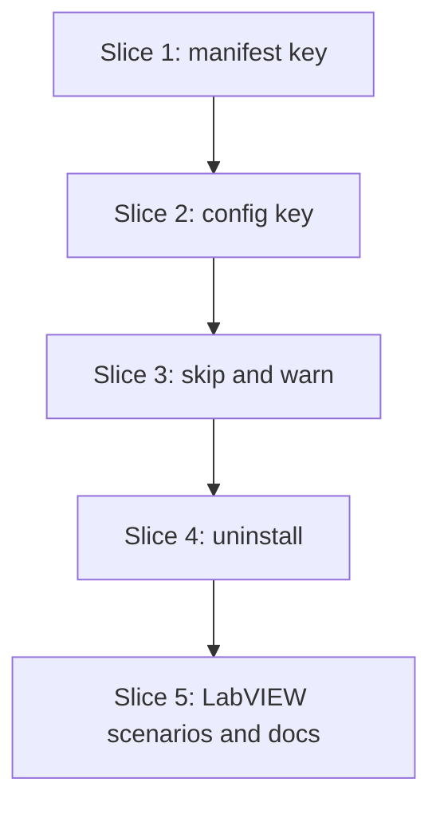

# Plan: Install hooks off by default (S12)

**Created**: 2026-11-03
**Branch**: claude/dev-team-ship-831367, off `main` at aab9a58
**Status**: implemented
**Gherkin persistence**: custom: tests/features/hooks/
**Spec**: [docs/specs/lvpm-install-hooks-s12.md](../docs/specs/lvpm-install-hooks-s12.md)

## Goal

Installing a package into a LabVIEW installation runs none of its hooks
unless the package is allowed: `hooks = "run"` on its line in the root
`lvpm.toml`, or its name in the user config `hooks.run` for a global install
without a project. `--hooks` allows every hook for one command. Every skipped
hook gets a warning that gives `lvpm run-hooks <pkg>` and how to allow it.
Uninstall hooks run only when the install hooks ran. Venvs behave as today;
headless still skips every hook without `--hooks`, but now says so per package.
Closes #76.

## Acceptance Criteria

From the spec; numbers match it.

- [ ] AC1: a global, non-headless install of a package with a PostInstall (or PreInstall) hook does not run it, warns, and exits 0.
- [ ] AC2: for each case in the message table, the warning has that row's lines and no other allow text; following the run-it-now line runs the hook *(manual: needs LabVIEW)*.
- [ ] AC3: with `hooks = "run"` on the line, `lvpm sync --global` starts the hooks and emits no hooks-skipped warning for that package.
- [ ] AC4: with the name in `hooks.run`, a global install runs the hooks and does not warn; `config set/get hooks.run` write and read the list.
- [ ] AC5: `--hooks` runs every hook of that command, for `install` and for `sync --global`.
- [ ] AC6: a package whose install hook was skipped runs no uninstall hook, and the uninstall says so; after `run-hooks` runs its PostInstall successfully it does. A PreInstall-only package stays off until reinstalled allowed.
- [ ] AC7: `lvpm add pkg@<newer>` on a `hooks = "run"` line keeps `hooks = "run"`.
- [ ] AC8: `hooks = "run"` in a dependency's own `lvpm.toml` allows nothing.
- [ ] AC9: a transitive dependency listed as `name = { version = "*", hooks = "run" }` runs its hook.
- [ ] AC10: `hooks = "<anything but run>"` fails at manifest read; the error names the table and package (`<table> <name>: hooks must be "run"`).
- [ ] AC11: headless, an allowlisted package is skipped unless `--hooks`; the warning says `(LabVIEW runs headless)`.
- [ ] AC12: venv installs run no hook and report as today; every other existing scenario passes, except the characterization rows that expected a default-on global hook run (they now pass `--hooks`) and the goldens' PhaseSkipped Hooks/Headless note; the PR lists both.
- [ ] AC13: the README hooks line states the new default; docs/usage.md and docs/labview-integration.md contain `hooks = "run"`, `hooks.run` and `skipped install hook`; docs/manifest.md contains `hooks = "run"`; docs/cli.md contains `hooks.run`.

## Approach stances (decision-defaults)

- **Replace-vs-merge:** merge. `hooks` joins the table form; `[hooks]` joins the user config file; nothing existing is rewritten.
- **Format fidelity:** the install record keeps its format; `skipped_hooks` only gets more entries. The lock is untouched: `hooks` is not a lock input.
- **Migrate-vs-edit-stub:** nothing to migrate, with one stated change. Global, non-headless records from before S12 list no install hook as skipped, so their uninstall hooks keep running. Headless records, and records whose PostInstall failed, already list their install hooks as skipped. Their uninstall hooks stop running after S12, which is ADR 3 §4's rule. A test pins it and the docs say it.
- **Scope:** the spec's. Out: a CLI flag that writes `hooks = "run"`, per-VI hash pins, venv hooks, a headless allowlist, `hooks` in `lvpm.lock`, `uninstall --hooks` (uninstall has no such flag today), grouping many warnings into one.
- **Integration:** one PR against `main` that says `Closes #76`. Not a deviation. Merged by the user, no auto-merge, as earlier slices. The "slices" below are commit groups inside S12's one PR, not issues of their own. Parts 1 and 2 add keys that do nothing until part 3.

## Terms

- **Allowlist** (`HookAllow` in code): the set of name keys whose hooks may run. Never "pin", which means a source or version pin here.
- **Install hook**: PreInstall or PostInstall. **Uninstall hook**: PreUninstall or PostUninstall.

## Design notes

- **`Project::hooks_allowed`**: `BTreeSet<String>`, names as written, filled by `parse_dependencies` from `LineKeys.hooks`. `dependency_table` accepts `hooks`; only the exact string `"run"` passes (case-sensitive, so `"Run"` is refused). `Project::hooks_allowed_for(name)` matches with `name_key`, as `source_pin_of` does. `Project` stays plain data.
- **`Config::hooks_run`**: `Vec<String>`, from `LVPM_CONFIG_HOOKS_RUN` or `[hooks] run` in the file. Both the env value and `config set` arguments split on `,` and whitespace, trim, and drop empty names. `config get hooks.run` prints one name per line, nothing when empty. `config set hooks.run` with no names clears the list, if the CLI accepts zero values; otherwise `config unset` does, as for the other keys. Every `Config { .. }` literal (about 21 files, mostly tests) gains `hooks_run: Vec::new()`; the build checks the list.
- **New module `ops/hook_policy.rs`** (`ops/install.rs` is already 930 lines). It needs no `OpEnv`, so it is tested without FakeInstallation:

  ```rust
  pub struct HookAllow { names: BTreeSet<String>, source: AllowSource }   // private fields
  enum AllowSource { Project { listed: BTreeMap<String, Table> }, Config { names: Vec<String> } }
  pub struct HookContext { pub venv: bool, pub headless: bool, pub forced: bool }
  pub enum Verdict { Run, Skip(SkipReason), Venv }

  impl HookAllow {
      pub fn for_command(config: &Config, project: Option<&Project>) -> Self;
      pub fn verdict(&self, cx: HookContext, name: &str) -> Verdict;
      pub fn line_for(&self, name: &str) -> AllowLine;     // project
      pub fn config_line(&self, skipped: &[String]) -> AllowLine;  // global, all skipped at once
  }
  ```

  Verdict order: venv → `Venv`; forced (`--hooks`) → `Run`; headless → `Skip(Headless)`; allowed → `Run`; else `Skip(NotAllowed)`. `InstallOptions.hook_allow` defaults to allowing nothing, so a missed wiring site fails safe. `for_command` is called at exactly three sites: `sync`, `add_remove::commit` (with `edit.project`, set on `sync_options.install` only), and `install` (no project, so the config). Only the root `Project` is ever passed, so AC8 holds by construction; a unit test proves it.
- **`SkipReason`** gains `NotAllowed` and `AlreadyInstalled`; no parallel enum.
- **The event**: `Event::HooksSkipped { package, hooks: Vec<HookKind>, reason: SkipReason, run_now: bool, dry_run: bool, allow: Option<AllowLine> }`, where
  `AllowLine::{ AddKey { name, table }, AddLine { name }, ConfigSet { names, skipped }, PassHooks }` (`skipped`: how many of `names`, at the end, are the packages this command skipped; the line says `it` or `them` from it).
  Core carries data; `src/render/install.rs` writes the text, and `--json` carries the fields. `run_now` is false when no PostInstall was declared, when headless, and in a dry run. `install_one` collects the events during `apply`, and `apply` emits them after `InstallDone`, and also before it returns an error, so a later failure never hides an earlier skip. On a global install, only the last event carries `allow: Some(ConfigSet { names })`, with the existing names plus every package skipped in this command. Pasting it once allows all of them and drops none.
- **Already installed, now allowed**: in `settle_installed`'s same-version branch, if the record lists a skipped PostInstall and the verdict is now `Run`, emit `HooksSkipped { reason: AlreadyInstalled, run_now: true, allow: None }`. It tells the user to run `run-hooks`. The hook is not run automatically. The allowlist takes effect from the next install or upgrade, and the docs say so.
- **The record** (`install.rs`, next to `mark_hook_skipped`): `Manifest::any_hook_skipped()` (any entry in `skipped_hooks`, so an uninstall-only package counts too) and `Manifest::clear_skipped_hooks()`. A skipped package gets every declared hook in `skipped_hooks` when the record is built, as headless does today. The field's doc comment is updated. `uninstall.rs` and `hooks.rs` call these methods; no new string-prefix checks elsewhere.
- **`run-hooks`** success: `clear_skipped_hooks` drops every install and uninstall entry, **PreInstall included**. Running `run-hooks` is the user's explicit act, and a PreInstall cannot run later anyway. A failed run changes nothing. A PreInstall-only package has no `post_install_vi`, so `run-hooks` skips it ("nothing to do") and its uninstall hooks stay off until it is reinstalled with an allow.
- **Uninstall-only packages**: the verdict applies to any package declaring a hook. A skipped package records its uninstall hooks too. `uninstall_one`'s existing per-hook filter only builds the unrun report and does not stop a hook (review of Step 3.1), so the gate is `any_hook_skipped()`, not an install-hook check.
- **Uninstall**: `uninstall_one` sets `hooks = venv().is_none() && !before.any_hook_skipped()`. The unrun report uses the new `UnrunReason::InstallHookSkipped`, rendered with the remedy.
- **TUI**: no change. `progress.rs` ignores unknown events and `log.rs` has a `{other:?}` fallback.

## Message texts

Rendered in `src/render/install.rs`, stderr, plain text (no colour). lvpm never wraps or truncates them. `--json` carries the structured fields.

| Case | Text |
|---|---|
| Not allowed, project, listed | `warning: pilot_a: skipped install hook PostInstall (hooks are off by default; see docs/labview-integration.md#hooks)` / `  run it now:     lvpm run-hooks pilot_a` / `  always run it:  add hooks = "run" to the pilot_a line in [dependencies] of lvpm.toml` |
| Not allowed, project, transitive | same first two lines / `  always run it:  add to [dependencies] in lvpm.toml:  pilot_a = { version = "*", hooks = "run" }` |
| Not allowed, global | per package, the first two lines; after the last one: `  always run them:  lvpm config set hooks.run <existing...> pilot_a pilot_b` (`it` for one package) |
| Headless | `warning: pilot_a: skipped install hook PostInstall (LabVIEW runs headless; hooks = "run" and hooks.run do not apply)` / `  always run it:  add --hooks to this command` (no run-it-now line) |
| Two hooks | `skipped install hooks PreInstall, PostInstall` |
| PreInstall only | no run-it-now line; `  run it:         uninstall, allow it, then install again (PreInstall runs only at install)` before the allow line |
| Dry run | `warning: pilot_a: would skip install hook PostInstall (...)`, no run-it-now line |
| Already installed, now allowed | `warning: pilot_a: install hook PostInstall was skipped when it was installed` / `  run it now:     lvpm run-hooks pilot_a` |
| Bad `hooks` value | `[dependencies] pkg: hooks must be "run" (delete the key to keep hooks off), got "yes"`; a non-string gives its TOML type, e.g. `got boolean` |
| Unknown key list | `unknown key "x"; expected version, github, index or hooks` |
| Uninstall after a skip | the existing unrun line, reason `its install hook did not run; next time, run lvpm run-hooks <pkg> before uninstalling` (PreInstall-only: `its install hook did not run`) |
| Config key list | `supported keys: cache, hooks.run, sources.local, venv.dir` |
| Uninstall, uninstall-only package not allowed | the existing unrun line, reason `hooks were not allowed when it was installed` (`UnrunReason::NotAllowedAtInstall`) |
| Record not updated after a hook | `warning: pilot_a: the install record could not be updated (<cause on one line>); its uninstall hooks may run` |

A package name goes into a run-it-now or always-run-it line only when it is pasteable: not empty, no leading `-`, and only ASCII letters, digits, `_`, `.`, `-`. Otherwise the line is left out.

## Slices

### Slice 1: `hooks = "run"` in the manifest

**Depends-on:** none
**Files:** `crates/lvpm-core/src/project.rs`, `crates/lvpm-core/src/manifest_edit.rs`, `tests/features/hooks/s12-install-hooks.feature`, `tests/steps/hooks.rs`, `tests/steps/mod.rs`, `tests/acceptance.rs`, `tests/features/build-slices/s4-github-manifest.feature`, `docs/manifest.md`

**Behavior:**

```gherkin
Feature: install hooks run only for allowed packages

  Scenario Outline: a hooks value other than "run" is refused when the manifest is read
    Given a project that <relation> "alpha" with hooks set to <value>
    When I run "lvpm lock"
    Then the exit code is non-zero
    And the error says "<table> alpha: hooks must be \"run\" (delete the key to keep hooks off)"
    And no lvpm.lock is written

    Examples:
      | relation      | value  | table              |
      | depends on    | "yes"  | [dependencies]     |
      | depends on    | "Run"  | [dependencies]     |
      | depends on    | ""     | [dependencies]     |
      | depends on    | true   | [dependencies]     |
      | dev-depends on| "skip" | [dev-dependencies] |

  Scenario: hooks = "run" is accepted on every dependency table
    Given "first" lists "alpha" 1.0, "beta" 1.0
    And a project that depends on "alpha" with hooks set to "run"
    And the project dev-depends on "beta" with hooks set to "run"
    When I run "lvpm lock"
    Then the command succeeds

  Scenario: hooks = "run" next to github keeps both
    Given a project that depends on "pkg" with github "o/r", version "*" and hooks set to "run"
    When the manifest is read
    Then it is accepted with the github source and hooks allowed for "pkg"

  Scenario: lvpm add of a newer version keeps hooks = "run"
    Given "first" lists "alpha" 1.0, 2.0
    And a project that depends on "alpha" "1.0" with hooks set to "run" and lvpm.lock is current
    When I run "lvpm add alpha@2.0"
    Then the command succeeds
    And lvpm.toml has exactly the line: alpha = { version = "2.0", hooks = "run" }
```

**Steps:**

#### Step 1.1: parse `hooks` on a dependency line

**Complexity**: standard
**IMPLEMENT**: `LineKeys.hooks`; `dependency_table` accepts `hooks = "run"` and refuses any other value with the message text; `Project::hooks_allowed` and `hooks_allowed_for`. The s4-github-manifest row 13 now uses `foo = "x"` as its unknown key; docs/manifest.md:237 names `foo` and the new key list.
**TEST**: unit tests in `project.rs`: `hooks = "run"` in each table kind and next to `github`/`index`; `"yes"`, `"Run"`, `""`, `true`, `1`, `[]` with exact messages; name match in any case; the short form gives an empty set. The test that expected `hooks` as an unknown key now uses `foo`.
**REFACTOR**: the unknown-key message lists keys from one array.
**Files**: `crates/lvpm-core/src/project.rs`, `tests/features/build-slices/s4-github-manifest.feature`, `docs/manifest.md`
**Commit**: `feat(s12): read hooks = "run" on a dependency line`

#### Step 1.2: `add` keeps `hooks`, and the scenarios

**Complexity**: standard
**IMPLEMENT**: a `manifest_edit` unit test that `set` on a line with `hooks = "run"` keeps it, asserting the exact line (no code change expected); the feature file with slice 1's scenarios, its steps in `tests/steps/hooks.rs`, listed in `FEATURE_FILES`.
**TEST**: slice 1's scenarios pass; full suite green.
**REFACTOR**: reuse the S7c table-line step helpers rather than copying them.
**Files**: `crates/lvpm-core/src/manifest_edit.rs`, `tests/features/hooks/s12-install-hooks.feature`, `tests/steps/hooks.rs`, `tests/steps/mod.rs`, `tests/acceptance.rs`
**Commit**: `test(s12): hooks = "run" survives lvpm add`

### Slice 2: `hooks.run` in the user config

**Depends-on:** 1
**Files:** `crates/lvpm-core/src/config.rs`, every file with a `Config { .. }` literal (`crates/lvpm-core/src/ops/*.rs`, `crates/lvpm-tui/src/app.rs`, `crates/lvpm-tui/tests/acceptance.rs`, `tests/support/sandbox.rs`, `tests/steps/*.rs`), `tests/features/hooks/s12-install-hooks.feature`, `tests/steps/hooks.rs`

**Behavior:**

```gherkin
  Scenario: lvpm config set hooks.run writes the global allowlist
    When I run "lvpm config set hooks.run pilot_a delacor_lib_qmh"
    And I run "lvpm config get hooks.run"
    Then the output lists "pilot_a" and "delacor_lib_qmh"

  Scenario: config set hooks.run replaces the list
    Given the user config has hooks.run "old_pkg"
    When I run "lvpm config set hooks.run new_pkg"
    And I run "lvpm config get hooks.run"
    Then the output lists "new_pkg" and not "old_pkg"

  Scenario: commas and spaces both separate names
    When I run "lvpm config set hooks.run a,b"
    And I run "lvpm config get hooks.run"
    Then the output lists "a" and "b"

  Scenario: LVPM_CONFIG_HOOKS_RUN overrides the file
    Given the user config has hooks.run "pilot_a"
    And LVPM_CONFIG_HOOKS_RUN is "other_pkg" for the command
    When I run "lvpm config get hooks.run"
    Then the output lists "other_pkg" and not "pilot_a"

  Scenario: an unknown config key names hooks.run among the supported ones
    When I run "lvpm config get hooks.allow"
    Then the exit code is non-zero
    And the error says "hooks.run"
```

Environment values are set on the spawned command, never on the test process, so scenarios stay isolated.

**Steps:**

#### Step 2.1: the `hooks.run` key

**Complexity**: standard
**IMPLEMENT**: `FileConfig.hooks.run`, `Config::hooks_run`, the split rule, `apply` and `get`; `hooks_run: Vec::new()` in every `Config` literal.
**TEST**: unit tests in `config.rs` through `resolve` and `apply`: file, env, `"a,,b"`, `" a "`, empty env value gives `[]`, set replaces; slice 2's scenarios; full suite green.
**REFACTOR**: one supported-keys constant for both error messages.
**Files**: as slice 2
**Commit**: `feat(s12): hooks.run in the user config`

### Slice 3: skip and warn unless allowed

**Depends-on:** 2
**Files:** `crates/lvpm-core/src/ops/hook_policy.rs` (new), `crates/lvpm-core/src/ops/mod.rs`, `crates/lvpm-core/src/ops/install.rs`, `crates/lvpm-core/src/ops/sync.rs`, `crates/lvpm-core/src/ops/add_remove.rs`, `crates/lvpm-core/src/install.rs`, `crates/lvpm-core/src/events.rs`, `src/render/install.rs`, `src/render/headless.rs`, `src/render/mod.rs`, `src/render/json.rs`, `tests/features/hooks/s12-install-hooks.feature`, `tests/steps/hooks.rs`, `tests/features/lvpm-lockfile/slice-1-characterization-harness-and-recorded-cli-output.feature`, `tests/golden/`

**Behavior** (core-level, not user-facing Gherkin: unit tests on `ops::testing::FakeInstallation`, which has no VI Server. "Started" means lvpm started the hook, seen as `HookStarting`; the real run is in slice 5's `@labview` scenarios). `[3.1]` and `[3.2]` mark the step that lands each scenario.

```gherkin
  # [3.1] the verdict
  Scenario: a global install skips a PostInstall hook nobody allowed
    Given a LabVIEW installation and no project
    And a package "hooked" declaring a PostInstall hook
    When "hooked" is installed into the installation
    Then the install succeeds
    And no hook is started
    And the install record lists "PostInstall" as skipped

  Scenario: a package in hooks.run has its hook started
    Given a LabVIEW installation and no project
    And the user config has hooks.run "Hooked"
    And a package "hooked" declaring a PostInstall hook
    When "hooked" is installed into the installation
    Then the PostInstall hook of "hooked" is started

  Scenario: sync --global starts the hook of a package with hooks = "run"
    Given a project that depends on "hooked" with hooks set to "run" and a current lock
    When the project is synced into the LabVIEW installation
    Then the PostInstall hook of "hooked" is started
    And no hooks-skipped warning is given

  Scenario: sync --global --hooks starts a hook nobody allowed
    Given a project that depends on "hooked" without hooks = "run" and a current lock
    When the project is synced into the LabVIEW installation with --hooks
    Then the PostInstall hook of "hooked" is started

  Scenario: only the package that is not allowed is skipped
    Given a project that depends on "hooked" with hooks set to "run" and on "other_hooked" without it, with a current lock
    When the project is synced into the LabVIEW installation
    Then the PostInstall hook of "hooked" is started
    And no hook of "other_hooked" is started

  Scenario: hooks.run does not allow a project sync
    Given the user config has hooks.run "hooked"
    And a project that depends on "hooked" without hooks = "run" and a current lock
    When the project is synced into the LabVIEW installation
    Then no hook is started

  Scenario: hooks = "run" in a project does not allow lvpm install
    Given a project that depends on "hooked" with hooks set to "run"
    And a package "hooked" declaring a PostInstall hook
    When "hooked" is installed with lvpm install
    Then no hook is started

  Scenario: add --global of a hooks = "run" line starts its hook
    Given a project that depends on "hooked" with hooks set to "run"
    When "lvpm add hooked@2.0 --global" runs
    Then the PostInstall hook of "hooked" is started

  Scenario: a transitive dependency listed with version "*" and hooks = "run" starts its hook
    Given "beta" depends on "hooked"
    And a project that depends on "beta" and on "hooked" "*" with hooks set to "run", with a current lock
    When the project is synced into the LabVIEW installation
    Then the PostInstall hook of "hooked" is started

  Scenario: hooks = "run" in a dependency's own lvpm.toml allows nothing
    Given a package "beta" from a source tree whose own lvpm.toml lists "hooked" with hooks set to "run"
    And a project that depends on "beta" and a current lock
    When the project is synced into the LabVIEW installation
    Then no hook of "hooked" is started

  Scenario: --hooks starts every hook of that one command
    Given a LabVIEW installation and no project
    And packages "hooked" and "other_hooked", each declaring PreInstall and PostInstall hooks
    When both are installed with --hooks
    Then the PreInstall and PostInstall hooks of both packages are started

  Scenario: headless with --hooks starts the hook
    Given LabVIEW runs headless
    And a package "hooked" declaring a PostInstall hook
    When "hooked" is installed into the installation with --hooks
    Then the PostInstall hook of "hooked" is started

  Scenario: a venv install runs no hook and reports as before
    Given a project with a venv that depends on "hooked" with hooks set to "run"
    When the project is synced into its venv
    Then no hook is started
    And the hooks-not-run line is given, not the hooks-skipped warning

  # [3.2] the warning
  Scenario: the skip warns with the config line
    Given a LabVIEW installation and no project
    And the user config has hooks.run "other_pkg"
    And a package "hooked" declaring a PostInstall hook
    When "hooked" is installed into the installation
    Then a hooks-skipped warning names "hooked", "PostInstall" and reason "not allowed"
    And its allow line is config set with "other_pkg", "hooked"

  Scenario: two skipped packages share one config line that keeps both
    Given a LabVIEW installation and no project
    And the user config has hooks.run "other_pkg"
    And packages "a_hooked" and "b_hooked", each declaring a PostInstall hook
    When both are installed into the installation
    Then each gets a hooks-skipped warning
    And exactly one allow line is given: config set with "other_pkg", "a_hooked", "b_hooked"

  Scenario: a listed project line is told to add the key
    Given a project that depends on "hooked" with github "o/r" and a current lock
    When the project is synced into the LabVIEW installation
    Then the allow line says to add the key to the "hooked" line in [dependencies]

  Scenario: an unlisted transitive dependency is offered a version "*" line
    Given "beta" depends on "hooked"
    And a project that depends on "beta" and a current lock
    When the project is synced into the LabVIEW installation
    Then the allow line is a new [dependencies] line for "hooked" with version "*"

  Scenario: headless skips an allowed package and says the allowlist does not apply
    Given LabVIEW runs headless
    And the user config has hooks.run "hooked"
    And a package "hooked" declaring a PostInstall hook
    When "hooked" is installed into the installation
    Then no hook is started
    And a hooks-skipped warning names "hooked" with reason "headless"
    And its allow line is "pass --hooks" and it has no run-it-now line

  Scenario: headless and not allowed gets the headless reason
    Given LabVIEW runs headless
    And a package "hooked" declaring a PostInstall hook
    When "hooked" is installed into the installation
    Then a hooks-skipped warning names "hooked" with reason "headless"

  Scenario: a PreInstall-only package gets no run-hooks line
    Given a LabVIEW installation and no project
    And a package "pre_only" declaring only a PreInstall hook
    When "pre_only" is installed into the installation
    Then no hook is started
    And the warning has no run-it-now line
    And the warning has an allow line

  Scenario: a dry run says what it would skip and writes nothing
    Given a LabVIEW installation and no project
    And a package "hooked" declaring a PostInstall hook
    When "hooked" is installed into the installation as a dry run
    Then a dry-run hooks-skipped warning names "hooked" with no run-it-now line
    And no hook is started
    And no install record is written

  Scenario: allowing an installed package with a skipped hook says to run it
    Given "hooked" was installed with its PostInstall skipped
    And the user config now has hooks.run "hooked"
    When "hooked" is installed into the installation again, same version
    Then no hook is started
    And a hooks-skipped warning names "hooked" with reason "already installed" and a run-it-now line

  Scenario: a failure after a skipped package still warns about it
    Given a LabVIEW installation and no project
    And "hooked" declaring a PostInstall hook, then "broken" that fails to unpack
    When both are installed into the installation
    Then the command fails
    And a hooks-skipped warning names "hooked"
```

CLI-level (non-`@labview`, the fake LabVIEW 2026 installation the slice-1 feature uses):

```gherkin
  Scenario: lvpm install of a hooked package exits 0 and warns on stderr
    Given a LabVIEW 2026 installation
    When I run "lvpm install hooked --labview-version 2026"
    Then the exit code is 0
    And stderr says "hooked: skipped install hook PostInstall (hooks are off by default"
    And stdout does not say "skipped install hook"
    And "lvpm list" shows "PostInstall" as skipped for "hooked"
```

Rendering (unit tests in `src/render/install.rs`, exact text, no colour):

```gherkin
  Scenario Outline: the warning reads as the message table says
    Given a hooks-skipped event for <case>
    When it is rendered as text
    Then stderr is exactly the <case> row of the message table

    Examples:
      | case                           |
      | not allowed, project, listed   |
      | not allowed, project, transitive |
      | not allowed, global, one       |
      | not allowed, global, two       |
      | headless                       |
      | two hooks                      |
      | PreInstall only                |
      | dry run                        |
      | already installed, now allowed |

  Scenario: --json carries the event as data
    Given a hooks-skipped event for "pilot_a"
    When it is rendered as JSON
    Then the line has the package, the hooks, the reason, run_now, dry_run and the allow line's kind and names
```

**Steps:**

#### Step 3.1: the verdict and `HookAllow`

**Complexity**: complex
**IMPLEMENT**: `ops/hook_policy.rs` with `HookAllow::for_command`, `HookContext`, `Verdict`, `verdict`; `InstallOptions.hook_allow`; wiring at the three sites; `install_one` asks per package; skipped packages get every declared hook in `skipped_hooks`. `SkipReason::NotAllowed`. The slice-1 characterization scenarios that expect "the PostInstall hook ran" without an allow now pass `--hooks`, with a comment pointing at S12, so the suite stays green from this commit on.
**TEST**: a table test over all 16 `HookContext` × allowed rows; `for_command` with a project, with none, and proof that a dependency's manifest is never read; FakeInstallation tests for the `[3.1]` scenarios, including `add --global`. Full suite green.
**REFACTOR**: delete `HookPolicy`; `report_unrun_hooks` keeps only the venv case.
**Files**: `crates/lvpm-core/src/ops/hook_policy.rs`, `crates/lvpm-core/src/ops/mod.rs`, `crates/lvpm-core/src/ops/install.rs`, `crates/lvpm-core/src/ops/sync.rs`, `crates/lvpm-core/src/ops/add_remove.rs`, `crates/lvpm-core/src/install.rs`, `crates/lvpm-core/src/events.rs`, `tests/features/lvpm-lockfile/slice-1-characterization-harness-and-recorded-cli-output.feature`
**Commit**: `feat(s12): install hooks run only for allowed packages`

#### Step 3.2: the `HooksSkipped` warning

**Complexity**: standard
**IMPLEMENT**: `Event::HooksSkipped`, `AllowLine`, `SkipReason::AlreadyInstalled`; collect in `apply`, emit after `InstallDone` and on the error path; the combined config line; the same-version check in `settle_installed`. Render to stderr per the message table; JSON (inline in `src/render/json.rs`). Drop the `PhaseSkipped { Hooks, Headless }` note on a LabVIEW installation, since the per-package warning replaces it; update the render tests at `src/render/install.rs` around lines 549–559 and `src/render/headless.rs`. Recorded goldens that show the old note are edited by hand, only the changed rows, and the PR says they were hand-adjusted, not re-recorded.
**TEST**: render unit tests for every message-table row; FakeInstallation tests for the `[3.2]` scenarios; the CLI scenario; the JSON test. Full suite green.
**REFACTOR**: one `hook_names` helper for the warning and the venv line.
**Deviation**: the CLI scenario is tagged `@labview`: it needs a LabVIEW installation, so the offline suite does not run it. The FakeInstallation tests cover the same warning.
**Files**: `crates/lvpm-core/src/ops/install.rs`, `crates/lvpm-core/src/ops/hook_policy.rs`, `crates/lvpm-core/src/events.rs`, `src/render/install.rs`, `src/render/headless.rs`, `src/render/mod.rs`, `src/render/json.rs`, `tests/features/hooks/s12-install-hooks.feature`, `tests/steps/hooks.rs`, `tests/golden/`
**Commit**: `feat(s12): warn after an install that skipped a hook`

### Slice 4: uninstall follows the install hook

**Depends-on:** 3
**Files:** `crates/lvpm-core/src/ops/uninstall.rs`, `crates/lvpm-core/src/ops/hooks.rs`, `crates/lvpm-core/src/install.rs`, `crates/lvpm-core/src/events.rs`, `src/render/uninstall.rs`, `src/render/hooks.rs`

**Behavior:**

```gherkin
  Scenario: a package whose install hook was skipped runs no uninstall hook
    Given "hooked" was installed into the installation with its PostInstall skipped
    And "hooked" declares a PreUninstall hook
    When "hooked" is uninstalled
    Then no hook is started
    And the uninstall says its uninstall hooks did not run because its install hook did not run
    And it says to run lvpm run-hooks first

  Scenario: a package with both install hooks gets its uninstall hooks back after run-hooks
    Given "hooked" declares PreInstall, PostInstall and PreUninstall hooks
    And "hooked" was installed with both install hooks skipped
    And its skipped hooks were cleared as a successful run-hooks clears them
    When "hooked" is uninstalled
    Then the PreUninstall hook of "hooked" is started

  Scenario: a failed PostInstall keeps the uninstall hooks off
    Given "hooked" was installed and its PostInstall hook failed
    When "hooked" is uninstalled
    Then no hook is started
    And the uninstall says its install hook did not run

  Scenario: a headless-installed record from before S12 no longer runs its uninstall hooks
    Given an install record for "hooked" written by a headless install, listing every hook as skipped
    When "hooked" is uninstalled
    Then no hook is started

  Scenario: a package with only uninstall hooks runs none unless it was allowed
    Given "unhooked" declares only a PreUninstall hook
    And "unhooked" was installed into the installation without being allowed
    When "unhooked" is uninstalled
    Then no hook is started

  Scenario: a global record from before S12 keeps running its uninstall hooks
    Given an install record for "hooked" with no skipped hooks and a PreUninstall hook
    When "hooked" is uninstalled
    Then the PreUninstall hook of "hooked" is started

  Scenario: a failed run-hooks leaves the record unchanged
    Given "hooked" was installed with its PostInstall skipped
    When lvpm run-hooks "hooked" fails because the hook VI is gone
    Then the install record is unchanged
```

**Steps:**

#### Step 4.1: uninstall checks the record

**Complexity**: standard
**IMPLEMENT**: `Manifest::any_hook_skipped`; `uninstall_one` skips both uninstall hooks when it is true; `UnrunReason::InstallHookSkipped` and its render text with the remedy.
**TEST**: FakeInstallation tests for the skip, an uninstall-only package, the failed PostInstall, the headless record and the global pre-S12 record; render unit test. Full suite green.
**REFACTOR**: the unrun filter reads the reason once; the existing `starts_with("PreUninstall=")` uses the new `Manifest` helper.
**Files**: `crates/lvpm-core/src/ops/uninstall.rs`, `crates/lvpm-core/src/install.rs`, `crates/lvpm-core/src/events.rs`, `src/render/uninstall.rs`
**Commit**: `feat(s12): uninstall hooks run only after their install hook`

#### Step 4.2: `run-hooks` clears the skip

**Complexity**: standard
**IMPLEMENT**: `Manifest::clear_skipped_hooks` (drops PreInstall, PostInstall, PreUninstall and PostUninstall entries); a small `settle_rerun(roots, &Manifest, Result<Duration>)` that clears and writes the record on `Ok` and leaves it on `Err`; `run_hooks` calls it with `run_hook_vi`'s result.
**TEST**: `settle_rerun` with an `Ok` (record cleared) and an `Err` (record byte-identical); unit test: a record with PreInstall= and PostInstall= skipped, cleared, then `uninstall_one` starts the uninstall hook. The failed-run test uses a missing hook VI (`RerunHookViGone`), which fails before any VI Server is needed, and asserts the record is byte-identical. The success path through `run_hook_vi` is covered by slice 5's `@labview` scenario. Full suite green.
**REFACTOR**: share the record read/write with `mark_hook_skipped`.
**Files**: `crates/lvpm-core/src/ops/hooks.rs`, `crates/lvpm-core/src/install.rs`, `src/render/hooks.rs`
**Commit**: `feat(s12): a hook run by run-hooks counts as run`

### Slice 5: real LabVIEW scenarios and docs

**Depends-on:** 4
**Files:** `tests/features/hooks/s12-install-hooks.feature`, `tests/steps/hooks.rs`, `README.md`, `docs/usage.md`, `docs/manifest.md`, `docs/labview-integration.md`, `docs/cli.md`, `src/main.rs`

**Behavior:**

```gherkin
  @labview @unsafe
  Scenario: a global install of the hook fixture skips it and says how to allow it
    Given the hook fixture package is not installed
    When I run "lvpm install lvpm_test_fixture --global"
    Then the command succeeds
    And the PostInstall hook did not run
    And stderr says "lvpm_test_fixture: skipped install hook PostInstall"
    And stderr says "lvpm run-hooks lvpm_test_fixture"

  @labview @unsafe
  Scenario: following the run-it-now line runs the hook
    Given the hook fixture was installed with its PostInstall skipped
    When I run "lvpm run-hooks lvpm_test_fixture"
    Then the PostInstall hook ran for "lvpm_test_fixture"
    And "lvpm list" no longer shows "PostInstall" as skipped for "lvpm_test_fixture"

  @labview @unsafe
  Scenario: following the always-run-it line runs the hook on the next install
    Given the hook fixture package is not installed
    And the user config has hooks.run "lvpm_test_fixture"
    When I run "lvpm install lvpm_test_fixture --global"
    Then the PostInstall hook ran for "lvpm_test_fixture"
    And stderr does not say "skipped install hook"

  Scenario: the docs state the new default
    Given the repository docs
    When they are read
    Then README.md mentions "hooks are off by default"
    And docs/manifest.md mentions "hooks = \"run\""
    And docs/usage.md mentions "hooks = \"run\"", "hooks.run" and "skipped install hook"
    And docs/labview-integration.md mentions "lvpm run-hooks", "hooks = \"run\"", "hooks.run" and "skipped install hook"
    And docs/cli.md mentions "hooks.run"
```

**Steps:**

#### Step 5.1: the `@labview` scenarios

**Complexity**: standard
**IMPLEMENT**: slice 5's `@labview` scenarios.
**TEST**: `cargo test` green (the `@labview` ones are counted as not run without `LVPM_TEST_LABVIEW=1`); run them with LabVIEW if available, otherwise note AC2 and the run-hooks success path as manual evidence for the PR.
**REFACTOR**: reuse `hook_ran` and the sandbox's hook marker.
**Files**: `tests/features/hooks/s12-install-hooks.feature`, `tests/steps/hooks.rs`
**Commit**: `test(s12): a real global install skips the hook fixture's PostInstall`

#### Step 5.2: docs

**Complexity**: trivial
**IMPLEMENT**: README hooks line and limitations bullet; docs/labview-integration.md gets a `#hooks` section with the rule table, what a hook is (package code run inside LabVIEW with your rights), that the allowlist applies from the next install, the PreInstall-only case, and the headless-record uninstall change; docs/usage.md (`--hooks`, `hooks.run`, the env override, the warning); docs/manifest.md (`hooks` key); docs/cli.md (`config` keys). `lvpm run-hooks --help` says hooks run package code.
**TEST**: the docs scenario passes; full suite green.
**REFACTOR**: the rule table lives in labview-integration.md and the others link to it.
**Files**: `README.md`, `docs/usage.md`, `docs/manifest.md`, `docs/labview-integration.md`, `docs/cli.md`, `src/main.rs`, `tests/features/hooks/s12-install-hooks.feature`, `tests/steps/hooks.rs`
**Commit**: `docs(s12): install hooks are off by default`

## Parallelization



| Wave | Slices (parallel) |
|------|-------------------|
| 1 | 1 |
| 2 | 2 |
| 3 | 3 |
| 4 | 4 |
| 5 | 5 |

One builder runs them in order. Slices 1 and 2 touch disjoint code but share the feature and steps files.

## Complexity Classification

As the template: `trivial` skips inline review, `standard` gets spec-compliance plus relevant quality agents, `complex` the full suite. Step 3.1 is `complex`: it is the security decision of the slice.

## Pre-PR Quality Gate

- [ ] `cargo test` passes (unit, scenarios; `@labview` counted as not run)
- [ ] `cargo clippy --all-targets -- -D warnings` passes
- [ ] `cargo fmt --check` passes
- [ ] `/code-review` passes
- [ ] AC2 manual evidence (a real global install of pilot A) in the PR, or stated as not done
- [ ] PR lists the files beyond build-slices.md's S12 Files line, and the hand-adjusted goldens

## Skipped (low value)

None.

## Risks & Open Questions

- The slice-1 characterization rows that expect a hook to run by default change; they are the shipped-behaviour change ADR 3 accepts.
- Headless records, and records with a failed PostInstall, stop running uninstall hooks after S12 (ADR 3 §4). Stated in the docs, pinned by a test.
- AC2's "following either runs the hook" and the `run-hooks` success path need a real LabVIEW; without one the PR states them as unverified.
- Core tests see "the hook started", not "the hook ran", because the fake installation has no VI Server.
- Recorded goldens for the headless hooks note are hand-adjusted, not re-recorded.
- `LVPM_CONFIG_HOOKS_RUN` can allow code to run, as `sources.local` can redirect sources; docs/usage.md says the env var overrides the file.
- Not done: grouping warnings when many packages are skipped. Each package gets its own lines.
- The spec is amended to match (run-hooks clears PreInstall too; the warning's allow line; dry run; already-installed; headless wording). The user sees the amendment at this gate.

## Build Progress

### Slices (grouped by wave)

#### Wave 1
- [x] Slice 1: `hooks = "run"` in the manifest
  - [x] Step 1.1: parse `hooks` on a dependency line
  - [x] Step 1.2: `add` keeps `hooks`, and the scenarios

#### Wave 2
- [x] Slice 2: `hooks.run` in the user config
  - [x] Step 2.1: the `hooks.run` key

#### Wave 3
- [x] Slice 3: skip and warn unless allowed
  - [x] Step 3.1: the verdict and `HookAllow`
  - [x] Step 3.2: the `HooksSkipped` warning

#### Wave 4
- [x] Slice 4: uninstall follows the install hook
  - [x] Step 4.1: uninstall checks the record
  - [x] Step 4.2: `run-hooks` clears the skip

#### Wave 5
- [x] Slice 5: real LabVIEW scenarios and docs
  - [x] Step 5.1: the `@labview` scenarios
  - [x] Step 5.2: docs

## Plan Review Summary

Plan tier: complex — reviewers: Acceptance, Design, UX, Strategic, Parallelization

Round 1: Parallelization approved; Acceptance, Design, UX and Strategic asked for revisions. Round 2: all four approve.

Blockers fixed in round 1:

- `run-hooks` left `PreInstall=` in `skipped_hooks`, so two-hook packages never got their uninstall hooks back (all four). Now every install and uninstall entry is cleared.
- The project hint rebuilt the line and could drop a `github`/`index` key (UX). Now it says to add the key to the existing line.
- Per-package `config set hooks.run` hints overwrote each other (UX). Now one combined line follows the warnings.
- Policy code would grow the 930-line `ops/install.rs` (Design). Now in `ops/hook_policy.rs`.
- Missing scenarios: crossed allowlists, headless with and without `--hooks`, already-installed and allowed, `s4-github-manifest.feature` row 13 (Acceptance).

Warnings taken: structured `AllowLine` in core; private `HookAllow` fields and `HookContext`; one `for_command` constructor; `Manifest` helpers; the `Config` literal fan-out listed; emit before an error; headless and dry-run wording; the bad-value remedy; the env override; characterization edits land in Step 3.1; `settle_rerun` pins the run-hooks record update; uninstall-only packages are gated by `any_hook_skipped` (corrected in Step 3.1 review: the existing filter only reports).

Warnings not taken: an injectable hook runner (no new abstraction; `settle_rerun` covers the record logic); grouping many warnings; `uninstall --hooks` (no such flag today).

Observations kept for build: the docs show a short-form line converted to table form once; `AlreadyInstalled` events carry no allow line.

## Approval

Approved by the user on 2026-11-03 ("Start Building automatically after the plan"), given before the round-2 reviews finished; all reviewers approved in round 2.
