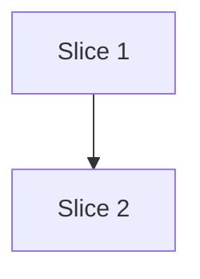

# Plan: A minimum release age for packages

**Created**: 2026-10-31
**Branch**: claude/lvpm-package-age-limit-b8af27
**Status**: approved
**Gherkin persistence**: tests/features
**Spec**: [docs/specs/lvpm-min-release-age.md](../docs/specs/lvpm-min-release-age.md)

## Goal

`[sources] min-age-days = N` in `lvpm.toml` makes lvpm hold back every
package version whose feed release date is less than N days old, and take the
newest version that remains. A version pinned exactly in the manifest is
exempt; an undated version is allowed. It defends against a malicious new
release on a trusted feed, which the community usually finds within days.

**Approach stances** (decision-defaults axes):

- **Scope**: `lvpm.toml` only. No `lvpm config` default, no CLI flag, no
  exclude list (user, 2026-10-31). Global `lvpm install` outside a project is
  not covered, and the docs say so.
- **Format fidelity**: `lvpm.lock` stays byte-identical when the key is absent
  or `0`; the key is recorded under `[inputs]` only when non-zero. `Entry`
  gains a field that `--json` query output does not serialize (`#[serde(skip)]`).
- **Replace-vs-merge**: the age check joins the existing LabVIEW gate in
  `solve.rs`'s `get_dependencies`; no second resolver path, and held-back
  reporting is computed in `solve.rs` from the same predicate.
- **Integration**: two slices, the first already a complete guarantee (filter,
  exemption, failure text, lock staleness). PR with `Closes` only if
  `/issues-from-plan` makes this a slice under #57. Auto-merge is not enabled.

## User-visible text (fixed here so scenarios assert exact strings)

One verb for the rule everywhere: **held back by min-age-days**. Dates are
shown in UTC as `YYYY-MM-DD`; "eligible" is release date + N days.

- **Held-back notice** (one line per package, newest held-back version only,
  nothing printed when nothing is held back or the key is absent/0, never for
  an exact pin), on stderr like the existing `warning: … unresolved` advisory:
  `held back alpha 1.1 by min-age-days = 14 (released 2026-10-28, eligible 2026-11-11); using 1.0`
- **JSON event**: `{"event": "held_back", "name": "alpha", "version": "1.1", "chosen": "1.0", "released": "2026-10-28T11:46:49Z", "eligible": "2026-11-11T11:46:49Z", "min_age_days": 14}`
- **No eligible version** (the error lists every version the constraint admits
  that was held back, newest first, and no version the constraint excludes):
  ```text
  alpha >=1.1: every version is held back by min-age-days = 14
    1.2 released 2026-10-29, eligible 2026-11-12
    1.1 released 2026-10-28, eligible 2026-11-11
  next: wait until 2026-11-11, lower min-age-days, or pin an exact version of alpha in lvpm.toml
  ```
  The `next:` date is the earliest eligible date listed. For a transitive
  package the last line reads `… or pin an exact version of beta in lvpm.toml
  (it is required by alpha)`.
- **Bad value**: `lvpm.toml: [sources] min-age-days must be a whole number of days, 0 or more (got "14"), for example min-age-days = 14`
- **Stale lock**: `lvpm.lock is out of date: min-age-days changed (14 -> 7)`; absent renders as `0` (`0 -> 14`)

## Acceptance Criteria

- [ ] AC1 Off by default: no key or `0` resolves as today; lock bytes unchanged
- [ ] AC2 A too-new version is held back for the newest eligible one
- [ ] AC3 Boundary: exactly N×86400 s old is eligible, one second younger is not; a future date is too new
- [ ] AC4 Transitive requirements are filtered too
- [ ] AC5 An exact pin is exempt, and only the pinned package; so is the version named on `lvpm add pkg@v` or `lvpm lock --upgrade-package pkg@v` for that run
- [ ] AC6 No eligible version in the source the name resolves from (first source wins; no fall-through): lock fails with the text above
- [ ] AC7 Undated feed entries and local/cache/`.lvpkg` packages are eligible
- [ ] AC8 The four release-date shapes parse; sign-less `0530` reads as `+0530`
- [ ] AC9 Held-back notice and JSON event as above
- [ ] AC10 Bad values (negative, non-integer, over 4294967295) are refused with the text above
- [ ] AC11 Changing, adding or removing the key makes the lock stale (`0` and absent are the same); time passing does not
- [ ] AC12 `docs/manifest.md` documents the key, the exact-pin exemption, the undated rule, the date's origin and the global-install gap

## Slices

Release dates in the acceptance fixtures are written relative to the real
clock when the feed is published ("released 3 days ago"), with ages far from
the limit (3 vs 30 days against 14). The fixture step records the timestamp it
wrote, and date assertions render it with lvpm's own UTC formatter, so a
midnight rollover cannot split them. The exact boundary (AC3) is a unit test
on a pure function that takes `now`. "Days passing" is simulated by
republishing the feed with older dates.

### Slice 1: Versions younger than the limit are held back

**Depends-on:** none
**Files:** `crates/lvpm-core/src/released.rs`, `crates/lvpm-core/src/lib.rs`, `crates/lvpm-core/src/index.rs`, `crates/lvpm-core/src/cache.rs`, `crates/lvpm-core/src/project.rs`, `crates/lvpm-core/src/solve.rs`, `crates/lvpm-core/src/ops/lock.rs`, `crates/lvpm-core/src/lockfile.rs`, `crates/lvpm-core/src/ops/sync.rs`, `src/render/lock.rs`, `src/render/query.rs`, `crates/lvpm-tui/**`, `tests/support/**`, `tests/steps/solver.rs`, `tests/steps/sources.rs`, `tests/steps/manifest.rs`, `tests/steps/staleness.rs`, `tests/features/lvpm-min-release-age/slice-1-*.feature`

**Behavior:**

```gherkin
Feature: lvpm does not choose a package version younger than min-age-days

  Background:
    Given a project with labview "2024" whose [sources] are "first" then "second"

  Scenario: without min-age-days the newest version is locked
    Given "first" lists "alpha" 1.0 released 30 days ago and "alpha" 1.1 released 3 days ago
    And the project depends on "alpha" ">=1.0"
    When I run "lvpm lock"
    Then the command succeeds
    And lvpm.lock takes "alpha" 1.1 from "first"

  Scenario: min-age-days = 0 is off
    Given the project sets min-age-days to 0
    And "first" lists "alpha" 1.0 released 30 days ago and "alpha" 1.1 released 3 days ago
    And the project depends on "alpha" ">=1.0"
    When I run "lvpm lock"
    Then lvpm.lock takes "alpha" 1.1 from "first"

  Scenario: a version younger than the limit is held back for the newest old enough
    Given the project sets min-age-days to 14
    And "first" lists "alpha" 1.0 released 30 days ago and "alpha" 1.1 released 3 days ago
    And the project depends on "alpha" ">=1.0"
    When I run "lvpm lock"
    Then the command succeeds
    And lvpm.lock takes "alpha" 1.0 from "first"

  Scenario: a held-back version never falls through to a later source
    Given the project sets min-age-days to 14
    And "first" lists "alpha" 1.1 released 3 days ago
    And "second" lists "alpha" 1.1 released 30 days ago and "alpha" 2.0 released 30 days ago
    And the project depends on "alpha" ">=1.0"
    When I run "lvpm lock"
    Then the command fails naming "alpha" and "min-age-days = 14"
    And no lvpm.lock is written

  Scenario: a transitive requirement is held to the limit too
    Given the project sets min-age-days to 14
    And "first" lists "alpha" 1.0 released 30 days ago requiring "beta>=2.0"
    And "first" lists "beta" 2.0 released 30 days ago and "beta" 2.1 released 3 days ago
    And the project depends on "alpha" "*"
    When I run "lvpm lock"
    Then lvpm.lock takes "beta" 2.0 from "first"

  Scenario: lvpm sync without a lock applies the limit
    Given the project sets min-age-days to 14
    And "first" lists "alpha" 1.0 released 30 days ago and "alpha" 1.1 released 3 days ago
    And the project depends on "alpha" ">=1.0"
    When I run "lvpm sync --prefix dest"
    Then lvpm.lock takes "alpha" 1.0 from "first"

  Scenario: lvpm add without a version writes the newest eligible version
    Given the project sets min-age-days to 14
    And "first" lists "alpha" 1.0 released 30 days ago and "alpha" 1.1 released 3 days ago
    When I run "lvpm add alpha --prefix dest"
    Then lvpm.lock takes "alpha" 1.0 from "first"

  Scenario: lvpm lock --upgrade does not move to a version younger than the limit
    Given the project sets min-age-days to 14
    And "first" lists "alpha" 1.0 released 30 days ago
    And the project depends on "alpha" ">=1.0"
    And I have run "lvpm lock"
    When "first" also lists "alpha" 1.1 released 3 days ago
    And I run "lvpm lock --upgrade"
    Then lvpm.lock takes "alpha" 1.0 from "first"

  # Exact pins
  Scenario: an exact pin younger than the limit is locked
    Given the project sets min-age-days to 14
    And "first" lists "alpha" 1.0 released 30 days ago and "alpha" 1.1 released 3 days ago
    And the project depends on "alpha" "1.1"
    When I run "lvpm lock"
    Then lvpm.lock takes "alpha" 1.1 from "first"

  Scenario: an exact dev-dependency pin is exempt too
    Given the project sets min-age-days to 14
    And "first" lists "alpha" 1.0 released 30 days ago and "alpha" 1.1 released 3 days ago
    And the project dev-depends on "alpha" "1.1"
    When I run "lvpm lock"
    Then lvpm.lock takes "alpha" 1.1 from "first"

  Scenario: lvpm add with an explicit version is exempt
    Given the project sets min-age-days to 14
    And "first" lists "alpha" 1.0 released 30 days ago and "alpha" 1.1 released 3 days ago
    When I run "lvpm add alpha@1.1 --prefix dest"
    Then lvpm.lock takes "alpha" 1.1 from "first"

  Scenario: an exact pin stays exempt when another package also requires the package
    Given the project sets min-age-days to 14
    And "first" lists "alpha" 1.0 released 30 days ago requiring "beta>=2.0"
    And "first" lists "beta" 2.0 released 30 days ago and "beta" 2.1 released 3 days ago
    And the project depends on "alpha" "*" and "beta" "2.1"
    When I run "lvpm lock"
    Then lvpm.lock takes "beta" 2.1 from "first"

  Scenario: an exact pin exempts only the pinned package, not its requirements
    Given the project sets min-age-days to 14
    And "first" lists "alpha" 1.1 released 3 days ago requiring "beta>=2.0"
    And "first" lists "beta" 2.0 released 30 days ago and "beta" 2.1 released 3 days ago
    And the project depends on "alpha" "1.1"
    When I run "lvpm lock"
    Then lvpm.lock takes "alpha" 1.1 from "first"
    And lvpm.lock takes "beta" 2.0 from "first"

  # Undated versions
  Scenario: a feed entry without a release date is eligible
    Given the project sets min-age-days to 14
    And "first" lists "alpha" 1.0 released 30 days ago and "alpha" 1.1 with no release date
    And the project depends on "alpha" ">=1.0"
    When I run "lvpm lock"
    Then lvpm.lock takes "alpha" 1.1 from "first"

  Scenario: a feed entry with an unreadable release date is eligible
    Given the project sets min-age-days to 14
    And "first" lists "alpha" 1.0 released 30 days ago and "alpha" 1.1 with release date "???, 19 ??? 2016 15:46:24 0530"
    And the project depends on "alpha" ">=1.0"
    When I run "lvpm lock"
    Then lvpm.lock takes "alpha" 1.1 from "first"

  Scenario: a package in a local folder is eligible whatever the limit
    Given the project sets min-age-days to 14
    And the local folder holds "alpha" 1.0
    And the project depends on "alpha" "*"
    When I run "lvpm lock"
    Then lvpm.lock takes "alpha" 1.0 from "local"

  Scenario Outline: a release date in each feed shape is read, not treated as undated
    Given the project sets min-age-days to 14
    And "first" lists "alpha" 1.0 released 30 days ago and "alpha" 1.1 released 3 days ago written as <shape>
    And the project depends on "alpha" ">=1.0"
    When I run "lvpm lock"
    Then lvpm.lock takes "alpha" 1.0 from "first"

    Examples:
      | shape                 |
      | a signed offset       |
      | GMT                   |
      | a sign-less offset    |

  # Failures
  Scenario: no version old enough fails listing what was held back
    Given the project sets min-age-days to 14
    And "first" lists "alpha" 1.0 released 30 days ago, "alpha" 1.1 released 3 days ago and "alpha" 1.2 released 2 days ago
    And the project depends on "alpha" ">=1.1"
    When I run "lvpm lock"
    Then the command fails with the min-age-days error for "alpha" ">=1.1" listing 1.2 and 1.1
    And the error does not mention version 1.0
    And no lvpm.lock is written

  Scenario: a LabVIEW-gated version is not listed in the min-age-days error
    Given the project sets min-age-days to 14
    And "first" lists "alpha" 1.1 released 3 days ago and "alpha" 3.0 for LabVIEW 2026 released 30 days ago
    And the project depends on "alpha" ">=1.1"
    When I run "lvpm lock"
    Then the command fails with the min-age-days error for "alpha" ">=1.1" listing 1.1
    And the error does not mention version 3.0

  Scenario: a transitive requirement with no old enough version fails naming who needs it
    Given the project sets min-age-days to 14
    And "first" lists "alpha" 1.0 released 30 days ago requiring "beta>=2.0"
    And "first" lists "beta" 2.0 released 3 days ago
    And the project depends on "alpha" "*"
    When I run "lvpm lock"
    Then the command fails with the min-age-days error for "beta" ">=2.0" listing 2.0
    And the error says "it is required by alpha"
    And no lvpm.lock is written

  Scenario Outline: a min-age-days that is not a whole number of days is refused
    Given the project's [sources] has the line 'min-age-days = <value>'
    When I run "lvpm lock"
    Then the command fails saying "[sources] min-age-days must be a whole number of days, 0 or more (got <value>)"
    And no lvpm.lock is written

    Examples:
      | value      |
      | -1         |
      | "14"       |
      | 14.5       |
      | true       |
      | 4294967296 |

  # The lock
  Scenario Outline: the lock records a non-zero min-age-days only
    Given the project sets min-age-days to <value>
    And "first" lists "alpha" 1.0 released 30 days ago
    And the project depends on "alpha" "*"
    When I run "lvpm lock"
    Then lvpm.lock <records>

    Examples:
      | value  | records                           |
      | absent | has no min-age-days entry         |
      | 0      | has no min-age-days entry         |
      | 14     | records min-age-days 14           |

  Scenario Outline: changing min-age-days makes the lock stale
    Given the project sets min-age-days to <before>
    And "first" lists "alpha" 1.0 released 30 days ago
    And the project depends on "alpha" "*"
    And I have run "lvpm lock"
    When the project sets min-age-days to <after>
    And I run "lvpm lock --check"
    Then the command fails saying "min-age-days changed"

    Examples:
      | before | after  |
      | 14     | 7      |
      | absent | 14     |
      | 14     | absent |

  Scenario Outline: 0 and absent are the same for the lock
    Given the project sets min-age-days to <before>
    And "first" lists "alpha" 1.0 released 30 days ago
    And the project depends on "alpha" "*"
    And I have run "lvpm lock"
    When the project sets min-age-days to <after>
    And I run "lvpm lock --check"
    Then the command succeeds

    Examples:
      | before | after  |
      | absent | 0      |
      | 0      | absent |

  Scenario: days passing do not make the lock stale
    Given the project sets min-age-days to 14
    And "first" lists "alpha" 1.0 released 30 days ago and "alpha" 1.1 released 3 days ago
    And the project depends on "alpha" ">=1.0"
    And I have run "lvpm lock"
    When "first" now lists "alpha" 1.1 as released 30 days ago
    And I run "lvpm lock --check"
    Then the command succeeds
    And lvpm.lock takes "alpha" 1.0 from "first"

  Scenario: raising min-age-days re-locks a version that is now too new
    Given the project sets min-age-days to 7
    And "first" lists "alpha" 1.0 released 30 days ago and "alpha" 1.1 released 10 days ago
    And the project depends on "alpha" ">=1.0"
    And I have run "lvpm lock"
    When the project sets min-age-days to 14
    And I run "lvpm lock"
    Then lvpm.lock takes "alpha" 1.0 from "first"
```

**Steps:**

#### Step 1.1: Read `Package.Release Date` into each feed entry

**Complexity**: standard
**IMPLEMENT**: New std-only module `released.rs`: `parse(&str) -> Option<i64>` (RFC 2822 with signed offset, `GMT`, sign-less `HHMM` read as `+`), `day(i64) -> String` (`YYYY-MM-DD` UTC) and `rfc3339(i64) -> String`. `Entry.released: Option<i64>` with `#[serde(skip)]`; `parse_into` fills it from `Package.Release Date`; local, cache and `.lvpkg` entries get `None`. Add `released: None` to every existing `Entry {` literal (≈40 in 16 files, a few more under `crates/lvpm-core/src/`: `fetch.rs`, `ops/sync.rs`, `staging.rs`, `install.rs`)
**TEST**: Unit tests in `released.rs` for the four shapes, `0530` == `+0530` != `-0530` (exact epoch values), `???` → `None`, and known-answer formatting: 0 → `1970-01-01` / `1970-01-01T00:00:00Z`, 1_700_000_000 → `2023-11-14` / `2023-11-14T22:13:20Z`, and a leap day: 1_709_164_800 → `2024-02-29` / `2024-02-29T00:00:00Z`. A `.lvpkg`-read entry has `None` too. One test in `index.rs` that runs a feed fragment through `parse_into` and gets the date from the `Package.Release Date` key; one that a cache-imported entry has `None`
**REFACTOR**: Keep `released.rs` the only place that knows date formats
**Files**: `crates/lvpm-core/src/released.rs`, `crates/lvpm-core/src/lib.rs`, `crates/lvpm-core/src/index.rs`, `crates/lvpm-core/src/cache.rs`, `src/render/query.rs`, `crates/lvpm-tui/**`, `tests/support/**`
**Commit**: `feat(index): read each feed entry's release date`

#### Step 1.2: Read `[sources] min-age-days` from the manifest

**Complexity**: standard
**IMPLEMENT**: `Project.min_age_days: u32` (absent = 0). In `project.rs`'s `[sources]` match, a `("min-age-days", Integer(n))` arm with `0..=u32::MAX` and a `("min-age-days", other)` error arm, both before the generic string arm (otherwise `"14"` is read as a source named `min-age-days`). Error text as in "User-visible text". A top-level `min-age-days` outside `[sources]` stays an ignored unknown key. Steps "the project sets min-age-days to …" (incl. `absent`) and "the project's [sources] has the line …" in `tests/steps/manifest.rs`
**TEST**: Unit tests in `project.rs` for absent, `0`, `14`, `-1`, `"14"`, `14.5`, `true`, `4294967296` (refused) and `4294967295` (accepted); acceptance Outline. The Outline's step matches its expected text to end of line, so `"14"` inside it parses
**REFACTOR**: Match the error style of the `defaults` arm
**Files**: `crates/lvpm-core/src/project.rs`, `tests/steps/manifest.rs`
**Commit**: `feat(manifest): read [sources] min-age-days`

#### Step 1.3: The solver holds back versions younger than the limit, except exact pins

**Complexity**: complex
**IMPLEMENT**: In `solve.rs`: `pub struct AgeLimit { now: i64, days: u32 }` (pub: `solve` is pub and `clippy -D warnings` rejects a private type in it) and pure `too_new(released: Option<i64>, limit: &AgeLimit) -> bool` (`days == 0` → false first, so 0 is fully off; then `None` → false; future date → true; saturating arithmetic). `solve` takes `Option<AgeLimit>`; the provider keeps the set of (name, version) named by a `Constraint::Exact` in `constraints` — the root constraints only, never a feed entry's `requires` (this includes `pins` from `lvpm add pkg@v` / `lvpm lock --upgrade-package pkg@v`). Keep `Gated`/`gated()` unchanged; the pubgrub `M` type becomes `enum Unavailable { Labview(Gated), TooNew { released: i64, days: u32 } }`, returned from `get_dependencies` beside the LabVIEW gate. `Unavailable` implements `Display` (pubgrub's `M` needs it) and the `Tree` alias moves to it. pubgrub yields one `Custom` leaf per rejected version, so a post-pass in `Conflict::explain` merges them into one `Fact::TooNew { package, versions: Vec<(version, released)>, wanted, required_by: Option<String>, days }`, taking `wanted` and the requirer from the sibling `Manifest`/`Requires` facts (also in `rank` and `Display`). In `src/render/lock.rs` `conflict_text`, a `TooNew` fact renders its own block and `next:` line in place of the generic header and footer. `ops/lock.rs` `resolve` builds the `AgeLimit` from `project` (no new parameter) with `now()` moved from `cache.rs` to `released.rs`. Update the `solve(` calls in `tests/steps/solver.rs` and the `solve.rs` tests (pass `None`) and the `Resolution {` literal in the `ops/lock.rs` test helper. Update the `Fact` matches in `src/render/lock.rs`
**TEST**: Unit tests for `too_new`: exactly N×86400 s (eligible), one second less (not), `now + 1` (not), `days = 0` (always eligible), `u32::MAX` (no overflow), `None` (eligible). Render unit test in `src/render/lock.rs` for the `TooNew` block. Unit test for the conflict text with two held-back versions newest first, with known-answer eligible dates (release + N×86400), and with `u32::MAX` days rendering without panic. Existing LabVIEW-gate conflict tests in `solve.rs` stay green unchanged. Acceptance: all Slice 1 scenarios except "# The lock"
**REFACTOR**: One eligibility predicate (`fn unavailable(&self, entry)`) used by `get_dependencies` and, in Slice 2, by held-back reporting
**Files**: `crates/lvpm-core/src/solve.rs`, `crates/lvpm-core/src/cache.rs`, `crates/lvpm-core/src/released.rs`, `crates/lvpm-core/src/ops/lock.rs`, `src/render/lock.rs`, `tests/steps/solver.rs`, `tests/steps/sources.rs`, `tests/features/lvpm-min-release-age/slice-1-versions-younger-than-the-limit-are-held-back.feature`
**Commit**: `feat(solve): hold back versions younger than min-age-days`

#### Step 1.4: The lock records the limit

**Complexity**: standard
**IMPLEMENT**: `Inputs.min_age_days: u32` with `#[serde(default, skip_serializing_if = "is_zero")]`; a difference is `StaleReason::MinAgeChanged { from, to }`, rendered as in "User-visible text" (and in `--json`). Update the `Inputs` literal in `ops/sync.rs`'s `lock_of` test helper and the doc comment on `Inputs`
**TEST**: Unit tests in `lockfile.rs`: the staleness check takes no clock input (its signature has no `now`); a zero lock's text is byte-identical to today's; a non-zero value round-trips; an old lock without the key parses as 0. Acceptance: the "# The lock" scenarios
**REFACTOR**: Check the new reason next to `SourcesChanged` in the same function
**Files**: `crates/lvpm-core/src/lockfile.rs`, `crates/lvpm-core/src/ops/sync.rs`, `src/render/lock.rs`, `tests/steps/staleness.rs`
**Commit**: `feat(lock): record min-age-days in [inputs]`

### Slice 2: Report held-back versions, and the docs

**Depends-on:** 1
**Files:** `crates/lvpm-core/src/solve.rs`, `crates/lvpm-core/src/ops/lock.rs`, `crates/lvpm-core/src/events.rs`, `src/render/mod.rs`, `src/render/lock.rs`, `docs/reference/json-output.md`, `docs/manifest.md`, `tests/steps/docs.rs`, `tests/steps/sources.rs`, `tests/features/lvpm-min-release-age/slice-2-*.feature`

**Behavior:**

```gherkin
Feature: lvpm reports what min-age-days held back

  Background:
    Given a project with labview "2024" whose [sources] are "first" then "second"
    And the project sets min-age-days to 14

  Scenario: a held-back newer version is reported
    Given "first" lists "alpha" 1.0 released 30 days ago and "alpha" 1.1 released 3 days ago
    And the project depends on "alpha" ">=1.0"
    When I run "lvpm lock"
    Then stderr has the held-back line for "alpha" 1.1 using 1.0

  Scenario: only the newest held-back version is reported
    Given "first" lists "alpha" 1.0 released 30 days ago, "alpha" 1.1 released 5 days ago and "alpha" 1.2 released 2 days ago
    And the project depends on "alpha" ">=1.0"
    When I run "lvpm lock"
    Then stderr has the held-back line for "alpha" 1.2 using 1.0
    And stderr has no held-back line for "alpha" 1.1

  Scenario: a held-back transitive version is reported
    Given "first" lists "alpha" 1.0 released 30 days ago requiring "beta>=2.0"
    And "first" lists "beta" 2.0 released 30 days ago and "beta" 2.1 released 3 days ago
    And the project depends on "alpha" "*"
    When I run "lvpm lock"
    Then stderr has the held-back line for "beta" 2.1 using 2.0

  Scenario: the held-back event is in the JSON output
    Given "first" lists "alpha" 1.0 released 30 days ago and "alpha" 1.1 released 3 days ago
    And the project depends on "alpha" ">=1.0"
    When I run "lvpm lock --json"
    Then the JSON events include one "held_back" event for "alpha" 1.1 with chosen 1.0, min_age_days 14 and its release and eligible dates

  Scenario: nothing is printed when nothing was held back
    Given "first" lists "alpha" 1.0 released 30 days ago
    And the project depends on "alpha" "*"
    When I run "lvpm lock --json"
    Then stderr has no held-back line
    And the JSON events include no "held_back" event

  Scenario: an exact pin is not reported as held back
    Given "first" lists "alpha" 1.0 released 30 days ago and "alpha" 1.1 released 3 days ago
    And the project depends on "alpha" "1.0"
    When I run "lvpm lock"
    Then stderr has no held-back line

  Scenario: a newer version gated by LabVIEW is not reported as held back by age
    Given "first" lists "alpha" 1.0 released 30 days ago and "alpha" 3.0 for LabVIEW 2026 released 3 days ago
    And the project depends on "alpha" "*"
    When I run "lvpm lock"
    Then lvpm.lock takes "alpha" 1.0 from "first"
    And stderr has no held-back line

  Scenario: lvpm lock --check prints no held-back line
    Given "first" lists "alpha" 1.0 released 30 days ago and "alpha" 1.1 released 3 days ago
    And the project depends on "alpha" ">=1.0"
    And I have run "lvpm lock"
    When I run "lvpm lock --check"
    Then the command succeeds
    And stderr has no held-back line

  Scenario: the manifest guide documents min-age-days
    Then docs/manifest.md mentions "min-age-days"
    And docs/manifest.md mentions "an exact pin is exempt from min-age-days"
    And docs/manifest.md mentions "no release date"
    And docs/manifest.md mentions "the release date the feed lists"
    And docs/manifest.md mentions "lvpm install --global"
    And docs/reference/json-output.md mentions "held_back"
```

**Steps:**

#### Step 2.1: Report a held-back newer version

**Complexity**: standard
**IMPLEMENT**: `Resolution.held_back: Vec<HeldBack { name, version, chosen, released }>` (`HeldBack` is pub), computed in `solve.rs` by `Provider::held_back_in(&chosen)` (beside `unresolved_in`): for each chosen package, the newest catalog version above the chosen one that the admitted range allows (rebuilt by a small `admitted(key, chosen) -> Ranges` helper from `self.direct` and the chosen entries' requirements via `floor_range`) and that is unavailable only because it is too new (not LabVIEW-gated, not exempt). A version above the chosen one kept out by a lock preference is not reported. Accepted over-report: a too-new version whose own requirements would also have conflicted is still reported. `lock.rs` maps it to `Event::HeldBack`, rendered in `src/render/lock.rs` and emitted on `lock` (with or without `--upgrade`), `add` and `sync` (not on `lock --check`, which resolves nothing). Text and JSON as in "User-visible text"
**TEST**: Unit tests for `held_back_in`: LabVIEW-gated and too-new → not reported; exact pin → not reported; chosen is newest → nothing; two too-new → only the newest. Acceptance: Slice 2 scenarios except the docs one
**REFACTOR**: `held_back_in` calls the same `unavailable` predicate as `get_dependencies`; add the event to `docs/reference/json-output.md` next to `requirement_unresolved`
**Files**: `crates/lvpm-core/src/solve.rs`, `crates/lvpm-core/src/ops/lock.rs`, `crates/lvpm-core/src/events.rs`, `src/render/mod.rs`, `src/render/lock.rs`, `docs/reference/json-output.md`, `tests/steps/sources.rs`, `tests/features/lvpm-min-release-age/slice-2-report-held-back-versions-and-the-docs.feature`
**Commit**: `feat(lock): report versions held back by min-age-days`

#### Step 2.2: Document `min-age-days`

**Complexity**: trivial
**IMPLEMENT**: Row in the `[sources]` table of `docs/manifest.md` and a short section. First paragraph: what it does and that a version with **no release date** is allowed (the protection gap). Then: whole days, UTC dates, an exact pin is exempt (and `lvpm lock --upgrade-package pkg@v` pins only for that run, so pin exactly in `lvpm.toml` to keep a young version across re-locks), the date is the one the feed lists (wording: "the release date the feed lists"; it protects only as far as you trust that date), it takes effect at the next `lvpm lock`/`lock --upgrade`/`add`/`sync` re-resolve (an up-to-date `lvpm.lock` is not re-resolved), and `lvpm install --global` outside a project is not covered. Add the key to the complete example at the top
**TEST**: The docs scenario above, using the existing `docs/manifest.md mentions "…"` step in `tests/steps/docs.rs`, its regex widened to `docs/(usage|manifest|reference/json-output)\.md`
**REFACTOR**: Link the section from the `[sources]` table row
**Files**: `docs/manifest.md`, `docs/reference/json-output.md`, `tests/steps/docs.rs`
**Commit**: `docs(manifest): document [sources] min-age-days`

## Parallelization

Slice 2 needs Slice 1's solver predicate, so they run one after the other.



| Wave | Slices (parallel) |
|------|-------------------|
| 1 | 1 |
| 2 | 2 |

## Complexity Classification

| Rating | Criteria | Review depth |
|--------|----------|--------------|
| `trivial` | Single-file rename, config change, typo fix, documentation-only | Skip inline review; covered by final `/code-review` |
| `standard` | New function, test, module, or behavioral change within existing patterns | Spec-compliance + relevant quality agents |
| `complex` | Architectural change, security-sensitive, cross-cutting concern, new abstraction | Full agent suite including opus-tier agents |

## Pre-PR Quality Gate

- [ ] All tests pass (`cargo test`)
- [ ] `cargo clippy --all-targets` clean
- [ ] `cargo fmt --check`
- [ ] `/code-review` passes
- [ ] `docs/manifest.md` and `docs/reference/json-output.md` updated

## Skipped (low value)

| Finding | Rationale (one line) |
|---|---|
| Summary line "N packages have no release date and were not age-checked" (UX review) | The user chose to allow undated versions; the docs state the gap in their first paragraph instead |
| Note when an exact pin bypasses the limit (UX review) | The exemption is the user's chosen escape hatch; the docs explain it, and a note on every lock would be noise |

## Risks & Open Questions

- **Fail-open on undated entries** (user decision): an attacker who controls a
  feed entry can omit the date. 173 of 2337 JKI entries have none today.
  Stated first in the docs section.
- **Who sets the date** (not verified): `Package.Release Date` is listed by the
  feed. If a publisher can set it freely, a bad release can be backdated. The
  docs say the limit protects only as far as the feed's date is trusted.
- **`lvpm lock --upgrade-package pkg@v` pins only for that run**: the young version is exempt for that
  run, but a later re-lock holds it back again (and fails if nothing older
  fits). Documented; making the flag persist a pin is out of scope.
- **Sign-less offsets** (291 entries) are read as positive. At day granularity
  a wrong reading costs at most one day.
- **Clock skew** on a build machine shifts the cutoff by the skew; accepted.
- **`min-age-days` becomes a reserved name** in `[sources]`: a hosted source
  labelled `min-age-days` is no longer possible. Unlikely; noted in the docs.

## Build Progress

### Slices (grouped by wave)

#### Wave 1
- [ ] Slice 1: Versions younger than the limit are held back
  - [x] Step 1.1: Read `Package.Release Date` into each feed entry
  - [x] Step 1.2: Read `[sources] min-age-days` from the manifest
  - [x] Step 1.3: The solver holds back versions younger than the limit, except exact pins
  - [ ] Step 1.4: The lock records the limit

#### Wave 2
- [ ] Slice 2: Report held-back versions, and the docs
  - [ ] Step 2.1: Report a held-back newer version
  - [ ] Step 2.2: Document `min-age-days`

## Plan Review Summary

Plan tier: complex (a `complex` step, security-sensitive) — reviewers: Acceptance, Design, UX, Strategic, Parallelization. Two iterations; Acceptance, Design and UX re-ran in iteration 2.

| Reviewer | Verdict | Notes |
|---|---|---|
| Parallelization | approve | Slices share `solve.rs`/`lock.rs`; run in sequence |
| Strategic | approve with warnings | Merged to 2 slices; docs state the feed-supplied date and the global-install gap |
| UX | approve (iter 2) | Exact texts fixed; warnings applied: `next:` hint, held-back line on stderr, bad-value example |
| Design | approve (iter 2) | Held-back reporting moved into the solver; warnings applied: pub `AgeLimit`/`HeldBack`, merged `Fact::TooNew` rendered in `conflict_text`, `admitted` helper, `now()` in `released.rs` |
| Acceptance | blocker fixed after iter 2 | Docs assertions now use phrases absent today; known-answer date tests, `u32::MAX` accepted, `lock --check` silent, pin-also-required and gated-not-listed scenarios added. Not re-reviewed (iteration cap) |

