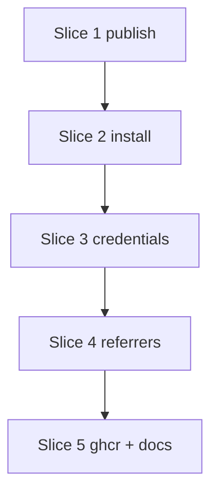

# Plan: OCI feeds (S7b)

**Created**: 2026-11-05
**Revised**: 2026-11-05, after plan review round 1 (UX, strategic, acceptance, design blockers)
**Branch**: claude/dev-team-ship-45aef4, off `main` at 2db838e
**Status**: implemented
**Gherkin persistence**: plan-file-only (the builder writes `tests/features/build-slices/s7b-oci-feeds.feature` and `s7b-ghcr.feature` by hand and adds them to `FEATURE_FILES`, as S9 and S12 did)
**Spec**: [docs/specs/lvpm-oci-feeds-s7b.md](../docs/specs/lvpm-oci-feeds-s7b.md)
**Issue**: [#68](https://github.com/ThatsTheEnd/lvpm/issues/68). The PR says `Closes #68`.

## Goal

A team publishes a `.lvpkg` to an OCI registry with `lvpm publish --to
oci://host/prefix`. Another project installs it from an explicit `[sources]`
entry `org = "oci://host/prefix"`, with the package pinned by `index = "org"`.
The lock records the source and the OCI manifest digest; `sync --locked` pulls
by digest. An existing tag is never replaced. The SBOM and the CI's Sigstore
bundle are referrers of the OCI manifest; lock finds and checks the bundle.
Credentials come only from the Docker credential store.

## Approach stances (decision-defaults)

| Axis | Stance |
|---|---|
| Scope | S7b's files plus what they force (see the Design section). One PR (user decision). |
| Replace vs merge | Merge: the folder publish, hosted feeds and existing lock fields stay; OCI is added beside them. |
| Format fidelity | The `.lvpkg` bytes are the layer, unchanged. The lock's `sha256` stays the archive hash, which equals the layer digest. No `FORMAT_VERSION` bump. |
| Integration | PR with auto-merge on green checks. |

## Design

Decisions every slice relies on. They answer the design and strategic critics.

### Where OCI enters the code

- **One split at the manifest.** `project.rs` gets `enum Feed { Hosted(String),
  Oci(oci::FeedUrl) }`. `resolved_sources()` returns `Vec<(name, Feed)>`. Its
  three callers (`ops/env.rs:318`, `ops/lock.rs:423`, `ops/sync.rs:748`) match
  on it. Hosted feeds go where they go today. OCI feeds go into a new
  `SourceSet.oci: Vec<OciFeed { name, url, pinned: Vec<String> }>`. The
  `SourceSet` literals (`env.rs:322`, `sync.rs:774`, the index tests) gain
  `oci: Vec::new()`.
- **One owner rule.** `Feed::owner()` gives the string `first_source_wins` and
  `source_pins` compare: `feed_url(folder)` for hosted, the `oci://` feed URL
  for OCI. `index.rs:459` (`owners`) and `lock.rs:601` (`source_pins`) call it
  instead of `feed_url` directly.
- **Entry stays string-addressed.** An OCI entry has `url =
  "oci://host/repo@sha256:<hex>"` and `source = "oci://host/prefix"`. This is
  OCI's own canonical reference, so it is the complete address. The
  `GITHUB_SCHEME` shortcut's upgrade trigger ("a third kind that needs more
  than a repo") does not fire: no field beyond the reference is needed.
  `oci::Reference::parse` is the only parser. Lock reads the digest from it
  and takes the lock's `source` from `entry.source`.
- **Local-path checks exclude OCI.** `index::is_local_url` returns false for
  `oci://`. `fetch::on_hand` treats `oci://` as remote.
- **Cache.** `sync --locked` already finds a cached archive by the lock's
  `sha256` (`Search::in_cache`), so a cached OCI package needs no network.
  For an unlocked fetch, `on_hand` for `oci://` GETs the small OCI manifest
  and then looks up the cache by the layer digest, which is the archive
  sha256. Only a cache miss downloads the layer.
- **Fetch.** `Downloads` holds an `Arc<Oci>`. `fetch::package` dispatches on
  `oci://` before its plain GET and fetches through `Oci`, with credentials.
- **Listing.** `SourceSet` gets `oci: Vec<OciFeed>` and `index::load` gets the
  `Arc<Oci>` beside it. Callers: `env.rs:322`, `sync.rs:774`, the index tests
  and `tests/steps/in_process.rs:24`. Listing failures are a typed
  `oci::ListingFailures` (`{pkg, source, registry, kind: NotListed | Refused
  | Unreachable}`). `read_each` returns the whole set as one error, and lock
  downcasts it and prints the sorted lines. A failed OCI pin never reaches
  `check_listed` as "not listed". Hosted `on_fail` stays as it is.
- **Sync.** `Source::Oci(OciFeed)` is a branch in `fetch_locked`'s `asking`
  loop. It builds the `Entry` from the locked `source` + `digest` and never
  calls `Source::index()`, which would list tags. `answers_for` gives it only
  names whose locked `source` equals its URL.
- **Re-lock.** `kept_of`/`from_same_repo` keep a previous OCI row only when
  its `digest` equals the entry's digest; otherwise the archive is re-hashed.
  This covers a tag moved on a registry without immutability. Unit test.

### Core reads no environment

- `OpEnv` gets one owner, `pub oci: Arc<Oci>`, shared with `Downloads`:
  - `client`: one shared blocking reqwest client for every OCI call, with a
    30 s connect and 60 s read timeout.
  - `credentials`: `Arc<dyn Fn(&str) -> Result<Option<Credential>> + Send + Sync>`.
    The default is anonymous (`|_| Ok(None)`).
  - `creds_by_host`: a `Mutex<HashMap<host, Option<Credential>>>`, so the
    helper runs once per host per run.
  - `tokens`: a `Mutex<HashMap<(host, scope), Token>>`; scopes are per
    repository.
  - `helper_timeout`: default 30 s; `src/main.rs` reads
    `LVPM_OCI_HELPER_TIMEOUT_SECS`.
- The front end (`src/main.rs`) installs
  `oci::credentials::docker_store(config_dir, helper_runner)`. It resolves
  `config_dir` from `DOCKER_CONFIG`, else `~/.docker`, the same way it builds
  `GitHubAuth::new(env_lookup, …)` today.
- Other clients (`index.rs:598`, `Downloads::open`, folder publish) stay as
  they are. Out of scope.

### One process runner

- `crates/lvpm-core/src/process.rs` lifts `run(command, stdin, timeout, cap)`
  out of `github/gh.rs`, so stdin can be given. It returns a neutral
  `Ran { Exited { status, stdout, stderr }, NotFound, TimedOut, Interrupted,
  Failed(io::Error) }` and depends on nothing in `github` or `verify`.
- `gh.rs` maps it to `GhRun`, `github/auth.rs` to `Option<String>`, and the
  credential helper to its own errors. There is no third copy. The existing
  `run` tests move with it.

### Publish target

- The CLI parses `--to` once into `PublishTarget { Folder(PathBuf),
  Oci(FeedUrl) }`, so `oci://` never passes through `Path` (Windows would
  collapse `//`).
- `Published` becomes an enum `{ Folder { path }, Oci { reference, digest,
  sbom } }`; `render/publish.rs` and its tests follow.
- The OCI sequence lives in `ops/publish/oci.rs`. `ops/publish.rs` keeps the
  folder path and dispatches.

### Module layout

`crates/lvpm-core/src/oci.rs` holds the `Oci` owner and the media types. The
rest is split as `github/*` is:

| Module | Contents |
|---|---|
| `oci/reference.rs` | `FeedUrl`, `Reference`; userinfo refused |
| `oci/auth.rs` | Challenge, token, refresh grant |
| `oci/manifest.rs` | Manifest, annotations, blobs |
| `oci/referrers.rs` | Referrers API and tag-schema fallback |
| `oci/credentials.rs` | Docker config and helpers |

### Signature subject (blocker from design and strategic)

- `attest-build-provenance` with `push-to-registry: true` signs the **OCI
  manifest digest**, not the `.lvpkg` sha256. The template therefore sets
  `subject-name: <registry>/<repo>` and `subject-digest: <manifest digest>`.
  `lvpm publish` prints that digest.
- On lock, lvpm takes the manifest bytes it already fetched and checked. It
  writes them to a temp file whose sha256 is the manifest digest. Then it runs
  `gh attestation verify <that file> --bundle <bundle file> --repo <repo>
  --format json`.
- `github::gh::Runner` takes a request struct:
  `GhVerify { artifact: &Path, repo: &str, token: &str, bundle: Option<&Path> }`.
  All construction sites change once; there are about 19.
- `attestation::classify`/`parse_gh_json` take the expected subject digest. A
  GitHub release passes the archive sha; OCI passes the manifest digest.
- The attestation pass re-GETs the OCI manifest by digest (cache or
  registry), since `fetch::package` returns only the archive.
  `Downloads::oci_attestation(entry)` sits beside `attestation(repo, sha)`.
  A refusal names its origin (`Origin::GitHub{repo}` or `Origin::Oci{source}`);
  the certificate's repo is in `UntrustedPublisher.subject`.
- `--repo` comes from the bundle's certificate. lvpm scans the DER for the
  Fulcio SourceRepositoryURI extension (OID 1.3.6.1.4.1.57264.1.12). No new
  dependency. Trust does not depend on this scan: gh verifies the repo, and a
  wrong scan only fails verification. It carries
  `shortcut: OID scan, not a full X.509 parse; upgrade if a non-Fulcio signer
  must be supported`.
- The signer and subject recorded in the lock come from gh's verified JSON, as
  in S6.
- Documented limit: with `require-signature = true` and no
  `trusted-publishers`, any GitHub-built bundle is accepted. The signer is an
  identity, not an endorsement; only `trusted-publishers` gives assurance.
  This is weaker than S6, which passes the repo the source declares; OCI
  takes it from the bundle's own certificate. ADR 7 and `docs/usage.md` say so.
- A referrers lookup that fails with anything but 404 (API or fallback tag)
  is an error under every policy. It is never read as "no signature", so it
  cannot fail open.
- **Why the bundle-file route, not `gh attestation verify oci://…`:** the
  `oci://` form logs in with gh's own registry auth, not lvpm's Docker
  credential store, so private registries fail. It also still needs
  `--repo`/`--owner`, and it helps only ghcr. The spike records whether the
  `oci://` form works, so the simpler route stays open.
- **Spike first (Step 4.0).** Run real `gh attestation verify` against a ghcr
  artifact attested with `push-to-registry: true`, before Step 4.3. Use the
  user's test repo if it is ready, else any public ghcr image with such an
  attestation. Record the exact command, the subject, and where the bundle is
  found (referrers API or fallback tag). If the spike contradicts this design,
  stop and re-plan Slice 4.

### Failures and messages

- Every failing OCI pin is collected. Lock reports them together in one error,
  one line each, sorted by package name. It does not stop at the first.
- Terminology: **source** is the `[sources]` name, **registry** is the host,
  **OCI manifest** is the registry object, **manifest** alone means
  `lvpm.toml`.
- Each message names the package, the source, the registry, and one next step.
  Scenarios assert these literal texts (`<…>` are filled in):

| Case | Text |
|---|---|
| 404 on lookup | `<pkg>: source "<src>" (oci://<reg>/<prefix>) does not list it; check the name, or publish it with lvpm publish --to oci://<reg>/<prefix>` |
| 401/403 on lookup | `<pkg>: registry <reg> refused the lookup for source "<src>"; the package is missing or your login cannot read it; run docker login <reg>` |
| Unreachable | `<pkg>: source "<src>" (oci://<reg>/<prefix>) is unreachable: <cause>` |
| Login refused | `registry <reg> refused the login from <credHelpers docker-credential-<n> \| credsStore docker-credential-<n> \| auths>; run docker login <reg>` |
| Helper failed | `credential helper docker-credential-<n> for <reg> failed with exit code <code>; run it by hand to see why` (stderr is never echoed) |
| Helper timeout | `credential helper docker-credential-<n> for <reg> did not answer within <secs>s` (default 30) |
| Userinfo in URL | `[sources] <src>: credentials do not belong in lvpm.toml; remove the user:password@ part and run docker login <reg>` (the user name and secret are never echoed) |
| Tag exists | `<prefix>/<pkg>:<ver> is already published at oci://<reg>/<prefix>; a published version is never replaced` |
| Publish failed before the OCI manifest PUT | `<cause>; nothing was published, it is safe to rerun` |
| Publish refused (401/403 on upload) | `registry <reg> refused the upload to <prefix>/<pkg>; run docker login <reg> with a token that can write packages; nothing was published, it is safe to rerun` |
| Publish success | `published <pkg> <ver> to oci://<reg>/<prefix>/<pkg>:<ver>`, then `  OCI manifest digest sha256:<hex>`, then `  SBOM attached` or `  no SBOM in the package` |
| SBOM push failed after the PUT | Success lines first (reference, digest), then `SBOM could not be attached: <cause>; the package is published and a rerun will be refused`. Exit code 1; the digest is always printed. |
| Locked digest refused | `cannot fetch <pkg> <ver> by digest from source "<src>": registry <reg> refused it; run docker login <reg>` |
| Locked digest gone | `cannot fetch <pkg> <ver> by digest from source "<src>": registry <reg> no longer holds sha256:<hex>; run lvpm lock` |
| Digest mismatch | `<pkg> <ver> from source "<src>": registry <reg> served bytes that do not match sha256:<hex>; nothing was installed` |
| Invalid tag | `<ver> is not a valid OCI tag; publish a version without "+" build metadata` |
| Tag exists (next step) | The tag-exists text plus `; bump the version to publish again` |
| Userinfo in publish target | `--to: credentials do not belong in the target; remove the user:password@ part and run docker login <reg>` |
| Helper not installed | `credential helper docker-credential-<n> for <reg> was not found; check that it is installed and on PATH` (helper stderr is never echoed, so a stray secret cannot leak) |
| Referrer lookup failed | `<pkg> <ver>: the signature lookup on registry <reg> failed: <cause>; the package was not locked` |
| Name resolves nowhere, OCI source exists | Today's error, plus `note: OCI source "<src>" is explicit; pin with index = "<src>"` |
| OCI source with no pins | Warning, once per run: `OCI source "<src>" has no package pinned to it and is never asked; pin a package with index = "<src>"` |

- Host-level failures (login refused, helper failed, not found, timeout) are
  reported once per host, ahead of the per-package lines. Per-package lines
  name package, source and registry.
- Either client timeout firing gives the unreachable text. Before an upload, publish prints
  `uploading <prefix>/<pkg>:<ver> to <reg>`.
- The SBOM line of the success output is rendered from Step 4.2 on; Slice 1
  prints reference and digest only.

## Acceptance Criteria

- [ ] AC1 A package published by `lvpm publish` to the fake registry installs in a second project pinned to that `oci://` source.
- [ ] AC2 The lock records `source = "oci://…"` and `digest`. After the tag is re-pointed, `sync --locked` installs the locked bytes and asks only by digest.
- [ ] AC3 Publishing an existing tag fails with the literal message. The fake's write log shows no write.
- [ ] AC4 The SBOM referrer equals the package's `bom.cdx.json`. Lock finds referrers with the referrers API on and off.
- [ ] AC5 A Sigstore bundle on the OCI manifest locks with its signer. A failed referrers lookup is an error, never "unsigned". `require-signature` refuses a package without one. `trusted-publishers` accepts a match and refuses a foreign subject. `sync --locked` installs a signed lock without running gh.
- [ ] AC6 An OCI source is asked only for names pinned to it. 404, unreachable and 401/403 each fail with the literal message and never fall through. All failing pins are reported together.
- [ ] AC7 Credentials come from `credHelpers`, then `credsStore`, then `auths`; with none, the pull is anonymous. `oci://user:pass@…` is refused at manifest read. No secret appears in any output.
- [ ] AC8 `@ghcr` scenarios pass against `ThatsTheEnd/lvpm-oci-test` with `LVPM_TEST_GHCR=1`. Evidence goes in the PR.
- [ ] AC9 GitLab and ACR publish and install *(manual, evidence in the PR)*.
- [ ] AC10 The release template has an OCI publish job and `actions/attest-build-provenance` with `subject-name`, `subject-digest` and `push-to-registry: true`. A test parses the YAML and asserts them.
- [ ] AC11 `docs/manifest.md`, `docs/usage.md` and ADR 7 document explicit OCI sources, publish, credentials, tag immutability and the downgrade behavior. A test asserts a key phrase in each.

## Slices

Test isolation for every scenario: each one gets its own fake registry, its
own temp `DOCKER_CONFIG`, and a `PATH` that holds only its own helper
directory in front of the system path. The fake helper is a small testkit
binary copied as `docker-credential-<n>` (`.exe` on Windows), because Rust's
`Command` does not resolve `.cmd` through `PATHEXT`. A file beside it sets
its behavior: user, secret, "not found", exit code, hang, run counter. A fake
`gh` is installed the way S6's steps do it; "gh is not installed" leaves it
off `PATH`.

### Slice 1: Publish to an OCI registry

**Depends-on:** none
**Files:** `crates/lvpm-core/src/oci.rs`, `crates/lvpm-core/src/oci/reference.rs`, `crates/lvpm-core/src/oci/auth.rs`, `crates/lvpm-core/src/oci/manifest.rs`, `crates/lvpm-core/src/lib.rs`, `crates/lvpm-core/src/ops/env.rs`, `crates/lvpm-core/src/ops/publish.rs`, `crates/lvpm-core/src/ops/publish/oci.rs`, `crates/lvpm-testkit/src/oci.rs`, `crates/lvpm-testkit/src/lib.rs`, `src/main.rs`, `src/render/publish.rs`, `tests/steps/publish.rs`, `tests/features/build-slices/s7b-oci-feeds.feature`, `tests/acceptance.rs`

**Behavior:**

```gherkin
Feature: lvpm publish to an OCI registry

  Background:
    Given a loopback OCI registry
    And a project "alpha" 1.0.0 that lvpm build has packaged, requiring "beta >=1.0" and LabVIEW 21.0

  Scenario: A package is published as one tagged OCI manifest
    When I run "lvpm publish --to oci://<registry>/team"
    Then it succeeds
    And the output says "published alpha 1.0.0 to oci://<registry>/team/alpha:1.0.0"
    And the output gives the OCI manifest digest of "team/alpha:1.0.0"
    And the registry holds tag "1.0.0" in repository "team/alpha"
    And that OCI manifest has artifactType "application/vnd.lvpm.package.v1"
    And its config has media type "application/vnd.oci.empty.v1+json"
    And its one layer has media type "application/vnd.lvpm.lvpkg.v1+zip" and the package's bytes
    And its annotations are:
      | key                             | value                     |
      | org.opencontainers.image.title  | alpha                     |
      | org.opencontainers.image.version| 1.0.0                     |
      | dev.lvpm.requires               | beta >=1.0                |
      | dev.lvpm.labview                | 21.0                      |
    And annotation "org.opencontainers.image.created" is an RFC 3339 time

  Scenario: An existing tag is refused and nothing is written
    Given the registry already holds tag "1.0.0" in repository "team/alpha"
    When I run "lvpm publish --to oci://<registry>/team"
    Then it fails saying "team/alpha:1.0.0 is already published at oci://<registry>/team; a published version is never replaced"
    And the registry received no blob or manifest write

  Scenario: A tag that appears during the upload is refused before the OCI manifest is written
    Given the registry will create tag "1.0.0" in "team/alpha" once the first blob is uploaded
    When I run "lvpm publish --to oci://<registry>/team"
    Then it fails saying "team/alpha:1.0.0 is already published"
    And the registry received no manifest write

  Scenario: A registry that cannot be reached fails before writing
    Given the registry is down
    When I run "lvpm publish --to oci://<registry>/team"
    Then it fails naming "<registry>"
    And the output says "nothing was published, it is safe to rerun"

  Scenario: A rerun after an aborted publish succeeds
    Given the registry went down after the blobs of "team/alpha:1.0.0" were uploaded
    And I ran "lvpm publish --to oci://<registry>/team" and it failed
    When the registry is back and I run "lvpm publish --to oci://<registry>/team"
    Then it succeeds
    And the registry received no second upload of a blob it already held

  Scenario: A tag check that fails with an error other than 404 stops the publish
    Given the registry answers 500 to a HEAD of "team/alpha:1.0.0"
    When I run "lvpm publish --to oci://<registry>/team"
    Then it fails naming "<registry>"
    And the registry received no blob or manifest write

  Scenario: A version that is not a valid OCI tag is refused before any request
    Given a package "alpha" whose metadata gives version 1.0.0+build.7
    When I run "lvpm publish --to oci://<registry>/team"
    Then it fails saying "1.0.0+build.7" is not a valid OCI tag
    And the registry received no request

  Scenario: Credentials in the publish target are refused
    When I run "lvpm publish --to oci://user:secret@<registry>/team"
    Then it fails saying "--to: credentials do not belong in the target; remove the user:password@ part and run docker login <registry>"
    And the output does not contain "secret"
    And the registry received no request

  Scenario: Folder publish is unchanged
    When I run "lvpm publish --to <folder>"
    Then the package file is in the folder
```

**Steps:**

#### Step 1.1: Fake registry in the testkit

**Complexity**: standard
**IMPLEMENT**: `lvpm_testkit::oci::Registry`: loopback HTTP on 127.0.0.1. It serves the distribution subset: bearer challenge plus `/token`, tags list, manifest GET/HEAD/PUT by tag and digest, blob HEAD/GET, and POST+PUT monolithic upload. It has an in-memory store, a request log (method, path, auth), `go_down`, a per-path status override, and a hook that creates a tag after the first blob upload.
**TEST**: Testkit unit tests with raw reqwest: put/get round trip, 404 `NAME_UNKNOWN`, the request log, the override.
**REFACTOR**: Share the request loop with `lvpm-testkit/src/http.rs` if it fits.
**Files**: `crates/lvpm-testkit/src/oci.rs`, `crates/lvpm-testkit/src/lib.rs`
**Commit**: `test(s7b): loopback OCI registry`

#### Step 1.2: OCI client and the `Oci` owner in `OpEnv`

**Complexity**: complex
**IMPLEMENT**: `oci.rs` holds `Oci { client, credentials, tokens }`, installed on `OpEnv` with an anonymous default, and the media type and annotation constants. `oci/reference.rs`: `oci://host[:port]/prefix` (userinfo refused without echo), `Reference { registry, repository, tag | digest }`, `Reference::parse`, and OCI tag validation (`[A-Za-z0-9_][A-Za-z0-9._-]{0,127}`). `oci/auth.rs`: the anonymous challenge and token. `oci/manifest.rs`: `head_manifest`, `get_manifest` (checks the digest of the bytes), `put_manifest`, `blob_exists`, `upload_blob`, `get_blob` (checks the digest). Plain `http://` is allowed only for `127.0.0.1`/`localhost`; everything else uses `https://`.
**TEST**: Unit tests against the fake: each call, digest mismatch refused, token sent after the challenge, URL parsing with userinfo refused, tag validation.
**REFACTOR**: Keep the public API to what publish and install use.
**Files**: `crates/lvpm-core/src/oci.rs`, `crates/lvpm-core/src/oci/reference.rs`, `crates/lvpm-core/src/oci/auth.rs`, `crates/lvpm-core/src/oci/manifest.rs`, `crates/lvpm-core/src/lib.rs`, `crates/lvpm-core/src/ops/env.rs`
**Commit**: `feat(s7b): OCI distribution client`

#### Step 1.3: `lvpm publish --to oci://…`

**Complexity**: complex
**IMPLEMENT**: The CLI parses `--to` into `PublishTarget`; `ops::publish::publish` dispatches, and `ops/publish/oci.rs` runs the OCI sequence. It reads name, version, requires and LabVIEW floor from the built `.lvpkg`, then validates the tag. Next it does the HEAD tag check: an existing tag is refused, and any non-404 failure fails. It uploads the config and the layer, HEADs the tag again, and PUTs the OCI manifest by tag. Every failure before the PUT ends with "nothing was published, it is safe to rerun". `Published` becomes the enum from the Design section, and render prints the success text from the table. Write the `.feature` file and add it to `FEATURE_FILES`.
**TEST**: The slice's scenarios above.
**REFACTOR**: One `already_published` message shape for folder and OCI.
**Files**: `crates/lvpm-core/src/ops/publish.rs`, `crates/lvpm-core/src/ops/publish/oci.rs`, `src/main.rs`, `src/render/publish.rs`, `tests/steps/publish.rs`, `tests/features/build-slices/s7b-oci-feeds.feature`, `tests/acceptance.rs`
**Commit**: `feat(s7b): lvpm publish to an OCI registry`

### Slice 2: Install from an explicit OCI source

**Depends-on:** 1
**Files:** `crates/lvpm-core/src/project.rs`, `crates/lvpm-core/src/index.rs`, `crates/lvpm-core/src/fetch.rs`, `crates/lvpm-core/src/lockfile.rs`, `crates/lvpm-core/src/ops/lock.rs`, `crates/lvpm-core/src/ops/sync.rs`, `crates/lvpm-core/src/ops/env.rs`, `crates/lvpm-core/src/ops/session.rs`, `crates/lvpm-core/src/oci/manifest.rs`, `crates/lvpm-testkit/src/oci.rs`, `tests/steps/in_process.rs`, `tests/steps/sources.rs`, `tests/features/build-slices/s7b-oci-feeds.feature`

**Behavior:**

```gherkin
Feature: Installing from an explicit OCI source

  Background:
    Given a loopback OCI registry
    And a project whose [sources] has team = "oci://<registry>/team"

  Scenario: A package published by lvpm installs in another project
    Given a publisher project "alpha" 1.0.0 that lvpm build has packaged
    And I ran "lvpm publish --to oci://<registry>/team" in the publisher project
    And the consumer project depends on alpha = { version = ">=1.0", index = "team" }
    When I run "lvpm sync" in the consumer project
    Then "alpha" 1.0.0 is installed with the published bytes
    And the consumer's lock records the OCI manifest digest that publish printed

  Scenario: A pinned package installs by digest and the lock records it
    Given the registry holds "alpha" 1.0.0 and 1.1.0 under "team"
    And the project depends on alpha = { version = ">=1.0", index = "team" }
    When I run "lvpm sync"
    Then "alpha" 1.1.0 is installed
    And the lock records alpha with source "oci://<registry>/team" and the OCI manifest digest of 1.1.0
    And the lock's sha256 for alpha is the sha256 of the installed archive

  Scenario: sync --locked pulls by digest even after the tag moves
    Given the registry holds "alpha" 1.1.0 under "team"
    And the project is locked with alpha 1.1.0
    And tag "1.1.0" in "team/alpha" now points at other bytes
    And the package cache is empty
    When I run "lvpm sync --locked"
    Then the locked bytes of alpha are installed
    And the registry was asked for the OCI manifest by digest and never by tag "1.1.0"

  Scenario: A layer whose bytes do not match its digest is refused
    Given the registry holds "alpha" 1.1.0 under "team" with a layer whose bytes do not match its digest
    And the project depends on alpha = { version = "*", index = "team" }
    When I run "lvpm sync"
    Then it fails saying 'alpha 1.1.0 from source "team": registry <registry> served bytes that do not match'
    And alpha is not installed

  Scenario: An unpinned name is never asked of the OCI source
    Given the project also depends on a public package "beta" listed by a hosted feed
    When I run "lvpm lock"
    Then the registry received no request for "team/beta"
    And beta comes from the hosted feed

  Scenario: An OCI source with no pins warns
    Given the project depends only on "beta" from a hosted feed
    When I run "lvpm lock"
    Then the output warns 'OCI source "team" has no package pinned to it and is never asked'

  Scenario: A name no source lists hints at the explicit OCI source
    Given the project depends on gamma = "*" without an index
    And no source lists "gamma"
    When I run "lvpm lock"
    Then it fails naming "gamma"
    And the output says 'note: OCI source "team" is explicit; pin with index = "team"'

  Scenario Outline: A pinned name the OCI source cannot serve never falls through
    Given the registry <answer> for "team/gamma"
    And a hosted feed also lists "gamma"
    And the project depends on gamma = { version = "*", index = "team" }
    When I run "lvpm lock"
    Then it fails saying '<message>'
    And no version of gamma is locked

    Examples:
      | answer                        | message |
      | holds nothing                 | gamma: source "team" (oci://<registry>/team) does not list it; check the name, or publish it with lvpm publish --to oci://<registry>/team |
      | answers 500 for the tags list | gamma: source "team" (oci://<registry>/team) is unreachable |
      | is down                       | gamma: source "team" (oci://<registry>/team) is unreachable |

  Scenario Outline: A registry that refuses the lookup fails and does not fall through
    Given the registry answers <status> for the tags list of "team/gamma"
    And a hosted feed also lists "gamma"
    And the project depends on gamma = { version = "*", index = "team" }
    When I run "lvpm lock"
    Then it fails saying 'gamma: registry <registry> refused the lookup for source "team"; the package is missing or your login cannot read it; run docker login <registry>'
    And no version of gamma is locked

    Examples:
      | status                         |
      | 403 DENIED after a valid token |
      | 401 without a challenge        |

  Scenario: Every failing pin is reported together
    Given the project depends on gamma = { version = "*", index = "team" }
    And the project depends on delta = { version = "*", index = "team" }
    And the registry holds neither, and answers 403 DENIED after a valid token for the tags list of "team/gamma"
    When I run "lvpm lock"
    Then it fails with these lines, in this order:
      | delta: source "team" (oci://<registry>/team) does not list it; check the name, or publish it with lvpm publish --to oci://<registry>/team |
      | gamma: registry <registry> refused the lookup for source "team"; the package is missing or your login cannot read it; run docker login <registry> |

  Scenario: A locked digest the registry no longer holds says to re-lock
    Given the registry holds "alpha" 1.1.0 under "team"
    And the project is locked with alpha 1.1.0
    And the registry deleted that OCI manifest
    And the package cache is empty
    When I run "lvpm sync --locked"
    Then it fails saying 'cannot fetch alpha 1.1.0 by digest from source "team": registry <registry> no longer holds'
    And the output says "run lvpm lock"

  Scenario: sync --locked without a login says how to log in
    Given the registry holds "alpha" 1.1.0 under "team"
    And the project is locked with alpha 1.1.0
    And the registry now requires a login for "team"
    And no Docker config
    And the package cache is empty
    When I run "lvpm sync --locked"
    Then it fails saying 'cannot fetch alpha 1.1.0 by digest from source "team": registry <registry> refused it; run docker login <registry>'

  Scenario: A cached locked package installs with the registry down
    Given the registry holds "alpha" 1.1.0 under "team"
    And the project is locked with alpha 1.1.0 and sync has installed it once
    And the registry is down
    When I run "lvpm sync --locked" into a fresh environment
    Then alpha is installed
    And the registry received no request

  Scenario: Locked bytes that do not match the lock are refused
    Given the registry holds "alpha" 1.1.0 under "team"
    And the project is locked with alpha 1.1.0
    And the registry now serves other bytes for that layer digest
    And the package cache is empty
    When I run "lvpm sync --locked"
    Then it fails saying 'alpha 1.1.0 from source "team": registry <registry> served bytes that do not match'
    And alpha is not installed

  Scenario: A re-lock after a tag moved records the new bytes
    Given the registry holds "alpha" 1.1.0 under "team"
    And the project is locked with alpha 1.1.0
    And tag "1.1.0" in "team/alpha" now points at other bytes
    When I run "lvpm lock --upgrade"
    Then the lock's digest and sha256 for alpha both describe the new bytes

  Scenario: An OCI manifest that is not an lvpm package is skipped
    Given tag "1.2.0" in "team/alpha" holds a container image, not an lvpm package
    And the registry holds "alpha" 1.1.0 under "team"
    And the project depends on alpha = { version = "*", index = "team" }
    When I run "lvpm lock"
    Then alpha 1.1.0 is locked

  Scenario: A version newer than the project's LabVIEW is not chosen
    Given the registry holds "alpha" 1.1.0 and 1.2.0 under "team"
    And "alpha" 1.2.0 needs a newer LabVIEW than the project's
    And the project depends on alpha = { version = "*", index = "team" }
    When I run "lvpm lock"
    Then alpha 1.1.0 is locked

  Scenario: min-age-days uses the OCI manifest's creation time
    Given the registry holds "alpha" 1.1.0 created 10 days ago and 1.2.0 created today under "team"
    And the project's min-age-days is 7
    And the project depends on alpha = { version = "*", index = "team" }
    When I run "lvpm lock"
    Then alpha 1.1.0 is locked

  Scenario: Credentials in an oci:// source are refused when the manifest is read
    Given [sources] has team = "oci://user:secret@<registry>/team"
    When I run "lvpm lock"
    Then it fails saying '[sources] team: credentials do not belong in lvpm.toml; remove the user:password@ part and run docker login <registry>'
    And the output does not contain "secret"
    And the output does not contain "user:"
```

**Steps:**

#### Step 2.1: `oci://` in `[sources]` and one owner rule

**Complexity**: standard
**IMPLEMENT**: `project::Feed { Hosted, Oci }`. `resolved_sources()` returns it and refuses userinfo with the literal message. `Feed::owner()` is used at `index.rs:459` and `lock.rs:601`. `SourceSet.oci` is filled from `source_pins`, and the three callers match on `Feed`. `is_local_url`/`source_of`/`on_hand` exclude `oci://`. Add the no-pins warning.
**TEST**: Manifest unit tests: accepted, userinfo refused (no user or secret in the message), unknown scheme still refused. Index unit test: `is_local_url("oci://…")` is false.
**REFACTOR**: Remove the now-unused direct `feed_url` calls for owners.
**Files**: `crates/lvpm-core/src/project.rs`, `crates/lvpm-core/src/ops/env.rs`, `crates/lvpm-core/src/index.rs`, `crates/lvpm-core/src/ops/lock.rs`, `crates/lvpm-core/src/ops/sync.rs`, `crates/lvpm-core/src/fetch.rs`
**Commit**: `feat(s7b): oci:// sources in lvpm.toml`

#### Step 2.2: List pinned names from an OCI source

**Complexity**: complex
**IMPLEMENT**: In `read_each`, for each OCI feed and each name pinned to it, fetch the tags list. A 404 means not listed. A 401/403 gives the refused error. Anything else is unreachable. Each failure is collected per pin. Then fetch each tag's OCI manifest. A manifest whose artifactType is not `application/vnd.lvpm.package.v1` is skipped. The annotations become an `Entry`; `released` comes from `org.opencontainers.image.created`. The collected failures become one error, sorted by package. The "explicit OCI source" note goes on the existing not-found error. The fake gains `deny_missing` (ghcr mode) and status overrides on tags lists.
**TEST**: Index unit tests against the fake: entries built, 404, 401, 403, 500, foreign artifactType skipped, unpinned name never requested, failures aggregated.
**REFACTOR**: The per-tag fetch stays in `oci/manifest.rs`; `index.rs` only maps it to `Entry`.
**Files**: `crates/lvpm-core/src/index.rs`, `crates/lvpm-core/src/oci/manifest.rs`, `crates/lvpm-testkit/src/oci.rs`, `crates/lvpm-core/src/ops/env.rs`, `crates/lvpm-core/src/ops/sync.rs`, `tests/steps/in_process.rs`
**Commit**: `feat(s7b): read pinned packages from an OCI source`

#### Step 2.3: Fetch by digest and lock the digest

**Complexity**: complex
**IMPLEMENT**: `fetch::package` for `oci://…@digest` GETs the OCI manifest by digest and its layer, checking both digests. A mismatch fails naming the package. `LockedPackage.digest: Option<String>` (`sha256:…`) is read from the entry via `Reference::parse`. `sync.rs` `Source::Oci` builds the reference from the lock's `source` + `digest`, never from a tag; the sha256-keyed cache answers first. It is a branch in `fetch_locked`'s `asking` loop, and `kept_of` compares digests (unit test). OCI source URLs go into `lockfile::Inputs.sources` beside the hosted ones, so editing an `oci://` source marks the lock stale (unit test). No `FORMAT_VERSION` bump. Write the slice's scenarios.
**TEST**: The slice's scenarios above. A lockfile round-trip unit test with and without `digest`.
**REFACTOR**: One helper builds the reference of a locked OCI package.
**Files**: `crates/lvpm-core/src/fetch.rs`, `crates/lvpm-core/src/lockfile.rs`, `crates/lvpm-core/src/ops/lock.rs`, `crates/lvpm-core/src/ops/sync.rs`, `crates/lvpm-core/src/ops/session.rs`, `tests/steps/sources.rs`, `tests/features/build-slices/s7b-oci-feeds.feature`
**Commit**: `feat(s7b): lock and sync OCI packages by digest`

### Slice 3: Credentials from the Docker credential store

**Depends-on:** 2
**Files:** `crates/lvpm-core/src/process.rs`, `crates/lvpm-core/src/github/gh.rs`, `crates/lvpm-core/src/github/auth.rs`, `crates/lvpm-core/src/lib.rs`, `crates/lvpm-core/src/oci.rs`, `crates/lvpm-core/src/oci/credentials.rs`, `crates/lvpm-core/src/oci/auth.rs`, `crates/lvpm-testkit/src/oci.rs`, `src/main.rs`, `tests/steps/sources.rs`, `tests/features/build-slices/s7b-oci-feeds.feature`

**Behavior:**

```gherkin
Feature: OCI registry credentials

  Background:
    Given a loopback OCI registry holding "alpha" 1.0.0 under "team"
    And a project pinned to alpha from team = "oci://<registry>/team"

  Scenario: A public package pulls anonymously
    Given the registry lets anyone read "team"
    And no Docker config
    When I run "lvpm sync"
    Then alpha 1.0.0 is installed
    And the registry received a token request with no Authorization header

  Scenario: A credential helper named for the host is used
    Given the registry requires a login for "team"
    And a Docker config whose credHelpers names "lvpmtest" for "<registry>"
    And a docker-credential-lvpmtest that returns user "u1" and secret "s1"
    When I run "lvpm lock"
    Then it succeeds
    And the registry's token endpoint received the login "u1"
    And the output does not contain "s1"

  Scenario: The credsStore is used when no helper names the host
    Given the registry requires a login for "team"
    And a Docker config whose credsStore is "lvpmtest"
    And a docker-credential-lvpmtest that returns user "u2" and secret "s2"
    When I run "lvpm lock"
    Then the registry's token endpoint received the login "u2"
    And the output does not contain "s2"

  Scenario: credsStore wins over auths, and a helper for another host is ignored
    Given the registry requires a login for "team"
    And a Docker config whose credHelpers names "first" for "other.example", whose credsStore is "second", and whose auths holds "u3:s3"
    And a docker-credential-second that returns user "u2" and secret "s2"
    When I run "lvpm lock"
    Then the registry's token endpoint received the login "u2"

  Scenario: auths is used when no helper is configured
    Given the registry requires a login for "team"
    And a Docker config whose auths holds "u3:s3" for "<registry>"
    When I run "lvpm lock"
    Then the registry's token endpoint received the login "u3"
    And the output does not contain "s3"

  Scenario: credHelpers wins over credsStore, and credsStore over auths
    Given the registry requires a login for "team"
    And a Docker config whose credHelpers names "first" for "<registry>", whose credsStore is "second", and whose auths holds "u3:s3"
    And a docker-credential-first that returns user "u1" and secret "s1"
    And a docker-credential-second that returns user "u2" and secret "s2"
    When I run "lvpm lock"
    Then the registry's token endpoint received the login "u1"

  Scenario: An identity token is exchanged as a refresh token
    Given the registry requires a login for "team"
    And a Docker config whose credHelpers names "lvpmtest" for "<registry>"
    And a docker-credential-lvpmtest that returns the identity-token user name and secret "r1"
    When I run "lvpm lock"
    Then the token endpoint received a refresh_token grant with "r1"
    And the output does not contain "r1"

  Scenario: A helper that holds no credentials for the host means anonymous
    Given the registry requires a login for "team"
    And a credential helper that answers "credentials not found in native keychain"
    When I run "lvpm lock"
    Then it fails saying 'alpha: registry <registry> refused the lookup for source "team"; the package is missing or your login cannot read it; run docker login <registry>'

  Scenario Outline: A wrong login is reported with where it came from
    Given the registry requires a login for "team" and refuses "u9"
    And a Docker config whose <config> gives user "u9" and secret "wrong" for "<registry>"
    When I run "lvpm lock"
    Then it fails saying "registry <registry> refused the login from <origin>; run docker login <registry>"
    And the output does not contain "wrong"

    Examples:
      | config                       | origin                                 |
      | credHelpers entry "lvpmtest" | credHelpers docker-credential-lvpmtest |
      | credsStore "lvpmtest"        | credsStore docker-credential-lvpmtest  |
      | auths entry                  | auths                                  |

  Scenario: A helper that exits with an error is reported without its output
    Given a Docker config whose credHelpers names "lvpmtest" for "<registry>"
    And a docker-credential-lvpmtest that exits 3 printing "token s7 locked" on stderr
    When I run "lvpm lock"
    Then it fails saying "credential helper docker-credential-lvpmtest for <registry> failed with exit code 3; run it by hand to see why"
    And the output does not contain "s7"

  Scenario: A helper that is not installed is reported
    Given a Docker config whose credHelpers names "lvpmtest" for "<registry>"
    And no docker-credential-lvpmtest on the PATH
    When I run "lvpm lock"
    Then it fails saying "credential helper docker-credential-lvpmtest for <registry> was not found; check that it is installed and on PATH"

  Scenario: A helper that does not answer in time is reported
    Given a Docker config whose credHelpers names "lvpmtest" for "<registry>"
    And a docker-credential-lvpmtest that never answers
    And LVPM_OCI_HELPER_TIMEOUT_SECS is 1
    When I run "lvpm lock"
    Then it fails saying "credential helper docker-credential-lvpmtest for <registry> did not answer within 1s"

  Scenario: The helper runs once per host per run
    Given the registry requires a login for "team"
    And the project also pins beta from team, and the registry holds "beta" 1.0.0
    And a credential helper that counts its runs
    When I run "lvpm lock"
    Then the helper ran once

  Scenario: publish logs in with the same credentials
    Given the registry requires a login to write "team"
    And a credential helper that returns user "u1" and secret "s1"
    And a project "alpha" 2.0.0 that lvpm build has packaged
    When I run "lvpm publish --to oci://<registry>/team"
    Then it succeeds
    And the registry's token endpoint received the login "u1" with push scope
    And the output does not contain "s1"

  Scenario: A refused upload says how to log in and that nothing was published
    Given the registry refuses writes to "team"
    And a project "alpha" 2.0.0 that lvpm build has packaged
    When I run "lvpm publish --to oci://<registry>/team"
    Then it fails saying "registry <registry> refused the upload to team/alpha; run docker login <registry> with a token that can write packages; nothing was published, it is safe to rerun"
    And the registry holds no tag "2.0.0" in "team/alpha"
```

The 30 s default is checked by a unit test.

**Steps:**

#### Step 3.1: One process runner; Docker config and helpers

**Complexity**: complex
**IMPLEMENT**: `process.rs`: lift `run` from `gh.rs` with optional stdin, timeout and output cap; `gh.rs` and `auth.rs` use it. `oci/credentials.rs`: `docker_store(config_dir, run)` reads `config.json` with precedence `credHelpers[host]` > `credsStore` > `auths[host].auth`. It runs `docker-credential-<n> get` with the host on stdin. "credentials not found" counts as none. `Credential` records where it came from, for the login-refused message. Secrets never reach `Debug`, errors or events. `src/main.rs` resolves `DOCKER_CONFIG` or `~/.docker`, reads `LVPM_OCI_HELPER_TIMEOUT_SECS`, and installs the store on `OpEnv.oci`. The testkit gains the fake helper binary.
**TEST**: Unit tests with a temp config and a fake helper: each source, precedence, not found, missing helper, timeout, `Debug` shows no secret. The existing gh and auth tests stay green.
**REFACTOR**: Delete the two old `run` copies.
**Files**: `crates/lvpm-core/src/process.rs`, `crates/lvpm-core/src/github/gh.rs`, `crates/lvpm-core/src/github/auth.rs`, `crates/lvpm-core/src/lib.rs`, `crates/lvpm-core/src/oci/credentials.rs`, `crates/lvpm-core/src/oci.rs`, `src/main.rs`
**Commit**: `feat(s7b): Docker credential store for OCI registries`

#### Step 3.2: Use them in the token dance, for pull and push

**Complexity**: complex
**IMPLEMENT**: `oci/auth.rs`: Basic auth on the token realm. A `<token>` user switches to POST `grant_type=refresh_token`. A 401 after a login gives the login-refused message. Tokens are cached in `Oci.tokens` per (host, scope). The fake requires a login per repository and scope, records the login, and can refuse a user or all writes.
**TEST**: The slice's scenarios above.
**REFACTOR**: One code path for pull and push scopes.
**Files**: `crates/lvpm-core/src/oci/auth.rs`, `crates/lvpm-testkit/src/oci.rs`, `tests/steps/sources.rs`, `tests/features/build-slices/s7b-oci-feeds.feature`
**Commit**: `feat(s7b): log in to OCI registries`

### Slice 4: SBOM and signature referrers

**Depends-on:** 3
**Files:** `crates/lvpm-core/src/oci/referrers.rs`, `crates/lvpm-core/src/oci.rs`, `crates/lvpm-core/src/ops/publish.rs`, `crates/lvpm-core/src/ops/attest.rs`, `crates/lvpm-core/src/ops/session.rs`, `crates/lvpm-core/src/github/gh.rs`, `crates/lvpm-core/src/github/attestation.rs`, `crates/lvpm-core/src/ops/lock.rs`, `crates/lvpm-testkit/src/oci.rs`, `src/main.rs`, `tests/steps/sources.rs`, `tests/features/build-slices/s7b-oci-feeds.feature`, `plans/lvpm-oci-feeds-s7b.md`

**Behavior:**

```gherkin
Feature: OCI referrers

  Background:
    Given a loopback OCI registry

  Scenario Outline: publish attaches the SBOM as a referrer
    Given the registry <api> the referrers API
    And a project "alpha" 1.0.0 that lvpm build has packaged with its SBOM
    When I run "lvpm publish --to oci://<registry>/team"
    Then the output says "SBOM attached"
    And "team/alpha:1.0.0" has a referrer of artifactType "application/vnd.cyclonedx+json"
    And its bytes equal the package's bom.cdx.json

    Examples:
      | api            |
      | supports       |
      | does not offer |

  Scenario: An SBOM push that fails after the package is live says so
    Given a project "alpha" 1.0.0 that lvpm build has packaged with its SBOM
    And the registry refuses referrer writes to "team/alpha"
    When I run "lvpm publish --to oci://<registry>/team"
    Then it fails saying "SBOM could not be attached"
    And the output gives the OCI manifest digest of "team/alpha:1.0.0"
    And the output says "the package is published and a rerun will be refused"

  Scenario: A package without an SBOM publishes without a referrer
    Given a project "alpha" 1.0.0 that lvpm build has packaged without an SBOM
    When I run "lvpm publish --to oci://<registry>/team"
    Then it succeeds
    And the output says "no SBOM in the package"
    And "team/alpha:1.0.0" has no referrer

  Scenario Outline: A Sigstore bundle on the OCI manifest locks with its signer
    Given the registry <api> the referrers API
    And "team/alpha:1.0.0" has a Sigstore bundle referrer that gh verifies as built by "https://github.com/o/r"
    And a project pinned to alpha from team
    When I run "lvpm lock"
    Then the lock records alpha's signer and subject "https://github.com/o/r"
    And gh was asked to verify a file whose sha256 is the OCI manifest digest of "team/alpha:1.0.0"

    Examples:
      | api            |
      | supports       |
      | does not offer |

  Scenario: require-signature refuses a package without a bundle
    Given "team/alpha:1.0.0" has no Sigstore bundle referrer
    And a project pinned to alpha from team
    And the project's [policy] has require-signature = true
    When I run "lvpm lock"
    Then it fails saying alpha has no attestation

  Scenario: trusted-publishers accepts a matching subject
    Given "team/alpha:1.0.0" has a Sigstore bundle referrer that gh verifies as built by "https://github.com/o/r"
    And a project pinned to alpha from team
    And the project's [policy] trusts only "https://github.com/o/*"
    When I run "lvpm lock"
    Then the lock records alpha's subject "https://github.com/o/r"

  Scenario: trusted-publishers refuses a foreign subject
    Given "team/alpha:1.0.0" has a Sigstore bundle referrer that gh verifies as built by "https://github.com/evil/r"
    And a project pinned to alpha from team
    And the project's [policy] trusts only "https://github.com/o/*"
    When I run "lvpm lock"
    Then it fails naming the subject "https://github.com/evil/r"

  Scenario: A bundle gh rejects is refused under require-signature
    Given "team/alpha:1.0.0" has a Sigstore bundle referrer that gh rejects
    And a project pinned to alpha from team
    And the project's [policy] has require-signature = true
    When I run "lvpm lock"
    Then it fails saying alpha's attestation does not verify

  Scenario: A bundle with no source repository in its certificate does not verify
    Given "team/alpha:1.0.0" has a Sigstore bundle referrer whose certificate names no source repository
    And a project pinned to alpha from team
    And the project's [policy] has require-signature = true
    When I run "lvpm lock"
    Then it fails saying alpha's attestation does not verify
    And gh was not run

  Scenario: gh missing is reported under require-signature
    Given "team/alpha:1.0.0" has a Sigstore bundle referrer
    And gh is not installed
    And a project pinned to alpha from team
    And the project's [policy] has require-signature = true
    When I run "lvpm lock"
    Then it fails saying "cannot check the attestation of alpha 1.0.0: gh is not installed"

  Scenario Outline: A referrers lookup that fails is an error, not "unsigned"
    Given "team/alpha:1.0.0" is in the registry
    And the registry answers <status> to the referrers lookup of "team/alpha:1.0.0"
    And a project pinned to alpha from team
    And the project's [policy] <policy>
    When I run "lvpm lock"
    Then it fails saying "alpha 1.0.0: the signature lookup on registry <registry> failed"
    And alpha is not locked

    Examples:
      | status | policy                       |
      | 500    | has require-signature = true |
      | 403    | has require-signature = true |
      | 500    | is empty                     |

  Scenario: The tag-schema fallback keeps an existing referrer
    Given the registry does not offer the referrers API
    And "team/alpha:1.0.0" already has a Sigstore bundle referrer in its fallback index
    When lvpm attaches the SBOM of alpha 1.0.0
    Then the fallback index of "team/alpha:1.0.0" lists both the bundle and the SBOM

  Scenario: With no policy, an unsigned package locks with no signer
    Given "team/alpha:1.0.0" has no Sigstore bundle referrer
    And a project pinned to alpha from team
    When I run "lvpm lock"
    Then the lock records alpha with no signer

  Scenario: sync --locked installs a signed lock without running gh
    Given a project pinned to alpha from team, locked under require-signature with alpha's signer
    When I run "lvpm sync --locked"
    Then alpha is installed
    And gh was not run
```

**Steps:**

#### Step 4.0: Spike real gh on a ghcr push-to-registry attestation

**Complexity**: standard
**IMPLEMENT**: No product code. Run `gh attestation verify oci://ghcr.io/<image>@<digest> --repo <repo> --format json`. Then fetch the bundle from the referrers API or the fallback tag, and run `gh attestation verify <manifest file> --bundle <bundle> --repo <repo> --format json`. Use the user's test repo if it is ready, else a public image attested with `push-to-registry: true`. Record in this plan's Risks section: the commands, the subject digest gh reports, the bundle's artifactType, and whether ghcr serves the referrers API.
**TEST**: The manifest-file form verifies, and its subject equals the manifest digest. If it does not, stop and re-plan Slice 4.
**REFACTOR**: none.
**Files**: `plans/lvpm-oci-feeds-s7b.md`
**Commit**: `docs(s7b): record the gh bundle spike`

#### Step 4.1: Referrers in the client and the fake

**Complexity**: standard
**IMPLEMENT**: `oci/referrers.rs`: `referrers(subject, artifact_type)` asks `/v2/<repo>/referrers/<digest>?artifactType=…`, and on 404 reads the `sha256-<hex>` tag-schema index. `push_referrer` uploads the blobs, PUTs the OCI manifest by digest with `subject`, and when the API is absent, updates the fallback index tag. The fake gets a referrers API toggle and fallback tags.
**TEST**: Unit tests both ways.
**REFACTOR**: Share OCI manifest building with publish.
**Files**: `crates/lvpm-core/src/oci/referrers.rs`, `crates/lvpm-core/src/oci.rs`, `crates/lvpm-testkit/src/oci.rs`
**Commit**: `feat(s7b): OCI referrers`

#### Step 4.2: publish attaches the SBOM

**Complexity**: standard
**IMPLEMENT**: After the OCI manifest PUT, push `bom.cdx.json` from the `.lvpkg` as a CycloneDX referrer. A package without an SBOM publishes without one. `Published::Oci.sbom` drives the render line.
**TEST**: The outline and the no-SBOM scenario.
**REFACTOR**: none expected beyond naming.
**Files**: `crates/lvpm-core/src/ops/publish.rs`, `tests/steps/sources.rs`, `tests/features/build-slices/s7b-oci-feeds.feature`
**Commit**: `feat(s7b): publish the SBOM as an OCI referrer`

#### Step 4.3: Verify the Sigstore bundle against the OCI manifest digest

**Complexity**: complex
**IMPLEMENT**:
- `Runner` takes `GhVerify { artifact, repo, token, bundle }`, and every construction site is updated. `real_runner` adds `--bundle` when it is given.
- `attestation::classify`/`parse_gh_json` take the expected subject digest.
- The attestation pass in `attest.rs`/`session.rs` matches on the entry's origin. A GitHub release is handled as today. For OCI, lvpm fetches the `application/vnd.dev.sigstore.bundle.v0.3+json` referrer; with none, the package is `Unattested`.
- Otherwise lvpm scans the bundle certificate for the SourceRepositoryURI OID. A missing value gives `Invalid`, and gh is not run.
- Next it writes the OCI manifest bytes and the bundle to temp files and runs the runner with `--repo` from the certificate.
- `verify::decide` handles the result unchanged. `sync --locked` keeps S6's rule: it trusts the locked signer and does not run gh.
**TEST**: The lock and sync scenarios above with a faked runner that records its request, as S6's tests do. A unit test feeds the OID scan a real Fulcio certificate fixture from the spike.
**REFACTOR**: Keep "who to ask" in one match on the entry's origin.
**Files**: `crates/lvpm-core/src/ops/attest.rs`, `crates/lvpm-core/src/ops/session.rs`, `crates/lvpm-core/src/ops/lock.rs`, `crates/lvpm-core/src/github/gh.rs`, `crates/lvpm-core/src/github/attestation.rs`, `src/main.rs`, `tests/steps/sources.rs`, `tests/features/build-slices/s7b-oci-feeds.feature`
**Commit**: `feat(s7b): verify OCI Sigstore bundles under [policy]`

### Slice 5: ghcr.io, template and docs

**Depends-on:** 4
**Files:** `tests/acceptance.rs`, `tests/steps/sources.rs`, `tests/steps/docs.rs`, `tests/features/build-slices/s7b-ghcr.feature`, `tests/features/build-slices/s7b-oci-feeds.feature`, `docs/oci-test-repo-workflow.yml`, `.github/workflow-templates/lvpm-release.yml`, `docs/manifest.md`, `docs/usage.md`, `docs/adr/0007-oci-sources-are-explicit.md`, `docs/adr/README.md`, `docs/vision/build-slices.md`

**Behavior:**

```gherkin
@ghcr
Feature: ghcr.io
  These scenarios depend on external state: the user's test repo
  ThatsTheEnd/lvpm-oci-test, its packages, and a login in the runner's Docker
  credential store. The tag alpha:1.0.0 must never be deleted. They run only
  with LVPM_TEST_GHCR=1.

  Scenario: The public test package installs anonymously by digest
    Given a project pinned to alpha from "oci://ghcr.io/thatstheend/lvpm-oci-test"
    And no Docker config
    When I run "lvpm sync"
    Then alpha is installed and the lock records its digest and signer
    And alpha 1.0.0 has an SBOM referrer on the registry

  Scenario: Republishing the fixed tag is refused
    Given the Docker config of the test runner
    And the fixture package alpha 1.0.0 from tests/fixtures
    When I run "lvpm publish --to oci://ghcr.io/thatstheend/lvpm-oci-test" for that package
    Then it fails saying "lvpm-oci-test/alpha:1.0.0 is already published"

  Scenario: The private package is refused without credentials
    Given a project pinned to internal from "oci://ghcr.io/thatstheend/lvpm-oci-test"
    And no Docker config
    When I run "lvpm lock"
    Then it fails saying "registry ghcr.io refused the lookup"

  Scenario: The private package locks with the runner's credentials
    Given a project pinned to internal from "oci://ghcr.io/thatstheend/lvpm-oci-test"
    And the Docker config of the test runner
    When I run "lvpm lock"
    Then internal is locked
```

```gherkin
Feature: OCI template and docs

  Scenario: The release template attests the OCI manifest
    When I read ".github/workflow-templates/lvpm-release.yml"
    Then its attest step uses "actions/attest-build-provenance"
    And that step's "with" has "subject-name", "subject-digest" and "push-to-registry: true"
    And a job runs "lvpm publish --to oci://"

  Scenario Outline: The docs describe OCI sources
    When I read "<doc>"
    Then it contains "oci://" and "<phrase>"

    Examples:
      | doc                                       | phrase                                     |
      | docs/manifest.md                          | index =                                    |
      | docs/usage.md                             | docker login                               |
      | docs/usage.md                             | tag immutability                           |
      | docs/usage.md                             | identity, not an endorsement               |
      | docs/adr/0007-oci-sources-are-explicit.md | is not an http:// or https:// index folder |
```

**Steps:**

#### Step 5.1: `@ghcr` tag and scenarios

**Complexity**: standard
**IMPLEMENT**: The harness counts `@ghcr` as not run unless `LVPM_TEST_GHCR=1`, as with `@labview`. `docs/oci-test-repo-workflow.yml` is a draft workflow; the user commits it to `ThatsTheEnd/lvpm-oci-test`. It publishes the fixture with this branch's lvpm and attests with `subject-digest` and `push-to-registry: true`.
**TEST**: Default `cargo test` counts 4 more not run; any assertion on the not-run total is updated in the same step. With the env var and the user's setup, they pass (evidence in the PR).
**REFACTOR**: Fold the env-flag gating into the existing tag table.
**Files**: `tests/acceptance.rs`, `tests/steps/sources.rs`, `tests/features/build-slices/s7b-ghcr.feature`, `docs/oci-test-repo-workflow.yml`
**Commit**: `test(s7b): opt-in scenarios against ghcr.io`

#### Step 5.2: Release template, docs, ADR 7

**Complexity**: standard
**IMPLEMENT**:
- Template: an optional OCI publish job, plus `actions/attest-build-provenance` with `subject-name`, `subject-digest` (from `lvpm publish`'s output) and `push-to-registry: true`.
- `docs/manifest.md`: `oci://` sources are explicit, and a pin is required.
- `docs/usage.md`: publish, credentials, tag immutability on ACR and GitLab, ghcr's 403, and that `require-signature` without `trusted-publishers` accepts any GitHub-built bundle.
- ADR 7 "OCI sources are explicit". It states the downgrade behavior: an older lvpm refuses an `oci://` source with "is not an http:// or https:// index folder". It reads a lock with `digest` but cannot fetch it.
- Mark S7b in build-slices.md as landed, with its differences.
**TEST**: The template and docs scenarios above (the template check parses the YAML). The existing docs tests stay green.
**REFACTOR**: none.
**Files**: `.github/workflow-templates/lvpm-release.yml`, `docs/manifest.md`, `docs/usage.md`, `docs/adr/0007-oci-sources-are-explicit.md`, `docs/adr/README.md`, `docs/vision/build-slices.md`, `tests/steps/docs.rs`, `tests/features/build-slices/s7b-oci-feeds.feature`
**Commit**: `docs(s7b): OCI feeds, credentials and ADR 7`

## Parallelization



| Wave | Slices (parallel) |
|------|-------------------|
| 1 | 1 |
| 2 | 2 |
| 3 | 3 |
| 4 | 4 |
| 5 | 5 |

This is sequential on purpose: every slice extends `oci/`, the fake and the
one feature file.

## Complexity Classification

As the template: `trivial` is docs only, `standard` stays within existing
patterns, and `complex` covers the client, auth, lock/fetch and attestation
changes.

## Pre-PR Quality Gate

- [ ] `cargo test` green (fake-registry scenarios included; `@ghcr` counted as 4 not run)
- [ ] `cargo clippy --all-targets -- -D warnings`
- [ ] `cargo fmt --check`
- [ ] `/code-review` passes
- [ ] `LVPM_TEST_GHCR=1` run against the user's test repo, with its output in the PR
- [ ] GitLab/ACR manual evidence in the PR, or a statement that it was not done

## Skipped (low value)

| Finding | Rationale (one line) |
|---|---|
| Lock field for the SBOM digest | Nothing reads it; AC4 observes the referrer directly. |
| `lvpm search` over OCI sources | Registries have no catalogue; explicit sources list only pinned names. |
| Upload progress events | One "uploading …" line plus client timeouts cover the hang case; a byte counter waits until a user reports large packages. |
| Sharing one HTTP client across hosted feeds, downloads and OCI | Only OCI's client is new. Merging the others changes code S7b does not need. |

## Risks & Open Questions

- **User setup needed for Step 4.0 and Slice 5:** repo `ThatsTheEnd/lvpm-oci-test` with Actions, a public package `alpha` (tag `1.0.0`) and a private `internal`. It also needs a classic token with `write:packages,delete:packages` in the Docker credential store via `docker login ghcr.io`. Slices 1–3 do not wait on it. Step 4.0 can fall back to a public image.
- **Spike outcome (Step 4.0):** *to be filled in by the builder.* If the manifest-file form does not verify, Slice 4 is re-planned before Step 4.3. Cut line if the re-plan does not converge: S7b ships Slices 1–3, 4.1, 4.2 and 5 without 4.3, and AC5 plus the signature parts of AC8 and AC10 move to a follow-up issue under #57.
- **ghcr referrers:** ghcr may lack the referrers API. The fallback covers it, and the spike and the `@ghcr` run show which applies.
- **OID scan:** this is not a full X.509 parse, but gh verifies the result, so a wrong scan fails closed.
- **Residual publish race** between the second HEAD and the PUT (user decision). The docs recommend tag immutability.
- **Downgrade:** an older lvpm refuses `oci://` sources. ADR 7 says so. No lock format bump.
- **Windows credential helpers:** `docker-credential-wincred` is the real route. The fake helper is a testkit `.exe`; a real helper shipped only as `.cmd` would not be found, and no Docker-shipped helper is one.
- **ADR 4 interaction:** explicit OCI sources add to ADR 4 and change nothing in it. ADR 7 records this.

## Build Notes (criteria gate, 2026-11-05)

The build-time criteria check asked for these refinements. They tighten tests; scope is unchanged.

- AC2: the re-pointed-tag scenario also asserts no tags-list request and no GET by tag path for `team/alpha`.
- AC3: publish prints the "; bump the version" form of the tag-exists message.
- AC4: the lock-side referrers on/off outline (Sigstore bundle) is the lock check; the SBOM is checked on the registry.
- AC5: Step 4.3 adds literal message rows for "has no attestation", "does not verify", "cannot check the attestation of <pkg> <ver>: gh is not installed" (S6 wording, reused) and the foreign-subject refusal.
- AC7: test secrets are long unique strings (for example `s1-7f3a9c-secret`), so "does not contain" checks cannot match by chance.
- AC8: the ghcr republish assertion uses the full repository path.
- AC9: manual. The PR carries GitLab/ACR evidence, or states it was not run and names the follow-up issue.
- AC10: no YAML parser is a dependency and none is added. The template test finds the attest step by its `uses: actions/attest-build-provenance` line and checks the step's lines for `subject-name`, `subject-digest` (from the publish step's output) and `push-to-registry: true`.
- AC11: docs rows also check `lvpm publish --to oci://` in usage.md and `docker login` in manifest.md.

- Slice 1 deviations (build): the client uses a 30 s connect timeout and 60 s per whole request (blocking reqwest has no read timeout), with 10 min for blob transfers. `Oci.credentials`, `creds_by_host` and `helper_timeout` land in Slice 3. Slice 1 also touched `events.rs`, `lvpm-testkit/src/http.rs`, `tests/oci_client.rs`, `tests/steps/build.rs`, `tests/support/{normalise,sandbox}.rs`. A rerun after an ambiguous PUT that did land is refused as "already published", which is correct.
- Slice 2 deviations (build): Slice 2 Gherkin is its own file `s7b-oci-install.feature` (one Feature per file) with steps in `tests/steps/oci_install.rs`. Scenarios run `sync --prefix dest`. The no-pins warning comes from `load_index_each`, so `sync --locked` skips it. Tag listing reads one page and manifests serially (marked shortcut). Listing keeps only manifests whose title matches the pin. Deferred to the final review: an OCI repo with no lvpm package gets the hosted "does not list it" text (spec defines only 404); manifest `Accept` is OCI-only, to check against ghcr in AC8.
- Slice 3 deviations (build): a plugin guard blocks edits to paths holding "credential", so `oci/credentials.rs` is `oci/logins.rs` (`lvpm_core::oci::logins`), the feature is `s7b-oci-logins.feature` and the steps `tests/steps/oci_logins.rs`. There is no `Oci.helper_timeout` or `creds_by_host` field: the timeout is a `docker_store` parameter and `login_for` keeps a per-host `OnceLock`, so a helper (or its failure) runs once per host. The fake helper is the acceptance exe linked as `docker-credential-<n>`. `base64` was added (already locked via reqwest). Only a realm 401 after a login is "refused the login"; a 403 reads as "your login cannot read it". The timeout scenario asserts `<DUR>`; the seconds are unit-tested. An invalid `LVPM_OCI_HELPER_TIMEOUT_SECS` fails every command (fail-fast, kept). Deferred to the final review: `sync` repeats a host fault on each package line, where `lock` prints it once.
- Step 4.0 spike (2026-11-06, gh 2.100.0, public image `ghcr.io/astral-sh/uv:latest`, index digest `sha256:96f40d39…b490`): `gh attestation verify oci://ghcr.io/astral-sh/uv:latest --repo astral-sh/uv --format json` passes; the subject is `ghcr.io/astral-sh/uv` with that digest, predicate `https://slsa.dev/provenance/v1`, bundle mediaType `application/vnd.dev.sigstore.bundle.v0.3+json`, signer SAN `https://github.com/astral-sh/uv/.github/workflows/publish-docker-image.yml@refs/heads/main`. The Step 4.3 path works: with the manifest bytes saved to a file (sha256 equals the subject digest) and the bundle from `gh attestation download`, `gh attestation verify manifest.json --bundle <bundle> --repo astral-sh/uv --format json` exits 0 offline of the registry, and `--repo astral-sh/ruff` exits 1 with `verifying with issuer "sigstore.dev"`. The bundle must be written byte for byte: re-decoding it as cp1252 corrupts the Rekor checkpoint's em dash and verification fails with the same message. uv does not use `push-to-registry`, so ghcr returned 404 for both `/referrers/<digest>` and the `sha256-<hex>` tag; whether ghcr serves the referrers API stays open until the user's test repo (AC8). gh also has `--bundle-from-oci`, which reads the bundle from the registry.
- Slice 4 deviations (build): Slice 4 Gherkin is `s7b-oci-referrers.feature` with steps in `tests/steps/oci_referrers.rs`. The client detects the referrers API from the `OCI-Subject` header on the manifest PUT; without it, it writes the `sha256-<hex>` fallback index, then reads it back and errors if the entry was lost (a read-modify-write with no lock, marked shortcut). A referrers answer with no `manifests` array, or a paged one (`Link` header), is an error, never "unsigned"; whether ghcr pages is checked in AC8. The SBOM is read with a 32 MiB cap. If the SBOM push fails after the package is live, the success lines and then a warning go to stderr and lvpm exits 1. New module `oci/sigstore.rs` holds the DER scan; it refuses a repo starting with `-` or made only of dots. gh needs `--bundle` to end in `.json`/`.jsonl`, so the cached bundle is linked as `<cache>/tmp/<sha>.json`. Only the first bundle referrer is used (fails closed, marked shortcut). A bundle with no readable source repository is Invalid under every policy. Scenarios fake gh with the acceptance exe linked as `gh` (`Sandbox::use_fake_gh`). Refusals reuse S6 wording.
- Slice 5 deviations (build): Gherkin is `s7b-ghcr.feature` (steps in `tests/steps/oci_ghcr.rs`) and `s7b-oci-docs.feature`. The `@ghcr` tag sits on the Feature line; the first version of the filter read only scenario tags, so the four scenarios ran once against the real ghcr.io (all 403, nothing written). The filter now merges Feature tags and the Background asserts `LVPM_TEST_GHCR=1`. The ghcr Background bypasses the sandbox proxy (`NO_PROXY=*`) and passes the runner's gh token to children. Scenarios use `lvpm sync --prefix dest`. The release template gets a separate `publish-oci` job gated on `vars.LVPM_OCI_PREFIX`; it rebuilds the package, so its bytes differ from the release asset. The test-repo workflow (`docs/oci-test-repo-workflow.yml`) builds lvpm from `main` by default. Neither workflow has been parsed by a YAML tool or run.

## Build Progress

### Slices (grouped by wave)

#### Wave 1
- [x] Slice 1: Publish to an OCI registry
  - [x] Step 1.1: Fake registry in the testkit
  - [x] Step 1.2: OCI client and the `Oci` owner in `OpEnv`
  - [x] Step 1.3: `lvpm publish --to oci://…`

#### Wave 2
- [x] Slice 2: Install from an explicit OCI source
  - [x] Step 2.1: `oci://` in `[sources]` and one owner rule
  - [x] Step 2.2: List pinned names from an OCI source
  - [x] Step 2.3: Fetch by digest and lock the digest

#### Wave 3
- [x] Slice 3: Credentials from the Docker credential store
  - [x] Step 3.1: One process runner; Docker config and helpers
  - [x] Step 3.2: Use them in the token dance, for pull and push

#### Wave 4
- [x] Slice 4: SBOM and signature referrers
  - [x] Step 4.0: Spike real gh on a ghcr push-to-registry attestation
  - [x] Step 4.1: Referrers in the client and the fake
  - [x] Step 4.2: publish attaches the SBOM
  - [x] Step 4.3: Verify the Sigstore bundle against the OCI manifest digest

#### Wave 5
- [x] Slice 5: ghcr.io, template and docs
  - [x] Step 5.1: `@ghcr` tag and scenarios
  - [x] Step 5.2: Release template, docs, ADR 7

## Plan Review Summary

Plan tier: complex (5 slices, 5 waves, security-sensitive credentials and signatures). Reviewers: Acceptance, Design, UX, Strategic, Parallelization (all 5).

| Reviewer | Round 1 | Round 2 |
|---|---|---|
| Acceptance | needs-revision | needs-revision; all 5 blockers and the warnings applied after round 2 |
| Design | needs-revision | needs-revision (8 warnings, no blockers); all 8 applied |
| UX | needs-revision | approve; warnings applied |
| Strategic | approve | approve; suggestions applied |
| Parallelization | approve | not re-run; waves [[1],[2],[3],[4],[5]], no collisions, no scope mismatches |

The round-2 fixes are not reviewed again: `/plan` allows at most 2 iterations. What changed after round 2:

- Acceptance: a helper-timeout env var (`LVPM_OCI_HELPER_TIMEOUT_SECS`); a failed referrers lookup is an error, never "unsigned"; the pinned no-fall-through outline over 404, 500 and down; the `sync --locked` failures (digest gone, refused, cached offline, bytes mismatch); a rerun after an aborted publish; a testkit `.exe` helper instead of `.cmd`; and literal messages, no-secret checks and concrete annotation values.
- Design: `Arc<Oci>` shared with `Downloads`, with `fetch::package` dispatching on `oci://`; `Source::Oci` as a per-lock-entry branch; `oci` passed to `index::load`; a `creds_by_host` memo; the md5 cache claim replaced by the sha256 cache; `kept_of` comparing digests; a neutral `process::Ran`; typed `ListingFailures`; the `PublishTarget`/`Published` enums and `ops/publish/oci.rs`; and `oci_attestation` with a manifest re-GET.

Open for the human:

- The Step 4.0 spike decides whether signature checks ship in this PR. The cut line is in Risks.
- The `@ghcr` scenarios need the user's test repository (see Risks).
