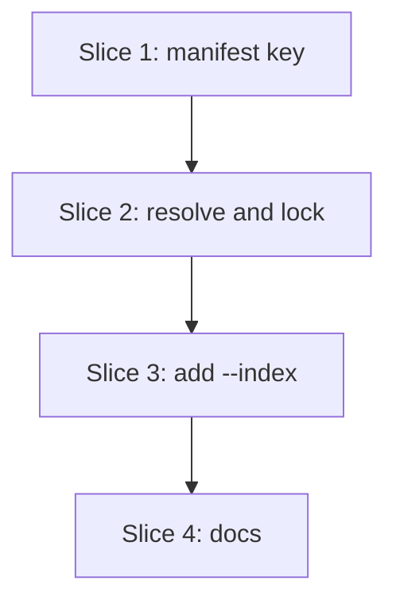

# Plan: Pinned sources (S7c)

**Created**: 2026-11-03
**Branch**: claude/lvpm-add-at-notation-38527a, off `main` at 7c53245. The name predates the reworded AC; the PR title says S7c.
**Status**: approved (revision 3, 2026-11-03)
**Gherkin persistence**: custom: tests/features/sources/
**Spec**: [docs/specs/lvpm-pinned-sources-s7c.md](../docs/specs/lvpm-pinned-sources-s7c.md)

## Goal

A dependency line `name = { version = "...", index = "<source>" }` makes
that package come only from the named `[sources]` entry. There is no
fallback to another source, a cache import or a `sources.local` folder.
`lvpm add <pkg> --index <name>` writes the pin, and a pin change makes the
lock stale. Closes #67.

## Acceptance Criteria

From the spec; numbers match it.

- [ ] AC1: a pin beats a higher version on an earlier source.
- [ ] AC2: a pin beats a `sources.local` folder and a `cache add` import.
- [ ] AC3: a pinned source that does not list the name, or has no fitting version, fails naming the package and the source.
- [ ] AC4: an unreachable pinned source fails naming the source.
- [ ] AC5: `lvpm add <pkg> --index <name>` writes the table form, with the version from the pinned source; the short form still parses; `add` without `--index` keeps a pin.
- [ ] AC6: a pin naming an unknown source (and `defaults`, `min-age-days`) fails when the manifest is read, for every command that reads it, naming the line and the source; `add --index <unknown>` leaves both files unchanged.
- [ ] AC7: adding, changing or removing a pin makes `lock --check` fail with "sources changed".
- [ ] AC8: a transitive dependency listed with `version = "*"` and a pin resolves from that source.
- [ ] AC9: one name pinned to two sources in two tables fails at read.
- [ ] AC10: `lvpm info <name>` in the project shows only the pinned source's versions.
- [ ] AC11: every existing scenario passes; a lock from before this slice is not stale and keeps its bytes.
- [ ] AC12: docs/usage.md and docs/manifest.md show `index`, the no-fallback rule, that a pin beats local inputs, and `--index`. The GitHub Pages site and CLI reference reflect this behavior.

## Approach stances (decision-defaults)

- **Replace-vs-merge:** merge. `index` joins the table form S4 added; the short form is untouched. `[inputs.index]` is an optional lock table.
- **Format fidelity:** no lock format bump (spec, Ambiguity Log). A lock without pins serialises to the same bytes as today (AC11). `add` keeps the other keys and the comment of a table line.
- **Migrate-vs-edit-stub:** nothing to migrate. `index` is refused today, so no manifest holds a pin.
- **Scope:** the spec's. No scoped names, no pins on public defaults, no flag that removes a pin, no `install --index`.
- **Integration:** one PR against `main` that says `Closes #67`. Not a deviation. Merged by the user, no auto-merge, as earlier slices. Slices 1 to 3 ship together and are never released apart: after slice 1 alone a pin parses but is not yet honored.

## Terms

- **Source pin**: the `index = "<source>"` key. In code: `index` on the manifest, `pinned_source` / `owners` in the filter. Never "pin", which `ops/lock.rs` already uses (`Pins`) for upgrade version pins.
- **Feed URL**: `{base}index.vipr`, what `Entry.source` holds. `[sources]` holds the folder URL; `index::feeds()` turns one into the other.

## Design notes

- **`Project::index`**: `BTreeMap<String, String>`, name as written → source name, filled by `parse_dependencies` next to `github`. The same-name check compares with `same_name`, as `github` does. `Project` stays plain data: no index import.
- **The read check** runs in `parse`, after `[sources]` is parsed, because a pin can only be checked against the full `[sources]`. An unknown name is refused before any command runs. `defaults` and `min-age-days` never enter `p.sources`, so the lookup refuses them without a special case; the message adds a hint for them.
- **The owner map** (design blocker 1): a pure helper in `index.rs`, `owners(sources: &[(String, String)], pinned: &BTreeMap<String, String>) -> HashMap<String, String>`. It maps `name_key` → feed URL, with the URL normalized by the same code as `feeds()` (extract a `feed_url(folder)` fn both use). `OpEnv::load_index_each` in `ops/env.rs` calls it with the manifest's sources and `Project::index`, and an empty map with no manifest (global install). Unit tests cover a folder URL with and without a trailing slash.
- **The filter**: `first_source_wins(entries, owners)`. A pinned name keeps only entries whose `source` equals its owner; every other name keeps first-wins. `load_each` and `read_each` already take 8 arguments, so `extra`, `local` and `defaults` move into one `SourceSet` struct passed by reference. `owners` is a separate argument to `load_each` only; `read_each` and the public `load` (sync.rs:762, tests/steps/in_process.rs:21) take the struct and no owners.
- **Failure text owner** (one function): `ops/lock.rs::resolve`, which holds the project, owners and sources. Before solving it refuses a pinned name with no entry at all ("does not list it"). After solving it maps a `SolveError::Conflict` on a pinned name and appends `from "second" (<url>), its pinned source; other sources are ignored for a pinned package`. The solver stays unaware of source pins.
- **Lock**: `Inputs.index: BTreeMap<String, String>`, `#[serde(default, skip_serializing_if = "BTreeMap::is_empty")]`, compared in `sources_changed` like `github`, giving the existing unit `SourcesChanged` reason (spec: no new reason). `Inputs` derives `Default`, and the three test literals (`tests/acceptance.rs:166`, `ops/github_index.rs:389`, `ops/sync.rs:816`) use `..Default::default()`.
- **`add --index`** (design blocker 2): the private `Request` (add_remove.rs:101, what `add` was asked for) gains `source_pin: Option<String>`, and `add(env, spec, table, source_pin: Option<&str>, options)` fills it. `Prepared::set` and `floor` take the request's `source_pin` at all three sites (`add_remove.rs:54`, `:62`, `:292`). The name avoids the local `index: Index` in `add` and `floor`. Callers: `src/main.rs:905`, `tests/steps/cancel.rs:282`, and the unit tests in `add_remove.rs`. `InstallOptions` is not used for it. Change detection (`:167-184`) compares (constraint, source pin), so a pin-only change counts as a change. `ManifestEdit::Added`/`Updated` in `events.rs` gain `index: Option<String>` with `#[serde(skip_serializing_if = "Option::is_none")]`, so tests/golden/json-add stays byte-identical, rendered in `render/edit.rs` as ` (from second)`.
- **`add --index` checks**: none of its own. `Edit::of` parses the edited text before anything is written, so an unknown name or a `github` line fails with the read-check text and both files stay unchanged. A valid source that does not list the name fails at resolve, and the existing restore puts both files back.
- **`manifest_edit`**: a new `set_pinned(text, table, name, constraint, source_pin)`; `set` keeps its signature and calls it with `None`. Its other callers (init.rs:345, ops/lock.rs:309, `set_file` and the test steps) do not change.

## Message texts

| Case | Text |
|---|---|
| Unknown source | `[dependencies] alpha: index = "nope" is not a [sources] name; [sources] has first, second` (`...; [sources] lists no index` when empty) |
| `defaults` / `min-age-days` | the unknown-source text, then `; defaults and min-age-days are settings, not sources` |
| Two pins | `[dev-dependencies] alpha: index = "second" differs from "first" in [dependencies]` |
| Not listed | `alpha is pinned to "second" (<url>), which does not list it; other sources are ignored for a pinned package. Fix or remove the index on alpha` |
| No fitting version | the existing conflict text, with `from "second" (<url>), its pinned source` as the source, then `; other sources are ignored for a pinned package` |
| Unreachable | the existing S13 unreachable text for `second`, unchanged |
| `add --index nope` / on a github line | the read-check texts above, from parsing the edited manifest |
| `lock --check` reason | the existing `sources changed` |
| `add` success with a pin | the existing added/updated line, ending ` (from second)` |
| `--index` help | `Take this package only from this [sources] name; writes index = "<NAME>"` |

## Shared step phrases

New, in `tests/steps/sources.rs`, each in the step that first needs it:

| Step text | First used |
|---|---|
| `Given the project depends on "<n>" "<c>" pinned to "<source>"` (any name, so `nope` and `defaults` work) | 1.2 |
| `Given the project dev-depends on "<n>" "<c>" pinned to "<source>"` | 1.2 |
| `Given the project depends on "<n>" "<c>" pinned to "<source>" and lvpm.lock is current` (locks, then `note_the_project()`, sync.rs:203) | 2.3 |
| `Given the project depends on "<n>" "<c>" and a lvpm.lock written before pinned sources` (writes the fixture template with `{FIRST}` and `{SECOND}` filled by `source_url` for each source, then notes the lock as `lock.before`) | 2.3 |
| `Given the project depends on "<n>" via github "<owner/repo>"` (if no such step exists yet) | 3.2 |
| `Given "<n>" <v> is in the cache` (`cache add` of the fixture archive; keeps the project and `[sources]`) | 2.1 |
| `When I pin "<n>" to "<source>" in lvpm.toml` / `When I remove the source pin of "<n>"` (`[dependencies]` only) | 2.3 |
| `Then lvpm.toml pins "<n>" to "<source>" with "<c>"`, optional ` in [dev-dependencies]` / ` in [dependency-groups.<g>]` (parses the TOML) | 3.2 |

Reused as they exist: `"first"/"second" lists ...` (one `"name" version` per item), `"first"/"second" cannot be reached`, `the local folder holds`, `lvpm.lock takes ... from "first|second|local"`, `the command fails naming "first|second"`, `the command fails naming "alpha" and "second"` (github.rs:729, any quoted names), `the error says`, `stderr is one line naming sources changed`, `the output shows version ... and not ...`, `the output says "..."` (init.rs:231), `lvpm.toml and lvpm.lock are byte-identical to before` (upgrade.rs:298), `lvpm.lock is byte-identical to before` (lock.rs:564), `no lvpm.lock is written` (lock.rs:559), `a current lock` (headless.rs:72, locks and notes both files), `the project depends on "X" "Y" and lvpm.lock is current` (lock.rs:292), and the docs steps `docs/(usage|manifest).md mentions "..."` (docs.rs:505).

## Slices

### Slice 1: the `index` key in the manifest

**Depends-on:** none
**Files:** `crates/lvpm-core/src/project.rs`, `tests/features/sources/s7c-pinned-sources.feature`, `tests/steps/sources.rs`, `tests/acceptance.rs`

**Behavior:**

```gherkin
Feature: a dependency can be pinned to one source

  Background:
    Given a project with labview "2024" whose [sources] are "first" then "second"

  Scenario Outline: a pin naming a source [sources] does not define fails for <command>
    Given the project depends on "alpha" "*" pinned to "nope"
    And the project has a venv bound to a LabVIEW installation
    When I run "<command>"
    Then the exit code is non-zero
    And the error says "[dependencies] alpha: index = \"nope\" is not a [sources] name"
    And no lvpm.lock is written

    Examples:
      | command         |
      | lvpm lock       |
      | lvpm sync --prefix dest |
      | lvpm info alpha |
      | lvpm check      |
      | lvpm search alpha |

  Scenario Outline: a pin naming the <key> setting is not a source
    Given the project depends on "alpha" "*" pinned to "<key>"
    When I run "lvpm lock"
    Then the exit code is non-zero
    And the error says "index = \"<key>\" is not a [sources] name"
    And the error says "settings, not sources"

    Examples:
      | key          |
      | defaults     |
      | min-age-days |

  Scenario: one name pinned to two sources in two tables fails
    Given the project depends on "alpha" "*" pinned to "first"
    And the project dev-depends on "alpha" "*" pinned to "second"
    When I run "lvpm lock"
    Then the exit code is non-zero
    And the error says "differs from \"first\" in [dependencies]"

  Scenario: one name pinned to the same source in two tables is fine
    Given "first" lists "alpha" 1.0
    And the project depends on "alpha" "*" pinned to "first"
    And the project dev-depends on "alpha" "*" pinned to "first"
    When I run "lvpm lock"
    Then the command succeeds
```

**Steps:**

#### Step 1.1: parse `index` and check it against `[sources]`

**Complexity**: standard
**IMPLEMENT**: `dependency_table` accepts `index` (string) and returns it; `parse_dependencies` fills `Project::index` with the two-table check; `parse` refuses a pin whose name is not in `p.sources`.
**TEST**: unit tests in `project.rs`: a pin in each table kind parses; unknown name, `defaults`, `min-age-days`, a non-string value, and two different pins fail with the message texts above; the same pin twice passes; `github` + `index` still fails; the short form and a table without `index` give an empty map. Replace the "index is not supported yet" test.
**REFACTOR**: share the "differs ... in [table]" check between `github` and `index`.
**Files**: `crates/lvpm-core/src/project.rs`
**Commit**: `feat(s7c): read index = "<source>" on a dependency line`

#### Step 1.2: the scenarios for a bad pin

**Complexity**: standard
**IMPLEMENT**: the `pinned to` Given steps, which write the table line by editing the TOML text (`set_pinned` arrives in 3.1; 3.1 then switches them to it); the feature file with slice 1's scenarios; add it to `FEATURE_FILES`.
**TEST**: slice 1's scenarios pass; full suite green.
**REFACTOR**: reuse the S13 Background step; no copied helpers.
**Files**: `tests/features/sources/s7c-pinned-sources.feature`, `tests/steps/sources.rs`, `tests/acceptance.rs`
**Commit**: `test(s7c): a bad pin fails when the manifest is read`

### Slice 2: resolve and lock a pinned package

**Depends-on:** 1
**Files:** `crates/lvpm-core/src/index.rs`, `crates/lvpm-core/src/ops/lock.rs`, `crates/lvpm-core/src/lockfile.rs`, `crates/lvpm-core/src/ops/env.rs`, `crates/lvpm-core/src/ops/github_index.rs`, `crates/lvpm-core/src/ops/sync.rs`, `tests/acceptance.rs`, `tests/features/sources/s7c-pinned-sources.feature`, `tests/fixtures/s7c-pre-pin.lock`, `tests/steps/sources.rs`, `tests/steps/in_process.rs`

**Behavior:**

```gherkin
  Scenario: a pinned package is locked from its source although an earlier one lists a higher version
    Given "first" lists "alpha" 2.0
    And "second" lists "alpha" 1.0
    And the project depends on "alpha" "*" pinned to "second"
    When I run "lvpm lock"
    Then the command succeeds
    And lvpm.lock takes "alpha" 1.0 from "second"

  Scenario: a pin beats a package in a local folder
    Given the local folder holds "alpha" 2.0
    And "second" lists "alpha" 1.0
    And the project depends on "alpha" "*" pinned to "second"
    When I run "lvpm lock"
    Then the command succeeds
    And lvpm.lock takes "alpha" 1.0 from "second"

  Scenario: a pin beats a package imported with lvpm cache add
    Given "alpha" 2.0 is in the cache
    And "second" lists "alpha" 1.0
    And the project depends on "alpha" "*" pinned to "second"
    When I run "lvpm lock"
    Then the command succeeds
    And lvpm.lock takes "alpha" 1.0 from "second"

  Scenario: a transitive dependency listed with a pin resolves from that source
    Given "first" lists "beta" 1.0, "alpha" 2.0
    And "second" lists "alpha" 1.0
    And the project depends on "beta" "*"
    And the project depends on "alpha" "*" pinned to "second"
    When I run "lvpm lock"
    Then lvpm.lock takes "beta" 1.0 from "first"
    And lvpm.lock takes "alpha" 1.0 from "second"

  Scenario: pinned and unpinned lines in one manifest each follow their own rule
    Given "first" lists "alpha" 2.0, "gamma" 1.0
    And "second" lists "alpha" 1.0, "gamma" 1.0
    And the project depends on "gamma" ">=1.0"
    And the project depends on "alpha" "*" pinned to "second"
    When I run "lvpm lock"
    Then lvpm.lock takes "gamma" 1.0 from "first"
    And lvpm.lock takes "alpha" 1.0 from "second"

  Scenario: a pinned package its source does not list fails naming both
    Given "first" lists "alpha" 1.0
    And "second" lists "gamma" 1.0
    And the project depends on "alpha" "*" pinned to "second"
    When I run "lvpm lock"
    Then the command fails naming "alpha" and "second"
    And the error says "other sources are ignored for a pinned package"
    And no lvpm.lock is written

  Scenario: a pinned source with no fitting version fails naming it, not falling back
    Given "first" lists "alpha" 2.0
    And "second" lists "alpha" 1.0
    And the project depends on "alpha" ">=2.0" pinned to "second"
    When I run "lvpm lock"
    Then the command fails naming "alpha" and "second"
    And the error says "its pinned source"
    And no lvpm.lock is written

  Scenario: an unreachable pinned source fails naming it
    Given "first" lists "alpha" 1.0
    And "second" cannot be reached
    And the project depends on "alpha" "*" pinned to "second"
    When I run "lvpm lock"
    Then the command fails naming "second"
    And no lvpm.lock is written

  Scenario Outline: lvpm <command> shows only the pinned source's versions
    Given "first" lists "alpha" 2.0
    And "second" lists "alpha" 1.0
    And the project depends on "alpha" "*" pinned to "second"
    When I run "lvpm <command> alpha"
    Then the command succeeds
    And the output shows version 1.0 and not 2.0

    Examples:
      | command |
      | info    |
      | search  |

  Scenario: an unreachable pinned source fails lvpm info naming it
    Given "first" lists "alpha" 1.0
    And "second" cannot be reached
    And the project depends on "alpha" "*" pinned to "second"
    When I run "lvpm info alpha"
    Then the command fails naming "second"
    And the error says "could not read"

  Scenario: adding a source pin makes the lock stale
    Given "first" lists "alpha" 1.0
    And "second" lists "alpha" 1.0
    And the project depends on "alpha" "*" and lvpm.lock is current
    When I pin "alpha" to "second" in lvpm.toml
    And I run "lvpm lock --check"
    Then the exit code is non-zero
    And stderr is one line naming sources changed

  Scenario: changing a source pin makes the lock stale
    Given "first" lists "alpha" 1.0
    And "second" lists "alpha" 1.0
    And the project depends on "alpha" "*" pinned to "first" and lvpm.lock is current
    When I pin "alpha" to "second" in lvpm.toml
    And I run "lvpm lock --check"
    Then the exit code is non-zero
    And stderr is one line naming sources changed

  Scenario: removing a source pin makes the lock stale
    Given "first" lists "alpha" 1.0
    And "second" lists "alpha" 1.0
    And the project depends on "alpha" "*" pinned to "second" and lvpm.lock is current
    When I remove the source pin of "alpha"
    And I run "lvpm lock --check"
    Then the exit code is non-zero
    And stderr is one line naming sources changed

  Scenario: a pinned project with a current lock is not stale
    Given "first" lists "alpha" 1.0
    And "second" lists "alpha" 1.0
    And the project depends on "alpha" "*" pinned to "second" and lvpm.lock is current
    When I run "lvpm lock --check"
    Then the command succeeds

  Scenario: a lock from before pinned sources is not stale and keeps its bytes
    Given "first" lists "alpha" 1.0
    And the project depends on "alpha" "*" and a lvpm.lock written before pinned sources
    When I run "lvpm lock --check"
    Then the command succeeds
    When I run "lvpm lock"
    Then lvpm.lock is byte-identical to before
```

**Steps:**

#### Step 2.1: source pins decide the owner in the first-wins filter

**Complexity**: complex
**IMPLEMENT**: `feed_url` extracted from `feeds()`; `owners(sources, pinned)`; `SourceSet`; `first_source_wins(entries, owners)`; `load_index_each` builds the set from the manifest, or with no owners without one. The `is in the cache` step.
**TEST**: unit tests: `owners` with and without a trailing slash; `first_source_wins` takes a pinned name from a later source, drops it from the cache and a local folder, keeps first-wins for unpinned names, and leaves none when the pinned source has no entry. Scenarios: higher version, local folder, cache, transitive, mixed (AC1, AC2, AC8), and the info/search outline (AC10).
**REFACTOR**: one doc comment on the filter that states both rules.
**Files**: `crates/lvpm-core/src/index.rs`, `crates/lvpm-core/src/ops/env.rs`, `crates/lvpm-core/src/ops/sync.rs`, `tests/steps/in_process.rs`, `tests/features/sources/s7c-pinned-sources.feature`, `tests/steps/sources.rs`
**Commit**: `feat(s7c): a pinned package comes only from its source`

#### Step 2.2: failure messages name the package and the pinned source

**Complexity**: standard
**IMPLEMENT**: the pre-solve "does not list it" check in `ops/lock.rs`; the conflict mapping in `resolve` appends the pinned-source clause.
**TEST**: the not-listed, no-fitting-version and both unreachable scenarios (AC3, AC4); unit tests on each message.
**REFACTOR**: the source label stays built in S13's one function.
**Files**: `crates/lvpm-core/src/ops/lock.rs`, `tests/features/sources/s7c-pinned-sources.feature`
**Commit**: `feat(s7c): a pinned package that cannot be found names its source`

#### Step 2.3: source pins are lock inputs

**Complexity**: standard
**IMPLEMENT**: `Inputs.index`, filled in `Inputs::of`, compared in `sources_changed` (existing reason); `Inputs` derives `Default` and the three literals use it. The pin/remove When steps, the pinned "lvpm.lock is current" step, and the pre-slice lock fixture: `tests/fixtures/s7c-pre-pin.lock` is a template, today's `lvpm lock` output for that manifest with the two source URLs as `{FIRST}` and `{SECOND}` (`Inputs::of` records every `[sources]` URL), so the loopback ports fill in per run.
**TEST**: unit tests: `[inputs.index]` round-trips; absent with no pins; a lock string written before this slice parses and is not stale; add, change and remove each give `SourcesChanged`. The five stale/fresh scenarios (AC7, AC11). Full suite green.
**REFACTOR**: the module doc example in `lockfile.rs` shows `[inputs.index]`.
**Files**: `crates/lvpm-core/src/lockfile.rs`, `crates/lvpm-core/src/ops/github_index.rs`, `crates/lvpm-core/src/ops/sync.rs`, `tests/acceptance.rs`, `tests/fixtures/s7c-pre-pin.lock`, `tests/features/sources/s7c-pinned-sources.feature`, `tests/steps/sources.rs`
**Commit**: `feat(s7c): a source pin change makes the lock stale`

### Slice 3: `lvpm add --index`

**Depends-on:** 2
**Files:** `crates/lvpm-core/src/manifest_edit.rs`, `crates/lvpm-core/src/ops/add_remove.rs`, `crates/lvpm-core/src/events.rs`, `crates/lvpm-core/src/render/edit.rs`, `src/main.rs`, `tests/steps/cancel.rs`, `tests/features/sources/s7c-pinned-sources.feature`, `tests/steps/sources.rs`

**Behavior:**

```gherkin
  Scenario: lvpm add --index writes the table form with the pinned source's version
    Given "first" lists "alpha" 2.0
    And "second" lists "alpha" 1.0
    When I run "lvpm add alpha --index second --prefix dest"
    Then the command succeeds
    And lvpm.toml pins "alpha" to "second" with ">=1.0"
    And lvpm.lock takes "alpha" 1.0 from "second"
    And the output says "(from second)"

  Scenario: lvpm add --dev --index writes the pin into [dev-dependencies]
    Given "second" lists "alpha" 1.0
    When I run "lvpm add alpha --dev --index second --prefix dest"
    Then the command succeeds
    And lvpm.toml pins "alpha" to "second" with ">=1.0" in [dev-dependencies]

  Scenario: lvpm add --index into a group
    Given "second" lists "alpha" 1.0
    When I run "lvpm add alpha --index second --group ci --prefix dest"
    Then the command succeeds
    And lvpm.toml pins "alpha" to "second" with ">=1.0" in [dependency-groups.ci]

  Scenario: lvpm add --index moves an existing pin
    Given "first" lists "alpha" 1.0
    And "second" lists "alpha" 2.0
    And the project depends on "alpha" "*" pinned to "first"
    When I run "lvpm add alpha --index second --prefix dest"
    Then the command succeeds
    And lvpm.toml pins "alpha" to "second" with ">=2.0"

  Scenario: lvpm add without --index keeps an existing pin
    Given "second" lists "alpha" 1.0, "alpha" 2.0
    And the project depends on "alpha" "1.0" pinned to "second"
    When I run "lvpm add alpha@2.0 --prefix dest"
    Then the command succeeds
    And lvpm.toml pins "alpha" to "second" with "2.0"

  Scenario: lvpm add --index naming an unknown source changes nothing
    Given "first" lists "alpha" 1.0
    And the project depends on "alpha" "*"
    And a current lock
    When I run "lvpm add alpha --index nope --prefix dest"
    Then the exit code is non-zero
    And the error says "index = \"nope\" is not a [sources] name"
    And lvpm.toml and lvpm.lock are byte-identical to before

  Scenario: lvpm add --index to a source that does not list the package changes nothing
    Given "first" lists "alpha" 1.0
    And "second" lists "gamma" 1.0
    And the project depends on "gamma" "*"
    And a current lock
    When I run "lvpm add alpha --index second --prefix dest"
    Then the command fails naming "alpha" and "second"
    And lvpm.toml and lvpm.lock are byte-identical to before

  Scenario: lvpm add --index on a github line fails
    Given the project depends on "alpha" via github "owner/repo"
    And a current lock
    When I run "lvpm add alpha --index second --prefix dest"
    Then the exit code is non-zero
    And the error says "github and index cannot be used together"
    And lvpm.toml and lvpm.lock are byte-identical to before
```

**Steps:**

#### Step 3.1: `manifest_edit::set` writes and keeps `index`

**Complexity**: standard
**IMPLEMENT**: `set_pinned(..., source_pin: Option<&str>)`: `Some` makes the table or sets the key; `None` keeps today's behavior and any existing `index`. `set` calls it with `None`.
**TEST**: unit tests: short line → table; table line without `index` gets it and keeps its comment; a different `index` is replaced; `None` on a pinned line changes only `version`; same input twice is byte-identical.
**REFACTOR**: `set` is the one-line `None` case; no other caller changes.
**Files**: `crates/lvpm-core/src/manifest_edit.rs`, `crates/lvpm-core/src/ops/add_remove.rs`
**Commit**: `feat(s7c): manifest_edit writes index on a dependency line`

#### Step 3.2: the `--index` flag

**Complexity**: standard
**IMPLEMENT**: `--index <NAME>` on `Add` in `src/main.rs`; `Request.source_pin` and `add(..., source_pin, ...)`, passed to `Prepared::set` at all three sites; change detection on (constraint, index); `index` on `ManifestEdit::Added`/`Updated` and ` (from second)` in `render/edit.rs`; `tests/steps/cancel.rs` passes `None`. The `lvpm.toml pins` step and the github-line Given step.
**TEST**: slice 3's scenarios (AC5, AC6 `add` part); unit tests for a pin-only change being reported, and for the JSON event carrying `index` only when set. The existing docs scenario (every flag has help text and appears in the usage guide) fails until step 4.1; steps 3.2 and 4.1 land in one commit pair before push.
**REFACTOR**: `--index` help text in the house style of `--group`.
**Files**: `src/main.rs`, `crates/lvpm-core/src/ops/add_remove.rs`, `crates/lvpm-core/src/events.rs`, `crates/lvpm-core/src/render/edit.rs`, `tests/steps/cancel.rs`, `tests/features/sources/s7c-pinned-sources.feature`, `tests/steps/sources.rs`
**Commit**: `feat(s7c): lvpm add --index pins the package`

### Slice 4: docs

**Depends-on:** 3
**Files:** `docs/usage.md`, `docs/manifest.md`, `tests/features/sources/s7c-pinned-sources.feature`

**Behavior:**

```gherkin
  Scenario: the docs describe source pins
    Then docs/usage.md mentions "pinned to one source"
    And docs/usage.md mentions "never falls back"
    And docs/usage.md mentions "beats a sources.local folder and a cache import"
    And docs/usage.md mentions "--index <NAME>"
    And docs/manifest.md mentions "the index key"
    And docs/manifest.md does not mention "index is not supported yet"
```

**Steps:**

#### Step 4.1: usage.md and manifest.md

**Complexity**: standard
**IMPLEMENT**: in usage.md: the first-wins section (~812-824) gains a "Pinning a package to one source" paragraph and example with the verbatim phrases "pinned to one source", "never falls back", "beats a sources.local folder and a cache import" and "--index <NAME>"; manifest.md says "the index key". The CLI reference is usage.md's command table; the "Out of date" reasons list (~228-231) adds the source-pin reason; the manifest example (~172) shows one pinned line; the `lvpm add` row (~13) and its examples list `--index <NAME>`. In manifest.md: replace "not supported yet" (~232-233, ~526) and the unknown-key text (~234, now `expected version, github or index`) with the `index` key and its rules. Say "source pin" wherever "pin" could mean a version.
**TEST**: the docs scenario above; the existing every-flag-in-the-usage-guide scenario now passes; `mdbook build` locally if installed, else in CI.
**REFACTOR**: none beyond removing stale wording.
**Files**: `docs/usage.md`, `docs/manifest.md`, `tests/features/sources/s7c-pinned-sources.feature`
**Commit**: `docs(s7c): source pins and lvpm add --index`

## Parallelization



| Wave | Slices (parallel) |
|------|-------------------|
| 1 | 1 |
| 2 | 2 |
| 3 | 3 |
| 4 | 4 |

Sequential: each slice builds on the previous one's types and shares the feature file.

## Complexity Classification

As in the template: `trivial` skips inline review, `standard` gets spec-compliance and the relevant quality agents, `complex` the full suite. Step 2.1 is `complex` because it changes the filter every command shares. Step 4.1 is `standard` because AC12 is the user-visible contract.

## Pre-PR Quality Gate

- [ ] `cargo test --workspace` and the acceptance suite pass
- [ ] `cargo clippy --workspace --all-targets -- -D warnings`
- [ ] `cargo fmt --check`
- [ ] `/code-review` passes
- [ ] Docs updated (slice 4)

## Skipped (low value)

None.

## Risks & Open Questions

- **One loader.** `OpEnv::load_index_each` is the only `load_each` caller, so `lock`, `add`, `info`, `search` and the TUI get source pins wherever they pass a manifest. The TUI has no scenario; it uses the same call as `search`.
- **The not-listed hint is lock-only.** `info`/`search` on a pinned name its source does not list show no versions, not the lock's error text.
- **AC4 is a regression guard.** S13 already fails on an unreachable source; the scenario proves a pin does not route around that.
- **Fail-open intermediate.** After slice 1 alone a pin parses but is ignored. Slices 1 to 3 merge in one PR, so no release holds that state.
- **Gherkin persistence.** As in S4 and S13, the build writes `tests/features/sources/s7c-pinned-sources.feature` directly. `plan_gherkin_export.py` is not run.
- **`info` with an unreachable pinned source** fails through `ops/query.rs`'s unknown-name path (`could not read <source>`), not the lock path; the scenario asserts that text.
- **Board.** The S7c card goes to In Progress when the build starts (CLAUDE.md step 1).
- **PR gate hook.** `pre_pr_review` refused `gh pr create` once in this session ("Could not determine the review-gate's own state"). Cause not yet investigated; the user asked for local commits only for now.

## Plan Review Summary

Plan tier: complex (Step 2.1 is complex; it changes the filter every command shares). Reviewers: Acceptance, Design, UX, Strategic, Parallelization.

| Reviewer | Round 1 | Round 2 |
|---|---|---|
| Parallelization | approve | not re-run |
| UX | needs-revision (warnings) | not re-run |
| Strategic | needs-revision (warnings) | not re-run |
| Design | needs-revision, 2 blockers | approve, 7 warnings (all applied) |
| Acceptance | needs-revision, 5 blockers | needs-revision, 5 new blockers (all applied, not re-reviewed: 2-round cap) |

Round 2 acceptance blockers, fixed in revision 3: docs phrases had quotes the step regex cannot take; `byte-identical` add scenarios noted no manifest (now `a current lock`); `add alpha@2.0` writes `2.0`, not `=2.0`; the pre-slice lock is a `{FEED}` template because the loopback port changes per run; `no lvpm.lock is written` already exists (lock.rs:559).

Decisions that differ from a reviewer's ask:

- **No own wording for `add --index nope`** (UX asked for one). The edited manifest's parse refuses it with the read-check text, which names the line; one owner for the text (design W7).
- **No clause on the unreachable message** (UX asked). The S13 text already names the source; the clause had no owner (design W4).
- **No new stale reason** (UX suggested `sources changed (source pin of alpha)`). The spec says no new reason (design W5).

Slice 1 review (2026-11-03): `index = "defaults"` is refused even when `defaults` holds a URL string; slice 1 also touched tests/steps/check.rs (`bind_venv` is `pub(super)` for the venv Given `lvpm check` needs) and s4-github-manifest.feature (its expected text is now `is not a [sources] name`, on purpose); a name pinned in one table and listed unpinned in another is accepted, and the source pin owns the name everywhere, since the lock holds one entry per name. Build criteria gate (2026-11-03): added `check` and `search` rows to the AC6 outline (`add` is covered in slice 3); the pre-slice fixture takes two URLs; AC8 means a dependency of a listed package that is itself listed with a pin, which the beta/alpha scenario covers (beta 1.0 requires alpha 1.0); AC12's Pages site is the mdBook in docs/ (SUMMARY.md lists usage.md as its CLI reference). Open warnings left to the build: a `[dependency-groups]` pair for AC9 as a unit test; a `--json` scenario for `add --index` (unit test instead).

## Build Progress

### Slices (grouped by wave)

#### Wave 1
- [x] Slice 1: the `index` key in the manifest
  - [x] Step 1.1: parse `index` and check it against `[sources]`
  - [x] Step 1.2: the scenarios for a bad pin

#### Wave 2
- [x] Slice 2: resolve and lock a pinned package
  - [x] Step 2.1: source pins decide the owner in the first-wins filter
  - [x] Step 2.2: failure messages name the package and the pinned source
  - [x] Step 2.3: source pins are lock inputs

#### Wave 3
- [x] Slice 3: `lvpm add --index`
  - [x] Step 3.1: `manifest_edit::set` writes and keeps `index`
  - [x] Step 3.2: the `--index` flag

#### Wave 4
- [ ] Slice 4: docs
  - [ ] Step 4.1: usage.md and manifest.md
